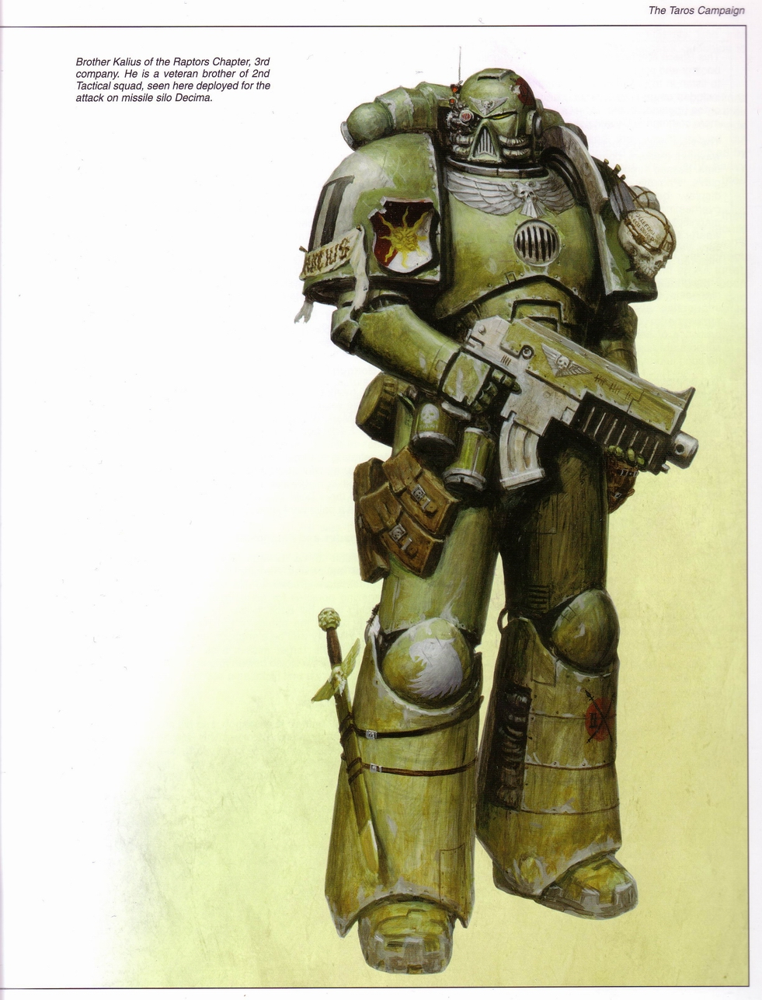

# 图解猛禽军团战术小队星际陆战队员

> 兔子半妖

## １动力装甲

这名星际陆战队员穿着一套ＶＩＩ型动力装甲，有时也被称为“Ａｒｍｏｒｕｍ　Ｉｍｐｅｔｏｒ”或者“飞鹰装甲”．这套盔甲由军团军械师做了些改动．它的胸甲部分是从一套老式的Ｖ型装甲上取下的，重新绘制了鹰徽并更换了内部的供能线路．各个型号的星际陆战队动力装甲都有着许多变体．一些变体改动了原始型号的部分属性．而另一些，比如这款，则是利用了几个型号的装甲上的部件．每个陆战队员都会对自己的装甲进行些个人化的改动，这些装甲多会被作为军团的圣器保留下来．一些非常老旧的装甲仍会被反复使用．

与所有的动力装甲类似，这型装甲的外骨骼里埋藏着与使用者的神经系统相连的插件，用以将肌肉的动作反射给加速器和人造肌肉纤维束，由此来驱动装甲进行动作．通过这套交互系统，厚重的装甲就犹如穿戴者身体的一部分，能够毫不迟疑地执行他的动作和意识传达来的命令．虽然动力装甲看上去笨重不堪，但是穿着它的陆战队员丝毫不会觉得累赘，速度和敏捷性也能得到最大限度的发挥．

人造肌肉纤维束可以令使用者力量倍增，让他能够举起难以想象的负重，或是进行远距离的跳跃．

动力装甲外部的装甲层由塑型合金与塑性钢装甲板组成，包裹在高弹性的防护层之中．这套装甲被设计成能够尽可能多地偏转和吸收外部的冲击．肩甲处装有一些小型的反应装甲模块，通过轻微的爆炸来抵消冲击．

在装甲层的内部则是生命维持系统和战斗系统．背包的下层储存着高蛋白的液态食物，经由陆战队员强化过的代谢系统消化后，不会产生任何废物，还能保持陆战队员的战斗效能而无需其他补充．在战斗中，陆战队员不用浪费时间在吃喝上，装甲会提供一切必须的养分．

装甲还具备独立的备用能源和一个充电用的太阳能电池阵列，这意味着即使没有背包它也可以短时间独立运做．

装甲中还有５支注射治疗针，可以解除绝大多数常见的毒素．治疗针同时还可以用做兴奋剂使用．

手套中的传感器可以读取它所持有的武器的信息，并将佩带着的基因识别码传给武器．没有正确的识别码的话，爆弹枪将无法被使用．

靴子的底部拥有磁性，还被设计成强化附着力的结构．穿着它的陆战队员在最光滑的地面上也不会滑倒．磁性功能可以随意启动或关闭．

## ２背包

装甲的主要动力来自于背包．在背包里安置了一个高效的微型反应堆，为所有内部系统供应能源．装甲还拥有备用能源以及后备用的微型太阳能电池阵列用以在紧急情况下充能．在通过太阳能阵列充满能量，并且关闭非必要的系统后，备用能源可以至少维持装甲一个月的运作而不需要对主动力进行维护．

反应堆产生的热蒸汽通过装甲背包上的喷嘴排出．在零重力的情况下可为装甲提供有限的移动能力．

背包中还容纳着装甲的氧气储备以及空气净化装置，使得穿着者能在有毒的环境下正常呼吸．依靠星际陆战队员们的肺部改造插件与这个装置，他们能在任何恶劣环境下不受阻碍地作战——哪怕是深水之下或者真空之中．空气摄入装置也安放在背包中．

背包的最下层是温度调节装置．在战斗中，动力装甲时常要以极限状态工作，这使得排出的热量迅速增长．装甲可根据作战环境来调节热量控制．在寒冷环境下它会保留更多的热量，而在酷热环境下它会努力降低温度．在塔洛斯之战中，装甲被调节为适应当地的平均气温．在装甲内部，穿着者基本不受到外界温度变化的影响，这似的星际陆战队员们能保持战斗效率．

## ３头盔

星际陆战队的改进版ＶＩＩ型头盔中包含了装甲的大部分战斗系统．所有这些头盔内置系统都集成到一个显示器和感应器上．首先是通过意识控制的常规通讯器．这名队员的头盔上还加装了额外的通讯和干扰组件，以防止通讯频道被敌人窃听．然后右眼上装有远距离的搜索－瞄准－敌我识别感应插件，这也是在头盔的标准配置上添加的．通常在蹂躏者重武器小队身上才会有这种插件，当然也有例外，比如这个．

护目镜处的可视式战术信息插件提供了地图、路点标记器、指南针，以及通过手套的传感器获得的武器信息．一般战斗情况下这里显示的是弹药量，同时还有在动力部件过热或阻塞的情况下发出警告的功能．它能提供画面四倍放大功能，使得拥有视觉强化改造插件的陆战队员在绝大多数情况下都能获得清晰的视野．这个插件还提供了最基本的红外线扫描功能．

通过他的自动感应器，陆战队员可获得完备的外界环境信息以及装甲运作状况报告：大气组成，气压，有毒化学物的存在．同时，盔甲内还安装了许多小感应器来检测此类信息．

头盔同时还能显示陆战队员自己的生理信息，比如说心率（两个心脏哦～），血压，毒素积累级别，内脏改造插件的工作状况等等，用以判定他的内部损伤状况．这些信息也能被指挥官获得．

除了装有通讯设备外，头盔的耳部还能屏蔽音波攻击，能够放大收集到的声音，还能在杂音中分辨出某个特定的声音来．耳部改造插件还使陆战队员在经受强劲的攻击波后不会晕眩或失去方向感．

头盔的面甲部分有个Ｍｉｃ，既能让穿着者用正常的声音讲话，又可以在激战中中放大音量．如果大气状况允许，面甲可以打开让穿着者呼吸外界的空气，而非净化过的或者内部储备的空气．

最后，头盔的护目镜中还整合了一个自动启动的亮度调节装置，使穿着着在突然暴露在强光下时不至于暂时失明．

## ４．神器与徽章

装甲的左肩上挂着两颗被雕琢过的头骨．这也许是盔甲的前任拥有者，也许是在战斗中光荣牺牲的战友，也可能是值得尊敬的敌手．星际陆战队中流行着许多类似的东西．每个军团都有各自的仪式和传统——源自军团的母星．通常，头骨之类的馈赠来自于军团牧师，作为对陆战队员勇敢作战无私奉献的奖励．

装甲胸前的鹰徽象征着这名战士对皇帝的忠诚．所有星际陆战队军团都佩带这样的徽章．

猛禽军团的徽章是一只白色雄鹰高高扬起的头．它位于盔甲的左肩和右膝．

右肩上绘有战术小队标记（巨大的白色箭头）以及罗马数字标出的小队序列号．这名战士属于第二战术小队．在标记下面是一个姓名卷轴．上面记录了这位战士的名字．就像所有由连队牧师亲手添加的饰物一样，它的作用是鼓舞陆战队员的士气，强化他对皇帝的虔诚．

塔洛斯战役徽章（红色圆盘上交叉的矛）被暂时性地绘制在头盔与左侧腿甲上．所有在塔洛斯上作战的部队，不论来自何处都佩带此徽章，以便在联合作战中进行识别．战役结束后这些徽章会被除去．

作为一名精锐老兵，这名陆战队员佩带着他自己的独有纹章：右肩上描绘着太阳图案的盾牌．这个纹章的意义不明，也许和他加入陆战队前的岁月有关．

最后，他的爆弹步枪上有１２个击毙标记，应该是在以前的作战中取得的战果．

## ５．爆弹枪

作为战术小队的一员，这名星际陆战队员的标准武器是爆弹枪．这把爆弹枪是标准的ＩＶ型，弧形弹夹中装有２０枚矢弹．矢弹是由火箭助推的穿甲高爆弹．在穿透目标后矢弹立即爆炸，足以摧毁轻型车辆，而对于步兵来说矢弹就更为可怕．爆弹枪可以选择单／连发以及３发长点射的射击模式．枪上有一个基因代码检测器．

## ６．手雷和其他装备

在爆弹枪之外，Ｋａｌｉｕｓ修士还携带了其他的战斗装备．在他的装具带上挂着两枚破片手雷，３个矢弹弹夹．他的背包后挂着的东西相对来说难以识别，不过根据猛禽军团在塔洛斯行星上的第一个任务来看，这个东西应该是用以摧毁导弹发射井的爆炸物．此外，他应该还携带了Ｋｒａｋ反装甲手雷，而且有一把爆弹手枪作为副武器．

## ７．战斗刀

星际陆战队员的最后一样武器，也是他唯一的近战武器，便是他的战斗刀．这把刀经过精心的装饰，有着鹰型的护手，厚重的刀柄，以及长达５０厘米的刀刃（看上去不像？刀的主人身高应该是２．５米左右，对比下）．因为是肉搏战中的唯一武器，所以这把刀被磨砺得相当锐利．

在军团的庆典仪式中，战斗刀也时常被拿出来使用．而在战斗前刀要接受祝福．它不是刺刀，不能装在爆弹步枪上，必须用手来舞动．白刃战是星际陆战队员必须经历的训练课程之一，而在Ｋａｌｉｕｓ修士的一生中，这样的训练永远不会停止．
