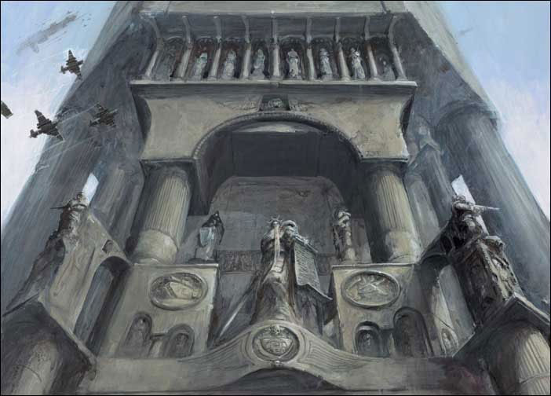
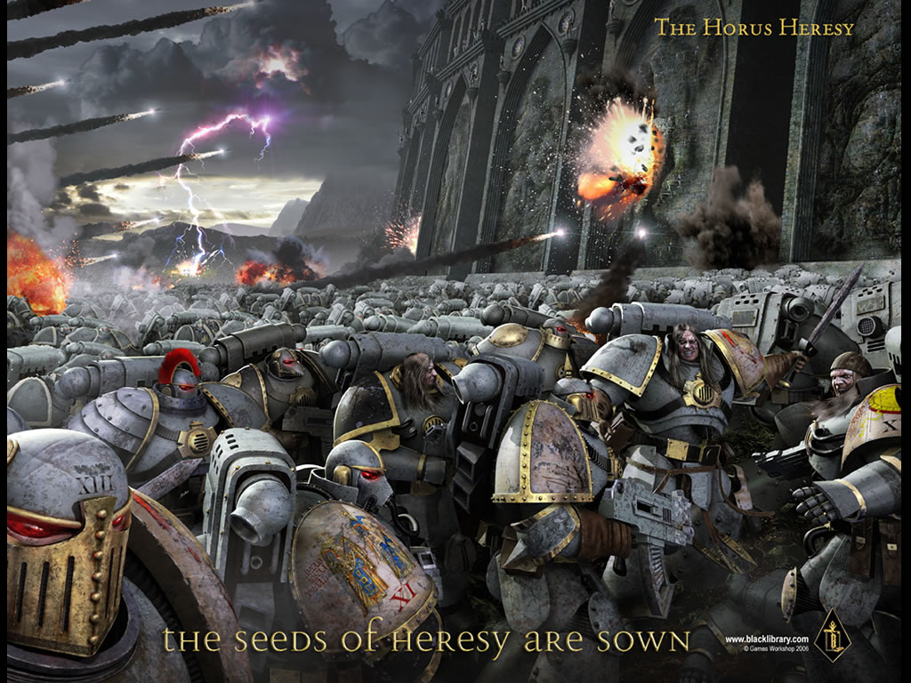

# 围攻帝王之城

【原创】【翻译】围攻帝王之城

[Vol.13](http://game.ali213.net/profile-uid-676753.html)

[[toc]]

## 暴风雨的前奏曲

何露斯叛乱，是有史以来对人类最大的一次挑战。这次恐怖的叛乱将帝国四分五裂，曾经亲密的战友突然就变成敌人…… 
许多帝国战士接受不了这样突然的变化，在叛军猛烈的攻击中不知所措。叛徒们利用这种优势不带损失的占领了许多行星。帝国境内的几乎每一处都有混沌的信徒发起暴动，有足够实力的异端直接发起武装叛乱，没有足够实力的叛徒们则用破坏活动与暗杀来扰乱帝国政府。许多帝国守卫部队与帝国皇家海军背叛了他们过去的信念，并向他们曾经的同志发动突袭。黑暗之神信仰像瘟疫一般在帝国境内传播，其影响范围之大远远超过预期。甚至连在火星上的机械神教都陷入内战。

然而，这一切其实只是暴风雨的前奏而已，所有屠杀和破坏只不过是混沌信徒的热身和消遣。何露斯真正的意图是利用这些混乱来给自己制造充足的时间，以集结他的军团攻打ＨｏｌｙＴｅｒｒａ并杀死帝皇。没有了他，人类世界将陷入一片黑暗。这正是黑暗之神所想看到的结局。

## Ｔｅｒｒａ之战

死亡，不仅仅是这场史诗般战役见证者们所要唯一面对的东西。令人做呕的突变体，野兽般的变异人和咆哮的异教徒…… 
各种各样奇形怪状的魔鬼由它们的主子――曾经荣耀的堕落星际战士们带领着杀向过去的战友……

这场伟大而悲壮的战役在被后世研究时通常被分为五个不同的阶段。它们分别是：

## Ｉ ― Ｔｅｒｒａ的陷落

对何露斯来说，想要攻陷ＨｏｌｙＴｅｒｒａ第一步也是最关键的一步就是他必须先在帝皇宫殿附近占领一个足够容纳重性支援部队登陆的着陆点。在一阵足以把周围守军炸的尸骨无存的猛烈轨道轰炸后，何露斯命令蚕食者和死者护卫两只军团着手攻打不朽之墙和“雄狮之门”太空港。

尽管太空港有着强大的防御体系，负责防御的帝国守卫部队却已经遭受混沌的侵蚀。当急袭开始时，这些可耻的叛徒找准时机加入攻击者的行列，使许多防区迅速沦陷。防御严密的太空港就这样轻易的落入混沌星际战士的手中。

叛徒们在夺取了太空港这块立足之地后变得势不可挡。他们迅速消灭的残存的守军之后便开始在每个地区展开屠杀以发泄自己狂暴的怒火。战斗至此时变成了彻头彻尾的混战。忠诚的帝国战士在每一个据点绝望的抵抗，希望自己的努力能延缓混沌势力的猛攻。而他们的辛苦也没有白费，这些勇敢战士的自我牺牲粉碎了何露斯试图让第一波重型支援部队快速登陆的计划。仓促着陆的重型装甲多半在帝国对空雷射的轰击下支离破碎，尽管这些对空雷射平台的守卫者很快就被混沌星际战士们屠杀。可惜的是，壮烈的牺牲并没有使胜利的天平倾向正义的一方，邪恶力量的压倒性优势还在慢慢扩大…… 
比起孤立无援的帝国守卫，混沌势力却可以通过遍地的尸体和鲜血来进行亵渎ＨｏｌｙＴｅｒｒａ这片圣地的邪恶仪式来召唤各种恶魔。恐怖的恶魔使那些对曾经的战帅-何露斯仍抱有一丝希望的人们的幻想彻底破灭。毫无疑问的，何露斯已经彻底投入了黑暗的怀抱……

## ＩＩ ―　通向圣殿之路

在确保太空港的控制权后，何露斯选择了暴风领主和燃烧之颅这两支泰坦军团登陆展开作战。而这两支军团也没有辜负他的期望，他们就像蚕食者和死者护卫在攻占太空港时一样表现出色，这也侧面反应了何露斯对他手下的所有军团的优缺点的确是了如指掌。尽管被称为“叛乱的始作踊者”而遗臭万年，他在军事方面的惊人才华还是无人可以否认。现在，何露斯唯一的障碍就是忠诚的帝国战士，这些勇敢的人通过自己的无畏牺牲将何露斯大部分的部队牵制在他们的登陆点附近。这是因为混沌势力的部队太过庞大而且难以指挥，即使是像何露斯这样的天才指挥官都难以将这些狂野的战士协调管理，于是何露斯将精力放在指挥各个关键战区的精锐部队上。在Ｋｈｏｒｎａｔｅ级泰坦荡平不朽之墙和雄狮之门两个登陆点之间的一切障碍后，本来只能在两个登陆点各自独立作战的两个混沌战士战线总算被连接起来。面对突然增强的攻势，感到无能为力的帝国部队终于开始撤退。此时，宏伟的帝皇宫殿终于暴露在邪神的大军面前，面临遭到围攻的命运。

## ＩＩＩ　―　外墙之战

“叛乱的大军一路行进到撒坦之门下时突然停了下来。嗜血的Ａｎｇｒｏｎ走出阵列在门前大声咆哮，要求守军投降。但是一个洪亮的声音盖过了叛徒的吼叫，圣吉列斯在城墙上怒斥Ａｎｇｒｏｎ和其他叛徒的劣行，并宣称除非他们全部战死，否则忠诚的帝国勇士是不会向邪神屈服的。”

这便是在民间传说中所流传的“外墙之战”的故事，英勇的战士怒斥叛徒并奋战到最后一刻。然而历史的真相总是和传说有一定的差异，根据Ａｄｅｐｔ　Ｊａｎｎａｒ遗下的记载，叛乱者的部队在攻打撒坦之门时并没有做丝毫的停顿，而那些忠诚的帝国勇士们亦并不全然无惧。事实上，当Ａｎｇｒｏｎ那令人丧胆的大吼响起时，不少帝国守卫士兵不得不依靠着城墙来支撑住身体以维持平衡。

尽管由异教徒和突变人组成的杂牌军在面对一条完整的帝国军防线时显得不堪一击，但当何露斯的泰坦和混沌星际战士将防线撕开一条缺口时，这些焦躁不安的疯子们一样能造成混乱和破坏，然而何露斯却迟迟不下令发动总攻。显而易见，他有自己的考虑。

此时，忠诚的帝国泰坦军团对叛军发动了猛烈的反击。当这些巨人停止前进时，白色烙印的骑军从它们脚下穿过，高呼着各种战吼冲入敌阵。为了不使战线被切断，死者护卫军团和暴风领主不得不转矛头阻止白色烙印那出人意料的突袭。

不仅如此，命运还和何露斯开了另外一个玩笑：帝皇之子脱离了混沌主力的大队转而向居民区前进。这些屠夫已经无法忍耐下去，他们迫切地想要掠夺和虐杀平民。对此无可奈何的何露斯不禁对当初自己以屠杀的快感为条件诱使Ｆｕｌｇｒｉｍ和他的军团加入叛乱的行为感到后悔，他为此付出了惊人的代价――几乎四分之一的混沌星际战士已经脱离他的指挥。现在他只能希望帝皇之子的部队能制造足够的混乱，以迫使守军分出一支部队去阻止他们的行动。

战斗进行的如火如荼，两条通向帝皇宫殿的主要战线分别由Ａｎｇｒｏｎ所带领的蚕食者和钢铁战士基因原体Ｐｅｒｔｕｒａｂｏ所开辟。蚕食者们以恶魔引擎为支援，展开了一场正面强袭作战。而精通围攻学的Ｐｅｒｔｕｒａｂｏ则带领着死亡之首泰坦军团着手在另一个方向展开攻击。不同于Ａｎｇｒｏｎ的狂暴，Ｐｅｒｔｕｒａｂｏ以精确的计算和高明的技术取胜。防御者们在蚕食者猛烈又疯狂的攻击下节节败退的同时，雄伟的帝宫之墙也在钢铁战士们暴风雨般的炮击下崩裂瓦解。帝皇宫殿错综复杂的内部终于呈现在叛军面前，大量的礼拜堂和回廊使其看上去几乎像是个迷宫一般。就在Ｐｅｒｔｕｒａｂｏ的泰坦部队装填弹药准备下一轮炮击的空隙，大量的混沌星际战士如同海水一般朝着这个缺口向帝皇宫殿内部蜂拥而入……

宽达一英里的帝宫外墙不仅仅是一面防御坚实的城壁而已，无数的贮存室，办公厅，工场被设置在墙内，组成一个曲折复杂的迷宫。激烈的混战在此展开，叛徒污秽的血液和忠诚的帝国战士的鲜血混合而成的血河在每个角落流淌。而就在据此不远的狮之门空港，无数的混沌星际战士还在不断登陆并加入围攻帝皇宫殿的大军。人类世界的最后要塞的陷落似乎只是个时间问题……

## ＩＶ　―　白色烙印的反击！

就在胜利的天平倾向混沌一方时，Ｊａｇｈａｔａｉ可汗，白色烙印的传奇领导者带领着他勇敢的骑兵队突击了狮之门太空港。就像一阵白色的暴风一般，他们迅速清除了附近街道的混沌部队并占领了周围几处战略要地，歼灭了狮之门太空港内所有敌军。这次成功的行动并没有使白色烙印的战士感到满足。骑乘着他们引以为傲的战斗摩托，白色烙印的骑士们接着向不朽之墙太空港前进，尽管这一次突袭并不像第一次那样顺利。与此同时，何露斯派出沉默却致命的死者护卫部队前往狮之门，企图将这个主要登陆点夺回以确保攻势的持续性。这两支强兵在狮之门展开了激烈的战斗，接连不断的破坏使狮之门化为一片废墟。尽管如此，白色烙印的奔袭还是成功地切断了混沌势力源源不断的增援部队，遭到围攻的帝皇宫殿所承受的压力因此大大缓解。

## Ｖ　―　圣殿内的战斗

在付出的惨痛的代价后，何露斯的部队终于打通了通向帝皇宫殿内部的道路。这都要归功于死亡之首泰坦军团的强大火力和Ｐｅｒｔｕｒａｂｏ天才的攻城技巧。钢铁战士们虽然精通于围城作战，但在即将来临的激烈巷战中很难发挥他们的优势。于是Ｐｅｒｔｕｒａｂｏ带着他的战士们离开炮击阵线，为帝国战士带来了另外一个“惊喜”――他们用猛烈的炮火将一个防御明显不足的帝皇之拳修道院要塞化为尘土。

终于，混沌的大军来到了终焉之门――帝皇宫殿的最后一座屏障之下。在此守卫的是圣吉列斯和他的圣血天使。Ａｎｇｒｏｎ的蚕食者们妄图用疯狂的攻势迫使圣血天使撤入终焉之门内，再追击他们以进入这座难以攻破的大门。然而这个计划被圣吉列斯挫败了――他只身一人抵挡住了一只恐恩的嗜血狂魔和无数蚕食者战士，直到所有幸存的守军撤入终焉之门内并将大门关闭。

千疮之子和独眼的Ｍａｇｎｕｓ一开始并没有加入何露斯的叛乱，但却因为遭到了太空野狼的攻击而被迫和叛徒联合。（详见gundamfire兄翻的千疮之子军团史，论坛上有）愤怒的千疮之子在到达ＨｏｌｙＴｅｒｒａ后展开了他们血腥的报复――他们以召唤出所有他们已知的恶魔，施展所有禁忌的法术来发泄自己的怒火。所有的重型攻城机械都因为体积过大没法进入外墙内参加攻打终焉之门，所以何露斯决定使用千疮之子的毁灭性法术来轰开帝国的最后防线。然而就在千疮之子的术士们准备开始他们的法术仪式前，Ｒｏｇａｌ　Ｄｏｒｎ和他的帝皇之拳终于赶到了战场。天空要塞――一座巨大的浮空战斗堡垒悬停在帝皇宫殿上空，用它惊人的火力驱散了围困帝皇宫殿的叛军。接着，圣血天使和帝皇之拳的智库馆长们在帝皇的亲自指挥下开始反击千疮之子的术士部队。双方的精神力量都无比强大，一时间谁也无法压倒对方。何露斯那似乎无坚不摧的军队终于在即将攻破帝国最后一道防线之前停下了它的脚步。

## ＶＩ　― 终曲

进行最后的全面攻击已不可能，何露斯感觉到了太空野狼与黑暗天使的迫近，而他手头上可用的战力只剩下了他的禁卫部队――何露斯之子。这两只军团的到来必将宣布叛军的失败。何露斯决定孤注一掷，他命令旗舰指挥官将旗舰的能量护盾卸下并等待帝皇本人的来临，因为他知道赢得这场战斗的最后希望就是在单对单的决斗中杀死帝皇。而这场决斗的结果，我们中的大多数人都已经知晓了：圣吉列斯被何露斯杀死，接着帝皇击杀何露斯，尽管自己也受了重伤。何露斯的死导致了混沌部队的全线崩溃，大部分叛军逃进了恐惧之眼，而他们过去的家园和亲人则被抛下面对帝国的愤怒……
