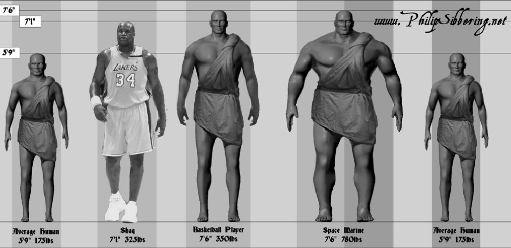
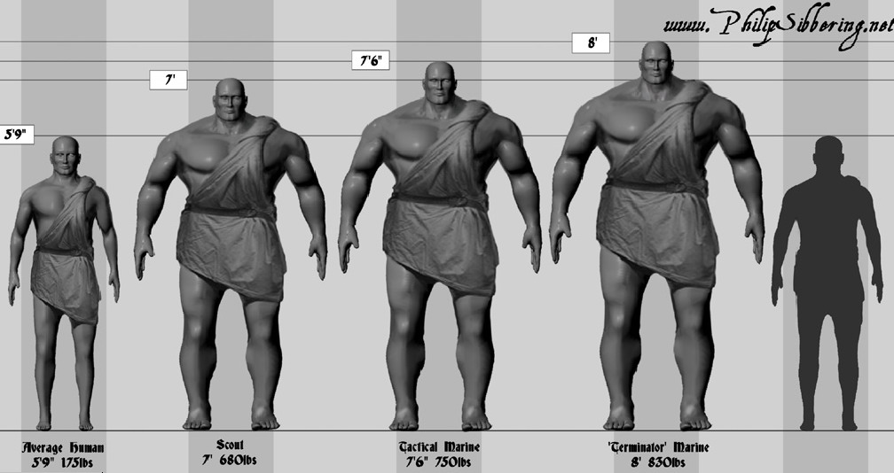
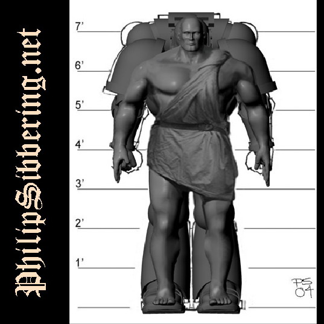
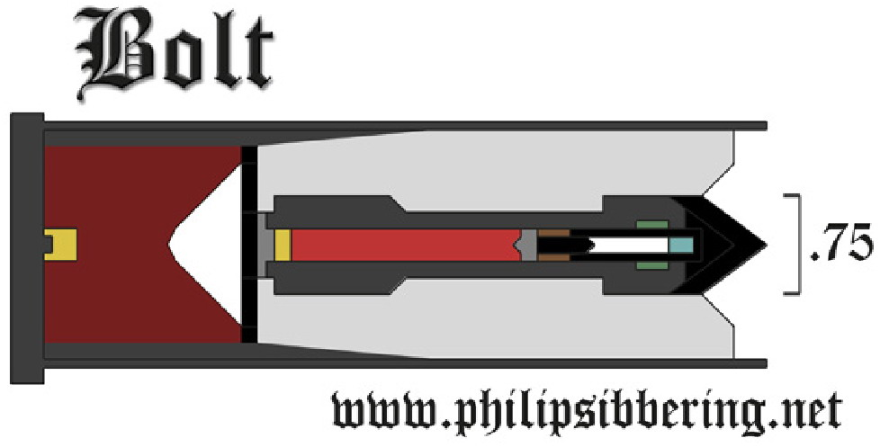
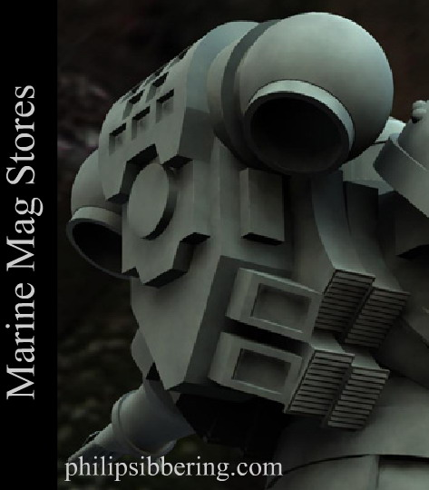

# 一点关于SM兵和bolt的资料

> Drydry

我在黑色图书馆找来了一些图片,不敢独享

大家知道SM是经过将近20到手术工序制作出来的强化战斗人种,那么人身体塞了胡七胡八那么多东西后和一个正常的人比较大概有多大的差异呢?请看

大鲨鱼和中间的陆战队相比才是刚刚过肩膀的水平

左二是侦察兵,中间是标准陆战队,右二是终结者,两头的是IG......也是我们1.75米的正常人....也是我的身高.

别看sm盔甲大,其实都添满了....

bolter弹头

可见这种标准bolt是脱壳火箭弹型的设计,而bolt的触发方式也多种多样,引用原文如下

__Rockets, Missiles and Bolts__ “Rocket-powered missiles are known as rockets if they lack post-launch guidance or missiles or guided missiles if they are able to continue tracking a target after launch. Cruise missiles typically use some form of jet engine for propulsion.”
__The Third Form:__ A bolt is not a missile as it will not track post-launch (unless using a long range sniper round that tracks a laser dot – but that’s an exception) neither is it a simple rocket either. A Bolt is a third form, a rocket that is pre-launch mode programmable.
__Construction__ Bolts are self propelled rockets and come with mode programmable warheads. In flight stabilization is achieved via spin imparted by three small rocket ports angled in such a way as to rotate the bolt along it's axis. 
__Programmable__  At slow speeds (up to 50m) the bolt is in mode one. The bolt detonates as a shaped charge on contact and is effective against heavy armours acting as an RPG (rocket propelled grenade). However they are ineffective against 'electric armours'.
After 50m the bolt has sufficient velocity to cause impact damage through kinetic energy, it then takes on a programmed intent of the firer.
__Bolt Modes__ Mode 1 HEAT round (on contact with hard surface)
Mode 2 Air burst (flechette shrapnel) proximity to target act like a grenade
Mode 3 penetrates massive biomass and explodes.
Mode 4 play dead (mine) proximity fuse active and set to vibration/ movement/ heat/ size 'guess', but they will not explode near Space Marines and are ineffective against chaos marines.
Mode 5 slow burn and low impact (stuns) acts as ‘rubber bullet'.
Mode 6 Delay fuse (grenade)

下图展示了背包携带备用弹夹的方式

[原文请到这里查阅](http://www.philipsibbering.net/WH40KRP/WH40KRP_Concepts.htm)
