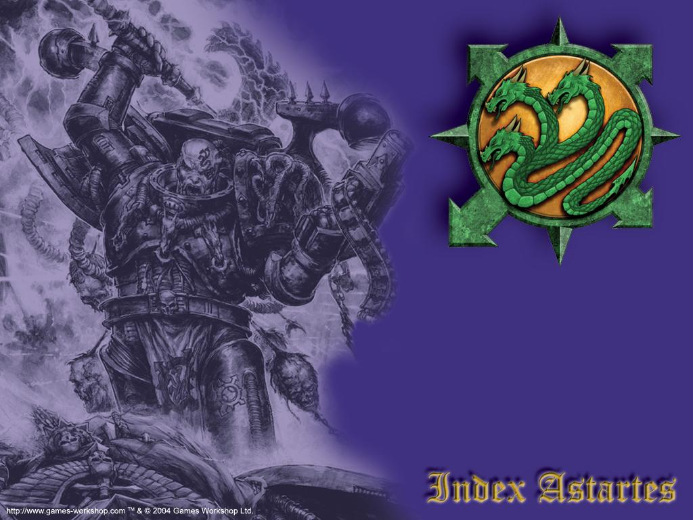

# 阿尔法军团（Alpha Legion）

在所有背叛的军团中，阿尔法军团是最不为人知的。这支军团擅长机密行动,间谍网络,以及离间计，他们喜欢同时从不同方面来打击敌人。

## History(历史)

### Alpharius(艾法莱尼)

阿尔法军团的基因原体的过去十分神秘，艾法莱尼和他的军团以保密文明，甚至连他们的Space Marine兄弟们也对他们了解甚少。艾法莱尼是最后一个在贺拉斯背叛之前被找到的基因原体。

艾法莱尼是在圣战(Great Crusade)结束和贺拉斯背叛之间的时间被发现的。一支影月之狼(Luna Wolves)的侦查队正在观察一个新的银河系时突然被一堆轻型战机攻击。虽然这些战机的设计十分原始，但那些攻击机有极高的协调力而且当那些战机被迫撤退时，影月之狼再追击时直接冲入了一个太空星雷阵。影月之狼的援军到了后，贺拉斯亲自登上了被炸伤的战舰。他发现船上的船员都楚于高警戒的状态因为有一小群敌人强行登上了观测船并且正在往舰桥移动。

贺拉斯留下来带领在舰桥上的防御。根据记载，有五个人冲入了舰桥。贺拉斯打爆其中四个人的头，但是第五个人闪开了爆弹枪的子弹。其它守卫的攻击虽然减慢他的速度，但是没有阻止他。他在要抓住贺拉斯喉咙的前一刻停住，发现对方原来是自己的兄弟。

## The Great Crusade(圣战)

贺拉斯并没有马上把艾法莱尼送回去见皇帝。他训练了艾法莱尼，有时候让他担任影月之狼的战术指挥。他对艾法莱尼的技巧和足智多谋感到印象深刻。同时艾法莱尼也对贺拉斯的军事能力感到敬佩。

后来，艾法莱尼被送去会见皇帝，但是他们两个并没有相聚很久因为帝国管理的需求。艾法莱尼很快就得到了第二十支Space Marine军团的指挥权，也就是阿尔法军团。

阿尔法军团是最后一支为了圣战创造的Space Marine军团。艾法莱尼磨拳擦掌的想要赶快证明自己的能力。他们第一场战役十分的成功，且艾法莱尼善用的战术很快的就被整支军团给精通。艾法莱尼认为最好的攻击模式是由很多种不同的方向一起攻击，并且让指挥官有最多的选择权才是通往胜利的道路。没有任何一批阿尔法军团的军队在没有备用计划的情况下攻击，他们随使都准备从侧面或是运用渗入行动攻击敌人的弱点。

根据书上记载，艾法莱尼不停的训练手下的军官，鼓励独立思考并听从他们的意见。他不停的给他的军官各式各样的挑战，有时候甚至会突然从战场上消失的方式来使他的军官及部队更能够适应临场应变的能力。有时候，他会完全消失一阵子来评估阿尔法军团在没有指挥官的情况下的表现。

## Tesstra Prime(太史塔事件)

在一场和无限战士(Ultramarines)的基因原体罗伯特．古莱曼(Roboute Guilliman)的争论后，艾法莱尼更努力的鞭策阿尔法军团。找寻更困难的挑战来证明古莱曼认为阿尔法军团永远都无法和无限战士相比的想法是错的。他知道自己没办法和他们打赢战争的次数相比，所以阿尔法军团寻求打赢的战争的质量。

太史塔是第一个被选为"高质量胜利"的目标，一个极度反对帝国统治的世界，艾法莱尼延迟了进攻整整一个礼拜，在这段时间中，防御的军队有足够的时间可以在太史塔的首都强化防御工事。根据估计，当地至少有一百万名士兵准备抵挡Space Marine的攻击。

阿尔法军团发动攻击，将火力集中在几个重要的区域。当进攻部队登入时，事先在渗透行动中被藏好的炸弹被引爆了。让被攻击的区域和增援隔绝，当地的民兵采取了各式各样的反制行动，但是这些早就都被阿尔法军团给料到并化解了。在一个礼拜内，在只损失一些些Space Marines的情况下防守军损失了百分之九时的战力。

原本准备因为这场决定性的胜利而接受歌颂的艾法莱尼反而受到其它的基因原体谴责。公开声明这场战役根本就是"浪费时间，精神和皇帝的弹药"。只有贺拉斯赞赏阿尔法军团的胜利。

## The Horus Heresy (贺拉斯的背叛)

很快的，贺拉斯以他在伊斯塔安三号 (Istvaan III)的行动背叛了皇帝，阿尔法军团是其中一支被送去摧毁贺拉斯和他的同盟的军团。被安排在第二波的攻击，阿尔法军团显露了他们早已加入了浑沌力量，登陆了伊斯塔安三号并在之后被命名为登陆点大屠杀事件(Drop Site Massacre)中摧毁了三支忠心的军团。一些学者相信这项陷阱其实就是艾法莱尼帮忙设计的，因为这个陷阱和阿尔法军团的风格极为相似。

当其它叛变的军团继续向泰拉(Terra)进攻时，阿尔法军团很明显有其它的目标，去寻找并攻击他的Space Marine宿敌。仍然记得古莱曼对阿尔法军团比起其它军团根本什么都不是的评论，艾法莱尼再度去证明古莱曼的错误了，打败白色伤疤(White Scar)和太空之狼(Space Wolves)，并占领了无数的Space Marine哨站。甚至在贺拉斯被打败后，阿尔法军团的锐气仍然不减，最后终于在伊斯卡瑞多(Eskrador)碰上了无限战士。

这场战役的战术是直捣阿尔法军团的心脏然后再将其它零碎的军队包围并消灭。古莱曼亲自率领攻往阿尔法军团营地的进攻，并强迫艾法莱尼和自己单挑。这场战斗的结果有很多种说法，有一些人说艾法莱尼被一拳打死，有一些人则认为古莱曼只把艾法莱尼打退。不管如何，阿尔法军团并没有因为失去主帅而被摧毁：艾法莱尼的训练让他的军官们再失去主帅时也不会阻碍阿尔法军团的运作。两个礼拜后，古莱曼放弃并结束了这场战役。

## Exile(流亡)

阿尔法军团在帝国重整和皇帝被放入黄金王座(Golden Throne)的这段时间消失灭迹。他们并没有和他们的同胞一起撤退至恐惧之眼(Eye of Terror)，他们仍然躲在一些藏在帝国中的基地里。阿尔法军团的摧毁是Space Marines和审判团的优先计划，有时候审判团会发布阿尔法军团已经被摧毁的消息。可是他们每次都成功生存并在一阵攻击后重新出现。

## 战吼

For the Emperor!
or
Hydra Dominatus!
注:其中一条Alpha Legion用的战嚎真的就是For the Emperor,其用意是来讽刺帝国的军队,我猜可能也有一些扰乱的意义,因为Alpha Legion最爱搞这套