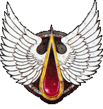
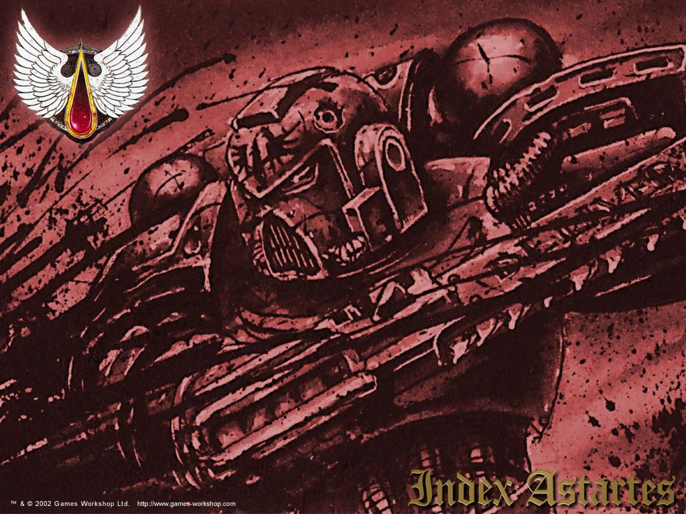
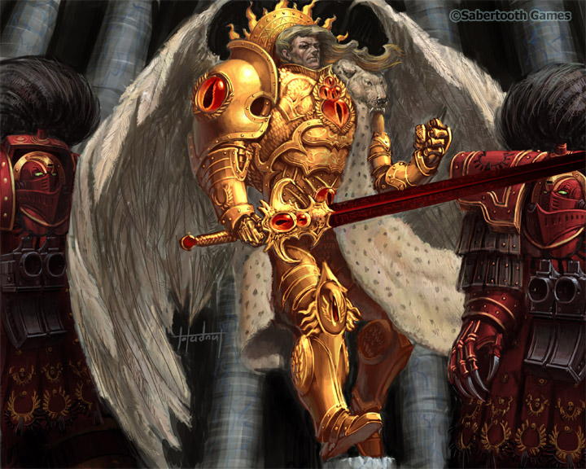
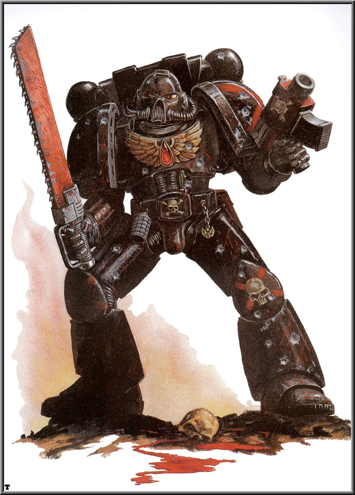
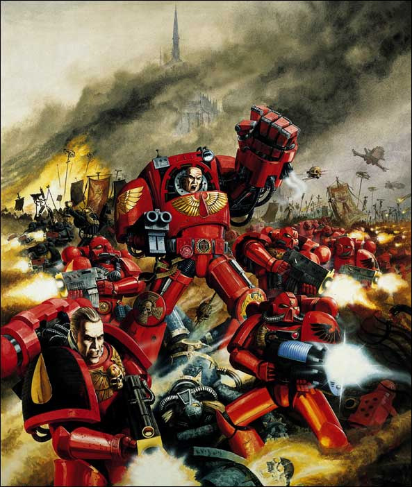

# 圣血天使军团

曾几何时，圣血天使被公认为Adeptus Astartes中受到无上圣佑的军团，他们继承了基因原体圣吉列斯的勇敢无畏及高超战技。但是，何路斯叛变这一事件给他们带来致命的打击，他们天使般的先父牺牲了。他的死亡如此可怖，竟在所有的军团成员灵魂深处刻下了不灭的伤痕。自那深暗之日起，关于圣血天使血脉中流淌着恐怖诅咒的传言，便悄悄地流传开来。

## 起源

它在帝国的阴暗角落中徘徊，它也许是最为异端的见解，它便是：基因原体们在年幼时曾受到混沌力量的碰触。据说,Adeptus Astartes的基因原体们在冷冻舱中便被混沌的能量所捕获，这个观点在帝国学者中并不少见。更有人对此种想法此给出了可信的解释，由神圣的帝王亲手释放，附着于幼年基因原体身上的强力巫术便是为了保护他们免遭这类邪力的侵袭。如有人胆敢劝诱你相信这些想法，那人并不会被消灭，而是被放逐到银河最遥远的角落，从此失去地球给予的庇护和援助。

混沌的力量是否企图扭曲和扰乱帝王的完美作品，仍然无从确认，但是一个或多个基因原体可能在生命开始时便被混沌所改变的看法，绝对是真正荒谬的。

人烟稀少的行星巴尔上和她双生卫星上的文明都未曾发展到出现文字历史的高度。然而，被称作“血族”的巴尔人部落世世代代口耳相传的故事里，描述了还是婴儿、背生细小双翼的圣吉列斯在一个叫天使崖的地方被人发现。不论如何，圣吉列斯都是真正的天使，不只因为肉体的相似，更因为他无暇的灵魂。

漫长岁月中，许多由圣血天使智库馆长转录的典故与圣诗仍被反复诵读（据第一个巴尔人部族的后裔所说,这些诗歌可以追溯到上古时期 ），并被圣血天使精心保藏于最圣洁的神龛典籍中。

唉，部落的历史在圣吉列斯降临之前竟全无只言片语。现在只能假设他们是巴尔卫星上的典型部落，一个没有信仰的可悲群体，每个族人费劲全力也仅能让自己在这遍布辐射、寸草不生的世界中生存下去而已。巴尔卫星上的辐射水平极高,可以在几秒内使没有防护的人恶疾缠身。同样，我们可以推断，当血族的族人发现一个无暇的、全身赤裸的婴儿安然躺在滚烫的沙地中，而他背上还生有细小的羽翼时，他们便认为他是变种人。

具有讽刺意义的是，据说多数族人都想立刻处决这个将赐他们以救赎的人。虽然这样彻底的亵渎之念绝难容忍，但是，考虑到那时的巴尔居民和野蛮人无异，自然不予追究。幸好，那时的他们定是感到了还无法说话的圣吉列斯的神性，纷纷动了善念，于是，这个超凡的孩子被收养了。

虽然圣吉列斯早年生活的细节早已被时间之河从记忆中冲去，他童年的事迹却被被巴尔的不同部落反复传唱，成为固着在整个族群心底的回忆。其中一个故事是这样描述的：他被发现还不到三周时，他的体格就和几岁大的儿童一样，还能够走路。他在了望者眼皮下出走，带着好奇和勇敢四处游荡，并以此证明自己很是能走。他的看护人四处搜索，终于在巴尔火蝎的巢穴里找到了他，那是一种怪异的掠食者，直立起来足有两个人那么高。尽管蝎子尾刺上的致命毒素足以在几秒内将一个成人烧成灰烬，手无寸铁的幼儿却不怕它的反复蜇咬，击败了那只怪兽。

据其记述，族人们当晚享受了一顿大餐。

和其他基因原体一样，圣吉列斯以难以置信的速度成长，他的双翼也是如此。那羽毛的洁白纯净有如天鹅，坚固硬挺有如帝鹰。他的双翼逐渐有力，能够在灼热的沙漠空气中将他带上天空，让凡俗的存在感到敬畏和景仰。

他在天使崖被发现后一年，圣吉列斯的身高便超过了巴尔卫星上的所有族人。他的体格就是完美一词的注解，他的英俊使人不敢逼视，以免双眼因不洁的凝视而失明。他能在最猛烈的烈日灼烧中行走，而他的收养者们只能拖着沉重的防辐射服艰辛跋涉。他能用手中利刃在山崩中破开道路，用简单的一瞥使野兽臣服，用有力的双翼在天空中翱翔，用天神的视野俯瞰大地。

圣吉列斯长大后，部落在他的领导下成长壮大。

由年长而可敬的学者 亥瑞昂特尔库斯?鲁西狄欧【Hyriontericus Lucidio,2342345M33】 完成的巴尔神话抄本自从归入圣血天使神龛典籍后便得到了最精心的保管。因此，以下引言来自其最原始版本，从灵族语Imrait'il'thax直接转录为鲁西狄欧的巴尔人经文。

“那撕食活人的变种人，人多势众远超我等。他们口舌生剑，众眼无神，多瘤之手抓握着锈蚀的刀剑。当时我们自认必死无疑。这时，那位天使开始行动。

他，纯净之人，不允灾难降加害我们。他愤怒了，先是一道炽烈的光，接着，死亡开始随他行走，带起恐怖的红雾。他的双眼和头冠在我们眼中开始燃烧，强烈无匹，有如同一个明亮暴烈的光环，一片携带毁灭的沙暴。我们都因他舞蹈中致命的美而陶醉。最终，变种人无一幸免，四周一片静默，而他立于我们前面，静如石冢，敌人的污血滴答落下。”

圣吉列斯很快成为巴尔卫星社会的顶级成员，在他的领导下，纯种巴尔人部落很快便开始团结一致，对抗那些在巴尔充满辐射的废土上肆虐无忌，不断袭扰的变种人。虽然在数量上处于绝对劣势，纯种人类仍赢得了对抗污秽变种人的战争。圣吉列斯以完美的、神赐的领袖才能，还有对格斗技巧的完全掌握，驱退了妄图通过战争吞没巴尔卫星真正人民的邪恶洪流，他的愤怒纯粹且无从抵挡。圣吉列斯不可避免的被他的追随者尊为神明。他们坚信，天使绛红的脚步的后面，必将留下一片乐土。

时光的脚步从不停息，帝王来到巴尔时，他丢失的儿子已坐在血族议会的首席。人类的王者神性的预言是正确的：他的一位基因原体身处荒芜的巴尔卫星，因此他带领最优秀的随员降临地表。

注：在这一点上，学者们不再依赖推测和古老神话（虽然被人不懈的记录着），因为人类之父的随从中有无数卓越人物和公证者。

因此我们了解到，在血族会议的高潮，帝王走进了经历无数沧海桑田形成的，雄伟圆形剧场。纯种人的千分之十出席了圣吉列斯的演讲。帝王走入他们的行列，血族衣衫褴褛的战士之间立现一片金光闪耀的轮廓。圣吉列斯的演讲升华了在场人民的真正灵魂，赐予了他们比希望更宝贵的信念，并在众人经久不息的欢呼中结束。此时，帝王已完全确定：这人便是他丢失的儿子。

其他记录如下：当帝王上前时，圣吉列斯立即认出了他。众人皆信，圣吉列斯闻名于世的预知能力预言了帝王的来访，这便解释了他那时的反应。他双膝跪地，水晶般的眼泪从双颊落入尘土。它们掉落的地方，雪白的鲜花在巴尔卫星贫瘠而污秽的土壤上纷纷开放。帝王令他起立，然后凝视着下面无数盯视着他的脸。他发现，他们在心灵和行为上都是美好的，都继承了来自他们领袖的一部分崇高和力量。

由此，在巴尔灼目的阳光下，圣血天使诞生了。

## 血族之天使

据帝国史籍记载，帝王随后便精选圣吉列斯手下最优秀的战士，以之建成一个完整的星际战士军团，然后便率领领他们投入大圣战的洪流之中。这些战士接受了来自基因原体的宝贵礼物：纯净而宝贵的基因种子。以之护佑，战士们在履行天职时不至枉死，而圣血天使的加入也大大增强了随同帝王远征的部队。

留守巴尔卫星的战士则肩负神圣使命，不仅负责保护行星上的天赋人权，还要确保未来世代的战士接受帝国信条的教育，使之了解曾在身边行走的真神及其事迹。即使是距那宿命之日已有一万年的今天，圣血天使仍然在巴尔卫星征召新兵。

为了确认谁有资格加入圣血天使，纯种人部落的青年必须参加残酷的角逐与壮烈的竞赛，他们不但要和家园的严酷环境搏斗，也要和同族的对手博杀。这种仪式自第一次招募血族新兵起已成惯例，直至今天也没有任何变化。每一代人都会举办一次竞赛，地点在天使崖，那片禁地便是圣吉列斯被发现的地方。届时，从天而降的“翱翔战车”（圣血天使的雷鹰炮艇，由资深战士驾驶）将宣布着新一轮角逐的开始。

参选者们必须不择一切手段抵达“挑战之地”，这一过程将淘汰希望加入圣血天使，但不够强悍的战士。参选者必须徒步穿越边界未知、吞噬生命的沙漠；只靠“天使飞翼”，一种由皮革和细藤做成的原始工具支撑自己的体重，从高耸的绝壁上一跃而下。他们必须在千沟万壑的峡谷中杀出一条生路，那里不止有巨大的火蝎四下出没，还有叫“干渴水怪”的液体状生物，能把所有和它接触的活物吸成肉干。地上空洞的尸体都曾是满怀希望的参选者，现在，他们干枯的身体只能提醒大家，轻视这些危险生物将有什么下场。当参选者抵达挑战之地后，与Ultramar星系形式类似的角斗竞技立即开始。仅有武技最为高强的战士能够幸存。

当五十名左右的获胜者从其他失败者中脱颖而出后，便立即被送上雷鹰炮艇，向旅途的下一站进发。失败者仍能保留体面的社会地位，也可去守卫试炼之地，直至下一组参选者完成准备，接受挑战。

成功过关的参选者们被送入位于巴尔主星的圣血天使修道院要塞，那里难以想象的壮丽景象，使他们无不因敬畏而屏气凝神。他们在未来的同袍面前列队通过，在这里，参选者和真正星际战士的区别一览无遗。

巴尔卫星的污浊大气和恶劣气候对地表居民的健康损害严重。许多参选者身上都带有过去生活的印记：在这样严酷的自然条件下，普通人不可能躲过辐射的致命之吻。虽然他们都还年轻，但他们的体态已佝偻扭曲，他们肌肉虬结的身体被伤痕和污染折磨得千疮百孔，他们的发育因营养不良和长期饥饿而停滞不前。与之相比，周围的星际战士们有如雕塑家的杰作，有着平滑的皮肤，俊美的面孔和洁白整齐的牙齿。

参选者们随后被领入圣血天使大礼拜堂，他们将在这里连续值守三天三夜，不得休息。睡着的人不论之前表现如何优秀，都被带离，没有任何档案能让我们得知他们的归宿。稍后，圣血牧师走入烛光摇曳的礼拜堂。这些高贵之人不止履行圣血天使药剂师的职责，还要承担不比寻常的责任。圣血牧师负责守护圣吉列斯之血。他们会在值守结束后将圣餐杯递给参选者，据说，杯中盛有少量圣吉列斯珍贵的血液。一旦参选者们分享了血之圣餐，他们便沉入一种深邃、漫长的睡眠，心跳几乎完全停滞。蒙面的血之奴工将带他们到达诊疗区，在那里，来自圣吉列斯的基因种子将植入他们沉睡的身体。

血之奴工吟诵着Credo Vitae圣诗，将他们送入石椁之厅。这令人叹为观止的厅堂的风格如同金壁辉煌的教堂，里面容纳了很多较小的建筑，任何建筑的尖塔都无法触抵它以浮雕修饰的穹顶。厅堂的墙壁上嵌有连绵不断的石椁，每个都有两人之高。沉睡的参选者被封入这高大的棺椁，然后接入由维生节点构成的庞大网络。他们将在这里封闭整整一年，通过静脉摄取养分，并接注圣吉列斯之血。

许多参选者在这一环节死亡，他们较弱的体质无法适应基因种子带来的翻天覆地的身体巨变。对于这些不幸的人，还是不予提及为妙。能够通过圣血试炼的人将快速而有序的成长，以类似其精神先父的进度达到均衡状态。据传，有些被密封的参选者在棺椁打开前便已苏醒，然后在密不透风、浸透着鲜血且伸手不见五指的骇人环境中承受幽闭恐惧症的折磨，造成精神失常，甚至更严重的后果。

如果参选者们的身体改造成功，他们的肌肉条块会增加，植入器官会完全融入他的身体。在他们沉眠时，可以通过鲜活而离奇的人造梦境了解圣吉列斯的经历。由此，基因原体的思想本源传承给他的新子嗣们，这深刻炽烈的情感和回忆将永远镌刻在他们的灵魂之中。

当参选者们最终被移出棺椁时，其脱胎换骨般的变化让人不敢相信，这曾是一个在巴尔卫星的活地狱中饱受折磨的可怜人。他们身材挺拔，体格雄伟，膂力过人。他们重塑过的身体和他们天使般的先父一样，有着令人无法忘怀的魅力。他们的感官敏锐如电，他们的肌肉坚实强韧胜似百炼精钢。

经过这些磨难，他们终于在成为圣血天使星际战士的道路上，迈出了第一步。

_插边资料_

## 死神连队

圣血天使的基因种子深处，深埋着圣吉列斯的记忆，其中最为刻骨铭心的，便是与何露斯的最后决战。有时，一些事件或情境可能唤醒这种“族群记忆”。此类情况十分罕见，往往会在战斗前夕突发，对于思想突然坠入遥远过去的不幸战士来说，这往往是一种致命的体验。闻名于世的“黑色狂怒”吞没了他，圣吉列斯的记忆和知觉侵入他的心智，一万年来的恐怖事实瞬间涌入他的脑海。这便是残酷的事实。

在他人眼中，被黑色狂怒吞没的星际战士因愤怒而进入半癫狂的状态，他不能区分过去现在，不能认出昔日战友。他可能会认为他就是即将死去的圣吉列斯，何露斯叛变中的腥风血雨在他脚边肆虐。那战士不止得到圣吉列斯的记忆，也会获得到基因原体的部分潜在力量，使他本已惊人的力量和耐力提升到超凡的程度。

为保证黑色狂怒得到控制，处于战斗前夕的圣血天使专心祈祷，纪念无数个世纪前牺牲的基因原体。牧师在在他们的行列中穿行，逐一祝福所有战士，同时额外留意眼光闪烁、言语含糊或谈吐过激的人。多数人克服了这古老诅咒对他们心智的袭扰。他们的所有训练都是为了控制它，将它压制到心灵的最深处。但是，对个别来说，圣吉列斯留下的烙印太过深刻，那种记忆过于强烈和深切。在牧师吟唱Morpatris，湮灭之弥撒时，被选的人会颓倒在教士的臂弯之中，然后被带出去。这些正饱受折磨的星际战士被编入一个特殊单位，它的名称就是：死神连队。

由于基因原体濒死时的记忆，死神连队的战士只有一个目标：与帝王的敌人战斗，至死方休。死神连队在黑色的盔甲上画上红色的斜十字，这血红的徽记象征圣吉列斯的牺牲。此连队由战团牧师领入战场，然后依照牧师的引导向预定敌人发起冲击。抱有必死信念的战士们悍勇无畏，无视能致普通星际战士于死地的创伤。即使他们能在战后幸存，那狂暴屠戮的终止很可能导致他们因之前的战伤死去。圣血天使们衷心拥抱这种死亡，因为他们生怕自己的疯狂很快会驱使自己走向最为黑暗的道路。承受此等厄运还不如清白且迅速的战死……

## 何露斯叛乱

相对其他战团，恐怖的何露斯叛乱对圣血天使的打击最为深重，其恶果永无挽回余地，这一悲剧命运自此改变了战团的面貌。战帅何露斯，帝王曾最信任和钟爱的儿子，堕入混沌，使得背叛的匕首深深没入帝国心脏，使之再不能恢复元气。

堕入混沌的何露斯揭开了悲剧的序幕，他开始着手诱骗和迫害其他基因原体，使之倒戈，矛头直指他们的父亲和导师，帝王。这一悲剧的高潮便是何露斯联军对帝王宫殿的攻击。星际战士与星际战士厮杀，叛国者与拥王者战斗，直到代表神圣地球的要塞开始沦陷为止。何露斯以自己的不朽圣灵做为投靠邪恶的祭品，获得了难以置信的力量。混沌的邪力终于占了上风。

在神圣御卫军军部【Sanctus Praetoria Imperator】绮丽的哥特式彩窗上，永久镌刻着圣吉列斯在燃烧的天空中战斗的图景：他正面对无数能以只言片语击溃伟大英雄心智的恶魔。那天使独守孤城，力阻狂澜，没有一只邪魔能活着染指帝王宫殿神圣的厅堂。无数人的记述中，对于永恒之壁空港防御战中英勇无畏，即使一息尚存也奋战至死的圣血天使们未曾吝惜赞美之词。虽然成百的圣血天使战死沙场，他们仍在这史无前例的邪恶怒涛中屹立不倒。无数人的讲述中，圣吉列斯手中燃烧着炽焰的利剑在空中飞舞，斩落敌人之时，他的子嗣身上便笼罩着炫目的光芒。在何露斯的坐舰上，圣吉列斯更是彻底的履行了他最后的天职。

何露斯因胜利而洋洋得意，他站巨大海怪般的指挥舰舰桥之上，纵览着战场。他正在渴望亲手击败帝王，他想要迫使人类的先父跪伏于尘土之中，他将要完全吞噬他的灵魂。叛党的军队终于突破了最后的防线，冲入宫殿的回廊与厅堂之间，何露斯一时愚鲁，关闭了坐舰的灵能护盾。电光火石间，圣吉列斯紧随帝王登上了这艘已化身人间地狱的战舰。。

众所周知，圣吉列斯天赋异禀，能够预见未来情境。他的发自纯净灵魂的预言从无差错。何露斯与他的再会，便是他生命的尽头，对此他了然于心，可是他仍然从容赴死。许多帝国神学家都质疑这一行为的原动力是宿命论还是对帝王的忠诚，他们的信念是不坚定的；圣血天使们对于这个问题的答案则是唯一的，他们坚信，圣吉列斯独闯虎穴，知不可以为而为之的行为是出于理智的：他早已知道自己将付出怎样的代价。

只有圣血天使知道他们基因原体命运的细节部分。因为他们创始人的壮烈牺牲早已深深烙刻于众人灵魂的深处，每个人的灵魂都会被圣吉列斯惨死时的梦魇所煎熬。由于这历久传承，刻骨铭心的记忆，圣血天使会坠入名为黑色狂怒【Black Rage】的失控状态，这时的他们会再次体验圣吉列斯死去时的痛苦经历。

一个圣血天使的资历越深，他所沐浴的血雨腥风就越发稠厚，他体内的黑色狂怒便越难压制。战团牧师雷斯塔里欧【Chaplian Lestrallio】，大的，悲剧式的殉道者，设计了一种特殊方法，这样，战团通过太空中航行奔赴战场时，无法压制黑色狂怒的人也能死得其所。在雷斯塔里欧程序【Lestrallio Procedure】中，无法压制黑色狂怒，无法撕碎敌人，无法壮烈战死的人，应将自己交由圣血教士监管。这些人将以精金枷锁监禁――负责这一过程的血之奴工往往损失惨重。枷锁完成后，他们被送入战舰上的诊疗区，在那里，他将在引导下说出自己的所见所识，这些宝贵资料反映了圣吉列斯在何露斯座舰深处的见闻。

下面的报告引自战团牧师雷斯塔里欧的叙述，日期2432053.M36，由血之奴工记录。这仍然是关于黑色狂怒最完整的第一手资料，雷斯塔里欧以他钢铁般的毅力写就了这最珍贵的遗嘱。

原文摘录如下：

"It's dark...aagh!It burns!The taint is so strong..the smell...rot,foul rot and death..it's hot.So hot...I feel my feathers singe,furling against me to avoid touching the walls,the walls...this is Hell...thorns,spines pushing through wet flesh _subject goes into spasm_ _subject screams in rage_

What's that..What's that!?So fast!Aaaaah!For the Emperor!Die!DIE!

_subject falls still，mutters unintelligibly,possibly a prayer_

"Where is he, where is he, you cannot stop me foul CHAOS FILTH!AAAGH!"

_subject spasms,gnashes teeth_ "curse this light..."

"Burn!BURN!All of you! _indecipherable_ the wall,there are no walls, this tunnel made of flesh,rotted flesh,bursting underfoot,bleeding the stench of pus... _subject screams then calms_"

"I will find,coward."

_six seconds pass,subject's eyes open_

"I name you Traitor!Face me!For the Emperor!FOR THE EMPEROR!"

原文翻译如下：

“黑暗……啊啊！燃烧！堕落的气息竟如此浓烈……那气味……腐臭，污秽的腐臭与死亡……灼热。如此灼热……我感到羽毛都被烧焦了，向我皱缩，避开那墙壁，那墙壁……地狱……荆棘、脊刺自粘湿的血肉中破出（痉挛）（愤怒的尖啸）什么……那是什么？！如此迅速！啊啊啊啊啊！帝王万岁！死罢！死！

（平静下来，发出无从了解的低语，应该是祈祷）

“他在哪里，他会在哪里，你无法阻挡我，邪恶――混沌――魔物！啊啊啊！

（痉挛，咬牙切齿）“可恶的强光……””

“烧！焚烧！统统烧死！（无法辨认的声音）那墙壁，根本没有墙壁，这隧道由血肉组成，被拼凑的血肉，在脚下爆裂，流出脓血和恶臭……（尖啸，之后是平静）”

“我会找到你，懦夫！”

（六秒过去，怒目圆睁）

“我宣汝为叛贼！光明正大的和我战斗！帝王万岁！帝――王――万岁！

【kv85注：以上（）括号内是实验体的反应】

这时，一阵空前剧烈的痉挛，几乎撕碎了他的身体，战团牧师雷斯塔里欧死亡，原因是严重生理损伤。这就是雷斯塔里欧程序的副作用，它还将在许多圣血天使身上重演。

### 实验记录结束

通过对实验记录的比对，由这些身负黑色狂怒的人所提供的宝贵证据离最终结论越来越近。大多数圣血天使都认为，单纯的一对一战斗中，何露斯不可能胜利。显然，圣吉列斯遭到了何露斯的灵能打击，其威力难以想象。

何露斯，以他无尽的怨恨，借助他所投靠的一切邪力，确保了圣吉列斯在死前承受了最深的痛苦与最大的亵渎。他的灵能攻击不仅在空间中徘徊，更在时间中回荡，最后使圣吉列斯子嗣的灵魂也一并共振。基因原体的牺牲使得何露斯难以分神，终使帝王能在他巢穴的深处将这叛徒捉个正着。在那里，帝王以惨重的代价将他击倒。而来自基因原体的痛苦无比透彻，他所有的子嗣的灵魂深处，都保留这那一天留下的烙印。

这便是圣血天使血统诅咒开始之日，而这诅咒散去之日，终究遥遥无期。

## 家园

古代的巴尔主星和卫星上的大气中，充斥着遮天蔽日、肆虐无忌的尘埃。曾有多支配备顶级标准防辐射服的勘探小组对巴尔卫星的某些参数进行过调查。在她们黑硬的地壳下深埋着知识的宝库，其地层结构也与预期估计大相径庭。调查结论表明，巴尔主星的表面自古以来都被红铁锈形成的沙漠所覆盖，但她的卫星曾是人类的乐土，那里的居民安享高雅艺术与科学技术的福音，远离挣扎求生与征服战乱的苦难。巴尔的地表上古代大厦的遗迹星罗棋布，以神话般的科技铸就的雄伟纪念碑在时间的洪流中屹立不倒。显然，巴尔的先民曾耗费大量时间建造巨型纪念碑，在山脉中凿刻王者和神祗的雕像。由此，帝国便可以通过建筑遗迹再现昔日巴尔人生活的画卷。

究竟是怎样的事件真正终止了这样的祥和环境，当然无人知晓，而问题的结论这一将在帝国史学界掀起轩然大波。目前唯一得到确认的是，灾变极其可怕，永久、彻底的改变了巴尔的面貌，其发生时间大约在科技的黑暗时代【Dark Age of Technology】结束之时。从此以后，巴尔卫星面目全非。残存的古代兵器被人们发掘出来，里面既有病毒武器，也有核弹，这也许可以给巴尔卫星上极其致命的辐射水平一个合理解释。这个行星的地层中包含者由黑硬琉璃质构成的平原，还有连绵不绝且被严重污染的沙漠。曾经的大海只剩染毒的湖水和剧毒的淤泥，现在被死灰层覆盖着。整个星系死亡的居民多达数百万。可人类终于坚持了下来。过去居民们变成了拾荒者，四出寻拾着过去伟大文明的遗骸。没有他们，便没有现在完善的防辐射服，人们便会在灾变后的大气中饱受腐烂与死亡的折磨，在病痛中成长，其身体也会很快衰竭。帝国学者的在他们学说中指出，在所有秩序崩溃后之后暗无天日的年代中，一些人的境遇比拾荒者更为悲惨：他们最终堕落了，开始猎食活人。

放射标准严重超标的大气所带来许多副作用，而且根本无法避免。无需太久，在幸存者体内积聚的化学毒素和放射性物质便会促使他们突变为变种人，步履蹒跚且形态扭曲。在巴尔主星上的Lasquo洞穴中，详细描绘着社会结构的分崩离析：诡异的画面中，变种人和疯子正在屠宰正常的人类平民，这副岩画由古代人类画在干热的岩壁之上。

但是，正如我们从巴尔经文上所知，仍然有一部分人保持了人形和人性，保持着正常的行为面貌，并形成了一个个部落，例如，收养圣吉列斯的那个部落。虽然这些人人数稀少、外敌重重，但是，新的、原始的文明已从古代的废墟之中崛起。所有复杂社会结构皆不复存在，只有部落这一形式存留下来。由于人类和变种人食人者十分相似，所以他们能够信任的只有自己的血亲。

巴尔星系的居民成为了逐水草而居的游牧人，一边捡走废墟中所有可用物资，一边为保卫他们收集的战利品而战。这些部落长期处于交战状态。盟约织成的大网日复一日的改变着它的脉络。灭绝的危险时刻等待着迟缓和弱小的族群。如果说巴尔卫星曾是凡间天堂，那么现在的她就是人间地狱。

对于少数幸存的人类来说，生命就是挣扎求生。长久以来，巴尔人类的灭亡似已命中注定，与他们世代为敌的变种人部落终将统治无垠的沙漠。尽管我们只能加以推测，但圣吉列斯降临之奇迹定会将希望的种子带给那荒芜的世界。

## 组织体系

虽然圣血天使的组织结构和其他兄弟战团相似，在许多方面都坚守着Astartes圣典的规章，但是仍有不同之处十分引人注目。圣血天使拥有多种专精作战单位，除其衍生战团：朱红天使【Angels Vermilion】，血红天使【Angels Sanguine】、深红天使【Angels Encarmines】、吮血战士【Blood Drinkers】、裂尸战士【Flesh Tearers】之外，再无那个战团拥有与之类似的部队。值得一提的是，与这里提到的其他战团相比，吮血战士战团严格遵守着Astartes圣典。他们的特点更接近极限战士【Ultramarine】战团。

圣血天使战斗序列中最值得关注的，是他们精锐的近战部队。如有机会成为圣血天使突击班组的一员，便可以驱退他们古老记忆中的幽魂。即使是毁灭者重武器班组【Devastatro Squads】，肩负火力支援这一重任的战士们，也曾经向前冲锋，试图与敌人短兵相接（cf. the Trachesai Massacre,230M34）。

圣血天使第一连如果不使用终结者盔甲，便以突击兵的形式战斗，而非兄弟战团那样充当战术班组。第八连全体都为近战部队，许多成员都是帝国最优秀的突击部队。这些星际战士如果没有配备喷射背包，便搭乘兰德速攻艇和摩托车来支援战友。第十连由编制不定的侦察兵组成，负责渗入敌后，抓住一切机会造成近战，在一片血雾中将敌人大卸八块。其他圣血天使连队的建制完全参照Astartes圣典，不过他们的犀牛运兵车被私自改装，使得发动机能量一直保持过载，使载员能够飞速抵达前线（注：勿庸置疑，对犀牛运兵车ＳＴＣ模板的修改对于车辆整体结构有不利的反作用。）他们专精部队以头盔颜色区分：战术班组为红色，毁灭者重武器班组为蓝色，资深突击班组为黄色。

圣血天使的指挥组中包括很多独一无二的阶层，反映着他们即使独有的性质和组织系统。这里面包括圣血教士，司掌圣吉列斯的圣血。据记载，圣血教士曾多次以圣血注射器【Exsanguinator】为战友成功输血，即使在战斗最为激烈的地方。

另一个与标准圣典不同的组织是班组内含的荣誉卫队【Honor Guard】，圣血天使突击部队的高阶精英，最受崇敬英雄的卫队。这些战士替代通常的指挥班组，可以得到掌旗兵和圣血教士的支援。据说，其中很多强力部队的名字占据了整整一个Adeptus Astartes的英灵殿。荣耀卫队可以通过金光闪闪的头盔识别，同时代表着友军的希望和敌人的绝望。

圣血天使也因Furioso型无畏机兵闻名于世，其原始设计经由几万年的战团锻造长改造，已十分完善，它用以接纳身体残损的星际战士英雄，使他们能有机会满足对敌人鲜血的渴望。Furioso的一对能量拳爪可以击杀任何对手，在杀戮欲望的驱使下，连兰德掠袭者重型坦克的精金装甲也会被它撕开一个大口子。

最后，最重要的是，圣血天使的组织体系常被陷入黑色狂怒的战士扰乱。这些不幸之人被编入声名远播的死神连队。令人叹息的是，在战斗前根本无从确切预知这些事变会如何影响战团的组织体系。

## 战斗原则

圣血天使的连队通常像Adeptus Astartes的军队那样井然有序地投入战斗。第二、三、五连是一线战斗连，这四个连队负责维持主要战线，首先投入战斗。专精连队作为预备队，只在必要时投入战斗。

但是，不要指望这些连队像帝国铁拳和暗黑天使那样有组织有纪律地战斗，因为他们基因中的诅咒可以将最冷静和睿智的老兵变成狂战士，只想将敌人碎尸万段，以此来释放自己无法平复的战斗欲望。在白热化的战斗中，任何圣血天使都会被黑色狂怒吞没，即使是毁灭者重武器班组和辩护者自行火炮【Vindicator】的车组。因此，圣血天使将会原地固守还是全力冲锋，总是无从判断。这在过去无数次地造成圣血天使的敌人被全体屠杀。也许，其中最为著名的是Hive Tempestora地区的战斗，在那里圣血天使以大无畏的精神疯狂厮杀，他们的冲锋撕裂了敌人的战线，建立了桥头堡，完成了在帝国战术家眼中绝无可能的壮举。据说，圣血天使的狂怒与热诚使他们在Armageddon战役中完成了无数不可能的任务。这种狂躁不定使得他们在其他帝国指挥官中极度不受欢迎，但圣血天们毫不在乎。他们知道对黑色狂怒的无尽抗争不会使自己软弱，只会使自己更加强大。

## 信条

圣吉列斯是预言家，是理想主义战士。在他早年的生活中他渴望带领他的人民走向美好新生活。当他加入大圣战之后，他的理想走向了更加广大舞台，可他从未放弃原来的追求。他希望人类能够过上和平的生活，他为拯救在科技的黑暗时代倾覆的人类文明，结束连天的烽火和无尽的战乱奋斗不休。

我们可以断定，圣吉列斯的愿望大大影响了军团的面貌。它藏每个圣血天使们的信条的最深处，建设美好世界的愿望总是强烈无比。毕竟，昔日衣衫褴褛的拾荒者，今日伟岸、自尊而英俊的战士便是这一原则活生生的证明。

这一信念贯穿于圣血天使的所有行为之中：他们总是尽全力做到完美无暇。他们的艺术创作里无不包含着和谐与美。他们苦练武艺，为达到更高境界昼夜不息。他们的信条中渗透着对人类已然逝去的生命与高尚的独特见解。

圣血天使肉体的寿限是星际战士战团中最为长久的。他们基因种子的特色之一就是能大副延长受体的生命，所以经历千年沧桑的圣血天使战士也并不罕见。事实上，现任战团大导师，但丁【Dante】，已有一千一百年的寿命。这样漫长的寿命可以使圣血天使在完善战斗技艺之余，还能使自己的艺术技法步入化境。他们有几个世纪的时间来训练完美的体魄，塑造完美的心灵，即使是他们的盔甲和战旗也是人间最华美的艺术品。

审判官Garillion在巴尔的修道院要塞逗留期间（1929734.m40），目击了最为战团最为奇特的习惯。不论何时，圣血天使都惯于在创造他们的石椁内安睡。显然，他们相信，在这漫长的沉睡中，他们能走近圣吉列斯的世界，洞察先父的心灵。当圣血天使在棺椁中休眠之时，他们的血液得到净化，重获纯洁。战团希望以此能减慢基因异化的进程，并找出永远治愈黑色狂怒的秘密。

对于有幸得见圣血天使作战记录的人来说，圣血天使无疑是帝王意志的化身，他们履行圣职的热情和忠诚和其他战团相比，有过之而无不及。事实上，这些档案证明，圣血天使的拼搏使得帝国的无数战役成为光辉的胜利，以帝王之名被歼灭的异型和异教徒不计其数。

## 基因种子

这个战团，这曾受无上神眷的战团，现在只能尽量避免和其他Adeptus Astartes部队合作。帝国军官的报告中充满担忧：这些战士似乎正被可怕的渴望折磨，而且是对鲜血的渴望，这在惯于胡思妄想的帝国学者眼里正是堕入混沌的第一特征。众所周知，圣血天使花费大量时间来寻求治愈自己诅咒的良方，但这并不代表这个战团居心叵测，刻意掩蔽着血脉中混沌萌芽。

圣血天使遗产中的蛛丝马迹也许会最终拯救他们，它带给他们谦卑和对自身弱点的清醒认识，终会使他们成为Adeptus Astartes之中真正高尚的战士。

被基因原体遗留的诅咒完全吞噬的不幸个体，其最终命运除战团外无人可知。传说巴尔上的修道院要塞内有一处密室，渴望生灵鲜血的嚎叫无刻不在回荡。显然，无人愿意提及究竟是什么秘密深藏在那诡异而荒凉的地方。

圣血天使在远方星系驻扎时曾发生惨案，一些当地居民突然失踪，他们再次被人发现时，便只剩下一滴血液都不留的躯壳（事件地点和时间：Rukh's Paradise,Amerialla Belte,Q34/9/4503/TR/Ultima Segmentum,6569347.M36）。这可能是意图玷污战团名誉的邪教徒所为。甚或是迷信的当地人向他们天神般的访客献祭。可是，满脑子荒诞空想的帝国史学家认为，这些人可能是死于某些圣血天使不洁的饥渴。

对这不正想法津津乐道的人妄言：这些离奇事件的根源，是因为圣吉列斯在婴儿时遭到的混沌袭乱多于任何其他基因原体。他们以他所生双翼为证，指其为邪恶的变异，并以此支持他们的学说。他们的争论继续深入，开始怀疑来自圣吉列斯的基因种子在第一个圣血天使诞生前便有缺陷，于是这一可怕结果就可说是注定发生的了。

在初创战团诞生的时代，帝王亲自监督了基因种子从基因原体移入星际战士体内的全过程。可是，自帝王被送入黄金王座中沉睡以来，每个战团都出现了各自不同的方法来控制和管理这一过程。圣血天使曾广行受血仪式，这一仪式过程的启动程序，便是将少量基因原体的血液样本注入战团参选者体内。可惜，这一仪式在圣吉列斯死去后几乎陷于废弃，幸运的是，他的部分血液留存在一个名为血红圣杯的古代圣物中。这鲜活的圣血，仍然拥有主人不可思议的力量，可是不能在暴露环境中长期保存。于是死去基因原体最后的生命被注入圣血教士的血管之中。他们由此成为基因原体生前力量活生生的容器。即使是今天，自血红圣杯中饮下取自各位圣血教士的鲜血，仍旧是新进圣血天使教士受封圣职仪式的一部分。这些纯粹血统的监管者们，将轮流提供新参选者所需的圣血。

也许，在何露斯叛变之后的无尽岁月之中，圣血教士血液中的细胞会发生突变，开始时其速度十分缓慢，但是近年来开始变快。事实上，参选者加入战团的仪式中所用的血液，从技术角度来讲，对于变异的抵抗能力十分低下。一些学说认为，复制过程中的错误导致了圣血天使的基因缺陷逐步扩大。

在帝国早期，基因不稳定性及相关事件的记录十分稀少，在圣血天使发展壮大的漫长千年中也是如此。在过去，圣血天使对战争无尽的渴望，使得他们在他人眼里变化无常。他们的可怕名声使得许多帝国部队不敢和他们联合作战。因此，如癌症般扩散的诅咒，不止损害着圣血天使的肉体与灵魂，更污损着他们的荣誉。

## 战斗口号

不负圣吉列斯之圣血！【By the Blood of Sanguinius!】
　

