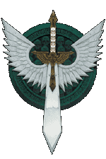
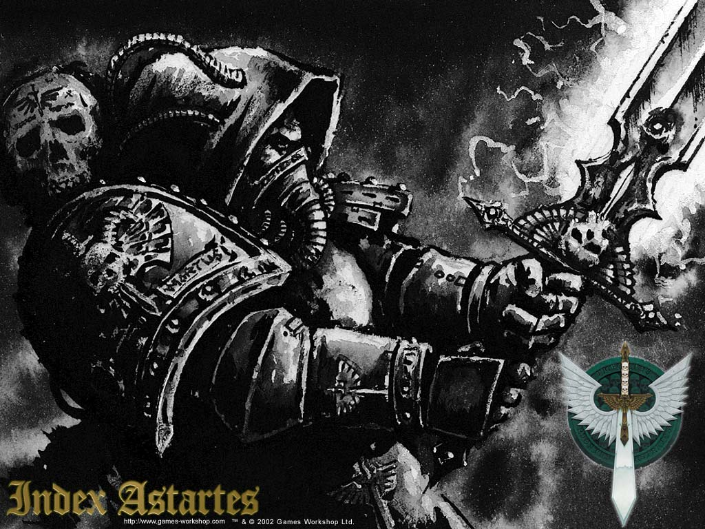
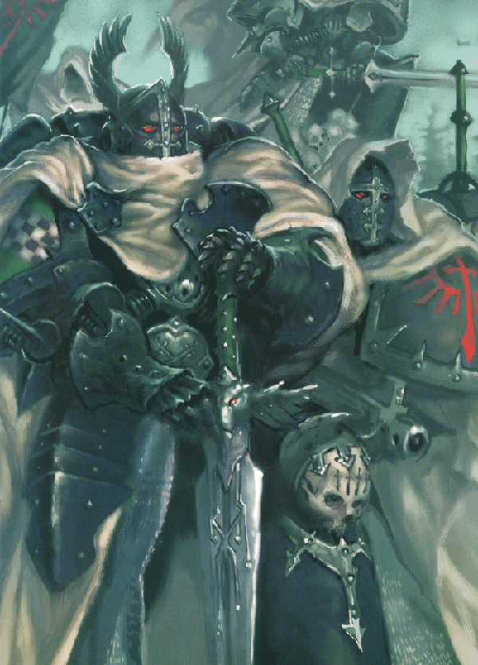
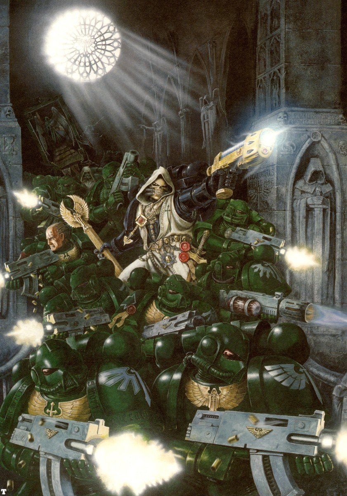
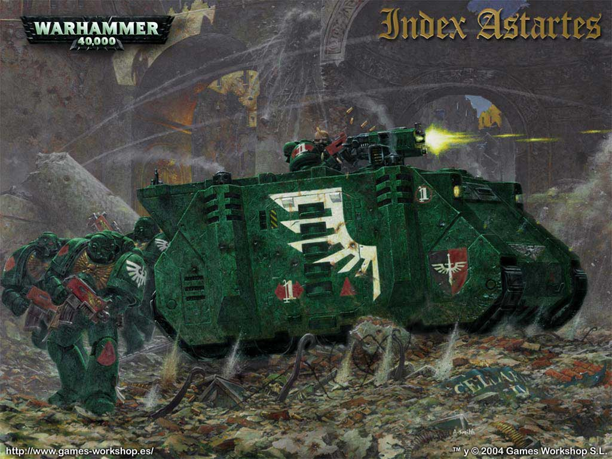

# 暗黑天使军团（Dark Angles）

不予宽恕

暗黑天使星际战士战团

帝国诞生，军团创建以来，暗黑天使星际战士们便为敌人所畏惧，为受庇护者所敬畏。暗黑天使们在战斗中顽固而无情，以永远的警惕和热诚履行着他们义务，是帝王最忠实的仆从。但是，一万年来，暗黑天使们深埋着一个凶险的秘密，一项如此恐怖而耻辱的行为，足以威胁暗黑天使全力捍卫的一切，并将他们拖入万劫不复之境。

## 起源

初创战团的真实起源，与帝国诞生、神样的帝王在凡人间行走的那个传奇时代，有着密不可分的关系。那个时代的真相恐怕已永远迷失在久远的岁月中，只剩下古老的传说被智库馆长们保存在战团史籍中，或许也在神圣地球上，圣图书馆那绵延无尽的拱廊间。可惜，相对于万年史书的厚重，史实难得一见而推测俯拾皆是。真理总是罕见，我们也只能得到如下一点点真相。

暗黑天使有着成为第一个星际战士军团的荣誉，由帝王一手创建，用以协助自己完成远大圣战，从而将人类从异星和邪神的统治下解放出来。他们的胜利成为传奇的蓝本，他们在无数人心目中是最优秀的星际战士，如果不计关于战团的历史，不胫而走的流言的话。所有初创战团的特征都深受其基因原体，或第一人的个性影响，暗黑天使也不例外。

星际战士的智库馆长们掌握着帝王创造第一批基因原体的事迹。他们讲述着帝王是如何以神授的力量，以摧枯拉朽之势重新统一地球上分裂战乱的部族，并引导他们走向光明。帝王知道，将在战乱年代分散到银河各处的全人类归为一统的时机，即将到来。他也知道，这样的壮举不可能独力完成，即使如他一般强大的人也无法事必躬亲。因此他开始塑造基因原体，或称第一人。他们是他的骨血，但并非简单的克隆。每一个基因原体都被精心塑造为人类的领袖，一个斗士，一个智慧与力量、肉体和灵魂并重的英雄。这些帝王后裔将领导人类摆脱黑暗的威胁，步入一个黄金时代。

但是，我们了解到，帝王在月球上的工作尚未完成，灾难便降临了。未出生的基因原体失踪了，离散于漫天繁星之中。关于基因原体的失散，出现了很多故事和传说。一些说，邪神预见到帝王的计划，于是设法毁灭他们未来的敌人，却只是打散了他们。另一些说，是帝王自己使基因原体在银河中漂泊，这样他们就能离开实验室的保护，真正学会独力生存。其他的却坚持说，是新生的基因原体自己选择离开帝王的保护，独自寻求知识。

看来，恐怕只有帝王本人才知道真相。我们又了解到，此后，他开始转向用已丢失的基因原体遗传模板进行基因强化和人类身体改造。通过这种方式，第一个星际战士军团被创建出来，追随帝王征服银河的，正是他们。

暗黑天使智库馆长回忆着有关他们基因原体的古老传说，他在他们失落的家园，美丽而蛮荒的世界――卡立班【Caliban】被发现，并将以 里昂?艾 庄森【Lion El'Jonson】的名字走上历史舞台。混乱领域的异变和腐蚀诅咒着卡立班，将她变为银河中最致命的死亡世界。不论如何，婴儿期的基因原体都应在到达后的几分钟内死亡。他是如何活下来已不可知，因为Jonson从未提起他早年在卡立班的经历。

人说卡立班的居民乃是骄傲尚武之人，只以剑为生，只死于剑下。卡立班的大地被幽深的森林覆盖，里面栖息着各种各样被混沌所扭曲可怕野兽。这些怪兽的凶残迫使行星上的居民在森林砍伐出大片空地，建造用以居住的石质要塞，卡立班的精锐战士统辖着这些城堡。

在卢瑟的简述中，一队来自叫做Order的团体的骑士，他们在森林深处发现了幼年的基因原体。他们领队，名为卢瑟的年轻男人，他将基因原体带回Order的修道院要塞，并给他取名里昂?艾 庄森【Lion El'Jonson】，在卡立班语的意思是“狮子，森林之子”。庄森很快适应了人类的生活，了解了民族风俗，在短时间内便融入了家园的社会。时光流逝，庄森和卢瑟的关系已亲如手足，两个人都在设法使另一人的能力和技巧得到完善。他们开拓和胜利的故事在卡立班四处流传，希望加入Order的青年也一年比一年多。

帝国学者确信，庄森领导了一次横扫行星的远征，直指在森林深处徘徊的混沌和堕落。所有修道院的大导师都加入了庄森和Order的圣战，不到十年便使整个世界摆脱曾经肆虐无忌的黑暗力量。从残暴景象解放的卡立班被选定为暗黑天使的家园。Order的战士争先入团，不久所有Order成员都成为了星际战士。人们确定，卢瑟是第一个接受强化的，在军团中的权势仅次于庄森。帝王带领卡立班继续远大圣战，他带走了庄森和暗黑天使军团的大部分战士。卢瑟和军团剩下的部队留下保护家园，防备混沌的再临。这些资料在帝国档案中有据可查，但是暗黑天使军团的留守者的最早历史和他们恐怖的叛变被精心掩藏。只有暗黑天使的核心阶层，或许还有审判庭的最高级成员，知道将来卢瑟叛变和军团分裂之事。

::: tip
下面内容比较郁闷，插播个小故事
:::

狮与狼

银河中最出名的传说来自暗黑天使和太空野狼的竞争，这要回溯到远大圣战的时代。在星际战士各军团在帝国边境上推进时，每个基因原体都尽力在帝王眼里胜过他人，莱曼?鲁斯【Leman Russ】，太空野狼的基因原体，自然不例外。只有何路斯和里昂?艾 庄森能比他取得更多胜利，这成为他长久以来的心病。在Dulan世界，太空野狼和暗黑天使并肩作战，故事便就此开始了。暴君Durath亲自侮辱了帝王，将数以千计的帝国牧师献祭给他的恶魔主子，鲁斯和庄森渴求着斩杀这异教徒的荣誉。Durath公然叫嚣，说鲁斯是帝王的吧儿狗，拿来喂他的宠物Grox再好不过，这更使顽固不化的太空野狼基因原体暴怒不已。

鲁斯发誓要砍飞Durath的头，并要求暗黑天使允许他立即放手突击那个暴君的腥红要塞。而庄森多日以来不断侦察要塞，寻找弱点，仔细策划攻击计划，自然不会让头脑发热的野蛮人破坏他精心设计的方案。他拒绝了鲁斯的要求，并开始突击，以极少的伤亡扫荡了要塞。鲁斯在护墙下陷入拉锯战，只能眼睁睁地向要塞高墙上的庄森和Durath怒吼。在战斗结束后鲁斯冲入要塞大厅，并照着庄森的脑袋就是一下。于是两个基因原体练了整整一天一夜的摔交，谁也不能放倒对方。

最后，两个对手摔开对方，鲁斯开始为刚才的可笑举动大笑。庄森则保持沉默。他将鲁斯那一拳看作逆行，在太空野狼基因原体大笑时，庄森突然发难，猛击过去。这下，他才觉得自己荣誉得到了维护。倒地不起的鲁斯则被手下扛出要塞，当他恢复意识时，他已经错过了Alisore战役。鲁斯赌咒发誓要为名誉受损报复，从此以后，不论何时何地，太空野狼和暗黑天使见面后，都会直呼对方号码，重打基因原体们古老的决斗，以此来恢复自己的荣誉。

## 背叛

远大圣战继续着，一个个世界被暗黑天使们收复。庄森的胜利和威名传遍了银河的每个角落。在卡立班，每一个关于他兄弟在战场上的勇气和战技的传说，都在将卢瑟心中的一星嫉妒和不平的灰烬，燃成熊熊怒焰。他自认是被遗忘的星球的门房看守的想法日益强烈，竟变成对他荣誉的严重侮辱，曾经的高尚骑士卢瑟，早已沉没在痛苦和敌意的泥沼里。

当何路斯叛变爆发，许多星际战士军团背叛帝王时，庄森正和太空野狼的基因原体莱曼?鲁斯在银河远方合力战斗。当两位基因原体得知何路斯叛变后，他们摒弃前嫌，集合军团向地球行军。但是，远航漫长而坎坷。因此他们赶到时，地球上的战斗已经结束，叛徒已被击败。胜利的代价是惨重的。帝国化为残垣断壁，帝王身受重伤，不得不进入黄金王座的生命维持设备。庄森被自责和悲伤所折磨，因为他没能在何路斯反叛时保护帝王，在哀伤中，他在多年后首次返回卡立班。

但是，在暗黑天使们的舰船经过艰辛的跋涉，终于进入家园的轨道时，行星表面爆发出一轮毁灭性的火力齐射，使残破的战舰如同流星一般陨落，在天空中燃烧。舰队在迷惑不解中撤离行星，庄森则设法寻找遭受攻击的原因。暗黑天使们即将会发现一个令人震惊的，关于背叛的传言。这传言在此后一万年中都将是暗黑天使不择手段加以掩盖的可怕秘密。

几十年来，卢瑟已污染了卡立班的战士们，将他的痛苦和嫉妒散播给他手下留守的暗黑天使们。他有力的讲演扭曲了他们，让他们陷入对偷走他们的荣誉，抛弃他们，让他们当看门狗之人的无理憎恨中。像何路斯何其他叛徒一样，卢瑟已经被混沌的阴险引诱所污染。他的自大和骄傲正好为邪神所用。

我们只能凭空猜测，那时的基因原体会做何感想，庄森曾和帝王在银河中并肩战斗，使得无数行星摆脱混沌的污染，现在却看到自己深爱的家园沦入同一邪力之手。当他发现真相后，他的狂怒令人无法正视。他的舰船开动，不顾行星防御系统的反击，开始残忍地轰炸行星的地表来摧毁背叛他的人。舰船和防御炮塔向对方倾泻着日炙般的怒火，使得森林燃烧、大地震颤。随着防御系统逐渐崩溃，庄森下令登陆，并亲自带队突击卡立班，复仇的渴望烧灼着他的心。

堕落的暗黑天使们利用Order庞大的修道院要塞作为掩护，Jonson则带领自己的战士攻打自己的家乡，他知道，卢瑟正等着他。

基因原体面对着昔日兄弟，发现他早已迷失了本性，黑暗的能量已然摧毁了那曾经可敬的人。基因原体是人间之神，而卢瑟则被混沌的能量强化，在任何方面都和他不相上下。两个战士开始战斗，这战斗似曾相识（kv85：就像帝王和何路斯的战斗），可惜无人有幸目睹。Order的古老家园在他们史诗般的战斗中化为瓦砾，暗黑天使舰队也继续对行星进行轰炸，摧平了所有残存修道院的营垒。卡立班的地面在一刻不歇的破坏下开始破裂翘起，暗黑天使的狂怒使他们失去了理智，浑然不知自己正对自己的家园倾泻着毁灭。

只有暗黑天使的导师了解更多内容，可他们守口如瓶。但是，古老的不朽Astartes手卷【Codicium Astartes Mortis】抑或死亡天使之书【Book of the Angle of Death】描述了卢瑟和庄森间的战斗。“\[他们\]以超越凡人之力战斗，在所有方面皆势均力敌，除了目的和决心……卢瑟终于失误了，他的脖颈暴露在他兄弟的\[正义之刃之下\]。当卢瑟倒下时，庄森高举起佩剑，但是\[即使他如此愤怒\]还无法使他挥出那致命的一击。卢瑟没有这样的顾虑，在庄森犹豫不决时，他释放出邪恶的灵力，重伤了基因原体……卢瑟伫立\[在里昂面前\]，在看着基因原体挣扎站起时，他的脸因痛苦而扭曲，邪恶的蒙蔽离开了卢瑟的双眼，完全释放出对自己变节行为的恐惧。他不止抛弃了他的朋友，他的军团和帝王，他已背叛了内在的高尚自我。他丢开他的武器，颓倒在庄森身边，他的神智被他罪恶的行为粉碎了。

在卡立班周围，次元开始扰动，已被封闭的黑暗能量再度释放出来。如果记录无误的话，其庞大无匹的狂怒直接撕裂了卡立班周围的正常空间结构，一场狂暴的次元风暴自裂口汹涌而出，吞没了整个行星。

次元能量释放出来形成了横扫整个卡立班的漩涡。强烈的地震遍及整个星球，毁灭了行星地壳，使之崩解开裂。暗黑天使舰队无情的轰炸已使行星变得脆弱，在他们的惊恐中分崩离析，面目全非，她死亡时产生的残骸被次元吸入。整个卡立班上只剩下Order修道院要塞的废墟。

暗黑天使坚持，废弃的要塞空无一人，但是不朽Astartes手卷指出：“当暗黑天使来到废墟之中，他们发现了卢瑟，蜷曲如胎儿，不断重复着同一话语。他一遍又一遍的告诉暗黑天使们，\[黑暗观守者\]已带走了基因原体，当卢瑟的罪恶得到宽恕之日，便将他送回。星际战士们努力搜寻周围飘荡的星体，但没有任何关于他们基因原体的线索。里昂?艾 庄森就此踪影全无。”

随着卡立班的陨落，战团的高级成员召集了一次秘密会议，决定所有关于他们战友堕落的线索必须永远由他们严守。他们战团的分裂或暗黑天使星际战士坠入混沌之事将对所有人保密。一旦恐怖的秘密为世人所知，战团将永远失去抹去这一污点的所有希望。

战团最资深官员组成的核心圈层【Inner Circle】成立了，每个人都立下毒誓，以防泄密。卢瑟的叛徒们，堕落的暗黑天使们，在那次大灾难中消失在次元深处，邪神的愤怒将他们在时间和空间上四散分离。在所有堕落的暗黑天使被逮捕和忏悔前，里昂真正的子嗣不会停息。只要还有一个堕落者还活着且没有忏悔，战团便不被宽恕，被他们的兄弟所诅咒，要为过去的罪永远赎罪。

::: tip
累了，插播小资料
:::

AZRAEL指挥官

暗黑天使大导师

（kv85:AZRAEL即司掌死亡的天使）

众所周知，暗黑天使最优秀的战团导师来自Kimmeria蛮荒世界的野蛮猎头部落。他的野蛮天性被战团所调和，随即他便证明了自己是高尚而可敬的战士。作为低阶战士他在Truan IX的侦察中打过多次胜仗，在Faze V击溃技术复兴分子骚乱的战斗中晋级为战地指挥官【Force Commander】，这次行动使他受到战团导师的许多赞许。随着他不断取得胜利，很快便受到死亡之翼的关注，并接受第三连队指挥权。作为这个连队的队长他参加了无数战役，广收同袍尊敬，在917.M41正式成为死亡之翼的导师。

暗黑天使大导师从核心圈层秘密选择他的接班人，当战团大导师于939.M41去世后，Azrael顺理成章的接替了他。Azrael接受了暗黑天使最为珍贵圣物，狮盔【Lion Helm】和奥秘之剑【Sword of Secrets】，还有大导师徽记。从此，他被尊称为真相守护者【Keeper of the Truth】。Azrael领导战团投入一场又一场战斗，他高尚的行为和无瑕的荣誉成为所有战友树立了榜样。

## 家园

在卢瑟和庄森惊天动地的战斗之后，卡立班只剩下Order的修道院要塞的废墟耸立在一块巨石上。暗黑天使将岩床钻凿通透，重建被毁的要塞，将被毁的星体改造成他们的新家，称作天使之塔【The Tower of Angel in High Gothic】，俗称巨石【the Rock】。里面建有连绵不绝的隧道、厅堂和石室，而次元引擎的建成使巨石能够在星系间移动。因此，巨石从不在任何一地久留，这造成暗黑天使的新兵来自条件各异的世界。所有新兵都接受过彻底筛选，一旦成为暗黑天使，他就要和从前的生活永别。他的一切都属于战团。

许多阴暗的秘密藏在天使之塔中。几个世纪来从未开启的地牢、以精金大门与圣印封闭的秘洞里面，封存着浩如烟海的上古技术档案。只有最为资深的暗黑天使成员，比如导师和核心圈层成员才知道这些洞室的存在，能够解开其中恐怖的秘密。

## 战斗信条

在何路斯叛变后星际战士军团开始解散，暗黑天使按照罗保特?基里曼【Roboute Guilliman's】的Astartes圣典被拆分成战团。除了死亡之翼和黑鸦之翼，暗黑天使遵从标准的星际战士战斗信条，他们在绝对劣势下的顽强坚守成为了传奇。在其他星际战士可能会后撤的战况下，暗黑天使会血战到底，决不将阵地丢给敌人。这也反映在他们面对敌人时会顽固地拒绝转移，即使如此做在战术上有利。

暗黑天使对于非人种族的偏见同样声名远播，会拒绝和任何包括异星种族的军队合作战斗。他们高度怀疑外人，往往无任何理由便避而远之或不予合作。事实上，暗黑天使与帝国审判官和传教士意见不合时会毫无理由的从战场上撤退，此情况已多次发生。

## 组织结构

对外来者来说，暗黑天使的组织与其他圣典战团没什么不同，战团共十个连队，每连一百人。在高级指挥部门方面暗黑天使和其他战团大为不同。每个战团都有一批独立于星际战士主力部队的资深军官和专业部队，暗黑天使中，这些人成员称作核心圈层。只有在战团长年战斗，一次次证明自己的忠诚的战士才能进入核心圈层。正是这些隐秘之人肩负着暗黑天使不为人知的耻辱，也只有他们能自行决定谁有资格加入他们。

暗黑天使的前两个连队与其他圣典战团差别最大。第一连有着死亡之翼的威名，是全体身着白骨色终结者装甲进入战场的资深战士。他们的盔甲原本是黑色的，但是，当一个终结者班组孤军奋战，使家园免于基因盗取者的入侵之后，他们的盔甲被永久改为白色，以此表彰他们的勇敢。第二连队是黑鸦之翼，是速攻战术的大师。所有战士都骑乘摩托或兰德速攻艇，其基本组织是包括五部车辆的中队，而不是十人班组。黑鸦之翼的盔甲颜色漆黑，而非暗黑天使通用的暗绿色。

## 信仰

暗黑天使赞美人的帝王，但不将他尊为神明，这令教廷司事大感苦恼。类似很多初创战团，暗黑天使像崇敬帝王一样崇敬其基因原体：帝国缔造者和他们的创造者。对于暗黑天使来说，帝王是人而非神。

战团行动的主要动机是猎捕堕落的暗黑天使，他们都被摧毁卡立班的漩涡所卷走。只有捉拿到所有堕落天使，才能使暗黑天使在帝王眼中洗去耻辱。堕落者在时间和空间上都已被打散，因此暗黑天使持续了一万年来的任务还远未完成。在这一目的的驱使下，他们会对一切风声大肆追查，不管多么缥缈不定的信息，都给他们提供了一个捉回堕落者的机会。一旦有人被捕，他会被带回巨石，投入最深暗的地牢，在那里，可怕的质问者牧师使出浑身解数，逼迫他为他过去的罪忏悔。如果他忏悔，他的死亡将迅速且无痛，一旦他拒绝，牧师将被迫动用一切手段逼迫他忏悔。通常，这会导致堕落者的死亡，为了将他的名字录入救赎之书，这只是必需的小小代价而已。

## 基因种子

作为第一个星际战士军团，暗黑天使的基因种子是最为纯净、异化程度最低的。随着何路斯叛变，星际战士军团拆分，暗黑天使分出了三个衍生战团：赦免天使、拯救天使和复仇天使。这些战团都以不予宽恕者为名，并继续进行其原体战团猎捕堕落者的工作。

暗黑天使基因种子无任何已知畸变，使得帝国最高议会为取得他们的基因种子创建新战团而大费周章。勿庸置疑，暗黑天使还有其他的衍生战团，但他们的名称和创立时间尚未记录。

## 统一战吼

“忏悔罢！明日即汝死期！”【"Repent! For tomorrow you die!】

