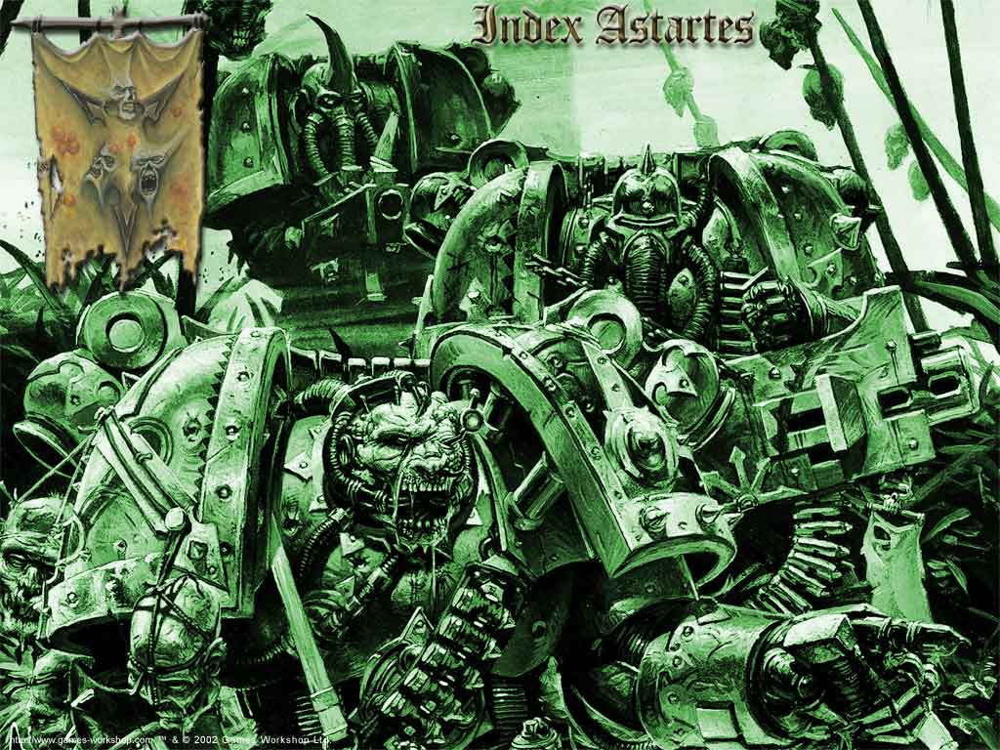
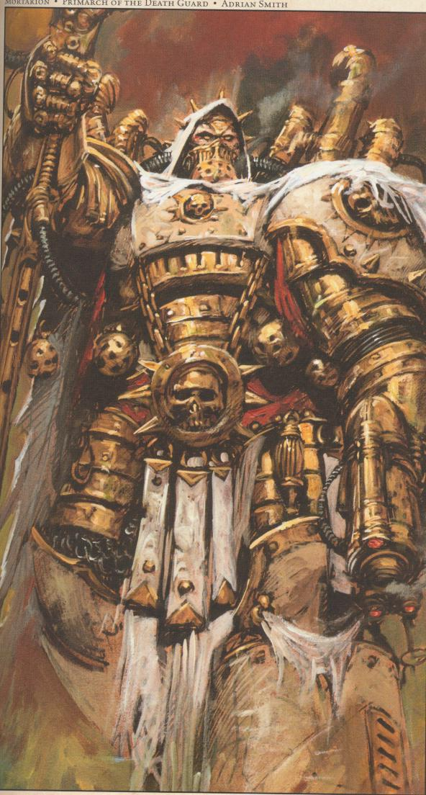

# 死亡守卫（Death Guard）

Death Guard，死亡守卫，可怕的瘟疫散布者

## 失落的被诅咒者

死亡守卫军团，Ｎｕｒｇｌｅ手下那群令人畏惧的瘟疫战士，对所有帝国子民而言都是一场永无休止的恐怖天灾．但在上万年前，死亡守卫军团曾是最初的２０个星际战士军团之一，他们团结在皇帝和他们可怕的军团长Ｍｏｒｔａｒｉｏｎ旗下，保卫着全人类的安全．

## 起源

当皇帝的２０个军团长们还在襁褓之中，被分散在银河的各个角落之时．冥界卷轴预言其中一人将会降落在一块萧瑟的荒野之中，在他的周围尸骸遍地，四处尽皆屠杀后遗留的残肢断臂．他降落的星球名为Ｂａｒｂａｒｕｓ，常年笼罩在瘴气之中．各个悬崖峭壁均被面容狰狞、法力高强的军阀们统治着．而那些万年前在此定居的开荒者们，拥挤在最低层的山谷中，以躲避笼罩在他们头上令人窒息的雾气．他们生活在永久的恐怖中，靠着微弱的连雾气都无法完全驱散的阳光来种植作物，勉强维持生活．在日落之后，他们蜷缩在火光边瑟瑟发抖，躲避着那些从永无至尽的黑暗中掠过的不名生物．

最强大的领主傲视着尸横遍野的战场，享受这场屠杀带来的快感．突然，一阵婴儿的哭嚎打破了战场的寂静．传说那名军阀被婴儿的哭声所吸引，他踏遍尸海，不分昼夜地寻找哭声的来源．当他找到那婴儿时，他本想立刻结束这年轻的生命，但转念一想，没有几个人能在Ｂａｒｂａｒｕｓ的瘴气中正常呼吸，更不用说像这孩子一样放声大哭．长时间的思考之后，他意识到这孩子绝非常人．虽然这个领主有着强大的黑暗力量，但这个孩子给了他一个力量没有赐予他的东西：儿子，同时也是继承人．由于这婴儿降生在死亡的拥抱之中，出现在遍步死亡的战场，领主将他命名为Ｍｏｒｔａｒｉｏｎ，意为死亡之子．

领主决定测试这婴儿的极限．在仔细思考这婴儿能抵御何种程度的毒云侵害后，他在最高的悬崖上建立了一座要塞，并用黑铁加固．同时他又把自己的住宅搬入这所要塞之中．在这个地方，大气的有毒程度即使对年幼的军团长也是致命的．Ｍｏｒｔａｒｉｏｎ就在这样的环境里成长：灰色岩石构成的要塞，坚铁铸成的围栏，空气令人窒息，太阳看上去不过是个天空中遥远的污点．而外面的世界则是永不停息的战争――其他的领主统领着尸块拼凑成的魔像大军前来进攻要塞，之后又是扭曲的变形者军队．为了生存，Ｍｏｒｔａｒｉｏｎ谦卑而又如饥似渴地向他的主人学习一切，一切他的主人可以教给他的东西．Ｍｏｒｔａｒｉｏｎ贪婪地学习一切：从战争的艺术到奥术的秘密，从个人的战斗技巧到全局战略．他在这样艰难的环境里成长，学习――作为皇帝的儿子，他有超人的抵抗能力，能够抗拒毒气的侵袭；他有着超人的体魄，在阳光和营养缺乏的环境下依旧能茁壮成长．Ｍｏｒｔａｒｉｏｎ的思维高度敏锐，领主提出的问题他全部能够一一解答．

渐渐地，这些问题开始集中于那些生活在下面的山谷中的脆弱生物上．军阀们通常捕猎这些人类，把他们的尸体复活成不死军队，或者用来活祭．Ｍｏｒｔａｒｉｏｎ的领主尽可能地让他远离这些人类定居点，但是领主的禁令却引发了他的好奇心．终于有一天，禁令被打破了，他通过要塞的地牢偷偷溜下了山．他最后一次听到的来自要塞的声音是他的“父亲”的怒吼．他听见领主在黑暗中咆哮，称他为叛徒，警告他只要回去就会死无葬身之地．

浓雾之下对于Ｍｏｒｔａｒｉｏｎ来说是一个完全的新世界：他的肺第一次呼吸到新鲜空气而非毒气，空气中弥漫着饭菜的诱人味道，以及刚被收割过的庄稼的清香．他的耳朵第一次听到未被浓雾扭曲的声音，第一次听到笑声．年轻的军团长意识到，这才是他的同类，这些军阀口中的“脆弱的猎物”才是他的同类．伴随着觉醒的是突如其来的愤怒，他决心领导这些农夫向蹂躏他们的黑暗势力讨还血债．

农夫们并没有简简单单地接受Ｍｏｒｔａｒｉｏｎ．虽然他觉得自己是这些人的同类，但在他们眼里，他却和来自上顶的怪物没什么区别．他比定居点最高的人还高出一截，面容憔悴，闪烁的双眼难以掩饰他心中的恐惧．Ｍｏｒｔａｒｉｏｎ吓坏了大部分居民，他们用怀疑而畏惧地看着他．这种眼神刺伤了年轻的军团长．但他没有放弃，而是用他惊人的力量来帮助居民们收割庄稼，等待证明自己的机会．很快，机会就来了，就在黄昏时分．

黑暗的侵袭伴随着夜幕一同降临．一个比较弱小的领主带着他僵尸般的军团杀进了居民点．这群寂静无声的冷血杀手毫不犹豫地执行主人邪恶的指令．农民们且战且退，用火把和农具竭力保卫自己的家园．没有人逃跑，即使这样的抵抗毫无意义，也没有人愿意放弃自己终生为之奋斗的家．他们心里都明白自己的运气到头了，但依然坚持无谓地战斗下去，直到Ｍｏｒｔａｒｉｏｎ突然出现在他们中间．

高大的年轻人握着一把双手巨镰冲向敌人，愤怒激发的力量让他势不可挡，黑暗的仆役们在他的怒气下溃不成军，纷纷败退．黑暗领主一边轻蔑地嘲笑着Ｍｏｒｔａｒｉｏｎ，一边躲上了毒瘴遍地的高山，以为这些人类无法找到他．可是Ｍｏｒｔａｒｉｏｎ却突然出现在他面前，挥动镰刀为那些“脆弱的猎物”报了仇．

此战过后，Ｍｏｒｔａｒｉｏｎ在居民心中的地位再无人置疑．
随着他长大成人，Ｍｏｒｔａｒｉｏｎ开始教导这些居民关于战争的知识．他的名气越来越大，许多人慕名前来学习．慢慢地，一个个村落变成了据点，村民们成为了强悍的战士．而Ｍｏｒｔａｒｉｏｎ在各个居民点间旅行，传授知识，支援建设，必要时出手相助．可是他最终的目标却始终无法实现：黑暗势力一旦败退，便立刻遁入毒雾的庇护中．Ｍｏｒｔａｒｉｏｎ的人民们只能防御，无法主动出击．

Ｍｏｒｔａｒｉｏｎ决心改变这一切．他征召了Ｂａｒｂａｒｕｓ上最强壮结实的居民，把他们编制成小规模作战部队．他不只教他们防御，还教他们如何进攻．他将铁匠铺进行改建，使它们可以随时从一种工具生产作坊转变为生产武器和甲胄的兵工厂．他找到最好的工匠，同他一起解决毒气的问题．

审判官Ｍｅｎｄｉｋｏｆｆ的文献《死神的骑士》中提到了这一研究工作的辉煌成果．当又一个军阀从山顶下来劫掠时，村民们奋勇反击将他击退．他试图带着他邪恶的仆从撤回山上，但Ｍｏｒｔａｒｉｏｎ和他的战士们戴上了呼吸面具，追入了雾气之中．在居民们的记忆中还从未有过这样的事：“猎物”们在死亡的领域里大肆散播死亡，杀死军阀，屠戮他的军队．Ｍｏｒｔａｒｉｏｎ在此战后一直在改进他的呼吸装置，直到他成为死亡守卫的首领，带领他的军队在更黑暗的世界里作战，对抗更可怕的瘟疫，这改进始终没停止下来．长期暴露在有毒环境中使死亡守卫们的体质更加坚韧，而这些基因又传给新一代死亡守卫．．．

只有一座毒气弥漫的山峰曾迟滞过Ｍｏｒｔａｒｉｏｎ和死亡守卫的脚步．当他们花费数月翻越遍布毒瘴的山脊时，Ｍｏｒｔａｒｉｏｎ惊讶地发现自己站在一座熟悉的巨宅前．可怕的记忆一下涌向Ｍｏｒｔａｒｉｏｎ，迫使他选择撤退．然而，他的世界注定要再一次脱离他的控制．

Ｍｏｒｔａｒｉｏｎ和他的同伴们回到村落，却发现村民们看起来很不正常．每个人都在谈论一个陌生人的到来，这个大恩人向他们承诺：他们会获得拯救．Ｍｏｒｔａｒｉｏｎ的心情很糟糕，他的一生都在为拯救这些村民而奋战．可他获得胜利的这天竟冒出个来历不明的家伙夺取了村民对他的信任！说书人们说Ｍｏｒｔａｒｉｏｎ撞开村落大厅厚重的木门，在宴会上落座后，却发现长老们和那个陌生人坐在一起．那个陌生人与Ｂａｒｂａｒｕｓ上的居民看起来千差万别：他们看起来苍白憔悴，而他看起来健壮结实，他有着古铜色的肌肤，完美的身形．村民们向Ｍｏｒｔａｒｉｏｎ致敬，欢迎他胜利归来．在村民们看来，虽然他们的大英雄Ｍｏｒｔａｒｉｏｎ的身体遭受了毒气的侵害，但仍与这个陌生人有诸多相似之处，他们看上去像一对父子．然而Ｍｏｒｔａｒｉｏｎ却没有这种感觉，他带着毫不掩饰的敌意向陌生人问好．陌生人的镇定则让Ｍｏｒｔａｒｉｏｎ变得更为恼怒．长老向Ｍｏｒｔａｒｉｏｎ介绍，说这个陌生人承诺，他将会把Ｂａｒｂａｒｕｓ的人民带入一个全人类和谐互助的大家庭中，帮助他们脱离现在的苦难．这些话使Ｍｏｒｔａｒｉｏｎ愤愤不平，他自己辛苦夺来的胜利在村民心中竟不如一个陌生人的空话！他握住巨镰的手越来越紧，指节开始泛白．他宣布他和他的死亡守卫不需要任何人的援助，一样可以完成他们行使正义的使命．

据说这个救世主平静地对暴怒的军团长所说的话表示质疑，并指出死亡守卫未能成功攻陷最后一个要塞．如果Ｍｏｒｔａｒｉｏｎ能单独对付最后一个军阀，他就会立刻离开Ｂａｒｂａｒｕｓ．但如果Ｍｏｒｔａｒｉｏｎ失败了，他们就必须加入他的帝国，而Ｍｏｒｔａｒｉｏｎ必须发誓向他效忠．

虽然死亡守卫们纷纷劝阻Ｍｏｒｔａｒｉｏｎ，但他仍然独自迈向最后一座与他作对的要塞，那个曾被他称为“父亲”的人所统治的要塞．虽然Ｍｏｒｔａｒｉｏｎ的内心深处知道自己无法在Ｂａｒｂａｒｕｓ顶峰生存，但他选择无视这一事实．Ｍｏｒｔａｒｉｏｎ逐步走向最高的山峰，他想尽快解决他与“父亲”之间不可避免的冲突，他想为他身边的人民伸张正义，当然，他最想做的就是在那个陌生人面前证明自己的誓言．

最后一战是如此的短暂而冷酷．Ｍｏｒｔａｒｉｏｎ的呼吸面具在毒气中开始腐烂，他挣扎着吸入空气，打破要塞的每扇大门，向领主挑战．他最后看到的一件事，是他自己跪了下来，世界变得灰暗，而他的“父亲”正站在他面前，打算履行自己的誓言．在这千钧一发之际，陌生人横在了他们中间．他的出现驱散了弥漫的瘴气，而他的剑锋结束了领主的生命．

Ｍｏｒｔａｒｉｏｎ兑现了自己的诺言．当他康复后，他向陌生人下跪，宣布他和死亡守卫都会向陌生人效忠至于．此时皇帝道出了自己的身份：他便是Ｍｏｒｔａｒｉｏｎ的真正父亲．他委任Ｍｏｒｔａｒｉｏｎ为星际战士第１４军团总指挥．

在《ＬｉｂｒａｍＰｒｉｍａｒｉｓ》（军团长之书）中介绍了Ｍｏｒｔａｒｉｏｎ是如何将他自己冷酷无情却又灵活多变的天性移植到了死亡守卫军团的基因中，而死亡守卫们又是如何适应了他的基因特性．从转移了他的基因之后，死亡守卫成为了以最英勇无畏而著称的一支军团，而Ｍｏｒｔａｒｉｏｎ也从来都是身先士卒勇敢作战．Ｍｏｒｔａｒｉｏｎ是一个冷酷且从不懈怠的军团长，他东征西讨，对帝国的敌人毫不容情．可是他与其他军团长的关系简直形同路人．在暗黑天使智库馆长Ｂｅｌｌｅｒｏｐｈａｎ的阴影日记中提到：惟独两个军团长能与Ｍｏｒｔａｒｉｏｎ愉快地相处．一个是暗夜领主军团那可怕的首领：暗夜游魂（ＮｉｇｈｔＨａｕｎｔｅｒ），另一个则是帝国主帅，皇帝的左右手何露斯．何露斯最为赏识死亡守卫的能力，通常在战斗中他都请Ｍｏｒｔａｒｉｏｎ防守战线的核心．死亡守卫的防守阵势可谓不动如山，而此时影月苍狼或是暗夜领主则如同一支巨大的铁锤一般砸向敌人，把敌人在由死亡守卫构成的铁砧上击得粉碎．这是一个相当有效率的战斗组合．

富有魅力的主帅在Ｍｏｒｔａｒｉｏｎ眼中是一个良师益友，他懂得Ｍｏｒｔａｒｉｏｎ的目标，也欣赏他的行事方式．Ｍｏｒｔａｒｉｏｎ与何露斯的关系走得如此之近，以至于极限战士的ＲｏｂｏｕｔｅＧｕｉｌｌｉｍａｎ和暗鸦守卫的Ｃｏｒａｘ向皇帝进言，提醒皇帝注意这二人的关系，以及死亡守卫的忠诚度．在皇帝看来，Ｍｏｒｔａｒｉｏｎ以前的行为早已证明了他的忠贞不二，虽然与Ｍｏｒｔａｒｉｏｎ与何露斯的关系过度密切是众人皆知．但皇帝宣布忠于何露斯就是终于皇帝本人，此事便不了了之．

## 背叛

在那炼狱般的行星Ｄａｖｉｎ上，帝国主帅和他的军团一同堕入混沌势力的掌控之中（讽刺的是，为了表彰何露斯的功绩与忠诚，影月苍狼刚刚被更名为何露斯之子）．在他们离开Ｄａｖｉｎ之前，何露斯已经完全被混沌邪神腐化占据．对皇帝的忠诚被抹杀，代之以对混沌邪神的无限忠诚，和对自己地位权力的无尽渴望．半数的军团长带着他们的战士加入了何露斯的叛乱．在叛乱结束后，Ｃｈａｒｏｎ议会被召集起来调查事件的原因．在他们保留的手抄本中提到，何露斯没有举行任何亵渎的仪式以使混沌占据Ｍｏｒｔａｒｉｏｎ的的思想．他向Ｍｏｒｔａｒｉｏｎ承诺，在他的统治下，旧的秩序将会被颠覆，而一个崭新的纪元即将到来――他们将以自己强大的力量来行使正义．如同多年前背叛Ｂａｒｂａｒｕｓ的领主一样，Ｍｏｒｔａｒｉｏｎ背叛了帝国，加入这场使帝国一蹶不振的叛乱：何露斯之乱．他当时还不知道自己将为此付出什么样的代价．

何露斯确实是一位杰出的战略家．他深知帝国的心脏乃是Ｔｅｒｒａ（地球）．在叛乱的过程中，他的目标始终就是地球．很快他便集结了一支足以轻易撕破帝国的多层防线的强大武力，打算长驱直入，一举攻陷皇宫．根据他的计划，Ｍｏｒｔａｒｉｏｎ将和死亡守卫一起前往地球，同他并肩作战．Ｍｏｒｔａｒｉｏｎ带领他的整支舰队驶入亚空间――他们并没有直接到达地球，而是飞入了一个永恒的噩梦之中．

死亡守卫舰队陷入一场无比庞大的亚空间风暴．导航员无法带领舰队从中穿过，也无法找出回到真实世界的安全通道．舰队在非物质空间中漫无目的地漂流，而此时，潜藏在亚空间中的毁灭者已经找到了他的猎物．

对Ｍｏｒｔａｒｉｏｎ和死亡守卫的战士们而言，没有比这次瘟疫更可怕的东西――在它面前他们传奇般的强韧免疫能力完全无用．虽然他们曾经征服过无数个常人根本无法立足的可怕世界，虽然他们曾经面对过各种疫病、传染源、毒气和污染，但这次的形势之恶劣让死亡守卫也束手无策．它在整个舰队中蔓延，摧毁他们曾经坚定不移的意志，吞噬他们曾经健壮无比的身体，把他们改造成恐怖怪异的行尸．腐蚀从灵魂深处开始，使他们的身体越来越虚弱，而他们坚韧的体质却又使他们无法获得死亡的宁静．在所有死亡守卫中，Ｍｏｒｔａｒｉｏｎ受到的折磨最多最久，他仿佛再次回到了Ｂａｒｂａｒｕｓ的山顶，再次倒在毒气中，可是这一次却没有领主赐他一死，也没有皇帝前来拯救他．

在这段痛苦无比的折磨中Ｍｏｒｔａｒｉｏｎ本人是否还保留着清醒的意识？答案只有他自己才知道．由于再也无法忍受这样的痛苦，Ｍｏｒｔａｒｉｏｎ向亚空间乞求一条生路．虚空中似有一个强大的存在一直在等待他这么做，在亚空间的深处，腐败之主?瘟疫之父――Ｎｕｒｇｌｅ回应了Ｍｏｒｔａｒｉｏｎ的要求，而条件是Ｍｏｒｔａｒｉｏｎ和死亡守卫将向他效忠．

当离开了亚空间之后，死亡守卫舰队已经面目全非．帝国精英们曾经闪耀的灰白两色的盔甲残破不堪，在锈蚀破裂的盔甲下是被瘟疫侵害，遍布疮疤的躯体上覆盖着溃烂腐败的秽物．他们的武器和重装备被注入了强大的混沌邪术，散发着病态的绿色磷光，流淌着恶心的脓液．无论对敌人，对盟友，甚至对他们自己而言，他们都是一群秽恶的瘟疫传播者．死亡守卫的名号被“瘟疫战士”取代．

何露斯被皇帝击败后，混沌势力撤入恐惧之眼，Ｍｏｒｔａｒｉｏｎ和死亡守卫也在其中．但不同其他一些军团，死亡守卫败而不溃．即使堕入混沌，他们依旧冷静如前．在Ｍｏｒｔａｒｉｏｎ的引导下，他们击退了其他星际战士和帝国卫队的追击，安全地躲进了恐惧之眼．在恐惧之眼中，Ｍｏｒｔａｒｉｏｎ挑选了一个被称为瘟疫之星的星球作为他的巢穴．它的战略位置优越，便于混沌势力再次发动对帝国的侵袭．他将瘟疫之星改造成自己喜欢的样子，由瘟疫战士们把守．而他的庇护神，污秽者Ｎｕｒｇｌｅ将他晋升为恶魔王子．皇帝夺走了Ｍｏｒｔａｒｉｏｎ的世界，何露斯未能实现自己的诺言，惟独瘟疫之父给了他最想要的东西：一个属于他自己的星球．Ｍｏｒｔａｒｉｏｎ成为了一个统治者，他有了一个新家，一个和Ｂａｒｂａｒｕｓ一样，凄凉恐怖，毒瘴弥漫的世界．
