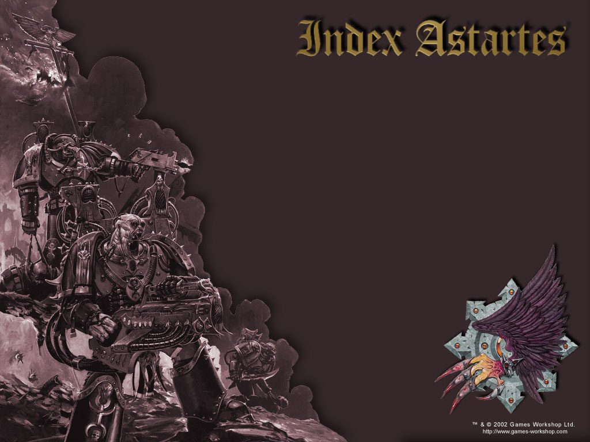
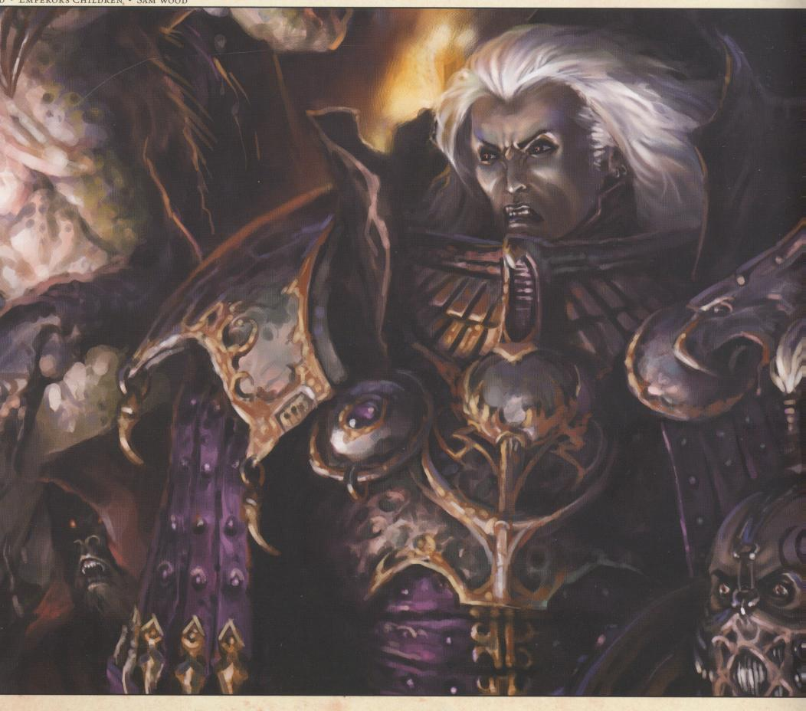

# 帝皇之子（Emperor's Children）

帝皇之子是一支投效混沌的军团，他们崇拜Chaos God Slaanesh (God of Pleasure)。

## History

Fulgrim (富根)

帝皇之子军团的历史是从掉到一个贫困星球 - 奇摩斯(Chemos)的基因原体富根开始的。这个星球倚靠太空贸易来换取食物，他们的贸易范围很小因为这个星球被强大的次元风暴围绕。就连严格定量配给的食物和振奋人心的演讲也没办法拯救奇摩斯的人漫向死亡。当装有富根的太空舱掉到这个星球上时，一个侦查兵发现了这个孩子并乞求可雷斯(Callax)殖民地的领导者不要杀掉这个小孩因为辜儿在这个星球上被视为资源的浪费所以通常都会被杀害。

起名于一个被奇摩斯人给抛弃已久的神祇，富根很快就成为一个传说，在他只有和他一起工作的工人一半年纪的时候他就可以轻松的完成他负责的工作。他很快就学会如何操作那些他使用的科技并且开始改造他们，这些被他改造的机器的效率大幅提高。当富根十五岁的时候，他的职位已经从工人升到殖民地的管理阶层了。在发现可雷斯和其它所有在奇摩斯上的殖民地都慢慢的衰退，富庚决定他要拯救他的家园。

在富根的领导下，大队的工程师从他们的堡垒工厂中前去维修那些已被抛弃已久的矿脉。当大量的矿石被送回可雷斯时，富根监督了更精密且节省能源的机器的制造。不久之后，奇摩斯回收资源的效率高到他们终于有余额(原文是surplus)了。后来，富根开始鼓励那些在为生活挣扎时期消失的文化和艺术的发展，其它的殖民地很快的就和可雷斯同盟，在到达奇摩斯的五十年后，富根已经是整个星球的领导者了。

## The Great Crusade (圣战)

当皇帝到达奇摩斯后，富根马上就对他宣示效忠并被指派带领他的军团。富根从皇帝身上知道了有关在远方的泰拉(Terra)和为了收复失土而展开的圣战的事还有他的身世事之谜。

在到泰拉去会见他的军队时，富根发现一个意外摧毁了大多数为他军团设计的基因种子。而且没有他们的基因原体要修复这个错误简直比登天还难。因此富根给予他军团的两百名Space Marine一个极度激励人心的演说，根据记载，他说的话感动了皇帝感动到皇帝把这支军团改名为帝皇之子并让他们使用Aquilia的标志在他们的动力护甲上，也就是皇帝个人的标志 - 双头老鹰。

富根很想要赶快在圣战中贡献他自己的力量。可是由于他的军团太小了所以他们必须听从贺拉斯和他手下的隐月之狼(Luna Wolves)的命令。贺拉斯和富根在东线战争的时候很快就结为好友。到后来，积极的从泰拉和奇摩斯征招士兵的富根已经可以自行发动圣战了，他带了了无数的世界到帝国的光辉之下。

## Horus Heresy (贺拉斯叛变)

当贺拉斯公开表示皇帝根本就不配那些以他的名义发动的战争并且他将不在听从皇帝时，皇帝送了七个军团去挑战高傲的战帅(Warmaster)而且如果必要的话摧毁他和他的手下。

富根和帝皇之子是第一个到达伊斯塔安(Istvvan)星系，也就是贺拉斯的前线基地，富根亲自去和贺拉斯会面并要求贺拉斯自己解释他的叛变。可是，贺拉斯感化了富根并让他效忠于自己。富根对贺拉斯的敬重让浑沌之力找到进入他的内心的路并摧毁他对泰拉的忠诚然后把他换成想把那个阻扰自己通往完美之路的人给催混掉的欲望。Slaanesh诱惑富根接受了他新神的条件。

这股欲望散布到了富根的副手和指挥官们，然后他手下的军官，最后只剩下极少数的人仍旧效忠于皇帝。完美主义被变成完美的快乐主义(hedonism)。当仍然忠心的军团到了伊斯塔安星系时，帝皇之子一直都在最前线帮助屠杀他们的前任弟兄们。

贺拉斯的叛变继续扩张并把整个帝国带入了内战。当帝国之子参与泰拉攻防战(Seige of Terra)时他们之前端庄的一面早已完全消逝了。当其它叛乱的军团对皇宫发动攻击时，帝皇之子则是去散布恐慌和欢乐(..?)到无助的地球平民 。上亿毫无防御的平民被抓去当用来催化快乐的药剂的实验品，有些则是被当作给恶魔的祭品，更多人则是被这只嗜血军团毫无目的的杀害

## After the Heresy

当贺拉斯被皇帝打败之后，帝皇之子在前往恐惧之眼的路上(Eye of Terror)留下了一条由人口几乎灭绝的星球的道路。在他们奴隶不够的时候，他们甚至会抢夺别的叛变军团的奴隶，后来在几场极度血腥的战斗后他们被他们愤怒的弟兄给击败了。最后，帝皇之子被打碎成一些快乐主义的追随者。大型的帝王之子军队十分少见，但是这世上恐怕没有比落入他们手中还惨的了...

富根自己则是被Slaanesh晋升为恶魔王子并统治一个有无限欢乐的世界。一直到现在，无数的帝王之子的成员和帝国审判官前去寻找这个世界，但是没有任何人回来过。

## 战吼

Children of the Emperor! Death to his foes!

> 帝皇之子
> by mephisto25

从Horus之乱至今的无数个世纪以来，堕落的帝皇之子军团已经成为帝国审判庭的最为头疼的祸害，他们就像一场永恒的瘟疫，在银河中不断传播污秽与腐化。为了同这种严重威胁到帝国秩序的诱惑战斗，忠诚的审判官们经历了数十年的训练以坚定其意志,来对抗邪神沙列士的诱惑。然而，许久以来，这些混沌的代言人仍然隐藏在帝皇的仆人之中。他们甚至曾经是帝皇最钟爱的战士。

## 起源

许久之前，在整个争斗之年代中，亚空间航行是不可能的事情，所有的人类世界都声称他们与其余的世界断绝了联系，而被迫在没有其余星系支援的情况下独自生存。在那段时期遗留下来的孤本《The Libram ex Dominar》中提到了Chemos也是这样一个世界。Chemos是一个矿业行星，依靠星际贸易来换取食物。这个星球的统治者尽力从这个荒芜的环境中榨取天然的食物来供给人民，但是Chemos还是渐渐走向死亡。自从最大的工厂Callax的墙上值守的警卫看见一颗拖曳着火光的流星穿过云层，坠向离墙仅仅数英里的地面时，这个世界被永久的改变了。由于Callax的执行官希望能够在降落的残骸中找到一些其余世界的幸存者的迹象，于是在没有多余的人力资源的情况下仍然派出了少数侦察员去调查降落地点。他们所找到的事物成为传说。

在陨石坑中央，一名仅仅比婴儿大一点的孩子躺在白热的太空舱残骸中。孤儿在Chemos上常常会被处死——因为执行官不会为照顾一名不能在工场中工作来回报他的投资的人花费任何资源。但是Callax的侦察员队长在这名孩子的眼中发现了一些超越了人类的东西。这名队长请求执行官让他收养这名孩子，因为队长对于Callax的价值，这项请求被接受了，队长可以把这个幼儿当作自己的孩子来抚养。他将养子以Chemos人民早就抛弃的古老传说中的神秘的创世之神Fulgrim命名。以这个传说命名的孩子马上就会创造自己的传说，并且将让这个世界上所有的人记住他的名字。

Fulgrim以非自然的速度成长，成为一名强壮且能干的人。在他的工友们一半年龄的时候，他就能够履行对执行官的义务，在不休息的情况下工作一整天。他不仅在肉体上十分强壮，还能迅速了解了在工作中所接触到的那些机器的科技原理，并且着手进行改进。在他从天空坠落的十五年后，Fulgrim已经是所有工人的领袖，并且是第一个成为执行官的工程师。在认识到了Callax和Chemos上其余定居点正在渐渐退化时，Fulgrim给了他自己一个拯救世界的任务。他一个接一个的说服了所有的执行官，要他们与正在摧毁Chemos的熵对抗。在Fulgrim的领导下，一队的工程师旅行到距工场很远的地方，在这个星球难以到达的地区重新开垦了很多消亡许久的村落。古老的矿脉被重新开采，这些矿脉带给Callax更多矿石并且允许他们进行更多饱经风霜的机器的建造。回收的效率持续增长，最终，Callax的生产超过了消费。看到成功的Fulgrim自豪的鼓励艺术与文化的复兴，在为了生存而进行的长久的斗争结束后，人文精神重新出现。在目睹了Callax的发展后，其余的定居点加入了Fulgrim的联盟。在Fulgrim从天空坠落的15年后，他成为了Chemos的统治者。

这时距离结束星球孤立的时刻已经不远了。在灰色的天空上出现了一艘披着装甲，满是战争创伤，有着双头鹰标志的飞船。听到这个消息后，一些记忆的碎片浮现在Fulgrim的脑海中。Chemos没有正规军队，但是飞船的降落地马上就被维持工场秩序的管理者给包围了。Fulgrim告诉管理者们暂时解除包围，并且允许来访者踏上Callax的土地。

在他的坚毅的战士组成的岗哨中，Fulgrim面对从群星间到来的重装战士。他们的脸上满是战争的伤痕，他们肩上装饰着的卷轴列举了他们的成就。他们的盔甲和武器工作良好，旗帜和标语则是艺术的结晶。Fulgrim意识到了这些人不仅技术先进，他失散的兄弟们从群星间而来，保留了艺术，他十分希望这些文明能够重返Chemos。从这些战士中走来的是他们的领袖，人类之皇。Fulgrim在观察了他之后
，没说一句话，就双膝下跪，呈上他的剑。从这一天开始，Fulgrim发誓全心服务帝国。

在帝皇那里，Fulgrim知道了地球，知道了为了收复银河而进行的大远征，还有以他为模版建立的军团。尽管这些故事听起来十分怪异，但他明白这是真实的，并且在帝皇的要求下，Fulgrim前往地球领导他的军团，帝皇之子。不像其余在大远征中战斗的军团，帝皇之子只有很少的成员——一场突发事故几乎摧毁了他们所有的基因种子，由于基因原体不知去向，重建工作十分缓慢。Fulgrim向这个军团能够集合起的所有两百名战士致辞。他给予他们一个神圣的任务，那就是将帝皇远大的智慧带给天空中的每一颗星星。“我们是他的孩子，”基因原体之书提到他这样告诉他们，“让所有看着我们的人明白这一点。只有瑕疵会让他失望。我们永不言败！”

被这位新找到的孩子的言辞所触动的帝皇给予了Fulgrim的军团一项独有的荣誉：帝皇之子被允许在他们的胸甲上展示帝国之鹰，只有一个军团被允许拥有这个标志。Fulgrim对于他即将展开的在银河未知地区的征途十分焦虑，他认识到他的两百名战士并不足以完成他所承诺的远征。带着帝皇的祝福，他和他的军团加入了影月野狼，Fulgrim和他的兄弟Horus在他的征服银河东方的任务中一起战斗。战帅本人赞扬了Fulgrim和他的军团，认为他们是Astartes圣典的具现。从Chemos和地球招募的新兵不断增加，最终帝皇之子有了足够的力量独自进行远征，Fulgrim骄傲的率领他的战士进入了未知的世界。在无数的世界他带来了帝皇的统治，摧毁任何在敢于反抗帝皇和人类的势力。在他的军团的阶级里，Fulgrim选择最具个性，最勇敢，最强壮和最高贵的战士做为Lord Commander，给予他们每人一只连队。Fulgrim亲自教导Lord Commander们，并且关注他们是否能够担负起他们的荣誉成为帝皇的代表。在教导之后，Lord Commander将Fulgrim的言语传达给下级指挥官，他们再传达给他们的班组。通过这种方式，每个帝皇之子的成员都谨遵帝皇的教诲。为了帝皇的荣誉，他们争取每件事都做到最好：服从战斗条例到其中的字母，战术和战略在分钟的层级上进行研究并达到完美，帝皇的条令被每个战士所牢记，并且在各个方面坚持执行。他们对于他的尊敬与崇拜近乎狂热。但帝皇之子就像其余军团一样，认为帝皇是个人而不是神。

## 家园

在整个孤立之年代中，Chemos是一个荒凉的，不可被救赎的世界。两个遥远的，渺小的太阳给予被星际尘埃所环绕的Chemos以热量，在那没有白天或者黑夜，只有永不闪耀的星辰发出的一点微光。很久以前Chemos是一个矿业行星，断绝了与地球的联系之后Chemos上的城市迅速衰亡。缺少了从其余世界运来的资源，数千人被饿死，只有在工场中人类才能艰难的生存下去。因为食物，水，能量的短缺，Chemos上的人们只能有少量的补给品，所有的市民在醒着的时候都不停的工作，操作蒸汽及其从稀薄的空气中摄取水分，并且不断的回收合成食物，将昨日的排泄物转换为今日的养料。娱乐，艺术和休闲要为生存让道，效率成为人们唯一坚持的事物。

在Fulgrim的领导下并重新加入帝国的家庭的Chemos很快扩张他们的工业基地，成为重要的矿产供应地。帝皇之子的修道院要塞坐落于Callax的中心，征召那些星球上最强壮，最勇敢和最具有智慧的人进入军队。尽管Fulgrim再也没回到Chemos，但他仍然十分关心他的意志是否被看作帝皇的使者，被人们遵从。Chemos上的征兵工作提供给他们最强壮和聪明的战士，但是在他们之中只有一小部分人能够通过由Fulgrim亲自制定的来确定他们是否值得成为帝皇之子一员的严格的测试。在对地球的围攻进行中，和在Horus叛乱结束后，帝国军对Chemos进行了轨道轰炸，将帝皇之子的修道院要塞和任何混沌的痕迹从这个星球根除。在这个行动后，审判庭宣布Chemos被隔离，并且在接下来的1万年内没有任何关于这个星球的更进一步的消息，甚至没有任何关于这个世界的记录出现在帝国的数据库内。

## 战斗条例

虽然条例原本随着军团一起消失，但是在研究了古代的战斗及战场报告后，审判庭仍然整理出了一些帝皇之子军团的战斗的惯例。整个军团尽力达到完美，并且不断的完善他们的军事行动。每一个成员在他们醒着的时候都为他的任务而训练，不管他们是步兵，驾驶员，炮手，侦察员还是狙击手。战斗的每个方面都被解析并转换为他们的优势，从人员和天气到后勤和补给。他们不给敌人任何机会。在战斗中帝皇之子和其余现存的星际战士军团一样勇猛。支撑他们的不仅是基因种子的样本，而是在他们心中极深的个人信仰，在任何条件下他们都尽力战斗，不管是重大的战役还是一次简单的巡逻。帝皇之子的任何成员都不会在战斗中溃退的事迹被广泛传播。同样的，需要友军一起行动－这种犹豫和无能的标志让帝
国守卫和星际战士无法忍受。这种领导的原则深深植于每个帝皇之子心中。他们对于其余的政权没有任何耐心。

## 组织

从他们简陋的开始，直到逃入恐惧之眼的结局，帝皇之子军团都在持续增长。在Fulgrim加入战帅的叛乱时他的军团有30个连队，每一个都被Lord Commander所带领，Lord Commander们都是最具魅力的个体，是星际战士良好品质的体现。每个战士都注意他们超人般的指挥官的指导，每个连队都从Lord Commander那继承了他们的风格和习惯。虽然很多军团也是这样，但是帝皇之子对他们领袖的热爱是无人可比的。

## 信仰

根据被审判庭查封的纪念碑的记载，帝皇之子并不像字面上那样神化帝皇，但是他们对于信仰的狂热和激情和每个帝皇的信徒都是一样的。在Fulgrim的领导下，军团相信帝皇是人类的顶点，并且只有以他为榜样才能将一个人的潜能发挥到极致。任何抵抗他的目标的个人或团体将会被蔑视，甚至不会被当作人类的一员。无论如何，帝皇被疯狂的崇拜。帝皇的完美首先在他们的基因原体上得到体现，军团的指挥官，队长和中尉，士官和星际战士都跟随着他们的榜样。因为如此，审判庭的理论家们认为只要诱惑了Fulgrim和他手下的指挥官们，整个军团都会被腐化。

仅存的卷轴告诉我们，在堕入混沌之前，帝皇之子相信帝皇最终将征服整个银河，移除所有障碍，人类文明将会毫无阻碍的达到顶峰。当研究战斗占据了一切时，军团也尊重文明的各个方面－音乐，艺术，雕刻等等。从帝国的各个世界来的艺术家装饰军团的盔甲，武器和机械。各种背景被给予极大的珍视，而且在军团的学习道路上并没有多少限制。

## 基因种子

在处理基因种子时几乎摧毁了整个军团的灾难过后，幸存下来的地球药剂师药典指出他们在工作时需要近乎完美的基因材料，这种风气和军团对于完美的信念相融合，所以帝皇之子的基因种子可能是所有军团中最为纯净和稳定的。只有最为完美的器官才会被移植，所以他们基因种子的突变率近乎为零。所有被基因种子增进的机能都达到了顶点，这允许星际战士们在战斗中将他们的潜能发挥到极致。没有其他的军团能够做到这点，并且这些技术在Horus叛乱后的1万年内没有再被发现。

## 战嚎

Children of the Emperor!Death to his foes!

## Horus之乱

在基因原体和星际战士们执行大远征之时，帝皇回到了地球，决心将他军队所建立的政权进一步稳固。众所周知，他的皇宫是帝国的心脏，但是只有一人不同意此点：战帅Horus，他是现在被更名为Horus之子的星际战士军团的领袖，也是最强大的基因原体。Horus十分自大，他认为帝皇十分软弱，不值得以他之名奋战。在听闻Horus背叛之后，帝皇送去了整整七个军团去对付战帅，如果有必要就摧毁他。帝皇之子是第一个到达Istvaan星系的，在那儿Horus等待着他，Fulgrim和Horus进行了一次私下的会面，要求知道他的目的和他的行动。但是相反的，Horus成功的腐化了他的兄弟，使其倒向自己一边。在Horus叛乱后成立的致力于调查基因原体背叛原因的Charon议会推断是Fulgrim对Horus的敬重影响了他，从而让混沌引诱他从帝皇身边离开。在他与Horus的谈话中，慢慢的，Fulgrim对于地球的忠诚粉碎了，取而代之的是强烈的摧毁他曾经相信能将人类带入完美的伪帝的意愿。被Horus的言语所引诱，Fulgrim转向建立一个从伪帝压迫下解放出来的最为完美的人类社会。邪神Slaanesh在Fulgrim的耳边低语，承诺他每件事都会完美，这时，Fulgrim将他的忠诚给予了他的新神。

在Fulgrim叛变后，同样的事情也发生在他的Lord Commander身上。他们认为他们的基因原体是完美的化身，并且跟随他一起成为Slaanesh的仆人。回到军团后，Fulgrim和他的Lord Commander们会见了他们的队长，鼓吹他们为了混沌的荣耀而战。队长们向他们的下属传达对于Slaanesh的崇拜，很快整个军团都遗忘了帝皇。在被他们的偶像重新调教后，他们全身心的投入对Slaanesh的崇拜，给予这位混沌王子他们曾经对于帝皇展现的热爱。Slaanesh让帝皇之子看见了天堂，一个无限自由的银河，没有不幸，因为所有的经验都是快乐的源泉。军团的牧师劝告他们的兄弟去感受这个梦境，去品尝所有的感受。帝皇之子的完美成为了完全的享乐主义，他们拥有无限的机会，没有事物能止息他们的狂怒。当忠诚的星际战士们到达Istvaan V时，帝皇之子是第一个站出来反抗他们的背叛者，愉快的享受着对忠诚的军团的屠杀。Horus的叛乱不断扩大，将整个帝国拖入混乱的泥沼。当Horus展开对地球的攻打时，帝皇之子就在他的身边。在他们参加了削弱帝国宫殿的防御的缓慢攻势后，Fulgrim和他的军团就转向没有抵抗的地区，那儿有无数恐惧的人类在那些指望马上剥下皇宫防卫的混沌信徒的视线之内。Istvaan的屠杀重现，但是规模远大于其。在地球上的混沌势力集合后，帝皇之子的药剂师和术士招来Slaanesh的力量来增强他们的快感，他们心智和身体已经遭到亵渎，现在他们不朽的灵魂也遭到同样的命运。被召唤而来的恶魔在囚犯中间享受鲜血和死亡的盛宴，星际战士们寻求更多的屠杀与肉体上的快感。Fulgrim愉悦的指挥着这些屠夫，相信他的军团已经将他们的牺牲品从伪帝的锁链中解放，并且允许他们感受真正的人性。围攻地球的狂怒怂恿他们屠杀了40倍于他们战士数目的平民和无力反抗的人，这只是他们为了满足自己的一种新刺激。更多为了满足这些杀手嗜血欲望而被杀死的人的数目无法被统计。

## 叛乱之后

根据帝国历史记载的，在对地球围攻的最高峰，Horus和帝皇在单对单的战斗中面对并且被打败。因为他的死亡，混沌军团陷入了混乱，这使得帝皇之子被迫逃跑，并且和其余的混沌舰队分散开来。追赶着Fulgrim座舰的帝国舰艇发现他们留下了一连串被毁灭的世界，在这些世界里尸体堆积如山，生存者为了逃离梦魇而祈求死亡，超过千人失踪，再也没被见到。最终，在进行了无数的恶行之后，帝皇之子到达了恐惧之眼，和其余的叛军一样在此躲避帝国的怒火。根据审判庭的预言，帝皇之子很快就玩厌了他们的奴隶和玩物，并且开始转向唯一可能牺牲者：从其余的叛军里抓来的奴隶和仆人。因为这所引起的战争恐怖且血腥，但是只有一个最终的结果，帝皇之子军团将会被摧毁。

对于Fulgrim本人的命运没有人能够确定。Slaanesh的敌人声称他在与同伴之间的战斗中被杀，但是机械会的打捞舰并没有发现他和他的座舰的残骸。而在剩余的帝皇之子成员中，盛传为了奖赏他对于快乐的热爱，Slaanesh将他提拔为恶魔王子，成为一个恶魔世界的统治者。经过了千年，许多帝皇之子，连同那些崇拜Slaanesh的星际战士经常去出发寻找在Fulgrim统治下拥有无尽快乐的世界，但是没有一个人回来。一万年后的今日，每当有这个背叛的基因原体的消息传来，不管消息多么缥缈，审判庭都会派出军队去消灭这些谣言。

现在的帝皇之子没有领导，但是仍然在追求着无尽的愉悦，为在那场恐怖战争中的失落寻求安慰，加入其余崇拜Slaanesh的混沌星际战士的卑鄙的远征。他们中的很大一部分都成为了噪音战士，这是一种扭曲的生物，他们沉溺于狂怒和动乱，只有破坏的咆哮和临死前的哭喊能够满足他们。只有最为强烈的感官刺激才能挑起这些疲倦的精英们的反应，他们用令人目眩的，互相抵触的色彩装饰他们的盔甲，并在其上缠满微亮的丝绸和金链。将他们的疯狂抛开的话，他们仍然是极为恶毒野蛮的战士，他们在战争的破坏中得到狂喜，并且愿意为任何能够提供他们实践对Slaanesh热爱的新鲜奴隶的领主效力。有一些靠着自己的能力成为了Warlord，为了能够重现万年前当Fulgrim率领他们在无数个世界寻找痛楚与死亡的快感。这些生物比那些服务他们的疯子更为可怕：他们用残忍的快乐来打量整个银河，从不满足于休息，他们放任自己感受颓废。幸好帝皇之子的Warband十分稀少，没有比银河成为他们的奴隶更糟的命运了。

## Laeran的清洗

第一抄写员Wendel Voss于帝国历893/M31记录

在独自的远征开始后，帝皇之子遭遇了迄今未知的一个种族，我们称呼他们为Laer。对被捕获的Laer的探子和外交使节显示Lare集中于一个星系，Laeran。虽然如此，他们仍然可能成为潜在的强大敌人。就像帝皇之子一样，Laer人对于文明各个方面的完美都十分珍视。在使用化学方法出生后，一个Laer人将会找到他在社会中的位子，不管他将会成为工人，战士，外交官还是艺术家。Adeptus的管理者认为征服这个星球对于帝国的征服有完善的保护，征服这个种族将会十分漫长而艰苦。Fulgrim拒绝任何形式的合作，他坚持只有人类才是完美的。将异端的种族与人类相比是一种亵渎，他们应该得到毁灭。他命令Lord Commander们立刻攻击，管理者们预言这场战争将会持续十年。Fulgrim听到这个预言后摇了摇头。“只要一个月，”他说，“雄鹰将会统治Laeran。”

每个地区都进行着战斗。帝皇之子从太空，陆地，海面下，他们的轨道平台上进行攻击。每一个地方他们都面对着适应此地条件的敌人－战船用生物电连接所有成员的思维。能够水下呼吸的战士，和Speeder一样快的侦察员，枪手的视力允许他们锁定数里外的星际战士。人员伤亡是极为可怕的，根据估计，如果不是军团医师十分出色，超过半数的战士将会因为他们所受的伤而死亡。

Laer人没有投降－他们的最后的战士在首都的废墟里战斗到死。攻击开始一个月后。Fulgrim留给Laeran星系的仅仅是一个画在他们尸体上的一头帝国之鹰。700名战士死亡，6倍的战士负伤，但是Fulgrim相信他证明了他的正确。在遭遇了更多更为强大的异族战士后，人类证明他们是最强的。\[保管者的记录：Laeran星系，现在已经拥有3个城市及许多矿石生产地，所有之前统治者的痕迹已经消失。\]

## Eidolon,帝皇之子的Lord Commander

Eidolon是第一个被Fulgrim挑选出来领导帝皇之子一个连队的星际战士，并且是所有Lord Commander中最被敬重的人。直到被腐化前，Eidolon致力于精通作战的所有方面，他的士兵在攻城战，防御行动，快速突袭和紧张的战役中都做的一样好。无论做任何事，他都不会显示出不成熟和无能。Eidolon只把Fulgrim当作字面上的父亲，他认为自己的基因种子才是最为强大并且是真正的第一人。尽管他在能力上远不能和基因原体相比，然而Eidolon在他醒着的每一个时候都在研究Fulgrim的战术和战略，他的文稿和演说，都希望尽可能的向他的完美的领袖靠拢。不管付出多少的努力，服务于审判庭的学者仍然不能断定Eidolon是否有参加围攻地球。一则没有确实根据的谣言指出Eidolon要为过去万年来对于千百个帝国世界的袭击负责，并且暗示他可能是毁灭者Abaddon的军官，Sylelle女王的配偶以及恶魔王子N\`Kari的勇士。没有任何一个审判官能够锁定这些谣言的发源地。但是，如果没有决定性的证据，审判庭是不会宣布Eidolon已死。
