# 几位基因原体和著名战团人物

[Baron.H](http://game.ali213.net/profile-uid-1484463.html)

（除注明外，介绍请参看对应战团史）

【人物】著名的阿巴顿大大

掠夺者阿巴顿，曾经以皇帝的名义征服过无数领土，现在已经成为恶魔之友，在万年不断的征战中将苦难和诅咒撒播到银河各个角落。

　　当黑色军团还叫作影月战狼的时候，阿巴顿是荷拉斯的副手，有人说他其实是战帅的克隆人。他对荷拉斯的忠诚是无可置疑的，而后者的战死将阿巴顿心中的信念和神像击得粉碎。最后他捡起了战帅的电爪，开始了复仇之路。他重新团结起荷拉斯之子，将其改造成黑色军团，重新从邪神那里取得帮助。他取得了恶魔之剑Drach'nyen，获得了剑中的力量，带领军团跨出恐惧之眼开始黑暗远征，阿巴顿的作战风格接近狂热，或者说带有自我牺牲一般的勇敢，能够亲自带队冲向敌人最严密防守的据点，并且奇迹一般获得胜利。人们相信他的命运已经被邪神所注定，只有他可以带领混沌军团重铸名声，走向胜利。

　　一个又一个世界在铁蹄下被奉献给邪神，追随者越来越坚定的依附在他身边，只有他能够获得九个叛乱军团的绝对服从，作为邪神的代言人，引导死亡和祸乱为世界带去末日启示。  
  
  
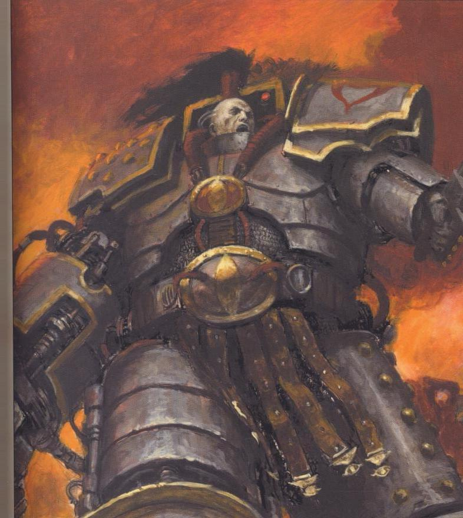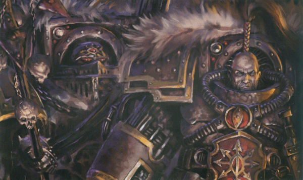

【基因原体】\[死亡守卫的莫塔里安大大\]  
  
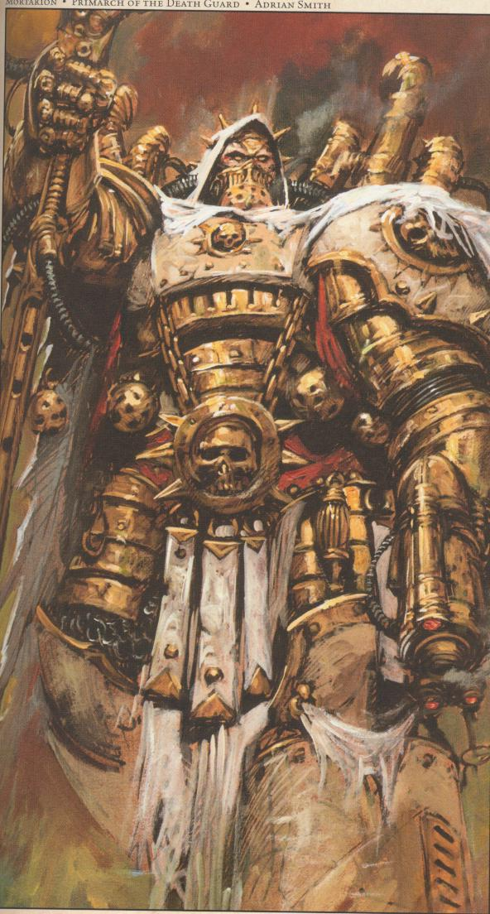

  
  
【基因原体】\[圣血天使的圣吉列斯大大\]  
  
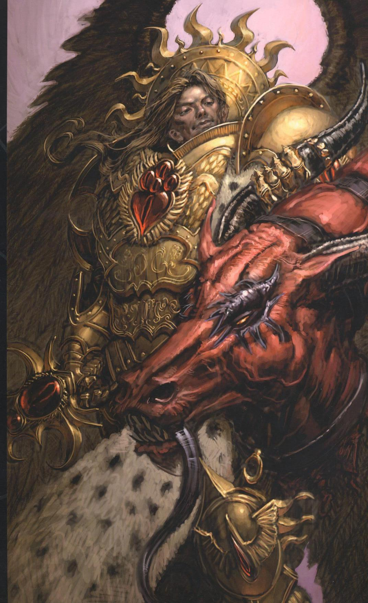

【人物】\[怪博士法比乌斯\]

法比乌斯拜尔曾经是帝王之子军团的副统帅，他曾经指挥军团参加了围攻地球战役。在那次惨烈的大战中，帝王之子并不在围攻圣殿，而是冲进平民区胡乱砍杀，犯下了许多灭绝人性并且毫不名誉的罪行。拜尔在段时间里不仅没有阻止部下的行为，反而是热衷于各种人体试验，他改造了许多军团战士的大脑，使他们在极度刺激下更加兴奋。在战后，他并没有像军团里其他人一样逃往到恐惧之眼并投入沙历士神的怀抱，拜尔从那以后起离开军团独自修行，专注于各种禁忌的人体试验，试图找到星际战士基因改造背后的秘密。

　　在此后几个实际的漫长旅途中，拜尔出租自己的技术，从各个叛变军团的指挥官那里获得试验用的俘虏或者古代技术的碎片。他能够轻易将普通士兵转变成凶猛的野兽，或者用禁忌的方式克隆军队，这些技术可想而知得到了所有混沌指挥官的青睐，他们愿意付出任何代价来获得法比乌斯拜尔的帮助。他在星系中利用基因技术制造出的各种怪物至今还在肆虐，审判庭的检察官花费了巨大的人力物力，但是也没法彻底消除他无意间造出的强化的精神错乱的所谓“新人类”。  
最后，在一次好不容易逃脱火龙战团的追杀之后，拜尔总算在恐惧之眼里面一处地方安定了下来，他与几乎所有的混沌军团达成协议，帮助他们创造出新的混沌士兵，以此换来保护。

【判乱前和后】  
  
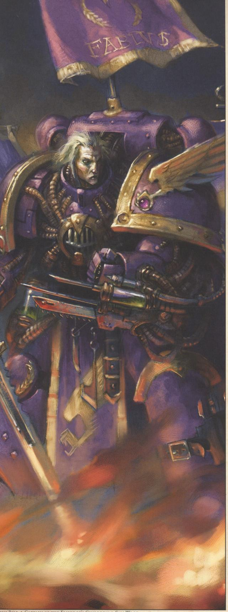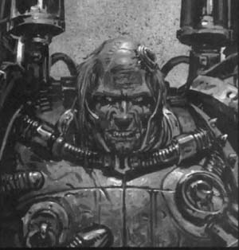

【基因原体】\[帝王之子的富根\]  
  
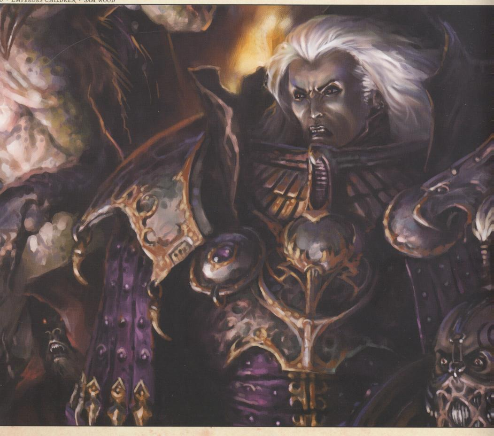

【人物】\[千疮之子的智库馆长阿里曼\]

【判乱前和后】介绍参见千疮之子战团史  
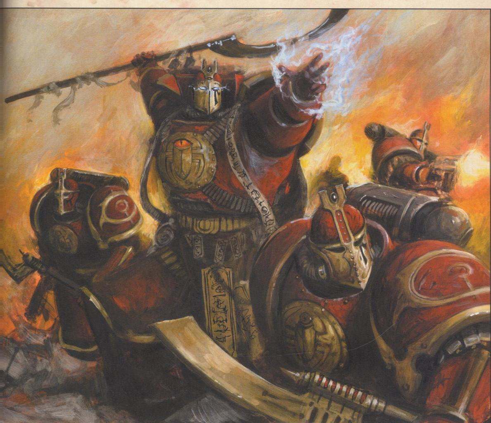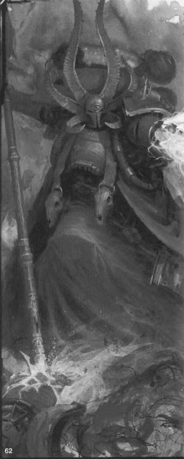

【基因原体】\[蚕食者的安格昂\])  
  
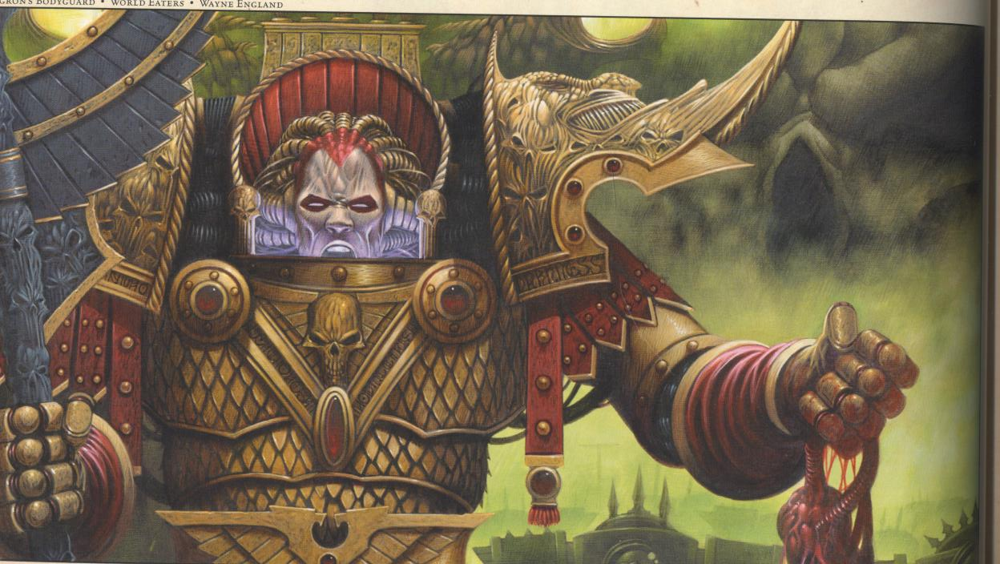  
  
【基因原体】\[最牛比的荷大~荷拉斯\]  
  
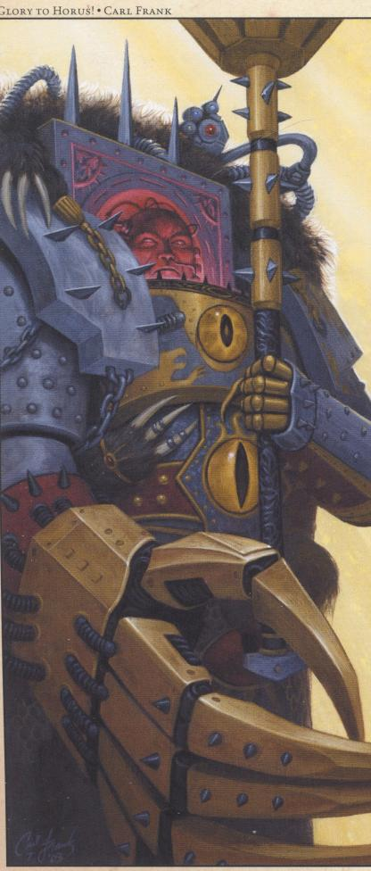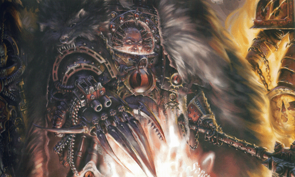

【基因原体】\[左边的是太空野狼的狼王－莱曼卢瑟，右边的是千疮之子的马格努斯大大\]  
  
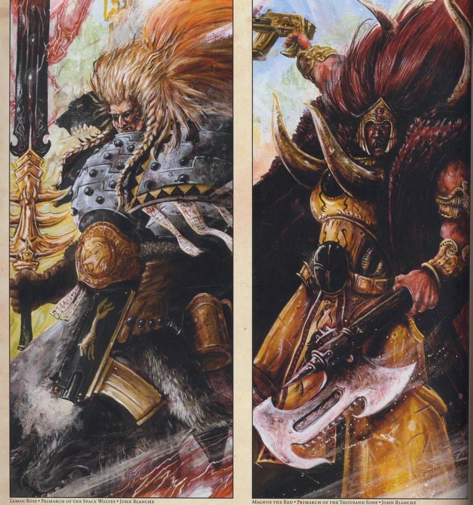