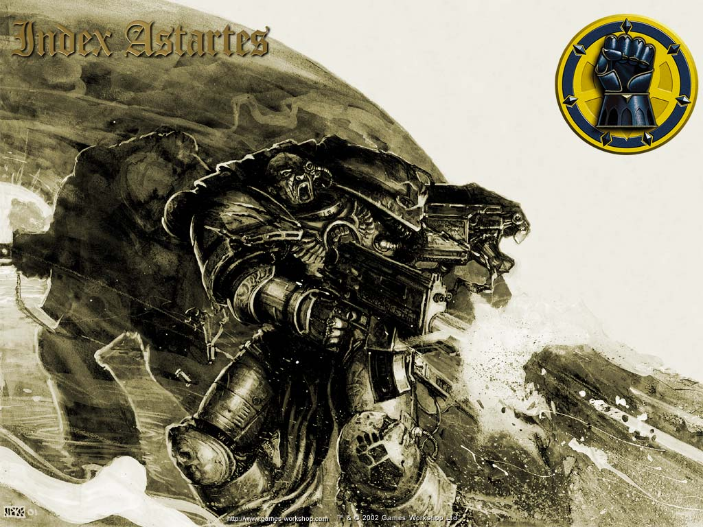

# 帝国之拳

－ＲＯＧＡＬ。ＤＯＲＮ－

身为二十个基因原体之一，ＲＯＧＡＬ　ＤＯＲＮ是帝国之拳［ＩＭＰＥＲＩＡＬ　ＦＩＳＴＳ］的军团领导者。

有关他的幼年时期与成长的星球，却是极少有人知晓。在帝皇的星际圣战推导着整个宇宙历史的转变，当帝国的军队来到极度都市化的ＩＮＷＩＴ星球时，ＤＯＲＮ在一艘巨大的星舰［ＰＨＡＬＡＮＸ］前迎接了帝皇的到来。帝皇欢迎ＤＯＲＮ回归的同时，也将ＰＨＡＬＡＮＸ收入他的麾下。之后更将它改造成了ＩＭＰＥＲＩＡＬ　ＦＩＳＴＳ的修道院要塞。

ＤＯＲＮ本身对帝皇的忠诚是不容质问的。他也从来没有向帝皇要求过任何协助。在基因原体中他的一言一行更是出自绝对的真诚，就算是对他有利，他也向来没有办法说谎。但也因为他自我严格律己的榜样。ＭＡＣＲＡＧＧＥ［ＵＬＴＲＡＭＡＲＩＮＥＳ母星］上的四座雕像中，就有一个是ＤＯＲＮ的塑像，伫立在ＧＵＩＬＬＩＭＡＮ的旁边。

在圣战终告一个段落，帝皇回到ＴＥＲＲＡ，为了建造一个足够统领一百万个星球的主星，ＤＯＲＮ被指派建造帝国宫殿的防御设施。他完成的杰作可以说是完美无暇，并在之后几年更受到非常严重的考验。帝皇之子的基因原体ＦＵＬＧＲＩＭ有一次问ＤＯＲＮ他所监造的防御是否连钢铁战士ＩＲＯＮ　ＷＡＲＲＩＯＲＳ都无法攻破。而ＤＯＲＮ出自真心考虑后的回答让ＰＥＲＴＵＲＡＢＯ极度的愤怒，让他们几乎在之后的战争中摧毁彼此。

在叛乱结束后，ＤＯＲＮ发现了严重受伤的帝皇，战死的ＨＯＲＵＳ和ＳＡＮＧＵＩＮＩＵＳ，他之后更在帝皇的耳语中得知建造黄金皇座［ＴＨＥ　ＧＯＬＤＥＮ　ＴＨＲＯＮＥ］的方法。

在帝皇进入皇座之后，ＤＯＲＮ严以律己的态度让他陷入严重的自责之中，深信帝皇是为他所害。他带领战团在帝国之中开始了一场重拾荣耀与巩固四分五裂帝国的圣战。在ＧＵＩＬＬＩＭＡＮ为了宣示亚斯提律令［ＣＯＤＥＸ　ＡＳＴＡＲＴＥＳ］分割战团成为战斗章节的实施而召他回ＴＥＲＲＡ后，他在宣示当场大发雷霆，认为这是帝国在责怪他的圣战导致更多星际战士的伤亡。但，在考虑过内部的不平衡对于现今脆弱的帝国所能造成的伤害，ＤＯＲＮ最后同意了。这是ＲＯＧＡＬ　ＤＯＲＮ一生最黑暗的一刻，他不但有负于帝皇，更对不起他所挚爱的战团。
　
有关战团分割的争执一直没有结束，是为什么帝国之拳没有办法如同其它战团一般成功分割呢？ＲＯＧＡＬ　ＤＯＲＮ的战士们，年轻到老一辈，全都将对战团的投入与热爱植入心中，在与彼此弟兄感情如此深厚的情况下，大部分战士都不肯配合于战团分割的行动。

陷入极度自责与颓废中的ＲＯＧＡＬ　ＤＯＲＮ在冥想时透过自我引发的痛楚看见的画面（藉由名为痛楚手套ＴＨＥ　ＰＡＩＮ　ＧＬＯＶＥ）得知他的战团必须在帝皇的眼中获得救赎，而唯一的方法便是透过牺牲，与痛楚。

ＤＯＲＮ最后决定一次重拾荣誉的军事行动，是在ＩＲＯＮ　ＷＡＲＲＩＯＲＳ为了挑战帝国之拳所建造的巨大军事要塞ＴＨＥ　ＩＲＯＮ　ＣＡＧＥ。ＤＯＲＮ率领了一团精英的敢死部队，在城下与背叛者军队打了一场好几个礼拜的攻城战。钢铁战士的追随者表示帝国之拳承受了一场毁灭性的挫败。并宣称要不是ＰＥＲＴＵＲＡＢＯ持续的饶过ＤＯＲＮ的性命，ＤＯＲＮ和他的部队早就被屠杀殆尽了。

而帝国之拳的纪录却是几乎相反。帝国之拳向来都是要塞攻防的个中好手，并且就算在毫无预警之下他们仍如骄傲的雄狮一般奋勇战斗。在前线之中，ＤＯＲＮ如同巨人一般冷静的站在弟兄之中。他的心灵在经过这么久的自疚与罪恶感之后，已经在使命之下变的清晰无比。钢铁战士将会为了摧毁帝国之拳而牺牲他们的基因原体与性命。一个他们尚未准备好付出的代价。

ＵＬＴＲＡＭＡＲＩＮＥＳ的到来迫使ＤＯＲＮ停止一切军事行动并让ＩＲＯＮ　ＷＡＲＲＩＯＲＳ有了机会逃入恐惧之眼中。帝国之拳承受了不小的伤亡，但也因此证明了对帝国忠诚并从先前无法守护帝皇等种种失败中洗净了自身的耻辱。

之后ＲＯＧＡＬ　ＤＯＲＮ终于将战团分割成三个战斗章节。

最积极热切于圣战的战士成了ＢＬＡＣＫ　ＴＥＭＰＬＡＲＳ［黑色圣殿骑士］年轻而较为理性的组成了ＣＲＩＭＳＯＮ　ＦＩＳＴＳ［血红之拳］执着于跟随基因原体与他的战团者则保留原名ＩＭＰＥＲＩＡＬ　ＦＩＳＴＳ［帝国之拳］ＤＯＲＮ在接下来的近２０年都在为了重建与各章节的初步发展而努力。

ＤＯＲＮ也许在混沌势力的第一次黑色圣战中阵亡了，在攻击多于己方数量多倍的敌舰时ＲＯＧＡＬ　ＤＯＲＮ决意在敌方完成部署前强行登舰，采用突击战让增援势力能够安全到达。ＤＯＲＮ成功了，但也付出很大的代价。收寻队只寻获一小部分的ＲＯＧＡＬ　ＤＯＲＮ一只现在为了表率牺牲奉献精神，而放在电磁力场中的白骨手掌。每一个帝国之拳的章节领袖都有将ＲＯＧＡＬ　ＤＯＲＮ的名字刻在他们手掌上的习俗。

但失踪的躯体仍然引发许多猜想，有些帝国纪录宣称他在第４１０世纪依然存活，有些谣言说他现今在守护黄金宝座的神秘ＣＵＳＴＯＤＩＡＮ战斗章节中，其它数据则说在ＴＥＲＲＡ的帝皇皇座中有着ＲＯＧＡＬ　ＤＯＲＮ　的整副骷颅。
