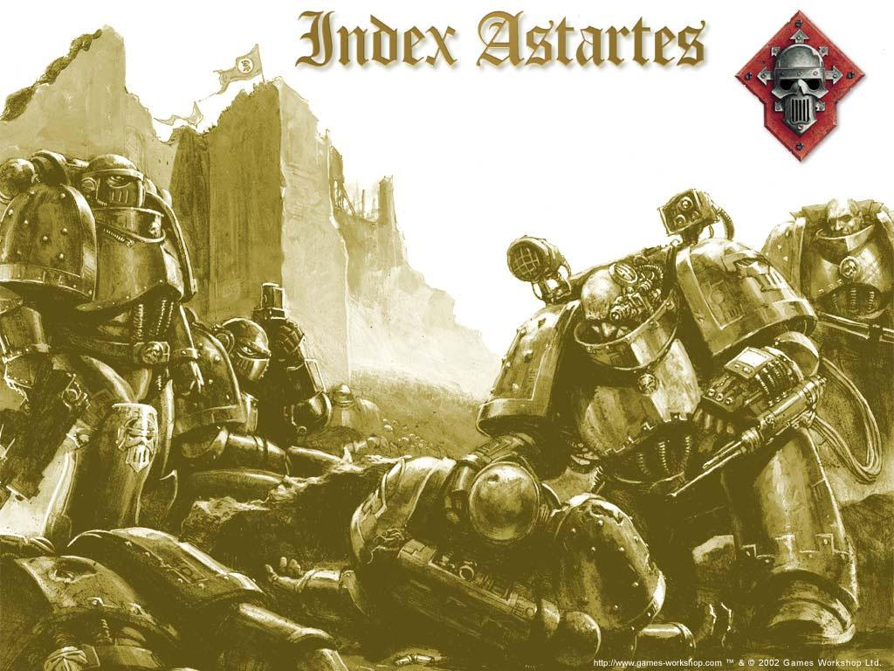

# 钢铁勇士（Iron Warrior）

## 被折磨与扭曲的战士

钢铁勇士是大圣战中最强悍的一支军团．任何号称坚不可摧的城墙，任何自以为牢不可破的城堡，任何胆敢阻碍皇帝与帝国前进的人，都被这支钢铁的攻城锤击得粉碎．然而当钢铁勇士们在Ｉｓｔｖａａｎ　Ｖ号行星上背叛其他军团的那一刻起，他们的荣耀就注定将被人所遗忘，他们曾经令人倾慕的名字也成了狡诈与异教的象征．

## 起源

钢铁勇士是最早成立的军团之一．那时帝国刚刚诞生，皇帝仍在领导着他的子民．与其他军团一样，他们的成立是在战团长原体失踪之后．在这些岁月中，钢铁勇士形成了他们的特性：他们非常重视科技，同时又有着一种近乎冷酷的理性．这虽然使得军团战斗力强大异常，但又使他们不像其他军团一样虔诚．不幸的是，钢铁勇士注定要遭遇一次这样的威胁――只有虔诚的信念才可化解的威胁．

皇帝在奥林匹亚上发现了钢铁勇士的基因原体：Ｐｅｒｔｕｒａｂｏ．这名阴沉忧郁，却又有着利刃般敏锐而冷酷思想的年轻人已经成为了Ｌｏｃｈｏｓ的暴君帐下的一位军阀，同时还是一名攻城战大师．由于命运的安排，Ｐｅｒｔｕｒａｂｏ在成长过程中只学到一项东西：如何扩展自己的权力．

奥林匹亚是一个起伏不平的多山星球，主要的人口都集中在城邦之中．独特的地形使得对战略要地的控制非常简单，只需控制了高地，就控制了各个通道．

年轻的Ｐｅｒｔｕｒａｂｏ被发现时，他正在攀爬Ｌｏｃｈｏｓ城的峭壁．在意识到这孩子非同寻常后，守卫们把他带到暴君Ｄａｍｍｅｋｏｓ面前．而这个阴沉怪异的孩子居然有办法让暴君把他带回家中并视若己出．Ｐｅｒｔｕｒａｂｏ从没信任过任何奥林匹亚人，即使Ｄａｍｍｅｋｏｓ在他身上花了不少的心血想赢得他的信任，他也没报以任何一点有人情味的报答．大多数人都觉得这孩子太过冷酷，但与他的被抛弃的原因，他的来源和他特殊的能力这一堆毫无头绪的问题相比较，他冷酷的性格实在算不得什么．

当大圣战的步伐行进到奥林匹亚时，Ｐｅｒｔｕｒａｂｏ向皇帝效忠．按照惯例，Ｐｅｒｔｕｒａｂｏ被任命为钢铁勇士军团的军团长，而奥林匹亚则成为军团的母星．被罢黜的暴君逃向荒野并试图夺回奥林匹亚，他没能活着实现着目标，但他的行为却在很多年后造成了麻烦．

没有太多时间可浪费，大圣战正在如火如荼地进行．Ｐｅｒｔｕｒａｂｏ迅速从当地人中招募了新的钢铁勇士．并对邻近的两颗星球：正义之岩和异教星球黑色仲裁．新兵们表现良好，他们的凯旋仪式在ＰａｌｉｍｏｄｅｓＦｒｅｓｃｏ上进行，那是一颗现在只存在于记录中的星球．

Ｐｅｒｔｕｒａｂｏ领导下的钢铁勇士是一支毁灭性的攻城部队．借由曾接受过科技神教祭司们的训练的专家工程师的帮助，他们迅速地改进了原本就极其出色的攻城技术．当钢铁勇士们开始为皇帝服务时，他们发现自己的特长并不是那么令人愉快――无论对于什么人，哪怕是星际战士，攻城都是一项漫长而令人厌烦的工作．在这种心理疲劳的折磨下钢铁勇士开始变得残酷异常，慢慢的在他们中间形成了这样一种习惯：一旦攻城部队部署完毕，敌人要么立刻投降，要么就等着被屠城――在冗长的攻城战后，钢铁勇士们需要一场刺激的战斗来放松在攻城战中压抑的神经．

随着大圣战的继续进行，许多星球上都建立了钢铁勇士堡垒以保证交通线的安全，极具讽刺意味的是，这些堡垒的第一次也是最后一次使用就是在何露斯之乱中支援叛军部队向地球的进攻．相当多的钢铁勇士小队被帝国派去驻守这些堡垒．不像Ｒｕｓｓ、Ｖｕｌｋａｎ、Ｍａｇｎｕｓ那样拒绝将自己的部队分开，Ｐｅｒｔｕｒａｂｏ强忍着怒火接受了皇帝的命令．钢铁勇士被分散在帝国的广大疆域中，成了一支守备部队……像是在Ｄｅｌｇａｓ　ＩＩ上的钢铁要塞中，就只有一个班的十名钢铁勇士守卫．但这个星球的人口居然有１３亿．不满开始在军团中蔓延，而最不爽的就是Ｐｅｒｔｕｒａｂｏ本人．

由于岁月的流逝和何露斯之乱摧毁的大量资料，想要弄清为什么钢铁勇士会遭这种蔑视已经不大可能．Ｐｅｒｔｕｒａｂｏ起初由于对皇帝的忠诚而接下了不少其他军团不愿意承担的任务，而他取得的一个又一个的胜利导致了这样一种局面：一旦有攻城或者守备任务，大家想到的首先就是钢铁勇士．虽说任何一支部队都需要休整以保持最佳状态，但是某个高层官员决定一直让钢铁勇士去做这种无聊的工作，而无视对他们造成的心理伤害．这也许是皇帝在测试Ｐｅｒｔｕｒａｂｏ有多忠诚．但也可能是另一个人――当时已经领导了许多次战役的何露斯．从叛乱开始时何露斯就已与几个军团取得相互“信任”来看，最有可能干这
事的就是何露斯，他通过这种手段来控制钢铁勇士．

而众所周知的就是Ｐｅｒｔｕｒａｂｏ看ＲｏｇａｌＤｏｒｎ不爽．从ＲｏｇａｌＤｏｒｎ那爱慕虚荣的天性就猜得出那厮会在Ｐｅｒｔｕｒａｂｏ面前不停地卖弄皇帝宫殿防御体系的完美程度，而在一个攻城专家面前卖弄这些．．．虽然Ｄｏｒｎ这种做法让很多人不满，但最讨厌他的就是Ｐｅｒｔｕｒａｂｏ．而这种不满，只需要一个权谋者的稍微点拨，就会爆发成一场可怕的报复．

可以确信的是其他军团长都离Ｐｅｒｔｕｒａｂｏ远远的，这可能是他的技术天赋引起的嫉妒．要知道Ｐｅｒｔｕｒａｂｏ在科技方面的成就堪比科技神教的技术贤者，他的发明包括亚空间引擎和聚能加农炮等等．Ｐｅｒｔｕｒａｂｏ的天才在这段时间的文献中多次被记载．其中最著名的一个故事是说ＬｅｍａｎＲｕｓｓ和Ｊａｇｈａｔａｌ二人的军团被Ｍａｓｈｏｇｇ的兽人击退时，Ｐｅｒｔｕｒａｂｏ计算出一条路线，他的军团轻易地避开了Ｍａｓｈｏｇｇ的低层轨道防御系统，直击兽人军队．

## 何露斯之乱

在对Ｇｕｇａｎｎ的Ｈｒｕｄ培育基地的清除过程中，何露斯向Ｐｅｒｔｕｒａｂｏ透露了奥林匹亚正在发生叛乱的消息．Ｄａｍｍｅｋｏｓ已死，民众们被煽动起来，拿起武器造反．此时Ｐｅｒｔｕｒａｂｏ已厌倦了工兵＋守备队长的工作，而成为唯一一个不能守卫自己母星的军团长的想法让他异常恼怒．何露斯抓住了最恰当的时机对他加以挑拨．

在离开前，何露斯将一柄战锤――熔炉破坏者赠给Ｐｅｒｔｕｒａｂｏ．这件武器很可能扮演了将混沌之力传导到Ｐｅｒｔｕｒａｂｏ身上的媒介的角色．同时，像何露斯这样一位伟大将领所赠送的礼物多少也拉近了两位军团长之间的距离．

Ｐｅｒｔｕｒａｂｏ和钢铁勇士返回母星，一条街道一条街道地清理叛乱者，不留任何活口．原来钢铁勇士的原则是敌人要么投降要么没命，但长久的战斗中他们已经习惯不留活口了．Ｐｅｒｔｕｒａｂｏ站在高台上，他就像这高台的基石一样冷漠无情地注视着这场屠杀．当屠杀结束时，奥林匹亚有５００万居民被杀，其他的全部被罚作奴隶．

在奥林匹亚燃烧的夜空下，钢铁勇士们慢慢意识到他们自己刚刚做了什么……之前他们还是突击Ｈｒｕｄ族的英雄，而现在他们却成了一群屠夫．Ｐｅｒｔｕｒａｂｏ就像一个酒醒后发现自己双手沾满鲜血的醉鬼一样，他不知道自己怎么会做出这种事．唯一能肯定的是，他陷入了深深的耻辱和绝望中，他知道皇帝不会原谅他的罪行．

在这样的绝望中钢铁勇士收到了新的消息和命令．消息传来时已经残破不全，但从破碎的片段中获得的信息仍如末日般可怕：太空野狼袭击了千疮之子；何露斯之子军团叛乱，Ａｎｇｒｏｎ的蚕食者和Ｍｏｒｔａｒｉｏｎ的亡者守卫也加入了何露斯的叛军；帝王之子的Ｆｕｌｇｒｉｍ试图说服何露斯，却被拉入了叛军阵营．这些消息把Ｐｅｒｔｕｒａｂｏ和钢铁勇士推向了疯狂的边缘．渐渐的，理性让位给了疯狂，然而身陷重围的皇帝也不可能来管他．．．

根据接收到的命令，钢铁勇士和其他６个军团将一起登陆Ｉｓｔｖａａｎ　Ｖ，共同围剿何露斯．

然而在Ｉｓｔｖａａｎ　Ｖ上．钢铁勇士和暗夜领主、食言者、阿尔法军团一起加入了叛军，对依然忠于皇帝的３个军团发起围攻．

在Ｉｓｔｖａａｎ战役结束后，钢铁勇士已完全被混沌的力量占据．他们被派去维持叛军的后勤补给，在１２个以上的星球中，钢铁勇士的战争铁匠取代了政府，并向居民争税以维持叛军的后勤（这段真怪．．．）

而Ｐｅｒｔｕｒａｂｏ领导一支钢铁勇士的精锐部队前往地球，负责攻破皇帝的宫殿．在这次战斗中Ｐｅｒｔｕｒａｂｏ的技巧派上了大用场，而粉碎帝国的象征这件任务也让他扭曲的灵魂欣喜若狂．在皇宫即将被突破时，皇帝突击了何露斯的指挥舰并将何露斯击毙．和其他的何露斯的追随者一样，钢铁勇士飞入了恐惧之眼，在他们新的母星中营造巢穴，准备着复仇．

小部分钢铁勇士仍死守着奥林匹亚．但是很快，依然忠于皇帝的军团开始了反击．帝国之拳和极限战士军团发起了一场长达十年的战役以解放落入叛军之手的星球．他们发现奥林匹亚像扎入帝国体内的一个带刺的钩子，如果不冒很大的风险是无法移除的．奥林匹亚的守军支持了两年，在发现已无继续死守的希望时，他们发射了发射井中所有的导弹，将一块废土留给了帝国．和其他的叛军母星一样，奥林匹亚被称为Ｐｅｒｄｉｔａ．

## 母星

和其他反叛的军团一样，钢铁勇士在恐惧之眼中占据了一个行星作为他们的新母星．

关于恐惧之眼内的星球我们所知甚少，况且，混沌统治的领域中，一个星球时常会发生怪异的变化．Ｍｅｄｒｅｎｇａｒｄ通常被描述为一个遍布要塞的星球，它本来的面目被高得不可思议的巨塔所覆盖，而它的核心被无数地下城占据（别说什么会被烧烤，在恐惧之眼里通常的物理规律一概无视）．这些建筑与从现实世界里搬来的更为精良的钢铁勇士要塞交织在一起．当然，对恐惧之眼的描述都来自一些噩梦般的记忆而不是确切的观察，因此这也可能是Ｍｅｄｒｅｎｇａｒｄ的假象．

审判官Ｍａｕｌ于Ｍ．３８对恐惧之眼进行了一次深入侦察．尽管他没能活着回来，但他在船舱中用自己的血记录了他看到的东西．Ｍｅｄｒｅｎｇａｒｄ被描述为一个萧瑟的监狱星球，无数的奴隶在此被折磨而死．巨大的混沌战舰停泊在巨塔的顶端，而钢铁勇士们就居住在巨塔之中．

## 战斗条例

钢铁勇士遵循一条十分简单的战斗条例．他们先用全部的火力持续不断地轰击敌军．这并不是胡乱的轰炸，钢铁勇士的轰炸行动经过了精心的策划，以使每一件武器都发挥出最大的效能．如果可能的话，背叛的泰坦军团也会用他们可怕的火力来支援钢铁勇士的攻击．通常来说轰炸要持续数周，而钢铁勇士似乎从来不会缺乏弹药．他们能熟练地掌握自己的武器，保持好阵型猛轰敌人，然后在敌人发动反击前迅速转移．通常他们的整支部队会突然集中火力攻击敌人的薄弱点，然后再无情地碾碎在绝望中挣扎的反击者．

如果可能，钢铁勇士会用野战堡垒来维持战线．通过这些堡垒，他们可以用最少的兵力牵制敌人．而大量的钢铁勇士则养精蓄锐，等待发起致命一击的机会．

一旦他们的精锐战士或渗透部队在敌人的战线上发现了缺口，大量的火力将倾泄在这个缺口上，以打开一个足以让大规模的突击部队通过的通道．这种突击部队通常由一些快速的重装部队构成，他们既有可怕的火力，又有闪电般的速度．在他们的攻击下缺口被迅速扩大，防线逐渐崩溃．如果战况需要，钢铁勇士在近战中的冷酷和残暴丝毫不亚于圣血天使和蚕食者，但不到情况需要他们绝不无谓地卷入近战．即使投入了近战，他们也是当停则停，不会狂暴到无法自制．

如果他们对敌人留手，那只是因为他们暂时发发慈悲．这群敌人会被包围起来，而一旦钢铁勇士有空，他们就会用炮弹和激光撕碎这群敌人，作为战斗之余的放松和娱乐．

钢铁勇士们是一群专家级的隧道兵、工程师和矿工，他们都能熟练掌握大量强大的攻城兵器．这其中包括白蚁隧道挖掘机，巨海兽运输舰，恐爪兽突击艇和许多通常属于帝国卫队的炮兵武器．这些装备由钢铁战士第一连队保管．此外他们还装备了许多Ｃｏｒｖｕｓ级突击登陆舱用以在登陆战中投放大量的泰坦．．．钢铁勇士时常能获得泰坦的支援，所以有些学者推测这些泰坦属于钢铁勇士的编制．这种说法没被所有人接受，但也反映出了钢铁勇士对用重火力覆盖敌人的偏好．

## 组织

钢铁勇士由一系列受战争铁匠统领的连队组成．刚开始时每个连队的编制都差不多，由大概１０００名星际战士构成．但现在各个连队间的人数相差很大了．战争铁匠们本身都是战斗工程学专家，随行的人员中有许多的奴隶机械师去做琐碎的工作．

现在有多少连队我们无从得知．在叛乱发生时，军团有至少１２个连队，而且还有大量散步在外的小分队，因此具体数量完全无从统计．
和其他叛军军团一样，他们现在的组织结构一片混乱．一个连队经常会被编为由许多次级军官带领的小部队．通过对他们的观察，我们发现他们趋向于三三制的编成方式，但这也没定下来．适合的新兵不管愿意不愿意都会被绑到Ｍｅｄｒｅｎｇａｒｄ，由连队的战争铁匠们挑选并分派到合适的作战单位中．

首次被目击到的毁灭者Ｏｂｌｉｔｅｒａｔｏｒ正是出现在钢铁勇士中，而更罕见的是在钢铁勇士中出现了能像毁灭者一样将自身肉体随意变化成武器的人，这些人与毁灭者看上去全无相似之处．

## 信仰

钢铁勇士们坚信，皇帝利用他们去完成圣战中最血腥的任务，却让其他受宠的军团长夺取他们的功劳．他们还相信是ＲｏｇａｌＤｏｒｎ教唆奥林匹亚的平民造反，以使钢铁勇士失宠并被抛弃．他们要向这两者复仇．

他们把自己看作散落在宇宙中的泰坦诸神之一（这帮子人生在奥林匹亚，怕是希腊神话看多了．．．）．想做什么就做什么，无论人或自然的法则都无法阻止他们．他们将混沌四神看作神明，但不会完全向四神效忠．他们唯一忠诚属于将他们从伪帝的祭坛上拯救下来的军团长Ｐｅｒｔｕｒａｂｏ．

## 基因种子

钢铁勇士作为最早创造的军团之一，带有Ｐｅｒｔｕｒａｂｏ的基因种子．投靠混沌之后他们发生了一些变异，但他们通过生化器官取代了变异的部分．

他们的性格明显偏制、爱猜疑，但智商极高，处理问题时得心应手．

## 战吼

以一个整齐而冰冷的声调说着：“身披钢甲,心如坚铁（Ｉｒｏｎ　ｗｉｔｈｉｎ，Ｉｒｏｎ　ｗｉｔｈｏｕｔ）”

## 钢铁囚笼

在叛乱时期取得的一次重大胜利导致Ｐｅｒｔｕｒａｂｏ得以跻身恶魔王子的行列．钢铁勇士原本已要攻破皇宫大门，但何露斯的战死使得叛军迅速溃败．在奥林匹亚被帝国之拳军团以绝对的数量优势踏平之后，Ｐｅｒｔｕｒａｂｏ在Ｓｅｂａｓｔｕｓ　ＩＶ行星上精心设计建立了一个名为“永恒要塞”的堡垒，这是一个用来算计帝国之拳的陷阱．果然，ＲｏｇａｌＤｏｒｎ公开宣布帝国之拳会独力攻陷永恒要塞，活捉Ｐｅｒｔｕｒａｂｏ，把他带回地球关进钢铁铸造的囚笼里．ＲｏｂｏｕｔｅＣｕｉｌｌｉｍａｎ试图劝说Ｄｏｒｎ接受自己的帮助，但正如Ｐｅｒｔｕｒａｂｏ预料的一样，Ｄｏｒｎ傲慢地拒绝了Ｒｏｂｏｕｔｅ，依旧要独自完成任务．

ＲｏｇａｌＤｏｒｎ指望能打一场堂堂正正的战斗，但Ｐｅｒｔｕｒａｂｏ可不这样想．永恒要塞是一个精妙无比的陷阱，在要塞的中心，是一个方圆２０平方英里的由掩体、塔楼、雷区、战壕、铁丝网、反坦克壕沟、棱堡构成的防御体系．从中心辐射出一个八角星型的隧道网络将地表的支撑点连接起来．所有的隧道入口都被巧妙地伪装起来，而核心要塞本身却是一个毫无价值的假目标．大部分的支撑点的存在只是为了保护附近的某个目标而不是要塞本身．永恒要塞，实际上是一个２０平方英里的屠场．

Ｐｅｒｔｕｒａｂｏ和钢铁勇士们静候在地表之下，等待帝国之拳第一轮的轨道轰炸结束．第一轮轰炸结束后钢铁勇士立刻遥控一些远离要塞的发射井中的武器开始反击．帝国之拳迅速用雷鹰机群空降了一批部队精确地突袭了发射井，同时军团的其他部队开始大规模战斗空降．帝国之拳刚刚攻下发射井，钢铁勇士就将其引爆．数千吨的碎片被抛入大气层，彻底地阻断了舰队与地面部队间的联系．

发射井爆破便是钢铁勇士舰队反击的信号．虽然叛军舰队并不比帝国之拳舰队强大，但大部分雷鹰此时都被困在地表．而混沌舰队却有足够的钢铁勇士步兵和突击艇来发动登舰战．帝国之拳虽然想维持阵型，但却抵挡不住猛烈的进攻，被迫撤退．数小时的激战之后，行星上唯一残留的目标就只有Ｐｅｒｔｕｒａｂｏ预先计划中的猎物了．

帝国之拳顶着来自太空的猛烈攻击４个连作为前锋继续进攻．Ｐｅｒｔｕｒａｂｏ在一座了望塔上观察他们的动向，开始一步步摧毁帝国之拳的行动．首先雷场完成了它们的任务．当帝国之拳杀到第一个外围支撑点时，钢铁勇士们涌入战壕向他们猛烈开火．借着战壕吸引住帝国之拳注意力的机会，数队隐藏在暗堡中的钢铁勇士用ＫＲＡＫ手雷和热融炸弹摧毁了帝国之拳的许多坦克．可当坦克部队转身来面对这些威胁时，反坦克陷阱又让他们动弹不得．帝国之拳只得背水一战，他们奋力冲入战壕，却发现里面已空无一人．这样，Ｐｅｒｔｕｒａｂｏ的目的已经达到了，他把帝国之拳的部队彻底分割开了，坦克间无法相互掩护，步兵们四处散落．而此时ＲｏｇａｌＤｏｒｎ仍相信自己已胜利在望，便命令属下全力进攻．Ｐｅｒｔｕｒａｂｏ命令部队交替掩护撤退，以便进一步诱敌深入．慢慢得，帝国之拳军团散落成了一个个孤立的连，接下来进一步分散成班组．在一天内苦战了６次之后，每个星际战士都疲惫不堪．活下来的战士们身陷重围，甚至只得用战死同伴的尸体作为掩体．而即使在这个时候Ｐｅｒｔｕｒａｂｏ依然保持着自己的耐心，他开心地看着Ｄｏｒｎ沿着战壕乱跑，大声呼喊Ｐｅｒｔｕｒａｂｏ的名字并要求单挑．因为他知道星际战士们看到军团长的这种行为后士气会更为低落．

对永恒要塞的攻坚战持续了３个月．帝国之拳深陷泥潭无力自拔．虽然下属们纷纷建议撤退，但Ｄｏｒｎ拒绝了这些建议．他蒙蔽了自己的眼睛，依旧四处要求Ｐｅｒｔｕｒａｂｏ和他单挑．帝国之拳的战士们不愿意抛弃自己的军团长，只得留下来和他同生共死．

Ｐｅｒｔｕｒａｂｏ唯一的错误就是他折磨敌人折磨得太久了，他原本可以轻易消灭帝国之拳．但是以大局为重的ＲｏｂｏｕｔｅＣｕｉｌｌｉｍａｎ带领着极限战士赶来展开了营救．强大的极限战士舰队逼退了钢铁勇士舰队，雷鹰机群登陆地表开始营救帝国之拳部队．Ｐｅｒｔｕｒａｂｏ不想同时对抗两个战团，他只是全力阻止帝国之拳带走死者和伤者．

ＲｏｇａｌＤｏｒｎ在此战后几乎完全崩溃．他和帝国之拳军团在十九年后才有信心重回战场．而超过４００名的星际战士永远留在了永恒要塞上，每个生还者也都是伤痕累累．

被夺取的基因种子被供奉给邪神，作为回报，Ｐｅｒｔｕｒａｂｏ被晋升为恶魔王子．一桩旧仇已经了解，此后，钢铁勇士们生存的唯一目的，就是为在围攻皇宫之战中倒下的战友们报仇血恨．
