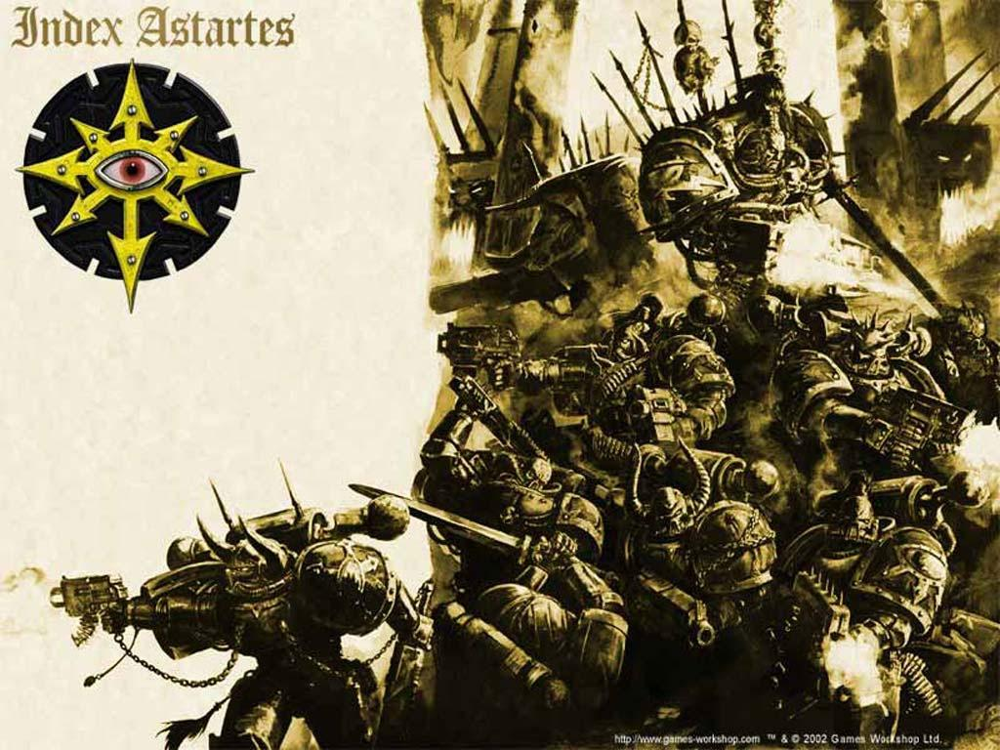
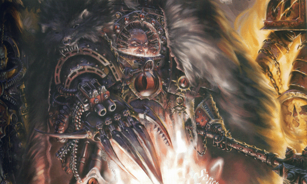
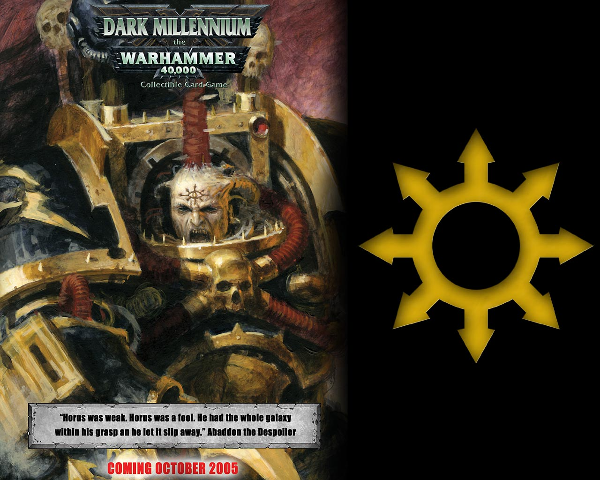

# 影月野狼

## Horus (贺拉斯)

贺拉斯，帝王的其中一个基因之子，在基因原体散布到银河之后他是第一个被重新发现的，尽管在众多基因原体之中属暗黑天使的艾尔庄逊最为资深。贺拉斯在Cthonia行星被发现，一个足够靠近地球的世界，那是不需要光速宇宙飞船就可以到达的距离。

三十年间，贺拉斯是帝王身边唯一的帝王之子，而在这些时间里，他们与第十六支星际战士军团 – 影月苍狼一起作战，成为了一场伟大的圣战(Great Crusade)，而延伸编制成最初的帝国军团。他们在与多危机中互相保护了彼此的生命，那时是帝王与贺拉斯之间关系最亲密的时候。

当帝王预知了第二位基因原体的出现，贺拉斯在大圣战中就失去了军队的绝对指挥权。当更多的基因原体被发现，并领导了他们各自的星际战士军团，贺拉斯就扮演着整体作战指挥官的角色。贺拉斯相当喜欢这个职位，这让他随着时间证明了自己高超的实力，每次的胜利都让他赢得帝王的敬重和其它军团的赞美。

影月苍狼军团沉浸在身为最伟大基因原体的个人护卫的荣耀之中，分享在战斗中贺拉斯的信任并成为最好的战士。影月苍狼在战场中总是站在最前线，努力地建造比帝国其它军团更多的战功。这支军团经常突击并粉碎所有核心反抗势力，并且在移动之后留下其它的军团，用以清理行星据点并进行驻守。

## The Ullanor Crusade (Ullanor 圣战)

无庸置疑的，影月苍狼打败了庞大的欧克(Ork即兽人)帝国被视为大圣战中最伟大的战役，伟大的战果让军团得到了帝王亲授的巨大奖赏，最特别的是，影月苍狼军团从此被更名为”贺拉斯之子”，而贺拉斯本人更被晋升为”战帅”(Warmaster)，在帝王浩翰的军队势力中拥有至高无上的权力。

帝王的宣告，影月苍狼胜利的荣耀都属于贺拉斯，但他的措辞看起来就像对贺拉斯有无比的忿恨。在基因原体们的眼中，贺拉斯为帝王建立了帝国之后，帝王花了不少心血，只为了保住自己的权位。

在贺拉斯出发返回地球，接受属于他的荣耀之前，贺拉斯在一个名为Davin的充满着原始野性的星球感到不适，在他疗养的期间，贺拉斯参加了一场为了让星球上的战士加入的仪式。这本来就是贺拉斯赢得军心的手段，为了那些他视察过的部属，如此在时机到来时，帝国才能够更加容易地利用他们来补充兵力。

## The Corruption of Horus (贺拉斯的堕落)

然而，贺拉斯的名声在改变之后，时光证明了其中的不同之处。贺拉斯与他的军团引见了一些相似的战士聚点，他们开始相信卡傲斯的启示已经成功影响了他们的战帅。贺拉斯之子毫不犹豫地跟随了他们的领导，很快地就鄙弃了帝王在他们心中身为神或造物主的形象，并把卡傲斯诸神当做自己新的信仰。

从Istvaan V的背叛开始到突击帝王的王位为止，贺拉斯之子参加了许多”贺拉斯异变”的战役。在一场与圣血天使的基因原体，圣吉列斯的血腥战斗之后，贺拉斯对帝王发动攻击并战死在帝王手上。帝王也受到了致命的伤害，必须被放置在生命维持器里，那是一个纯金打造的王座，但一切都结束了，背叛者们失败了。对帝国的攻击很快地结束了，贺拉斯之子从地球撤退，并在一场激烈的战争之后回收了他们的基因原体的尸体。

## The Exile (流亡)

贺拉斯之子与其它背叛的军团一起，他们找到了在浩瀚银河中的避难所，那被人称做恐惧之眼的空间(Eye of Terror)。他们为贺拉斯建造了一个巨大的，像保垒一般的坟墓，贺拉斯遗留下来的军团持续地与帝国进行战斗。那曾经无止尽浩大的军团如今也变的可以观望了，当双方的人员伤亡之后，取代他们位置的，就是受恶魔附身的卡傲斯附魔部队。

贺拉斯之子同时和其它许多背叛者的军团进行血战，为了在恐惧之眼里获得最崇高的地位，并得到在其中那些可以利用的，极其稀少的资源的控制权。贺拉斯之子的新母星被一支联合舰队摧毁，而贺拉斯的遗体被帝王之子偷走(Emperor’s Children)。在这充满危机的局势里，贺拉斯之子的生还者们决定推选一个新的领导人，他就是前任影月苍狼精英部队的资深队长，掠夺者阿帕顿。(Abaddon the Despoiler)

阿帕顿感受到了战帅的记忆，贺拉斯的失败让卡傲斯星际战士受到了束缚。这给了他们动力，进行了一次光速般的突击并摧毁了贺拉斯的遗体。从此时开始，黑色军团(Black Legion)成为了帝国最大的恐怖威胁。
