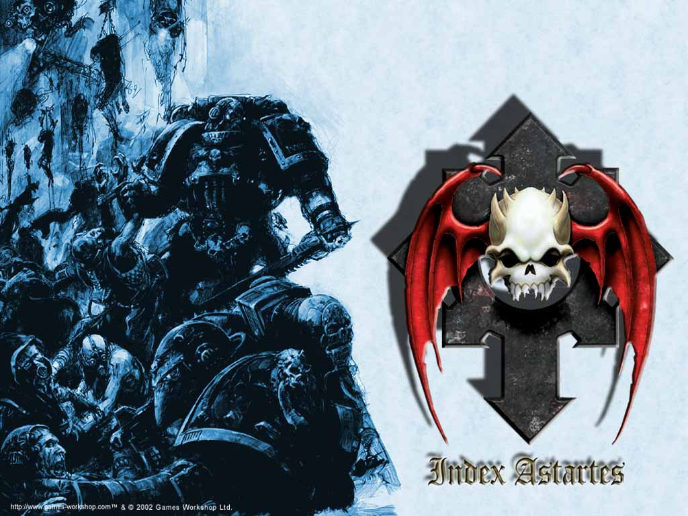

# 午夜领主（Night Lords)）

首先,Nightlord的基因原体;Night Haunter

他降落在Nostramo,这是一个含矿量极高的城市,大部份的人民都过着如蚂蚁一样每天工作的生活,被雇主所压迫及劳动。四处都是罪行,是一个治安很差,很混乱的星球。

Night Haunter没有像其它基因原体一样被家庭收养,他独自一人存活下来,凭着他的机智和决心,自行捕猎野生动物来生存下来。他讨厌这种生活和这种未来,每晚都发着让他毛骨悚然的恶梦...

后来在年轻的时候,他加入了反抗军(不确定),途中每当他见识一些他认为是错误的事情,他都会很快坚决地处决了这些他认为的罪恶。

最初,城市的腐败贵族阶层消失了,最初激烈反对的声音也消失了,人们都看到官员在窗外边垂悬......

在这些时间,该城市的犯罪率接近零,社会因为他出现了巨大的变动,一些母亲会告诉她的儿子,如果他不乖,Night Haunter将会来抓你。人们对他的形象出现了种种的传闻(就像蝙蝠侠 ),有人认为他是一个一名罪犯或是异教徒,或是一头黑暗生物,他有着锋利的利爪.....并且随时准备把你的内脏挖出来!

这个城市的人民看到希望了,Night Haunter成为人们恐惧的象征,而他,最终成为这个城市第一个国君。当初他打算成为一个温和而公正的统治者,但直到后来,只要一些不公道的词语进入了他的耳朵,他便会翻遍天涯海阁把源头找出来,然后用痛苦的方式杀死他,这就是他的新标准,时而温和公正,时而凶残成性。

终于,帝皇来到了,就像这个星球上的预言所说一样。

当帝皇出现的时候,他发出的亮光让这星球的居民张不开眼,因为他们已经适应了这星球长久以来的黑夜。

帝皇和他的代表团一直走,直到Night Haunter的皇座前面,他正站着等待帝皇到来,他拼命张开自已的眼晴,看着他的父亲,也就是帝皇,向他诉说什么事情发生在他身上。

Night Haunter接受军训,成为第八星际战士团的基因原体,他们铁一般..或说毫无感性的记律和作风,让他们对搜捕政治犯非常有心得。

他们喜欢在自已的战甲上添上很多让敌人恐惧的装饰,散布大量使对方恐惧的谣言,有效制止了所有罪行,也使很多突变体(?)和异端进入死亡的末路。

他们实行轮流当兵的制度来补充新兵,但因为Night Haunter离开了,他的星球又回复到从前一样。结果,唯一够强壮成为星际战士的只剩下那些罪犯和流氓,他的军队渐渐失去控制,纪律一天比一天差。

当一些星球有激烈的反抗时,皇帝便会派遣Night Lord到该处驻守,他们会以血腥而残酷的暴行来整治治安,渐渐,Night Haunter的所作所为被视为疯狂。更甚者,帝皇叛背了他,他声称他从来没有认可Night Lord任何一次的清洗行动,并且Night Lord必须为他们的所作所为接受审判。Night Haunter非常愤怒,他开始攻击帝皇的圣城,并且向帝皇派来清洗Nostramo(就是他的原生星球)的皇家之拳进行攻击,Night Lord善于埋伏和游击战术,让帝国的船舰在看到敌人前便被成千上万炮火轰炸。最终,Nostramo还是保不了,它因为内核过度加热而爆炸了。(这里有点不确定)

Night Lord的可怕行动使他们受到chaos诱惑,事实上Night Lord开始变得疯狂,他们的战争不再以帝皇的名义,而变成以死亡和恐惧为名。最后,帝皇召回Night Haunter回来,打算要求他回答为什么有这样的改变和再次惩罚他。但在Night Lord到达前...地球出现了一次大危机...

对,贺拉斯背叛开始了,Night Lord然想都不用想便马上加入了贺拉斯的行列,他们完全没相信任何一个混乱之神,他仅仅只是希望得到混沌的力量。现在,Night Lord已经完全由罪犯组成,他们再没有以往的纪律和忠诚......

在贺拉斯失败后,他们没有像其它叛军一样撤退,他们继续对帝国发动攻击,但他们的战术改变了...变得像想要自杀一样.........

Night Haunter最终被神殿刺客所杀,然而,这很明显是Night Haunter自已不作反抗才会发生的(神殿刺客确实很利害,但其实理论上基因原体要搞定他们完全不成问题)。虽然没有人知道原因,而且从来没有人去证明他真的死了,但M'Shen的vid日志所知,Night Haunter死时带着微笑。很可惜,他的死没有Night Lord的攻击停下来,他们还是依然去帝国进行攻击了41年。

Night Lord的普遍做法,使一个星球失去通讯能力,然后才发动攻击,他们对敌人很残酷,但一方面,他们也很乐意接受投降。

Night Lord不会有什么对混沌之神的崇拜仪式或是邪恶的传教运动,他们只会战斗。黑暗是他们的盟友,他们善于运用恐惧和埋伏,秘密行动是他们的看家本领。

他们的军队有特别强的快速打击部队,以快速攻击让敌人无从反击,最著名的是他们大量使用的机车,猛禽小队和飞行恶魔。他们喜欢在夜间战斗,他们的出生让他们即使在黑夜中也能清楚看见敌人,但对方却看不见他们。当他们不移动,不射击,你将会无法发现他们。

这是他们的座右铭:「We have come for you!」

维基中有四句名言,我只翻译一句我认为精彩的:「他的到来并不使我惊奇,刺客。为什么我不可以被你杀害?只要你杀了我,使可以证明我是对的,或是说,证明了这事情的真相。我仅仅只是惩罚了那些我错误的人,就好像那个虚伪的帝皇现在打算惩罚我一样。没什么比我的死亡是更好的辩护了。」

另外,他的个人传记暗示了一件关键的事情:Night Haunter有着双重性格.....

还有的是,Konrad Curze是他在星球上的名字,但他告知帝皇Night Haunter才是他的名字。

还有三句名言,但我累了:p

以下是我自已说的

其实Night Haunter说不定是无辜的,他自已也控制不了自已的军队,再加上他自已的双重性格,说不定他自已并不知道自已做了什么。

他的死,除了是对帝皇的一种反抗外,说不定也是一种希望的赎罪,他的战术改为自杀式进攻,是不是心中也希望了结自已和他自已那个发狂的军队呢?

说不定Night Haunter也认为自已是错的,只是他一方面也无法原谅帝皇对他做的事,加上他的双重性格.......让他也开始无法控制自已的行动。

从另外三句名言,我可以告诉你,Night Haunter相当期待帝皇的到来,每天做着恶梦的他,一直希望这个父亲回来接他,总之,起初他忠诚到不得了。他内心的深处大概还是有一部份存在着对帝皇的无比忠诚.....

有关楼上的NL的故事,是从WD261中节录出来的
当初在选择了40K军队时,看上了NL蝙蝠头的造型

选定后,为了了解NL的军团,花了好长的时间才把这篇故事看完
(英文不好
但看完,让我更爱上NL,也更加配服GW说故事的能力

在这边我把这篇故事补完,有些没PO的片段我认为也很精彩
以下是补上我觉得很精彩的片段翻译,可能有错,各位看官多包含

在Haunter的胚胎胶囊落在Nstramo,因为降落的力道过大,让胶囊深入星球的熔岩层.理论上来说,Haunter要来到地表,必须要游过炎浆才可能.有记载到:一个全身通红的婴儿在那儿,从残破的街道中的深坑中缓缓爬出,炎浆从他身上低落.是恶魔...不会错,有着婴儿的身驱,却有着老人一般的表情,它的双眼有如冰冷的黑曜石一样.

这段是讲述Haunter初登场的时候,令人印象深刻;值得一提的是Nstramo是一个没有亮光的黑暗星球,这也说明了NL天生的夜视能力

有关Haunter的生平,有提到他受到"恐惧灵视"这个灵能的诅咒.这和灵族先知的预知未来能力不同,它只能看到黑暗和不安.让Haunter步入疯狂.有一些卷轴记载到"黑暗"
"有时候,在极度的痛苦中,我看见是什么选择了我.在这个幻象中,我夺走了无数的生命,他们的头胪是我的战利品.而我在父亲的手中一次又一次的死去.我的儿子屠杀着他们的兄弟,我的名字就是恐惧的代名词.我看到我的世界被光明之枪所撕裂,将一切化为尘埃,如此的鲜明,一再的重复"

这段说明了Haunter性格和行为改变的主要原因,他所看到的,在未来是真的发生了
但,这是Haunter自发性的去实现预言,或是只是巧合,没人知道

在杂乱的街道尽头,帝王找到了Haunter,长发盖住了他的脸,好去抵抗帝王带来的光明,帝王张开了双臂,来迎接他的儿子.
Haunter开始疯狂的颤抖,他的双手就快把自己的双眼给挖出来,他跪在地上.口中发出微弱的尖叫.帝王命令的他随从后退,他带着微笑,把手温柔着放在Haunter头上.
"Konard Curze,平静下来吧,我来了,来带你回家"
"那不是我的名字,父亲.我是Night Haunter.而且我知道你为了什么而来"

这段是说帝王跟Haunter见面,说明了Haunter的恐惧成真,纵使帝王叫他的名字.纵使他称帝王为父亲,他还是不愿意自己就是那个人.而只是黑夜中的幽灵

Haunter的军事教育是由帝王之子的基因原体Fulgrim所负责的.Haunter跟其它的基因原体感情并不融洽,但是他对Fulgrim存在着一些些的信任.也因如此,Haunter才肯对Fulgrim透露过他所见到的幻像,而Fulgrim却跟Rogal Dorn(这是否为就是帝王之拳的基因原体?)透露这个讯息,Rogal Dorn认为这是在亵渎帝王,埋下了2人对立的种子.

"在石板上,Rogal Dorn混身鲜血,带着微弱的呼吸,他的身体少了一大半.伏在伟大战士身上的,是一只可怕的石像鬼.它如同Night Haunter一样的苍白.他带着沉重的喘息,纠缠的长法盖着黑玉般的双眼,面对着我们.他哭泣着.扭曲的面孔,疯狂的咆哮,他的表情充满的憎恨与内疚"

Haunter杀了自己的兄弟,也说明他的身体产生了异变,并不是受混沌影响,而且导致这样的结果发生,一部份是他认为他被Fulgrim出卖,一部份是Rogal Dorn前来讨伐他,他不得不战;这跟千疮之子被太空野狼攻击一样...唉..