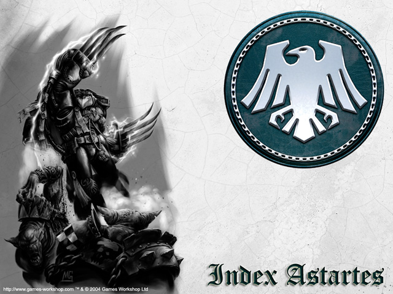

# 闇鸦守卫

引言

闇鸦守卫是一支专精于敌后突击，游击作战和针对敌方战略行动进行高速反应的特别战团。闇鸦守卫擅长巧妙的运用敌方的弱点。所以在大远征中，他们征服了无数固若金汤的行星。然而在何露斯之乱当中，闇鸦守卫几乎被完全摧毁。所幸，他们孤注一掷，奋力拼搏，终于使军团得以幸存。

## 起源

几乎无人知晓闇鸦守卫基因原体Ｃｏｒａｘ的过去。皮肤苍白的他的年轻时代被迷雾所笼罩，人们所知的只有他在矿产丰富但却十分荒凉的Ｌｙｃａｅｕｓ上长大。Ｌｙｃａｅｕｓ是Ｋｉａｖａｈｒ－一颗高度发达并拥有铸造教堂的科技行星的卫星月，行星上的主要人口由来自周围粗野星球的被放逐者们以及自Ｋｉａｖａｈｒ流放而来的人渣们和政治犯组成。Ｌｙｃａｅｕｓ的监工们有着强大的武装力量，他们居住在一座黑色的方尖塔中，用暴力统治着这个荒凉的世界……

根据古老的军团典籍记载，Ｌｙｃａｅｕｓ曾经是一颗被奴役的行星。居民们长期以来作为Ｋｉａｖａｈｒ的奴隶在巨大的矿坑里辛苦劳作。在如此危险的环境中，各种死亡事故屡见不鲜。不仅如此，重度的污染还使孩子们的健康受到威胁。Ｌｙｃａｅｕｓ之月的人民日夜向帝皇祈祷，希望有一日能有一位救世主能来解放他们。而他们的祈祷也得到了回应，一位白色的救世主来到了Ｌｙｃａｅｕｓ之月，尽管那时他还是个孩子……

关于Ｃｏｒａｘ是如何被帝皇找到的故事有许多版本，而真相却无人知晓。其中一个传说说的是百余名在一个位于冰河之下的矿井中工作的奴隶找到了隐藏其中的基因舱。另一个传说则叙述了一颗带着烈焰的慧星坠入一座铁山附近，一位笼罩在幽灵般白光的孩子自废墟中缓缓走出…… 第三个传说讲述的则是一位如巨人般的垂死战士在临死前来到一批奴隶面前，乞求他们庇护他怀中的婴儿。无论事情的真相到底如何，Ｌｙｃａｅｕｓ的奴隶们把这名肤如白雪发如午夜的孩子带大，并将他取名为Ｃｏｒａｘ-“救世者”。他们不但视他如己出，甚至冒着危险在看守者的眼皮底下隐藏了他的存在。在接下来几年中，Ｃｏｒａｘ那超乎常人的发育速度令奴隶们大受鼓舞，他们一致认为Ｃｏｒａｘ真的是帝皇派来的救世主。从这些来自不同社会背景的养父母们那里，年轻的“救世者”学到了许多生存的技巧-包括城市战，爆破作业与最原始的杀戮技巧，以及作为一名领导者所需的各种特质。沉默寡言的Ｃｏｒａｘ有着不可思议的理解能力，他以惊人的速度消化了所有知识，并且渴望学到更多。

自孩提时代开始，Ｃｏｒａｘ就被教导他的宿命是将Ｌｙｃａｅｕｓ的人民从苦难中拯救出来。时光飞逝，随着Ｃｏｒａｘ的成长，自由的种子也开始在Ｌｙｃａｅｕｓ的土地上茁壮成长。尽管奴隶们有限的资源只能制做出最基本的武器。Ｃｏｒａｘ将大部分的武器集中在各个战略要点附近来避免武器不足的问题。不仅如此，他还将奴隶们编制为暴风突击小队，并给每个小队都任命了小队长。这些小队长们不但经过精心挑选，最关键的他们会无条件的遵守Ｃｏｒａｘ的命令。Ｃｏｒａｘ还开始同看守们进行心理抗争，策划罢工与制造各种骚乱，以此来打击守卫们的士气。Ｌｙｃａｅｕｓ就像一个即将被引爆的炸药桶一般，在各方的压力下随时可能猛烈的爆炸……

当反叛的时机终于来临时，Ｃｏｒａｘ精心训练的奴隶反抗军驾驶着采矿用的巨大机械，迅速占领了数条街道。不仅如此，以掘石机和雷射切割器为武装的破坏小队还切断了埋在地下的通讯及补给管道。与此同时，Ｃｏｒａｘ亲自带领一小批最精锐的战士夜袭了监工们的方尖塔并将其占领。奴隶们处决了所有被俘的监工，数世纪的仇恨此时终于得到宣泄。

Ｋｉａｖａｈｒ的技术工会被这次突如其来的叛乱打的措手不及。他们迅速派遣了部队对Ｌｙｃａｅｕｓ进行了镇压。然而事情并不如他们所想象的那么顺利。Ｃｏｒａｘ的战士们从重力井的上方向敌人投掷满载不稳定工业废料的货舱，其效果并不输给任何炸药制成的武器。当Ｋｉａｖａｈｒ的部队冒着猛烈的轰击强行登陆后，迎接他们的是Ｃｏｒａｘ和他亲自挑选的精英部队。乌鸦的利爪如外科手术般精确，不仅撕开了Ｋｉａｖａｈｒ部队的阵线，还彻底破坏了他们的补给系统。尽管Ｋｉａｖａｈｒ拥有优势兵力却不得不转入守势。

没有了Ｌｙｃａｅｕｓ的矿产资源，Ｋｉａｖａｈｒ的经济迅速崩溃。技术工会失去了权力，分裂为数个派系为了争夺余下的资源互相争斗，整颗行星陷入了无政府状态。失去了母星的支援，Ｋｉａｖａｈｒ的平叛部队迅速投降。Ｌｙｃａｅｕｓ的人们欢庆了数日。不仅如此，他们还将Ｌｙｃａｅｕｓ改名为Ｄｅｌｉｖｅｒａｎｃｅ（大意为被解救的行星）以纪念伟大的胜利。

在最完整的大远征记录-帝国史鉴（Speculum Historiale）中并没有太多有关Ｃｏｒａｘ是如何与帝皇相认的记载。就像许多有相似情况的战团一样，寻找这件事真相的难题则被留给了闇鸦守卫的智库馆长们。传说就在Ｌｙｃａｅｕｓ人欢庆胜利时刻，帝皇驾临了这个刚刚获得自由的行星。Ｃｏｒａｘ谨慎的望着这位孤身前来的陌生人，随后两人交谈了足有一天一夜，尽管有关他们交谈的内容已经无人知晓。第二天的破晓时分，Ｃｏｒａｘ同意接过闇鸦守卫的指挥权，并为帝皇效忠。条件则是帝皇要帮助他给Ｋｉａｖａｈｒ带来永远的和平。在战锤的世界中，惟有武力才能带来和平。强大的闇鸦守卫将本来就摇摇欲坠的技术工会政权彻底粉碎，取而代之的是由帝国监管的新政府。新政府的效率和技术工会的腐败官僚有着天壤之别，仅仅数年Ｋｉａｖａｈｒ的重建就达到令人满意的程度，丝毫看不出这是一颗新近遭受战火与经济崩溃的行星。与此同时，Ｋｉａｖａｈｒ新政府还恢复了Ｄｅｌｉｖｅｒａｎｃｅ上的采矿业。当然，对矿工的待遇自然大大改善。Ａｄｅｐｔｕｓ　Ｍｉｎｉｓｔｏｒｕｍ（帝国专门掌管对帝皇崇拜的组织）亦在Ｋｉａｖａｈｒ开始推行对帝皇的个人崇拜。回到Ｄｅｌｉｖｅｒａｎｃｅ的闇鸦守卫将曾经作为监工们压迫象征的黑色方尖塔改建为一座要塞，并称之为“鸦之塔”。

大远征见证了闇鸦守卫的能力，在那混乱的时期他们为帝皇赢得了数不清的辉煌胜利。Ｃｏｒａｘ从未忘记他在Ｄｅｌｉｖｅｒａｎｃｅ上所学到的东西，周密的计划和他在突袭方面的天赋使他和他的战士们在帝皇的远征之路上无坚不摧。不计其数被誉为固若金汤的行星被乌鸦致命的利爪撕的粉碎…… 闇鸦守卫成为了刺杀，敌后行动与破坏的代名词。很少有一场战役需要Ｃｏｒａｘ投入所有的乌鸦参加战斗，不过这并不意味着Ｃｏｒａｘ是个“小气”的人。事实上，造成这种现象的真正的原因闇鸦守卫往往可以用最少的人数来完成任务。

闇鸦守卫的能力甚至得到了帝国的“战帅”-何露斯的肯定，在何露斯指挥的许多场大型战役中人们都能看到乌鸦们黑色的身影。以至于许多人认为在何露斯无数辉煌胜利中有一部分要归功于闇鸦守卫的支援。关于这一点，闇鸦守卫们选择了保持沉默。许多帝国的历史学者推测这是因为冷漠的Ｃｏｒａｘ不想过度亲近何露斯。谣传有一次两人甚至差点发生激烈的争吵。从此以后，Ｃｏｒａｘ的军团不再接受何露斯的指挥。两人在何露斯叛乱之前也再没见过面。

第一次军团内战爆发后，闇鸦守卫，钢铁之手与火蜥军团被一同派往何露斯的大本营-ＩｓｔｖａａｎＶ发动进攻。另外四个军团则在他们的侧翼准备支援登陆作战。一切看起来都那么顺利，叛徒似乎就要伏诛，然而尽管何露斯背叛了帝皇，他的狡猾却更胜从前…… 忠心耿耿的三支军团在登陆后发起猛攻，无奈背叛者占据地形优势利用大量掩体使勇敢的星际战士们无法向前推进。情况危急之下他们决定暂时撤退，重整旗鼓后再做打算。就在三支军团撤退到由钢铁战士驻守的空投区时，迎接他们的居然是一阵冰雹似的炮击！原来何露斯已经腐化了前来攻打他的七支军团中的四支。被两面夹击的忠诚战士中只有极少一部分成功脱出，大部分则是为了掩护他们的同伴撤退拼死奋战到最后一刻……

闇鸦守卫在这场战斗中几乎被彻底摧毁。心灰意冷的Ｃｏｒａｘ回到了Ｄｅｌｉｖｅｒａｎｃｅ，并被命令尽快重建闇鸦守卫。在这段帝国的艰难时期，Ｃｏｒａｘ对自己竟然无法做些什么感到十分自责。于是自暴自弃的他把自己关进鸦之塔的图书馆中，努力搜寻着古老的典籍，试图找到一种重建军团的方法。他找到了一些许多年前帝皇创建第一批强化战士时的资料。通过研究这些资料Ｃｏｒａｘ有了一个惊人的发现，那就是他可以通过重复这些程序来“制造”一批完整的星际战士！但是古老的典籍也提到使用这种方法可能会带来意想不到的危险甚至制造出一批怪物。尽管如此，Ｃｏｒａｘ还是下定决心赌一赌，他马上命令药剂师们开始执行制造程序。

有关第一批“复制闇鸦守卫”的所有资料已经被闇鸦守卫们封印起来，没有人知道他们的命运到底如何…… 而他们的后继者则成为了新的闇鸦守卫军团。新生的乌鸦们变的与众不同，他们不再和其他的军团一起战斗，战术也变的更加隐密。而一切闇鸦守卫曾使用禁忌技术的资料都被抹消。一个太空野狼的符文祭司-Weregeld贤者曾经说过：“在那些漆黑的乌鸦的身体中，寄宿着疯狂而嗜血的野兽……” 也许这是因为同样的诅咒（许多太空野狼战士背负着Ｗｕｌｆｅｎ的诅咒，战斗中可能会变成狼人……）与誓言反而使得两个军团惺惺相惜吧。当然这句话也侧面证明了复制军团战士基因的不稳定性。据说每一百个基因舱中只有一个能成功塑造一名星际战士，其余的不是在过程中夭折就是变成难以想象的诡异生物……

时光飞逝，整个银河系都在战火中燃烧。Ｃｏｒａｘ和他的新生军团也在长期的休整后进入这个庞大的战场。在Ｃｏｒａｘ的英明领导下，闇鸦守卫的敌后行动技巧似乎更胜从前。每一次行动乌鸦们都能以最小的伤亡取得胜利。然而，重建军团的代价也是相当高昂的。鸦之塔的地下已经充满了塑成失败的星际战士，这些野兽般的失败品将鸦之塔的地下变成一个令人恐惧的咆哮地狱。Ｃｏｒａｘ为如何处理这些大伤脑筋，虽然说它们不是真正意义上的星际战士，甚至不能称之为“人”。但是这些怪物身上毕竟流着闇鸦守卫的血…… 苦思良久，出于不能让任何人知道闇鸦守卫为了重建军团付出了多么大的代价，Ｃｏｒａｘ最终决定以帝皇之名带给这些牺牲品永远的安息。

随着阿斯塔特圣典的作者-极限战士军团的基因原体罗保特登上帝国军最高军事指挥官的宝座。他上台后的第一项决定就是将每个军团都拆分为“战团”。尽管有许多基因原体对这项决议感到不满，Ｃｏｒａｘ却对罗保特的想法表示支持。最后，闇鸦守卫被拆分为三个战团：黑色守卫，诽谤者和猛禽军团。

Ｃｏｒａｘ的一生充满了神秘色彩，连他的最后归宿都是那无边黑暗之中。在闇鸦守卫被拆分，帝国进而统一了整个银河系之后，Ｃｏｒａｘ将自己锁进了鸦之塔的顶端，为了自己在重建军团时犯下的罪孽日夜向帝皇祈求宽恕。数年过去，无人知晓帝皇是否在梦中给了Ｃｏｒａｘ救赎…… 直至一天，Ｃｏｒａｘ突然自鸦之塔中冲出并离开了Ｄｅｌｉｖｅｒａｎｃｅ。他最后一次被发现是在恐惧之眼附近，自此之后就再也无人知道他的去向。这位伟大的基因原体最后选择在混沌中结束他扑朔迷离的一生。而他的唯一遗产只是简单无比的一个词：“永不”…… （Ｎｅｖｅｒｍｏｒｅ……）

## 家园

作为一个著名的科技行星，Ｋｉａｖａｈｒ生产各类战争装备的能力是有目共睹的。加上其卫星月Ｄｅｌｉｖｅｒａｎｃｅ提供的大量矿石则更是如虎添翼。据资料记载，Ｋｉａｖａｈｒ在它生产能力到达顶峰时甚至可以与一个大型铸造世界相抗衡！当然，闇鸦守卫的真正故乡还是土地贫瘠却拥有丰富矿产的Ｄｅｌｉｖｅｒａｎｃｅ。从这颗无氧的星球的黑暗侧面，每天都有大量的运输机将各种矿石运往Ｋｉａｖａｈｒ。Ｄｅｌｉｖｅｒａｎｃｅ最有名的象征物就是一座巨大的黑色方尖塔-闇鸦守卫的要塞“鸦之塔”。这座高塔曾经是Ｄｅｌｉｖｅｒａｎｃｅ过去的统治者-来自Ｋｉａｖａｈｒ技术工会的监工们残暴压迫的象征。在Ｃｏｒａｘ带领奴隶们消灭监工们后，这座塔便被改造为一座天然要塞。与许多军团不同，闇鸦守卫与Ｄｅｌｉｖｅｒａｎｃｅ的居民保持密切的关系。尽管闇鸦守卫的募兵范围并不局限于单个地区，大部分新兵却都是自Ｄｅｌｉｖｅｒａｎｃｅ招募而来。Ｄｅｌｉｖｅｒａｎｃｅ的人民视星际战士们为帝皇崇高意志的象征，对他们将本部设在自己的行星感到骄傲。另一颗行星Ｋｉａｖａｈｒ则是作为闇鸦守卫主要的装备供给基地。在这颗主要人口为工匠和技术人员的行星上遍布着大大小小的工业基地与城市。这两颗行星构成了一个巨大的生产线，为闇鸦守卫的征服之路做成不小的贡献。

## 战斗信条

闇鸦守卫一直忠实的遵循阿斯塔特古抄本中所记载的战斗方式，尽管他们所使用的战术却有很大不同。在战斗初期，闇鸦守卫总是先以大量使用侦察兵收集前线情报，而后，装备有跳跃喷射包和雷霆爪的指挥小组带领大批同样装备喷射包的突击小队作为先锋部队以迅雷不及掩耳的速度突击敌人。与此同时，大批战术小队也将由登陆舱空投或是由雷鹰机群机降入侦察小队所指定的敌方薄弱地带。闇鸦守卫作为“敌后行动”的代言词在帝国军团中享有盛誉，这也意味着闇鸦守卫总是尽量回避和敌人在前线硬碰硬的进行战斗。虽然闇鸦守卫只装备很少的装甲部队，但是用登陆舱空投无畏机甲支援步兵却是相当普遍的闇鸦战术。在何露斯叛乱之后闇鸦守卫的人数大量减少。残存的闇鸦守卫因为人数上的劣势不得不寻求另一种战术，于是许多闇鸦守卫战士逐渐变成游击战术的专家。而这个特色一直保留至今，为了寻求最佳的机动性和隐蔽性闇鸦守卫彻底舍弃了大部分的装甲部队和重型支援，单纯依靠神出鬼没的步兵给予敌人致命打击。

## 组织

作为刺杀，敌后行动与破坏的代名词，闇鸦守卫已经成为各个战团研究学习突袭技巧的经典范例。有预见性的部署使闇鸦守卫的第一波突击部队总能被空投到最合适的位置。然而，闇鸦守卫强大之处不仅是准确的空投能力，高机动并充满战场弹性的部队才是闇鸦守卫为人所恐惧的关键。在空投舱和战场运输车辆的帮助下，闇鸦守卫总能在第一时间与敌人接触并展开肉搏战，这使他们成为一支有能力快速将战场形势逆转的部队。

闇鸦守卫的另一大特色就是许多老兵以装备他们历史悠久的星际战士盔甲为荣。这些盔甲大部分是在ＩｓｔｖａａｎＶ事件爆发前后甚至大远征时期制造的。老兵们认为穿带这些盔甲战斗能得到Ｃｏｒａｘ的祝福，因而更努力的战斗。

## 信条

闇鸦守卫承认帝皇为军团的创立者与银河的统治者。但无论如何，对他们而言帝皇只是一个遥远的象征。Ｃｏｒａｘ则被视为军团的父亲与最高领导人，他坚强的意志与无私的付出被每一名闇鸦守卫战士所敬仰。直至今日，乌鸦们仍然将Ｃｏｒａｘ的教诲当作行为的准则。

对闇鸦守卫的领导者来说，战术素养和进取精神被视为比战斗技巧更重要的个人素质。只要有机会将致命的利爪插入敌人的心脏，乌鸦就不会浪费时间在如何撕开对方的胸膛上。这种战斗信条在战斗时往往会引发闇鸦守卫与其它喜欢强攻的战团关系紧张，特别是以鲁莽的攻击而文明的圣血天使战团。

## 基因种子

由于闇鸦守卫的基因库遭到过无法挽回的损坏，他们招募新兵的过程往往比别的军团久的多。
不仅如此，苟刻的训练使人数众多的志愿者中只会有极少数人活下来最终成为一名星际战士。所以闇鸦守卫部队长期以来就以人数稀少而闻名。

作为Ｃｏｒａｘ的孩子们，闇鸦守卫的Melanchromic器官发生了严重的突变。一名闇鸦守卫战士的皮肤将随着时间的流逝逐渐变得苍白，直到苍白如纸。同样的变异还发生在他们的发色上，他们的发色亦会最终变的漆黑如夜。这种对身体无害的变异所造成的唯一后果就是所有发生过变异的闇鸦守卫都会拥有和他们父亲一样的特征-肤白如雪发如午夜。

## 战吼

闇鸦守卫的战吼通常用拉丁文喊出：“Ｖｉｎｃｔｏｒｕｓ　ａｕｔ　Ｍｏｒｔｉｓ！”
