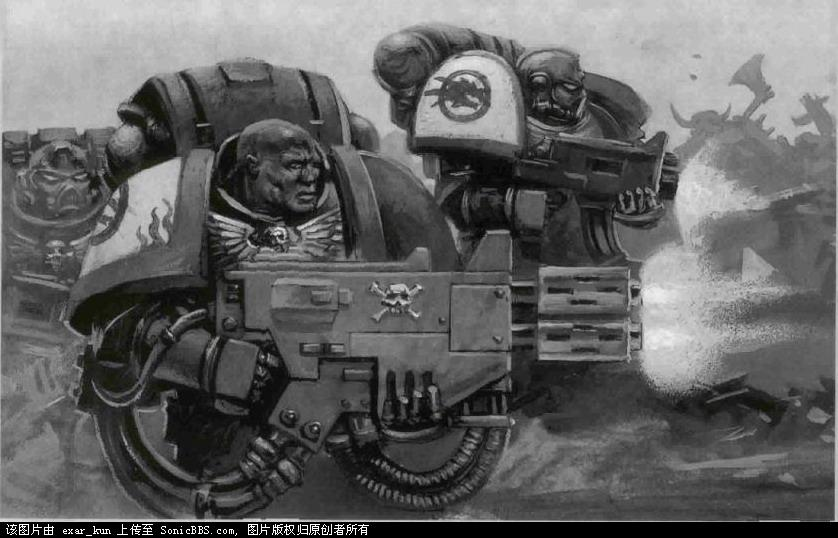
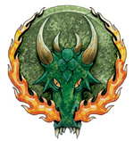
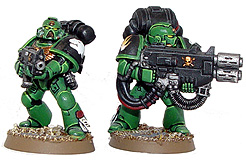
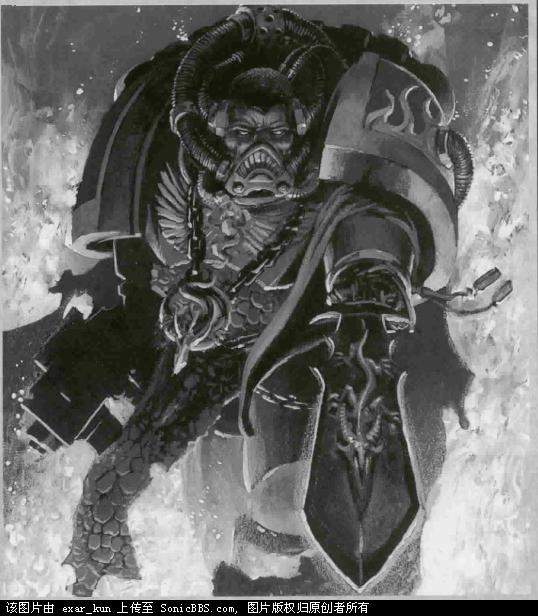
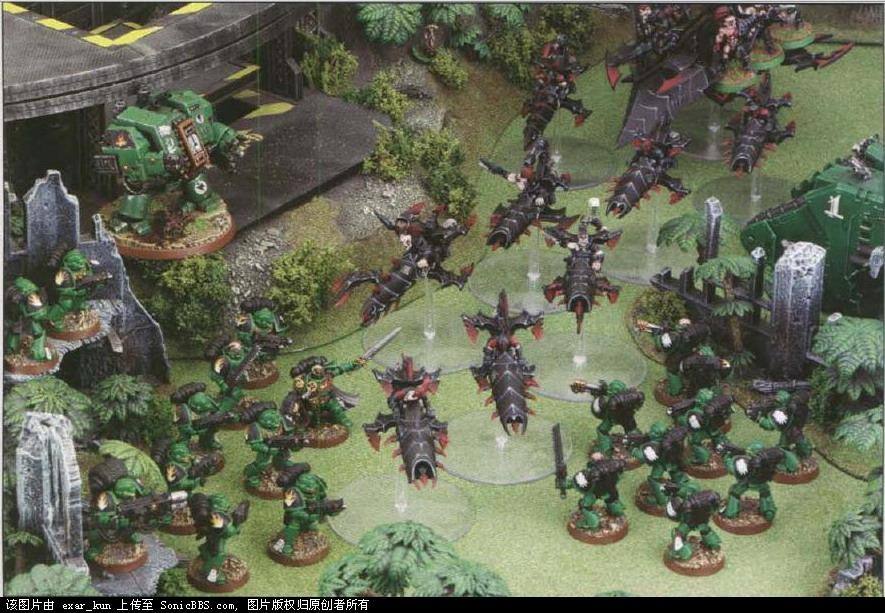
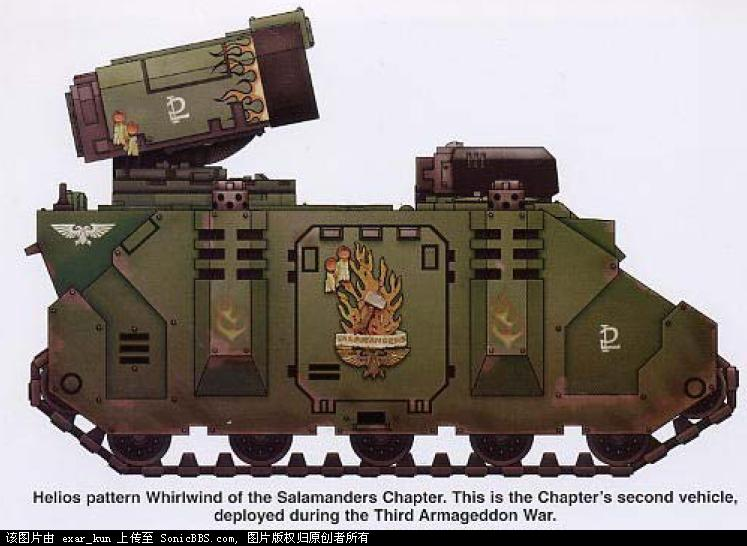
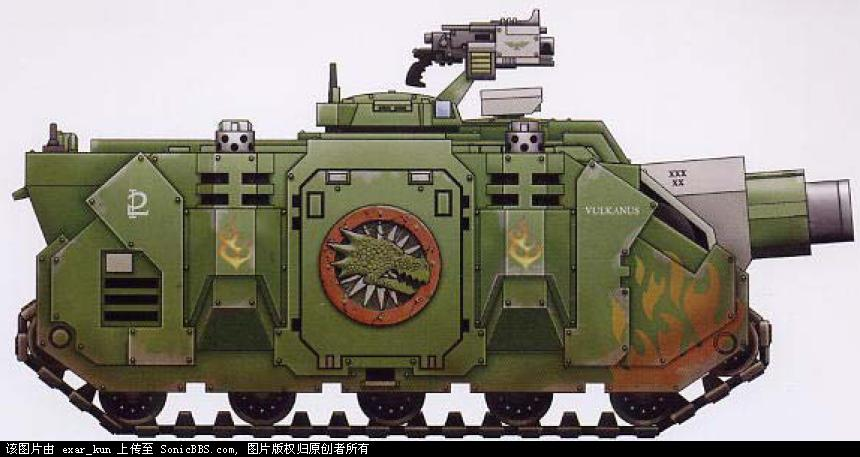
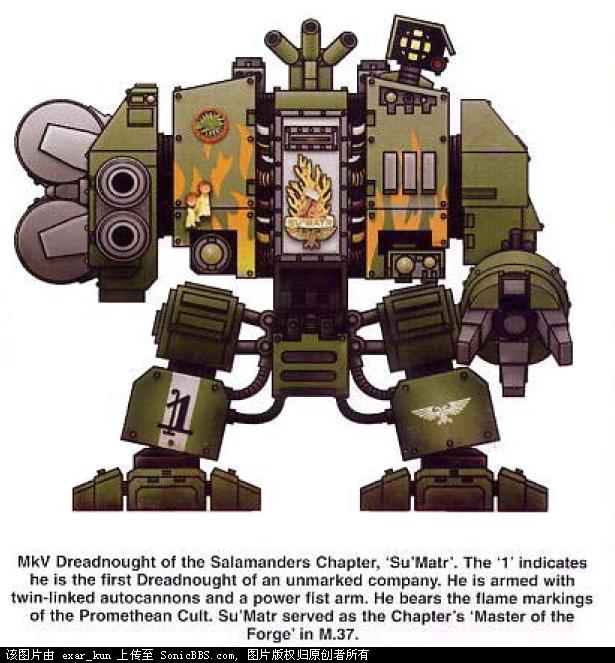
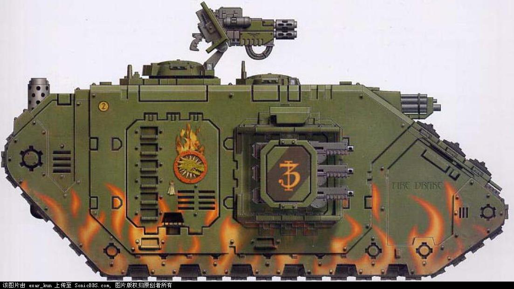

# 火蜥蜴战团

> 翻译 Index Astartes Salamander Chapter火蜥蜴战团
> exar_kun

The Salamanders Space Marine Chapter

作为初创战团之一，火蜥蜴战团拥有能追溯回帝国之初的丰富历史。火蜥蜴战团的成员从居住于Nocturne（一个致命的火山星球）的人民中选出。这样一个世界孕育了吃苦耐劳的战士，拥有强壮的体质和忠实的心灵，成为理想的星际陆战队征兵对象。

## 起源

在所有的帝皇的基因原体的故事中，伏尔甘的传奇故事是其中最为人所知的。根据普罗米西安之书（帝国对伏尔甘的了解的主要来源）所说，在试炼之时，一段动荡不安，星球遭到巨大地震和火山喷发折磨的年代，有一颗巨大的彗星拖曳着一道长长的火焰划过Nocturne的天空。没有人知道这一切是否预兆着基因原体的到来。Nocturne是一个残酷无情的火山世界，一块充满岩石悬崖和不断隆起的玄武岩山脉，使早期的殖民者很难利用其丰富的矿脉。自从人们的记忆之初起，艾尔达海盗就给Nocturne的人民带来无尽灾难，不断地洗劫小定居点，劫走并奴役人类的孩子。因此，Nocturne的人民很少娱乐休息，十分吃苦耐劳而讲究实用。

据普罗米修司之书所著，某日早晨一名叫尼贝的铁匠在走进铁匠铺的院子时发现了基因原体。当时基因原体是否是在襁褓中并不清楚，但这个不明身份的婴儿在铁匠铺的出现非常奇怪，使尼贝将其带到了他的定居点的长老议会面前。早在许多个漫长的Nocturne星球年之前，贤哲预言了救世主的到来，一名从天堂而来，将他们从堕落的艾尔达手中解救出来的战士，因此人们马上意识到尼贝找到的这个婴儿的重大意义。没有人敢宣称这个婴儿属于他之手，因此长老会颁布命令让尼贝将这个婴儿作为他的养子和学徒。这个铁匠大师以 火蜥蜴，一种巨大的，漫步于Nocturne火山中的蜥蜴，的第一个国王之名，将这个婴儿命名为伏尔甘。

伏尔甘十分惊人地成长。在三年中，他就比这个聚居地中所有的人都强壮巨大，思维锐利过所有Nocturne打造的剑刃。他很快地学会了尼贝所教的所有金属锻造技巧，并在不久后就在这一方面超过了他以此闻名的养父在这一方面的能力。就是伏尔甘他教导了Nocturne人民最不为人知晓的金属的秘密，最神秘的锻造模式，金属铸造，合金工艺和金属的互相键合。这些他教授的课程改进了Nocturne人早已熟练的武器制造技巧。

据普罗米西安之书所说,在伏尔甘4岁时,一群艾尔达来到他的村镇,意欲进行袭击和抢掠.当地的人民已经长久习惯于这种抢掠,并且想出了许多聪明的方法以躲避这些掠夺者.但伏尔甘宣称他不会因为任何进攻者而躲藏自己,而且不顾其他村庄贤哲的请求,扛着铁匠锤站在村庄正中.为他的勇敢所激励,村庄中的其他人离开他们在阁楼和地窖中的避难所,站在伏尔甘身旁,鄙视那些进攻者.伏尔甘站在防线的最前面,双手各挥舞着一把铁匠锤,一人就杀死了一百个艾尔达袭击者.其余的袭击者从伏尔甘的盛怒下逃走,这个村庄的胜利也很快传遍了Nocturne.不久七个最重要的村庄的领袖就来到向伏尔甘致敬,赞扬他与艾尔达袭击者的战斗.领袖们发誓面对并且击碎他们的敌人而不是在恐惧中躲藏.并且决定召集所有人进行庆典以庆祝这次伟大的胜利,其中包括大规模的武器制造技艺的竞赛.

普罗米西安之书中被简单记作"outlander"的一段说了伏尔甘是如何和帝皇重聚的.书中所说,在庆典的开幕式上,一个陌生人出现在伏尔甘的村庄的大门口.他只是问了他能否参加竞赛.尽管他闭口不提自己从何而来,他仍被准许参加.他的皮肤苍白,服饰奇怪,但仍然被看出是位强者.他向聚集的观众宣布他将在任何竞赛中胜过所有的对手,观众们用大声的嘲笑回应他.他们都相信没人能在智力,心理和技艺上超过他们那超人般的领袖.伏尔甘和陌生人互相定下赌约:失败者将永远服从胜利者.

他们的竞争持续了8天,其中包括许多技巧,力量和忍耐力方面的比赛.在举铁砧比赛中,每一个最强壮的人均可将一个铁砧举过头顶达一个半小时,但伏尔甘和陌生人在裁判宣布平局以进行下一个比赛项目前,却将铁砧高高举起达半天之久.这两个强者几乎势均力敌.偶然有一个在一个项目中略微胜过另外一个,但在最后的项目--猎杀火蜥蜴--中,两个强者根本不分上下.两人均有一天一夜的时间去打造一柄武器,并用它杀死他们能找到的最大的火蜥蜴.谁能带回最重最大的蜥蜴尸体谁就赢得了赌注,另一个就要永远服从胜利者.

整整一个白天,铁锤敲击的响声回荡在附近的火山中.没有一个停下来休息过.当Nocturne的太阳落山后,两个竞争者望着火山的最高峰,那里的道道火焰显出了火蜥蜴的存在.伏尔甘夸耀说他会爬上死亡之火火山的顶峰,那里可以找到最大的,足有几吨重的火蜥蜴.陌生人赞同地点头说不论伏尔甘到哪里,他都会尾随而至.

两个强者以惊人的速度爬上陡峻的山峰,从一块岩石跳跃到另一块岩石.陌生人手提利剑,伏尔甘扛着巨大的白银锤.他们很快脱离了视线,但打斗声很快穿过天际,火蜥蜴的火焰舔过火山口的烟云.伏尔甘先找到他的猎物,并用战锤把蜥蜴那被甲壳保护的头砸离了它的肩.在远处,陌生人尾随另一条更强壮的火蜥蜴,并且开始追逐.当伏尔甘带着他的战利品回村庄时,厄运降临到他身上,火山剧烈地喷发了,将石块和岩浆投射上天空.他被扔下悬崖,只能用一只手握住石块坚持几个小时,另一只手则抓住火蜥蜴的尾巴.伏尔甘决定不惜一切代价保住战利品.火山继续喷发,但伏尔甘仍然拒绝放弃战利品.

正当他逐渐坚持不住时,那个陌生人出现了,从宽阔的岩浆流的另一边喊伏尔甘的名字.伏尔甘回答了,并且看到那个陌生人的猎物确实比自己的要大.在那时伏尔甘的无穷的忍耐力也因为一周的激烈竞赛而逐渐衰弱.他的手开始松动,但他因骄傲而不愿求助.那个陌生人似乎意识到基因原体的危机,将他的火蜥蜴尸体扔进岩浆中,以使自己能跨过岩浆.陌生人大步跳来,将疲惫的基因原体从深渊边拉起.在这时,伏尔甘看到陌生人的战利品正被岩浆所吞噬.

当他们回到基因原体的村庄时,裁判们判伏尔甘赢了,因为陌生人什么也没有带回来.拥挤的人群热情地欢呼着,但伏尔甘让大家安静.众目睽睽下,伏尔甘跪倒在陌生人面前,说任何一个能更加珍视生命超过荣耀的人值得他的效忠.陌生人拉起伏尔甘,除去他身份的掩饰,显露出人类帝皇的真身.Nocturne的人们在威严下跪倒,并且从那天起,Nocturne成为 火蜥蜴战团的家园,以纪念使帝皇和基因原体重聚的这种强大动物.
　
## 家园

火蜥蜴战团坐落于深蓝星域的西部的一个双行星系统.Nocturne和它那过大的卫星普罗米修斯沿着不规则的轨道互相环绕,导致了Nocturne薄薄的地壳上四处出现巨大的地质构造运动.活火山链遍布行星,地壳由于频繁的地震而分裂.每过1Nocturne年(大约等于15地球年),这两颗行星将非常地接近,以至于Nocturne几乎被引力所撕碎.这一段时间中,巨大的潮汐扫过狂暴的大海,阳光被成千的火山喷发出的火山灰所遮蔽,大地震动不止,村庄成为废墟,因此这段时间就以试炼之时而为人所知.地壳版块漂移和随之而来的寒冬将包裹大陆整整一个季度,冻死年幼者并且杀死绝大多数那些本可能活过Nocturne炎热的严酷气候的家畜.

有些人可能说Nocturne的人民忍受这严酷的环境乃疯狂之举,但经过数百代的传承,他们被着严酷的环境塑造为坚韧的民族.而且Nocturne的试炼之时也带来巨大的回报.地壳的隆起运动暴露出珍贵宝石和金属的矿脉,对熔炼来说极其重要的矿石也露出地面.当岩浆流凝固之后,人们同样可以从岩浆中开采出珍稀元素,天然气,钻石和对机械教来说,可以被用在激光和能量传输系统中,具有高度价值的水晶.这就是Nocturne的人民生存的原因,利用广大的矿物财富,通过和其他星球进行贸易,买进额外的家畜,建筑材料和部分 火蜥蜴战团不能制造的武器.

火蜥蜴战团的修道院要塞坐落在巨大的卫星普罗米修斯上.这是普罗米修斯上唯一的定居点,而且仅仅是一个连接到轨道船坞的太空港.在船坞中,战团的打击巡洋舰和战斗旗舰能得到修理和补充装备弹药.当不处于战争中时,战团的战士们在普罗米修斯或者Nocturne的人民度过绝大多数时间.不同于其他战团,火蜥蜴战团与他们的家园世界保持着密切的联系,和居民混杂在一起.战团的战士是定居点的领导者,也是Nocturne人民的灵感和指引的源泉.年轻的志愿者们渴望达到这个拥有权威和尊敬的地位,同时也渴望成为帝皇的一个传奇战士.

希望作为一个战团战士的学徒的年轻人在6-7地球岁时就成为招募兵.如同伏尔甘一样,学徒先要花几年的时间学习锻造的技艺.战团的药剂师和牧师从这些学徒中判断并且选出最能干的,获选者被带去普罗米修斯经受生化手术改造成为星际陆战队战士.在改造和训练的不同阶段,这些年轻的侦察兵必须经受当年伏尔甘和帝皇互相竞赛所经历的试炼和测试,包括最后最难的一项--猎杀一条火蜥蜴.

## 战斗条例

火蜥蜴战团遵循一般的星际陆战队战术和战斗条例，但根据他们自身的生理和心理特质作出了小小的调整。火蜥蜴战团喜好近距离交火，使用他们众多的热熔武器和喷火武器来摧毁重装甲的敌人或烧毁一整片敌人的轻装部队。由于他们来自一个很看重技艺，工匠受到高度尊重的社会， 火蜥蜴战团可以接触并保持高度复杂精密的科学技术。这被他们军队中终结者的数量和相当比例的精巧的装甲，以及大师工艺打造的武器所证实。而由于Nocturne丰富的矿藏，他们能够和机械神教进行定期贸易，以充实他们的科技水平。

## 组织结构

火蜥蜴战团的组织结构早在伏尔甘向帝皇效忠时就被确定下来。每一个连来自Nocturne七个最大的定居点，由来自这七个定居点的连长指挥。这个组织结构一直保留到今天，甚至在军团建立数千年后，伏尔甘神秘失踪，第一连的连长成为战团长之后。但这被 火蜥蜴战团认为只是摄政期。他们相信伏尔甘总有一天会回来领导战团投入征服混沌的伟大战役。火蜥蜴团的每个连略大于标准的圣典战团连，在大叛乱后又根据Codex:Astarte重新组织。Nocturne的环境并不适合进行高速攻击的训练或使用由反重力引擎驱动的兰德速攻艇，所以战团部署相对较少的这些专精速攻的单位。Apocypha of Skaros将火蜥蜴团的侦察连列为已知战团中最小的单位之一。Nocturne稀少的人口和火蜥蜴战团缓慢而慎重的选择新兵的过程造成很低的新兵周转率。

第一连是作为指挥部的核心骨干战士，并组成了战团长的卫士。他们以喷火巨龙，最大的漫步在Nocturne的火蜥蜴之名闻名。一名战士必须经过连长的荣誉提名，并要求以杀死一条喷火巨龙来证实自身的忠诚信仰。战团修道院中第一连的会堂就由在试炼中所杀死的喷火巨龙的龙皮所装饰。

## 信仰

普罗米西安崇拜主宰着火蜥蜴战团的信仰，它着重强调自我信任依靠，忠诚和自我牺牲。其中许多价值观念来源于他们的铁匠训练课程----耐心和不屈不挠的决心是最被珍视的。
锤子和火焰是教授普罗米西安崇拜中重要的象征物。由打烙印和烧灼造成的仪式伤疤在火蜥蜴战团的战士们中十分常见。走过燃烧的煤炭和背负炽热的金属条这样的试炼也经常进行。

## 基因种子

就目前所知，火蜥蜴战团的基因核稳定而尚未被污染。战团战士的反应并不像其他团一样迅速，尽管他们的动作装备了动力装甲后仍然很快。然而，这究竟是因为基因核的问题，还是所成长的星球的高重力环境，或者是战团战斗条例反对急噪和轻举妄动仍然未知。

火蜥蜴战团从未达到很大的人数，而且是初创军团中最小的一个。可能是由于这个原因，目前貌似没有来自这个战团的重建战团，而同时其他军团则被拆解数个战团。但也有说法认为Istvaas V事件是这个战团没有重建战团的原因（许多学者认为火蜥蜴战团参加了这场臭名昭著的战斗和屠杀。）尽管外表上相似，许多学者也认为某些战团例如风暴巨人和黑龙在体质，战团标志和战术条例上与 火蜥蜴战团有相似之处，火蜥蜴战团是否有继承战团仍然处于争辩中。最近关于黑龙战团基因核纯洁性的疑问使一些基因生物学家质疑他们的来源受精卵的纯洁性。但火蜥蜴战团的遗产和声誉使诽谤者受到公开嘲笑。

## 战吼

"Into the fires of battle,unto the anvil of war!"　

火蜥蜴战团的地狱火型旋风.这是这个战团在第三次Armageddon战争中部署的第二辆该车辆

火蜥蜴战团的证明者型突击炮,这是军火库中的第二辆该型号战车,"Vulcanus".火焰装饰说明车辆成员是普罗米西安教团中的高级成员.该车辆装甲被增强,炮管上有5个战绩记号.部署在第三次Armageddon战争中.

火蜥蜴战团MK5型无畏,"Su Matr",1号表明了那是某个未知连队的第一个无畏.他装备有一个双联自动炮和动力臂.身上有代表普罗米西安教团火焰纹章.在M.37,Su Matr是战团的"熔炉导师".

火蜥蜴战团第二连的第三辆战车.Land Raider Crusader带有普罗米西安教团的火焰标志,车辆名字"Fire Drake"
