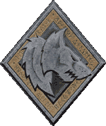
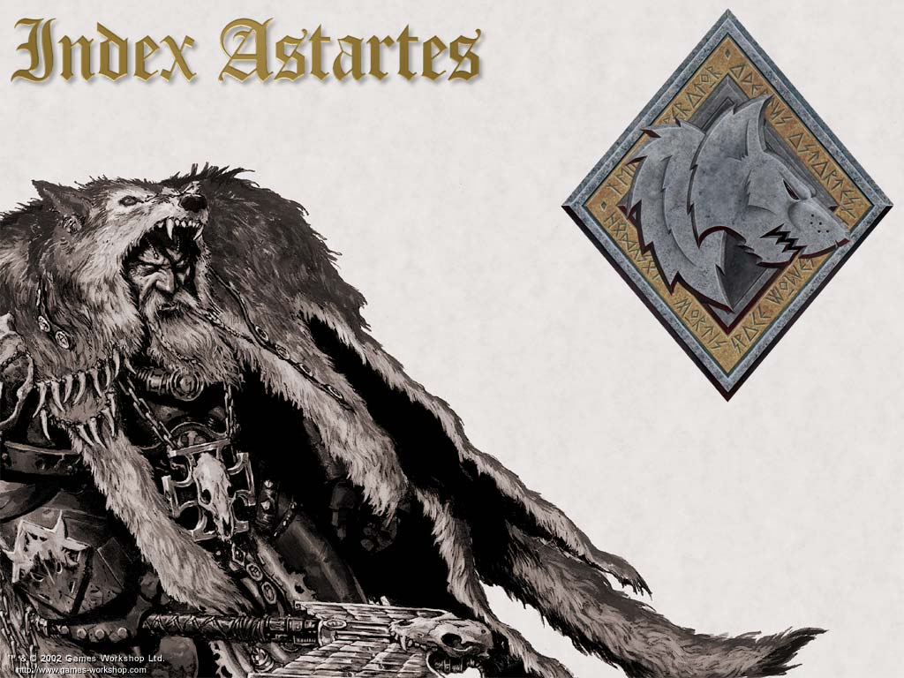
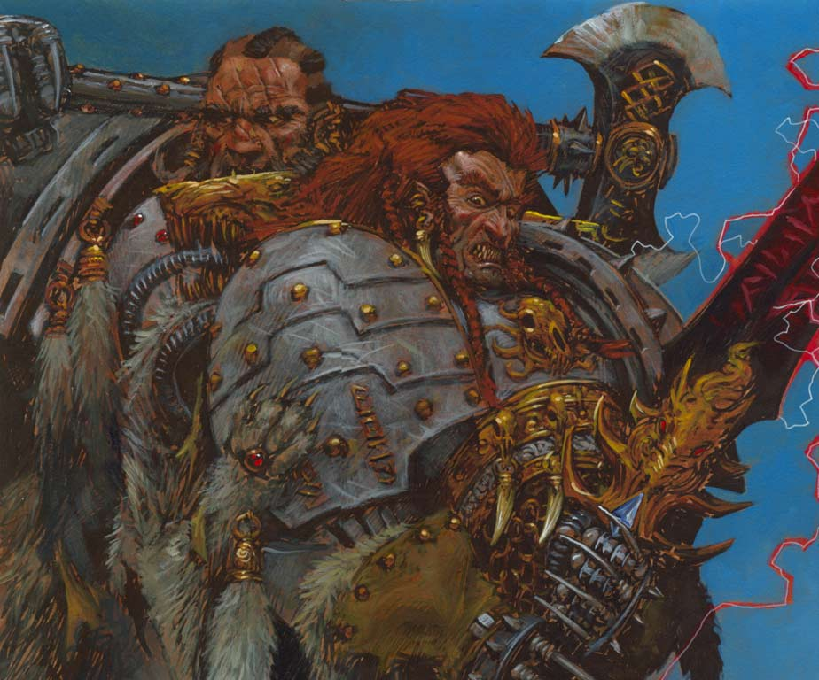
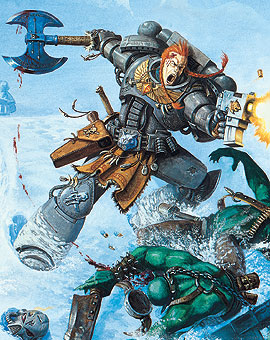

# 太空野狼军团（Space Wolves）

从帝国创建的那一刻起，太空野狼就一直用它的獠牙和利爪为皇帝奋战．作为星际战士中最有名的战团之一，他们的名号和事迹在整个银河系中被广为传诵．顽固、狂暴，太空野狼是近战专家．他们的战士最关注的就是在战场上赢得荣誉．太空野狼为战而生，死亡并不能使他们畏惧．
　

## 起源

帝国的基石乃是成千上万个人类殖民世界．虽然历史的具体细节已不清晰，但我们知道，在千年以前，全能的皇帝还在我们凡人中间，他将人类联合起来，带领我们走向人类的黄金时代．关于他的传奇在无数个世纪中广为流传．在Ｓａｎｃｔｕｓ图书馆的地下室中有许多关于这段历史的文献，由星际战士中的智库馆长们悉心守护着．这些文献中，最引人注目的就是关于战团长原体（Ｐｒｉｍａｒｃｈ）的诞生的部分．

皇帝登上了自己权力的顶峰，他是全能的．但是，即使是全能的皇帝也无法同时照看帝国的每一个世界，他夺目的光芒无法同时照耀银河系所有黑暗的角落．因此，皇帝以自己神圣的血液创造了战团长原体．这些克隆体在任何一个方面的能力都远远凌驾于普通的人类之上．最初的这一代星际战士被培养成为领袖，凭借冷静和智慧来引导着他们自己强大的战力．

每一个强化过的克隆战士都比普通的人类士兵强大数倍，他们便是皇帝用以统一银河系的精锐部队――星际战士（Ａｓｔａｒｔｅｓ军团）．星际战士的以战团长原体为基因样本而创造．这些战团中，最杰出的一支成为了太空野狼．

许多关于太空野狼创建历史的记载由于一个异族毕生的心血而得以保存．他是Ｇｎａｕｒｉｌ，一个灵族人．他与古代的芬里斯国王Ｔｈｅｎｇｉｒ生活在同一个时代．他保存下来的传说一个字一个字地被口头传述．千年已逝，而这些传说依然完好地保留下来，作为他与芬里斯人的神圣约定，提醒芬里斯人不可忘却过往的神话．Ｇｎａｕｒｉｌ之歌中许多部分详细记载了太空野狼的原体ＬｅｍａｎＲｕｓｓ早年的生活，这些部分大多已经融入了芬里斯的民间传说中．

在银河系遥远的西北角，有一颗名为芬里斯的冰封世界．它，正是一位战团长原体的成长之地．由于气候的恶劣，弱小的生命在这里通常是没有生存权的．似乎，一头芬里斯母狼最初抚养了ＬｅｍａｎＲｕｓｓ；ＬｅｍａｎＲｕｓｓ自己也不止一次地提到这种抚养关系．他的幼年同伴，两头芬里斯狼Ｆｒｅｌｉ和Ｇｅｒｉ同他一起成长．

ＴＯ　ＢＥ　ＣＯＮＴＩＮＵＥＤ

在Ｇｎａｕｒｉｌ的传奇故事《狼王的登基》中记载了年轻的战团长原体宿命中的一个冬天.Ｒｕｓｓ加入了狼群对一个邻近居民点的袭击，他带着四头不住地咆哮的狼闯入了村庄的储藏室，弄到了不少咸肉打算带给饥饿的狼群．不巧的是，他们尚未出门就被闻讯赶来的村民逮个正着．他用一种难以置信的凶猛扑向村民，为狼的逃跑创造了机会．村民们未曾见过这样的事情，他们向国王，Ｒｕｓｓ的Ｔｈｅｎｇｉｒ禀报，希望国王能解决狼群的威胁．于是在一周内，一大票装备精良的猎手整装待发，他们的箭上涂有亚龙的毒液，刀锋利到能够轻松划断橡木．

在这次狩猎中倒在猎手的箭和矛下的狼不计其数．即使是抚育了战团长原体的母狼也未能逃脱．她奋力保护自己的孩子，杀死了五名猎手．可到最后，毒箭剥夺了她的抵抗能力，一支矛穿过了她的喉咙……她在死前将战团长原体压在了自己身下，毒药对他钢铁般坚韧的体质没什么影响，而射在他脸上的翎箭像破草茎一样被弹开．他被五花大绑地送到Ｔｈｅｎｇｉｒ国王面前．

接下来，《狼王的登基》描述了战团长原体与芬里斯皇族的第一次接触：

“在黄昏时，狼人被松绑了．国王要求这凶猛的生物像狗一样伏地求饶．这个奇怪的野兽努力站直了身体，向着国王怒吼．他的咆哮持续了如此长的时间，以至于许多年轻人承受不了而逃出大厅．这个眼中充满野性的生物向Ｔｈｅｎｇｉｒ国王吐出一大团含有毒液的污血，老国王惊讶地发现，这双金色的眼睛里闪耀着帝王般的自尊和高傲．”

接下来几年，这个狼孩由Ｔｈｅｎｇｉｒ国王亲自抚养．国王教这他如何使用战斧，如何捕鱼，接下来，如何说话．他迅速地成长，用一种让人无法想象的高效率学习知识．同时，他在使用武器上颇具天赋，空手战斗更是无可匹敌．

一开始时，他的笑声在旁人听起来是野兽的咆哮，唱歌时更是毫无音调可言地一阵乱嚎．可是，他还是渐渐认识到自己是人，而不是一头狼，他是一个比其他人强大得多的人．Ｔｈｅｎｇｉｒ国王在与他的第三次正式比武后，便亲自将代表国王卫队长身份的战斧交到他手中．国王告诉自己，这个年轻人命中注定该成为一个伟大的统治者．接下来他又掌握了雄辩的口才．

一个傍晚，Ｔｈｅｎｇｉｒ国王认为他已经证明自己配得上一个皇室的高贵名字．ＬｅｍａｎＲｕｓｓ（Ｒｕｓｓ的Ｌｅｍａｎ）从此诞生．

许多关于ＬｅｍａｎＲｕｓｓ身世的传闻和有关他的传奇故事迅速在大陆上四处流传开来．芬里斯城的居民们传说他能轻松地拔起一棵橡树，并背在背后生生折断；还说他能毫发无伤地打败敌人的整支军队；最夸张的是他能空手放倒一头芬里斯猛犸并把它做晚餐烧烤之……当Ｔｈｅｎｇｉｒ逝世后，ＬｅｍａｎＲｕｓｓ无可质疑地继承了王位，坐上了国王的宝座．

每个冬暮节前夜（Ａｌｌｗｉｎｔｅｒ＇ｓ　Ｅｖｅ），在太空野狼堡垒修道院的獠牙大厅中，符文祭司们会详细地吟诵ＬｅｍａｎＲｕｓｓ的传奇故事．每个太空野狼战士都通过记忆来了解这些传奇，所有故事由严肃的祭司带着极大的敬意讲述给年轻的“幼狼”．通过这样的方式，ＬｅｍａｎＲｕｓｓ的传奇至今仍能保存完好．

由于通过口头讲述来流传这些故事的传统，在太空野狼中对下面的文献没有任何形式的文字记载．然而作为Ｃｏｒｍａｃｋ狼语者（Ｗｏｌｆｔｏｎｇｕｅ）的客人，审判官Ｃｈａｌｆｏｎｔ在流浪者盛宴（Ｆｅａｓｔ　ｏｆ　Ｗａｎｄｅｒｅｒ）上有幸听到了太空野狼世代流传的故事，并将它们翻译给帝国的学者：

> Ｒｕｓｓ，被拥立为所有芬里斯人的国王．
> 他的裁决，同他挥剑的手一样有力，
> 他的权威，无一人胆敢质疑．
> 野兽或人，都不敢也不配挑战狼王．
> 还没有一个部落，能够抗拒他的军队．
> 在Ｒｕｓｓ的王国中，狼与人和睦共处．
> 侍立在他的王庭上的，是最凶悍的军阀（ＷａｒＬｏｒｄ），
> 以及最美艳的女子．
> 关于他四处征战攻无不克的故事，
> 像森林大火一样四处蔓延．
> 很快，皇帝的目光开始注意到这个年轻人．
>
> Ｒｕｓｓ的声名是如此的显赫，
> Ｒｕｓｓ的功绩是如此的伟大，
> 以至于神圣的皇帝决定亲自来寻访Ｒｕｓｓ．
> 皇帝深信，这名强大的武士，
> 正是他失散的孩子之一．
> 他知道，Ｒｕｓｓ不会心甘情愿地屈服于他，
> 除非他能在战斗中打败Ｒｕｓｓ．
> 皇帝了解Ｒｕｓｓ的力量，即使强如Ｒｕｓｓ，
> 也无法伤皇帝分毫．
> 因为，
> 没有人可以挑战这位活生生的神，
> 没有人能不服从这位人类的王者．
>
> 皇帝巨大的座舰越过星海，
> 在Ｒｕｓｓ登基一年后驾临芬里斯冰封的表面．
> 皇帝穿着破旧的长袍，缓缓步入嘶嚎着的洞穴，
> 来到Ｒｕｓｓ国王的王庭．
> 他遮蔽了自己神圣的灵光，
> 他隐藏了自己无比的心能；
> 面罩遮住了他的半张脸，
> 手中握着流浪者常用的橡木杖；
> 但那犀利的眼神暴露了他强大的存在，
> 芬里斯的巨狼群在皇帝的面前纷纷闪避．
>
> ＬｅｍａｎＲｕｓｓ从橡木王座上向前探身，
> 一手拿着烈酒，一手提着烤熊腿．
> 他儿时的同伴，巨狼Ｆｒｅｋｉ和Ｇｅｒｉ
> 正蜷缩在他的赤足边．
> 火炬的微光照耀着王座下的鲜血，
> 很显然，刚刚狩猎过的“宫廷成员”们，
> 对这陌生人打扰了宴会十分不悦．
>
> 流浪者迫近了虬曲的王座上高大的国王，
> 他坚定地面对着Ｒｕｓｓ，
> 紧紧盯着Ｒｕｓｓ的双眼．
> 狼王巨大的咆哮在王庭上回响，
> 整座大殿静了下来．
> Ｆｒｅｋｉ磨着他的牙齿，
> 而更年长的Ｇｅｒｉ明智地缩在一边，
> 因为这陌生人竟能毫不畏惧地面对狼王的凝视．
>
> 陌生人提出挑战的要求，而内容将由国王决定．
> 如果陌生人赢了，他要求坐在Ｒｕｓｓ的右边，
> 参与这盛大的宴会．
> 大殿上响起一阵敲击盾牌的声音，
> 大家纷纷嘲笑陌生人不自量力的要求．
> Ｒｕｓｓ提出，如果陌生人输了，
> 就要在一年内服侍狼王．
> 陌生人冷漠地接受了这个条件．
>
> 狼王不想破坏宴会的气氛，
> 他提出的第一项比赛是食量．
> 无数的食物被呈上大殿，
> 陌生人的着实能吃，
> 他毫不停歇，即使是最强壮的武士，
> 食量也只是他的零头．
> 可当他抬头的时候，
> Ｒｕｓｓ已经吃下了第三头Ａｕｒｏｃｈ．
> 凌乱的红色骨头散落在他周围，
> 一口肉屑都没有剩下．
> 伴随着雷鸣般的打嗝声，
> Ｒｕｓｓ向着陌生人露齿微笑，
> 牙齿在火炬的光芒下映出一片猩红．
> 陌生人低下头继续大嚼．
>
> 狼王觉得十分有趣，他意识到，
> 这个棕袍的旅者有着芬里斯人坚毅的精神．
> 他提出第二项比赛：痛饮美酒．
> 尖锐的号角声宣布了比赛的开始，
> 陌生人和很快喝下了６桶芬里斯的烈酒，
> 已经没有酒可供他再喝．
> 因为狼王已经把整个宴会上酒喝完了，
> 酒量之大足以放倒一整只连队的士兵．
> 陌生人的眼中开始闪现愤怒的光芒．
>
> 如果他没有机会展露自己的实力，
> 如果迎接他的只是宾客们的嘲笑，
> 他又怎能收服这伟大的武士，他失落的儿子呢？
> 在失望的驱使下，陌生人称Ｒｕｓｓ为一个酒鬼，饭桶！
> 除了涨红脸吹牛外什么都不会！
>
> 一刹那…整个大殿静了下来．
> 没有人敢大声出气，狼王从宝座上站了起来．
> 布满血腥的食物碎屑纷纷凋落．
> Ｒｕｓｓ拔出他的巨剑，径直走向陌生人，
> 他跳上桌子，用剑顶住陌生人的咽喉．
> 狼王平静了下来，宣布了第三项比赛的内容．
> 大殿上上的人群向两侧分开．
>
> 时间似乎静止了．．．
> 皇帝抛下了他的斗篷，扯开了他的面罩！
> 人类的王者展现在众人面前！
> 他远比任何人都要高大，身穿着金光闪闪的盔甲．
> 皇帝大步踏上桌子，
> 闪着幽光的宝剑从镶嵌着宝石的剑鞘中拔出，
> 发出一阵嘶鸣．
> 伴随着震动大殿的怒吼，狼王一跃而起！
> 战斗在两个巨人般的存在间展开．
> 
> 皇帝的动作优雅而精确，如同液态的火焰般，难以捉摸．
> 他的剑招快过了常人视力所及．
> 狼王凭借愤怒的力量全力攻击，
> 他的技巧和经验指引着愤怒的剑刃．
> 皇帝的金甲上倒映着火光和旁观者的注视，
> 狼王的皮肤上流淌着汗水和低落的鲜血，
> 他披散的头发随着他的怒吼上下飘动．
> 
> 狼王的迅猛的攻击，对勇猛和机智的完美融合，
> 以及闪电般的反应速度，
> 让皇帝确信，这就是他失落的儿子之一．
> 能量拳套划出一道金色的弧线，
> 皇帝一拳轰中ＬｅｍａｎＲｕｓｓ的面门．
> 
> （下面这段巨汗）
> 
> 啊！这便是对我们的狼王Ｒｕｓｓ强壮过人的证明！
> 在承受了这足以摧毁常人的一击后，
> 不过一小时，他就又能清晰地思考，
> 他迅速地恢复过来，看上去连头痛的迹象都没有．
> 如果他真的头痛，那也是饮酒过度造成的．
> 当然，无论如何，他带着破碎的牙齿和微笑，
> 发誓向人类的皇帝效忠．

此后的事情已广为人知，在证明了自己的身世之后，ＬｅｍａｎＲｕｓｓ誓死为皇帝效力．在皇帝的教导下，他的进步神速．不过数周，皇帝便确信Ｒｕｓｓ完全有能力在横跨全银河系的圣战中统帅一支军队．Ｒｕｓｓ被介绍给那些带有自己基因的战士，从此刻起，他同时成为了太空野狼军团的父亲、基因原体和领导者．

ＬｅｍａｎＲｕｓｓ很快投入了太空野狼军团长这个新的身份中．他身上换上了由皇帝亲自祝福过的战甲，他原先的巨剑则是被传奇武器霜刃Ｍｊａｌｎａｒ取代．这柄剑上的锯齿取自于深海巨妖Ｇｏｒｍｅｎｊａｒｌ的胃囊，而剑刃据称足以将芬里斯上的冰山劈为两段．太空野狼军团毫不犹豫地接受了高大的狼王作为他们的军团长和领袖，他们很快就像儿子爱戴父亲一般拥戴狼王．

此时，所有的军团长都与他们自己的军团会合了；在历史上，这段时间被称为征服与胜利的黄金时代（Ｇｏｌｄｅｎ　ａｇｅ　ｏｆ　ｃｏｎｑｕｅｓｔ　ａｎｄ　ｓｕｃｃｅｓｓ）．这段时间内，帝国的武力东征西讨，势不可挡，将整个银河系统一在皇帝的旗下．Ｒｕｓｓ总是在战斗中身先士卒，粉碎一切皇帝的敌人．在大圣战（Ｇｒｅａｔ　Ｃｒｕｓａｄｅ）的每一场战斗中，太空野狼永远奋战在第一线．伴随着狼群的咆哮，Ｒｕｓｓ冲杀在他军团的最前方，屠戮一切敢于阻碍他的活物．

## 何露斯之乱

Ｒｕｓｓ领导的作战是如此的顺利，以至于太空野狼已经深入到了银河系边远的角落，距离太阳系许多光年的地方．数千个世界被纳入帝国的版图，似乎人类的黄金时代永远不会终结．然而，一个意想不到的事情导致了银河系的分裂：Ｒｕｓｓ的兄弟，影月苍狼的基因原体和军团长何露斯投向了黑暗势力．

何露斯之乱是一场全面战争，邪恶势力的苏醒导致了整个帝国的分裂．狡诈多端的何露斯通过威胁、误导和腐化使得足足九个星际战士军团转投混沌一方．

虽然太空野狼未曾参与何露斯之乱中最惨烈的战役：混沌势力对皇帝宫殿的围攻，但太空野狼军团与这场浩劫仍脱不了关系．因为这场浩劫的开场序幕便是太空野狼对千疮之子的攻击，从这场战斗开始，两个军团结下了世世代代的血仇．

与太空野狼相比，千疮之子更热衷于对知识的探索和追寻．因此，从千疮之子母星找到的失落典籍中记载了很多关于这次战斗的内容，其中最引人注目的是千疮之子母星Ｐｒｏｓｐｅｒｏ的彻底毁灭．即使由于战斗中的仓促，千疮之子关于这次战斗的记载不是十分详尽．但是在那些破败的文档中，我们仍可看出太空野狼在千疮之子心中烙下的难以想象的残暴形象．

然而，通过对两个方面说法的总结，我们也许可以揭开这次战斗的真相――那么，就让我们来仔细端详这幅展示两个军团世仇的画卷吧．

“红魔”Ｍａｇｎｕｓ是一个高大的巨人，即使是他的兄弟们――各个军团长与他相比也远不能及．他的头发和皮肤都呈现出铅红色，而更引人注目的是他额头上巨大的独眼；正常人有一对眼睛，而他只有一个（这是什么废话．．．）

．据称他的力量堪与Ｒｕｓｓ匹敌，但他把大部分精力都放在研习远古的奥术知识上而不是用于提高自己的战力．当然，他生理上的怪异之处并未引起其他军团长的不适．毕竟，圣血天使的Ｓａｎｇｕｉｎｉｕｓ有一对翅膀，狼王自己也有着锋利的獠牙．虽然狼王担心混沌的触角已经污染了巨人的灵魂，但皇帝对此毫不在意，因为Ｍａｇｎｕｓ也是他的儿子．

下面这件事导致何露斯之乱走向了最惨痛的结局．“红魔”Ｍａｇｎｕｓ通过心能向皇帝发送了一条消息．没有详细的记录记载着条消息到底是什么，但是有不止一处的消息来源指出这条消息是向皇帝警告何露斯的阴谋．这条消息没能起到警告皇帝的作用，反而暴露了千疮之子仍在使用禁断的巫术的事实．皇帝不相信他最宠爱的孩子何露斯会背叛自己，因而对Ｍａｇｎｕｓ的警告大发雷霆．

在皇帝眼里，千疮之子对玄秘知识的探寻已经过了头，到了危险的程度，尤其是Ｍａｇｎｕｓ居然背着他继续偷偷研究异教的和渎神的东西让他怒不可遏．这种情况下Ｍａｇｎｕｓ的辩解没起到任何作用，反倒是Ｒｕｓｓ一直以来的怀疑被皇帝确信了．在Ｒｕｓｓ的坚持下，皇帝认定叛徒是Ｍａｇｎｕｓ而不是何露斯．盛怒之下皇帝命令狼王迅速前往千疮之子的母星，Ｒｕｓｓ立刻带领他早已整装待发的军团杀向千疮之子．

Ｐｒｏｓｐｅｒｏ曾经是一个人间天堂：巨大的由坚冰和象牙制成的巨塔耸立在地平线上，美丽的花园和湖泊随处可见．而Ｒｕｓｓ认为每一个学者、书记员或者巫师都陷入混沌的陷阱太深，他们在禁断知识的诱惑下已无回头的可能．没有别的选择，必须执行皇帝的命令：毁灭千疮之子．

在一场疯狂的轨道轰炸后，狼王的军团空降在Ｐｒｏｓｐｅｒｏ上，咆哮着扑向千疮之子．他们的野蛮而凶暴的攻击显得势不可挡，太空野狼一路残杀，直逼千疮之子的首都．但是一路上的战斗也给了千疮之子充足的时间来备战，Ｍａｇｎｕｓ带领着他的军团，默默地守侯在城堡的大门后，准备决一死战．

最后的激烈战斗日夜不息．太空野狼以他们野兽般的狂暴作战，而千疮之子为保卫自己的家园毫不退让．战斗持续了许多天，夺走了太多千疮之子的生命．

虽然千疮之子知识渊博，但这不足以使他们抵抗整支太空野狼军团凶残的攻击．Ｊｏｒｉｎ?血牙带领的野狼十三连冲杀在战线的最前方．这支部队的战士内心深处的野兽灵魂将他们变形为半狼的噩梦般的生物：Ｗｕｌｆｅｎ．十三连恐怖的屠杀在千疮之子的防线上打开了一个大缺口，Ｐｒｏｓｐｅｒｏ翠绿的牧场被流淌的鲜血染成了红色．Ｍａｇｎｕｓ麾下勇敢的战士们在太空野狼的攻势下越来越少，尽管如此，他们丝毫不惧死亡，每个千疮之子战士都为保护神圣的知识和家园战斗到生命的最后一息．

每个阵亡的战士都被记载在《Ｐｒｏｓｐｅｒｏ之殇》中，虽然此文的真实性曾被置疑，但它是唯一一个记录了独眼的军团长在绝望中与混沌立下契约的文献．

> Ｍａｇｎｕｓ从他破碎的塔楼上向四下望去，
> 下面的景象让他心碎：
> 他的孩子们被Ｒｕｓｓ的野狼们撕成碎片，
> 狼群的咆哮充斥着他的耳朵，
> 干扰着他的注意力，
> 粉碎了他的心能护罩，
> 将他逼向疯狂的边缘．
> 他从黑檀树宝座上站起，双手伸向天空．
> 乞求有人能解救他的军团和他们的学识．
> 好象有什么秽物一直在等待他的召唤，
> 天空迅速变暗，空气中流淌着强大的能量，
> Ｍｇａｎｕｓ的身体被注入了可怕的力量，
> 他的身体和灵魂都为此扭曲．
> 他愤怒地注视着下面的杀戮，
> 对着天空发出一声狂啸．
>
> 数以百计的野狼在他强大的法术下失去神智．
> 天空被撕裂开，铺天盖地的闪电劈向野狼，
> 一队又一队的太空野狼在这怒火下化为灰烬．
> Ｐｒｏｓｐｅｒｏ的每一寸土地都开始攻击，
> 无数双手从地下伸向太空野狼．
> 即便如此，嗜血的野狼们仍义无返顾地战斗，
> 冲向由重重法术守卫着的城堡．
>
> 红魔Ｍａｇｎｕｓ大步踏上战场，
> 破碎的大地在他的脚下熔化．
> 复仇的怒火指引他杀向狼群，
> 一切敢于阻拦他的东西都被粉碎．
> 他冷酷的目光所到之处，
> 即使是最为强悍的长牙战士，（注：太空野狼的精锐老兵）
> 也立刻化为没有生机的石像．
> 愤怒的独眼喷射着一阵阵异常的光芒，
> 倒竖的红发展露着一波波慑人的能量，
> 在皇帝的眼中，他已成了个十恶不赦的怪物．
>
> ＬｅｍａｎＲｕｓｓ杀出重围，
> 试图阻止这巨人对野狼战士的屠杀．
> 趁Ｍａｇｎｕｓ转身的机会，
> Ｒｕｓｓ抓起一个千疮之子战士，
> 用力掷向巨人的面门．
> Ｍａｇｎｕｓ的石化凝视被短暂地阻挡了一下，
> Ｒｕｓｓ抓住这个机会奋力一跃，
> 扑向那头绯红的巨兽．
> Ｍａｇｎｕｓ也绝非泛泛之辈，
> 他以一种难以想象的速度轻巧地避开攻势，
> 同时一拳击向Ｒｕｓｓ的胸膛．
> Ｒｕｓｓ的胸甲被打碎，碎片扎入了心脏之中．
> 但狼王不会就此认输，
> 趁Ｍａｇｎｕｓ挥拳做第二击的时候，
> 狼王抓住他的胳膊，顺势跳起，
> 狠狠一脚踢中了巨人的独眼．
> Ｍａｇｎｕｓ痛苦的哀号震动了天际，
> 浓厚的黑血开始从天上降下．
>
> Ｒｕｓｓ更是没放过这个机会，
> 抓起Ｍａｇｎｕｓ的腰，将他举过头顶，
> 脊柱折断的痛苦让他咬牙切齿．
> 看到他们的领袖被打倒，
> 千疮之子开始撤退．
> 但当Ｒｕｓｓ举起霜刃Ｍｊａｌｎａｒ，
> 意欲给巨人最后一击时，
> Ｍａｇｎｕｓ念出一句咒语，
> 沉入了色彩斑斓的大地之中．”

这场史诗般的宏大战斗到底是如何结束的？说法不一，有些人说千疮之子的巫师们打开了一道通往亚空间的传送门，集体遁入了混沌的领域以逃避太空野狼的狂暴追击．有些人说，在千疮之子逃跑后，ＬｅｍａｎＲｕｓｓ发誓要全歼千疮之子军团，一个活口不留．更有些人说，千疮之子军团已经成为了类似鬼魂的存在，在他们的恶魔庇护者的羽翼下积蓄力量．

但可以确信的是，千疮之子没有被彻底消灭，他们成功地逃跑了．同时还尽可能地挽救了他们珍视的知识和魔法物品．Ｍａｇｎｕｓ也没被杀死，从这一天起，他仇恨的怒火将永远烧向帝国．当然，无论他们逃到哪里，变身为Ｗｕｌｆｅｎ的野狼第十三连一直在追击他们，再也没有回来，第十三连已经在帝国的记录中消失，太空野狼军团为了纪念他们，在Ｇｒａｎｄ　Ａｎｎｕｌｕｓ上选了一块玄色巨石，将他们的事迹记录在上面．太空野狼也再没有重建过第十三连．

## Ｒｕｓｓ的消失

每过１０００年，远古时期的无畏机甲Ｂｊｏｒｎ　ｔｈｅ　Ｆｅｌｌ－Ｈａｎｄｅｄ将从他的休眠中被唤醒．他将战团的符文牧师集合到一起，向他们讲述古代的传奇，并测验他们是否牢记着战团的遗产．下面是由Ｖａｇｎａｌ　Ｒａｖｅｎｍａｎｅ在７６６２／Ｍ３５记录下的由Ｂｊｏｒｎ口述的关于Ｒｕｓｓ的消失的记载．

庆祝皇帝统一银河的盛宴是太空野狼所见过的最盛大的宴会．在这场庆祝皇帝打倒何露斯（Ｇｒｅａｔ　Ｅｖｉｌ　Ｏｎｅ）的活动上，数以千计的皇帝的孩子们都加入了这场欢庆．漫长的墙壁上无数的火把仿佛夜空中的群星，我们的灵魂似乎在这庆典中升腾了一般，大厅里沸腾着笑声与歌声．在宴会的首座上，端坐着狼王ＬｅｍａｎＲｕｓｓ，以及他的亲密战友们．

不止一次地，狼王跳上橡木桌，他曾在这桌上，为了自己的生命与尊严而与皇帝进行了激烈的战斗．大家以为他又要开始一番演讲，讲述那过往的传奇．

时间一分一秒地过去，整个大厅静如古墓，所有眼睛都注视着他．

然而Ｒｕｓｓ一言不发，身体也仿佛被冻结了一般．我们这些在他身边的人可以看到他黄色的双眼无神地看着远方，他钢铁般坚实的肌肉绷得紧紧的．慢慢地，有个声音打破了大厅的寂静．一名战士开玩笑似地问在海妖眼里世界是什么样的．我们开始笑的时候，狼王也突然爆发出一阵震耳欲聋的笑声，他要更多的麦酒？他想和谁比武？我们不知道，也没人敢问．

突然，Ｒｕｓｓ重重地跪了下去，巨大的响声让大厅又一次陷入了寂静．他转身面对自己的亲信，用一种小到他人几乎听不到，甚至连我都听不到的声音开始说些什么．他的脸色悲戚，这种莫名的哀伤甚至感染了在场的每头野狼战士的灵魂．接着，他和亲信们一同转身走出大厅．只有我，狼王所宠爱的战士中最年轻的一个被留在后面．

每年的宴会上他的座位都被保留着，每年他饮酒用的号角都盛满了酒以备他回来，可是Ｒｕｓｓ始终没有回到我们身边．这七年是我们所经历的最悲伤的七年，因为其实大家都知道，狼王出走的那个夜晚，是芬里斯上最可怕的一次寒冬的开始．最后，我们做了决定，既然狼王自己不回来，那我们就去找他．我被选作搜索队的头狼，去寻找我们的父亲．这就是第一次大狩猎的开始．

数连的太空野狼乘上他们的飞船，航向浩瀚星海的各个方向.关于我们战斗的故事和我们发现的星球的名单是如此之长，以至于在每个冬暮节上要朗诵这些都十分费力．但我们真正要找的东西却没找到，找到的只有故事和空洞的预言，第一次大狩猎就这样在哀伤中终止了．

据说Ｒｕｓｓ会想符文祭司们托梦，这时符文祭司们所说的话就是Ｒｕｓｓ的意旨．在这种情况下，我们会开始一次新的大狩猎．虽然最终的目标始终未能实现，但我们以Ｒｕｓｓ之名取得了无数次的胜利，完成了无数个艰巨的任务．我们相信他与我们的约定：他会回到我们中间，带领我们迎接最后的战斗，带领我们迎接苍狼时代．

## 母星

芬里斯是一个充满痛苦和艰辛的世界．它的表面被刺骨的寒冰和吞噬一切的烈焰所包裹．这颗行星位于银河系的西北方，非常接近恐惧之眼，但它仍保持着自己的纯洁．从宇宙中看过去，芬里斯的大部分表面都是冰冷的海水，其间点缀着几块被冰雪覆盖的陆地．帝国的学者们还指出，在芬里斯漫长、阴暗的冬天，芬里斯的海水都全部被冻结，为星球披上一层白色的幕布．只有一小块大陆能让上面的居民熬过历年可怕的寒冬，它就是坐落于世界之冠的阿萨海姆（Ａｓａｈｅｉｍ）．芬里斯的公转轨道是一个明显的椭圆，因此，它的气候非常恶劣，在一年的大部分中都是冰封的冬季，而夏季又热得可怕．即使是在到达恒星近地点的时候，芬里斯的主大陆也没什么人敢去接触．因为那上面四处肆虐着流淌的岩浆和喷涌的熔岩，大地撕裂，高山崩塌，喷射着毒气的巨大坑洞仿佛是行星表面的伤口．然而，芬里斯的居民们在这恶劣的环境下挣扎着活了下来．

长期的恶劣气候造就了芬里斯居民们坚韧的性格，也培养了各式各样的凶猛生物．芬里斯人狩猎的对象，通常包括身形高大、有着锋利的巨角的芬里斯麋鹿，以及能轻易将一个人踏成肉酱的芬里斯猛犸，这些已经足够危险了．然而，更可怕的是那些踏遍银河系都难以见到的凶猛的食肉动物．

远古的亚龙和巨龙掠过碎裂的岛屿，寻找因地热而温暖的洞穴．海龙和巨海妖在深海中兴风作浪，这些生着巨大触须的巨海兽有时甚至长达千码．备受尊敬的生物学家Ｍａｇｏｓ　Ｂｉｏｌｏｇｉｓ　Ａｎａｔｏｌｅ　Ｌｅｖｉｔｉｃｕｓ在研究了一头被Ｒｕｓｓ独力捕获的所谓“海妖”后，认为这些生物是远古时期一次未成功的虫族入侵的遗留物．

而在冰封的苔原上，可以见到巨大的白熊．这种巨大凶猛的野兽可以长到同冰鲨一样大小，而且在暴风雪中几乎无法被发现．它们能轻易打碎最坚固的建筑，猎食里面惊慌失措的居民．但是还有一种被看作银河系最危险的猎食者的生物――芬里斯巨狼．这些长着坚硬鬣毛的猎手最小的也有一头小马那么大，而大的芬里斯狼可以长到一匹重型军马的大小．一系列的研究证明它们强力的腭可以在塑化钢上留下痕迹．它们之所以危险不单是因为其体型庞大，爪牙锋利，还因为它们极度的狡诈．在这种成群狩猎的猎杀者面前，没有什么猎物有机会逃脱．

大多数太空野狼的战士们都身皮芬里斯巨狼的毛皮作为其战士的荣耀标志――每名战士的狼皮都是他自己空手同芬里斯狼搏斗后赢得的！芬里斯的战士是全银河系最强壮的，因为在这极度危险的世界中，只有最强悍的战士才能生存下来．很少有哪个行星在野狼的鼻息前不感到畏惧的．

## 组织

依据ＣｏｄｅｘＡｓｔｒａｔｅｓ，太空野狼战团被分为１２个连队．每个连队都由一名恶狼领主（ＷｏｌｆＬｏｒｄ）带领．恶狼领主只对头狼（ＧｒｅａｔＷｏｌｆ）负责．近八百年来，头狼的位置由无耻的ＬｏｇａｎＧｒｉｍｎａｒ占据．每个连队在太空野狼的要塞獠牙城堡中都有他们自己的总部或曰“狼穴”，这座高耸的堡垒雄踞阿萨海姆山脉的顶峰，被称为除地球之外最坚固的帝国要塞．獠牙城堡的作用包括总部、教堂和要塞．每个连队在其中都有自己独立的部队、武器、飞船、兵工厂、生活区．

每个连队都从当前的恶狼领主那继承了不少东西，包括他的名字．当一名恶狼领主去世后，野狼们将通过比武来选出一名替代者，然后重建连队．这种方式使得指挥体系的流动性相当大（由于他们酷爱近战的天性，野狼的伤亡率很高，这没什么好奇怪的，当然一些极其强悍的恶狼领主居然活过了上千年）．每个恶狼领主都在芬里斯神话中选出一个徽记作为他个人的印记，而这印记就会被绣上连队的旗帜．在十二个连队的区域之后就是头狼的领地．这里居住着战团中大多数最强大的英雄：符文祭司、钢铁祭司、恶狼祭司和无畏机甲．他们佩带的徽记永久不变：一头在群星间奔跑的巨狼――狼王ＬｅｍａｎＲｕｓｓ的个人徽记．

## 基因种子

太空野狼的基因种子独特而致命．第一代基因种子的在成功植入Ｒｕｓｓ的战士体内前，已经消耗了数百名芬里斯战士的生命作为代价；这些人没有死亡，他们被转化成了可怕的怪物．

Ｃａｎｉｓ螺旋是必须的，如果没移植它的话其他的基因螺旋都根本无法移植．然而不幸的是，它的部分基因代码中的核酸与人类的基因无法恰当地融合，而且它还会对即将成为星际战士的候选者的神智产生难以想象的影响．这种基因在候选者通过考验的过程中开始起作用．候选者被几乎赤身裸体地抛入荒野中，靠自己的力量回到獠牙城堡．此时基因开始偷偷地影响他的思想和身体，将他变回茹毛饮血的原始人的状态．他的骨骼分裂又再融合，他的毛发迅速生长并覆盖全身，他的唯一渴望就是噬肉饮血，他的身体将长大８０％，他的犬齿在转化过程中伸长．在这痛苦的转化过程中，他必须控制住自己不被这种基因完全控制．众所周知，芬里斯的夜晚是被一种巨大的凶猛生物Ｗｕｌｆｅｎ统治的．这些生物就是为能成功控制住基因的候选者，他们放弃了抗争，变成了真正的怪物．

如果候选者成功地穿过了布满捕食者的寒风刺骨的冰川，活着回到獠牙城堡．他将会被移植其他的基因种子，稳定Ｃａｎｉｓ螺旋的状态以完成他的基因转化，由此加入Ｒｕｓｓ之子的行列．不过还是有一小部分的战士没能完全控制基因种子的原始效应，嗜血的原始状态始终潜藏在他们的基因中，这被称为Ｗｕｌｆｅｎ的诅咒．

## 信仰

芬里斯的战士们在成长过程中听到的故事都是关于英雄、怪兽、巨狼、海妖的传奇．一个引人入胜的故事在他们眼里不亚于一场精彩的搏斗．就连芬里斯的神话也充斥着英雄的壮举和统治着阿萨海姆的芬里斯巨狼的传奇．虽然Ｅｃｃｌｅｓｉａｒｃｈｙ（我猜是帝国的某个机构）很看不起这些异教徒似的故事，但是Ｒｕｓｓ的子民们拒绝放弃他们的信仰，即使他们老了，牙长了、皮肤干裂起皱了，他们仍坚持着自己的信念．在太空野狼杀向战场时，他们总佩带着能够驱逐邪恶、带来好运的图腾和护身符．

他们信仰的中心是ＬｅｍａｎＲｕｓｓ．Ｒｕｓｓ在他们心中不单单是一个伟大的领袖，他是一个神，是最伟大的英雄，他会在世界末日来临时回到狼群中，与他们并肩战斗．

## 战斗条例

太空野狼的部队与其他的星际战士相比，在编制上有极大的不同．每个连队都由各种大小不同的班组或曰“狼群”构成，这些连队在战斗中扮演着不同的角色．

一名太空野狼的星际战士在其一生中可能会不断地获得晋升，直到他开始衰老．如果他的勇气和力量无可置疑，那么他可能获准加入恶狼卫士，甚至成为一名恶狼领主．

大部分太空野狼的新兵生涯由血爪恶狼部队开始．这些部队由热血的新兵组成，迫不及待地想证明自己的能力．他们在战场上会咆哮着杀进敌阵，奋不顾身地战斗以赢得属于自己的荣誉．血爪恶狼是太空野狼的快速部队和突击矛头．如果他们能活下来并成长为更强的战士，他们将加入灰色猎手部队．这支部队在战斗中狂热得不得自制，随时准备为荣誉献身．而当一名太空野狼完全成熟，头发变成灰色时，他们将加入精锐老兵部队：长牙战士．他们的信念是战士中最坚定着，掌管着连队的重型武器．

最勇敢和强壮的太空野狼在证明了自己超出常人的勇气和力量后，就有希望成为恶狼卫士．恶狼卫士要么是领导其他年轻战士作战的指挥官，要么是和其他最强壮的战士一起组成恶狼领主的卫队．没有谁能对抗这些装备精良的英雄，他们配备着全连队最强大的武器，在近战中无可匹敌．

太空野狼的战斗条例与其他的战团几乎没有相似之处．他们甘愿为战斗的荣誉奉献生命．一名年轻的太空野狼十有八九会把“战术”抛诸脑后，狂嚎着一头杀向敌军．这多少都会让同他们合作的友军指挥官头痛．ＬｏｒｄＳｏｌａｒＭａｃｈａｒｉｕｓ就在ＴａｃｔｉｃａＵｌｔｉｍａｔｕｍ中记录了自己的不满：“血爪恶狼的疯狂行为不但让他们自己身处险境，还时常让友军置于危险之中．好吧，如果他们这么想死，又不愿意听从同伴的劝戒，那就让他们对着狮子口直冲过去算了，至少我们可以祈祷有几个疯子会撞进狮子的喉咙，把它噎死．”

然而，与蚕食者那些完全不能自制的狂暴战士相比，太空野狼是把疯狂的近战当作一种有效的战斗方式而不是唯一的战斗方式．毕竟这种疯狂的作战是十分有效的，太空野狼在成千上万次的战斗中凭借这种方式取得了胜利，帝国的指挥层好象也不打算逼他们硬改过来．

## 战斗口号／战吼

每个连队的战吼都是不同的．当然，可以确定的是，一旦攻击开始，每个战士都会用最大的嗓门发出一阵让人血液凝结的阴森嚎叫

