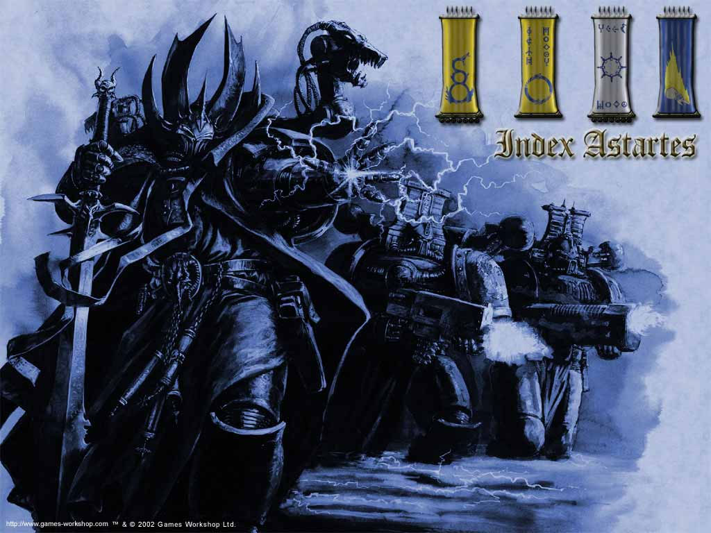
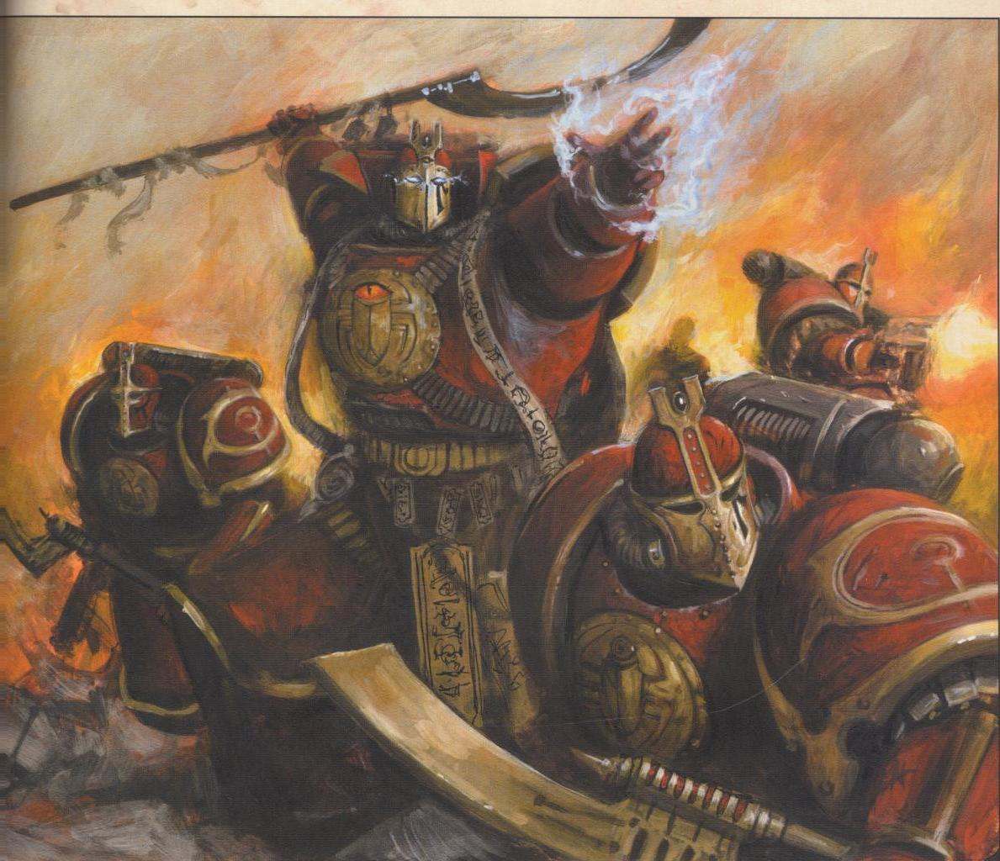
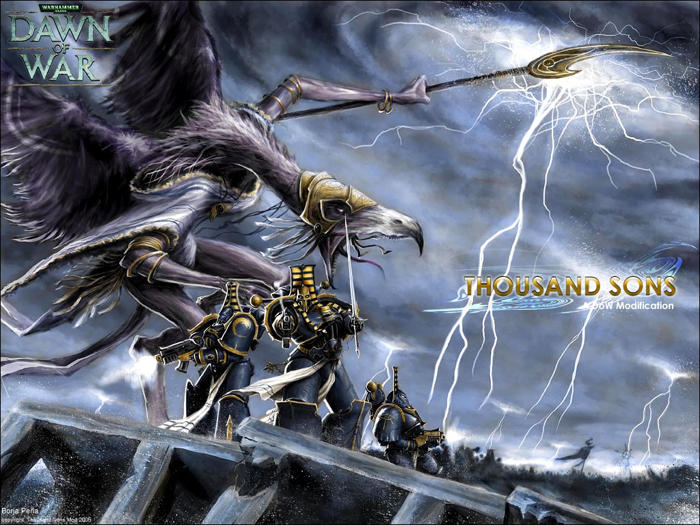
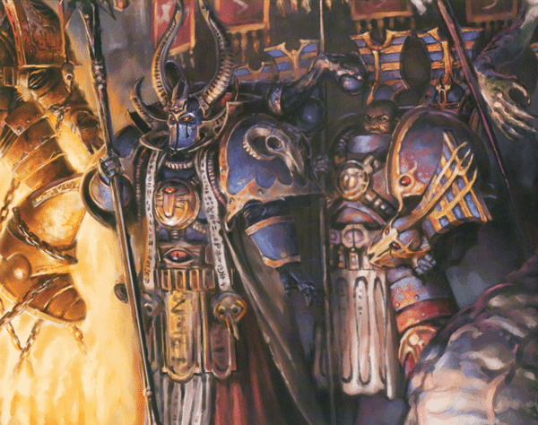

# 千疮之子（Thousand Sons）

千疮之子――禁忌知识的大师

千疮之子，源自于丑陋的的基因原体 Magnus。他是一个有着古铜色的皮肤，火红的头发，以及凌厉的独眼的彪形大汉。有人声称他那巨大的身躯正是他那渊博的知识的反映；就如他那独眼，也正是他一无他顾的意志的写照。在大远征的最高潮之时，Magnus 位列于最为威名远扬的基因原体之中，但也一直被怀疑是最有可能反叛的人。而后来他将要忍受混沌的低语终其余生...

## 起源

当各个基因原体还在襁褓之中时就从地球神秘失散了；还是婴儿的 Magnus 漂流到了偏远的 Prospero 殖民星。他算是非常的幸运：像他这么一个相貌怪异的变异独眼巨人，要是在别处肯定会引起人们的恐慌，唯恐避之不及。但是他到的是一个隐蔽的星球，住着一群被排斥的人类灵能者。以后还会看到 Magnus 的命运再次被如此顺畅地操纵。

Prospero 最初的拓荒者们之所以选中这个世界，就是因为此地离开地球路途漫漫，遥远的距离足以切断与人世的联系。他们孤零零的堡垒就坐落在行星的地下；一望无际的地下水栽作物供应着所需的给养，必需的能量交由机械化的灵力收集器提供。整座设施闪闪发亮，被称为“光之城”，其华丽溢于言辞：在 Prospero 的一片荒芜之中，遍布着耀眼的银塔，高耸的方尖碑，以及庄严的金字塔。在这个远离世人的视线，被精心雕琢的隐居之处，这群被流放的人类全身心地投入到了对知识的追求，以及对这个初生的变异人对灵能的掌握之中。正是他们那不断增长的灵力，才使得他们被隔绝开来。

传说中 Magnus 就像一颗预示着凶兆的彗星一样，穿越 Prospero 稀薄的大气层停在了城中的广场上。Prospero 里的长者们，并没有发现他们的避难地从上方极易受到攻击，在日后这一点将会使他们损失惨重。

Magnus 成了公社里学者们的一名卫士。或许他们从这变异的人身上找到了自己那一点与众不同的血脉；又或者他们发现了他的潜力。人们能够知道的，就是导致了他的导师们被迫与世隔绝的那种力量，他很早就能由自己完完全全地操纵了。Magnus 精通了灵能的每一条规则，很快就超越了公社里最为熟练的学者。当他的身体成熟之时，长得非常高大，而无论心智，灵力抑或感官，都像他的体格一般出众。他额上的独眼睁开之日终于来临；他并不是从亚空间中汲取能量，而是看见了亚空间里面，而 Prospero 上的生活从此被永远改变。

从他巨大的独眼看到了那个能量的空间的那一刻开始，赤红的 Magnus 就从学生摇身一变成为了绝对的大师。

亚空间与现实空间一样同样存在生命。像 Magnus 那样强大的灵力存在决不会无人知晓。不只一个人感觉到了这股超越了非物质世界的生命力，也不止一个人认出来他是什么人。

不只一个人来找他了。

Skaros 的史官记录下了他的主人――皇帝到达 Prospero 的那一天。

“他们就像多年的老朋友一样；Magnus 变异了的容貌并未妨碍那位人皇，陛下拥抱着他失散了的基因原体，宣布他是自己的儿子。”

后来有人认为那一次的面对面的交谈只是“视觉”上的事后之举，他们的精神长久以来就已经通过亚空间来寻找彼此。

皇帝以前选出注入了 Magnus 的基因核的星级战士，作为他的第十五支远征军团的先锋部队。史官记录下了基因原体和军团相聚的时刻。

“失散在亚空间的那位基因原体聆听着皇帝的话语，但回复只有很简单的一句：‘我是您的儿子，所以他们是我的儿子。’他跪在地上，接受了第十五支军团――千疮之子――的首领的职务。”

实际上皇帝没办法更早一些找回千疮之子失散了的基因原体。这支由 Magnus 自己的基因核所创建的军团，被用来对付数量上跟他们远不成比例的灵力变异者；在如此的形势之下，羽翼未全的帝国并没有足够的军力来控制局势。对于诸如 Navis Nobilite 所称“导航基因”的稳定变异所带来的好处的认识，由于严重的党派之争而被分裂。导航者一族的“第三眼”使得在亚空间旅行，设定穿过非物质空间的航线成为了可能；但也有人认为与日俱增，而且看起来是随机的人类变异，是一种毁灭性的内在威胁。第十五军团的人因为这种自发而不受控制的灵力表现而深受其苦，但活了下来并接受训练的人，都跻身于那个时代最为强大的智库馆长之列。更多的人则无法通过这一道磨练。然而，帝国内反对变异人的“狩猎巫师”行动，则将这支失控的军团视为灵力变异危害的证据，并限制了他们的规模。在帝国内将灵力者斩尽杀绝的呼声并非偶尔为之，其中最为尖锐的矛头指向了地处偏远，又超乎常人的星际战士千疮之子。Magnus 的到来正好将军团从毁灭的威胁之中挽救出来。Magnus 把整支疲惫不堪的军团重新部署在 Prospero，用他学识上的才华来指引军团走向灵能者之路。

有些学者，尤其是好几支星级战士战团的智库馆长，认为正是这个时候他又跨过了另一道门槛。他们认为正是急于将整支军团毁灭性的灵力变异控制住，Magnus 才会去寻找捷径，或者是尝试一些更为危险的方法。也有其他人，包括很大一部分审判庭的成员认为，并没有所谓的“门槛”的存在；最初公社里的灵力学者们在 Magnus 到来之前就已经是更为黑暗的艺术的门徒了，故此他已经不可避免地投身到这些门派之中。还有人猜测，是这位基因原体本身对知识无止境的渴求使得将来的一切避无可避。事情的原委已无从知晓，但有证据显示赤红的 Magnus 和他的千疮之子军团追求正道之外的知识，并无视灵力的规条，开始研习巫术。

他们的差异在一开始并没有广为人知。Magnus 颇有干劲地参加了大远征。他率领着千疮之子，与皇帝，其他被重新找回并也带领着各自的军团的基因原体，还有人类所有的其他军事力量并肩战斗。他们参与了从地球辐射而出的庞大的战役，为了皇帝的光荣而去解放被隔绝已久的殖民地，同时占领新的星球。至于千疮之子，常常使用阴谋诡计而不是武力取得胜利，起初倒并没有引起多大注意：不管怎么样，胜利始终是胜利。不过，皇帝的疆域越是拓展，反抗也就越是顽固；星际战士的军团和帝国卫队的各个团，本来降落至各个星球之上以期发现失落的人类的殖民地，却越来越多地只找到了对他们怀有敌意的神秘力量的奴隶。这些邪教的奴隶使用巫术――来自亚空间的恶魔一般的存在所赐予的力量――进行反抗，没有几个人会没发觉这些力量，与 Magnus 的千疮之子所施行的力量相似。在这些怀疑者中，包括了帝国审判庭里怀疑千疮之子的手段的人；不过其中最重要的是 Mortarion，散布着死亡气息的死亡护卫的首领，因为他从自己黑暗的过去深知巫术的力量是不会没有代价的。太空野狼的基因原体 Leman Russ，每战必是用手来打，而谋略则被其斥之为不荣誉，当然在指责千疮之子时也不会吝惜自己的口舌。分裂严重地扩大，威胁到了新生的秩序的根基。人皇本人于是召开评议会，以期永远地解决争论。双方最有力的支持者汇聚于 Nikaea 行星上一座容纳了数万人的古代圆形剧场展开辩论，皇帝则登上讲台充任仲裁者。就在此处，闪烁的群星之下，巫师猎人们举出了他们的事例。他们诵读了人类的痛苦往事：被恶魔所侵蚀的巫师们对皇帝的目标造成侵害；变异人变得不能自已，残暴的统治者将他们灵力上的天赋为其黑暗的私心牟利。反驳这些指控的则是 Magnus 本人。他默默地登上讲台，其面相看起来仿佛证明了巫师猎人所述。但当他开始发言时，责难他的人明显地都比不上作为一名星际战士的基因原体的魅力，对这一位特别的基因原体罪责的自信霎时大减。Magnus 对着下面的人群称，没有任何知识天然即是污秽，只要探寻真理之人仍然是他之所学的主人，那么他的寻求就不会是错误的。而且在最后 Magnus 还宣布，世上再无知识千疮之子尚未掌握，对于他们一切都不会难以学习。当他步下台阶时，评议会更加深刻地分裂了：巫师猎人收集了有很深影响的事例，却还不足以击败千疮之子的基因原体的辩解。即使是皇帝能够裁定他其中一个儿子落败，大会都已经明显受到伤害了。

紧张的情势一触即发，各方险些动起手来；这时一群星际战士的智库馆长代表来到了台前。皇帝点了一下头以示致意，下面也鸦雀无声，看得出在这些智库馆长们之中有着好些帝国最强大的军团的领袖。这些神秘的战士们在讲台前围成一个半圆，好让一个声音说话，在这时一名年轻的书记官向前传达他们的话语。此人身份已然轶失；但他却以近乎狂热的激情宣讲，为评议会提供了第三种可能。他提议一名灵能者就如一名运动员一般，乃是一个天赋之人，其才智必须小心地栽培。灵能者并非生而邪恶；巫术乃是一种应该探寻的知识，即使是其中最为简单的一种，而无论凡夫俗子或是圣哲完人亦无从知悉此种简单的学识的奥妙。其他的智库馆长围着他，提议对灵能者施以最好的教育以服务人类已是帝国当下优先大务。至于巫术的施行则被视为人类的异教，应永远禁止。

由众智库馆长提出的妥协对两派各有让步，看起来也正是皇帝自己期待地解决方法。皇帝宣布其为不可违逆的律令，而 Nikaea 法令(Edicts of Nikaea)在这个千年被实施，一直作为帝国对待人类灵能变异的政策。但这并不是 Magnus 想要的决定。异教真言书（Grimoire Hereticus）记录下了皇帝与 Magnus 那次宿命的面对面的对质。其时皇帝拦下了想冲出大厅以示抗议的 Magnus，敕令他停止使用巫术和咒语，不再探寻有关魔法的知识。传闻当这位独眼的基因原体听到父皇的命令时脸孔犹如古老而脆裂的岩石一般。已经是脆得即将破裂的份上了；但千疮之子的基因原体耷拉着双肩，发誓他自己以及他的军团将会遵从命令。无论是皇帝还是基因原体都没有想到这已经是他们最后一次的会面，而事态的发展最终将会在背叛、杀戮以及痛苦中达到高潮。

## 叛变

评议会所化解了的对羽翼未丰的帝国的危机，却正好掩盖住其他更为黑暗，也早已开始行动的反乱者。在 Davin，事情在 Horus――同辈之中的第一个，战帅，也是皇帝的左膀右臂――沦为混沌操纵下的牺牲品后达到了悲剧性的高潮。这一场危机不会仅靠辩论或是仲裁即可解决；被黑暗力量完全迷惑住了的 Horus 在 Davin 起事，其目标就是彻底摧毁帝国。Horus 唆使他的基因原体兄弟加入他这一方，准备给帝国的其他人来个措手不及；而皇帝也的确被完完全全地被打了个措手不及。他是一位战绩辉煌的战略家，自信已经控制住所有可能的因素以确保自己的胜利。但他只是在一点上算错了：尽管有父亲的裁决，Magnus 也被迫发誓了，不过 Magnus 此后并没有投向对黑暗艺术的追求。

Magnus 从他在 Prospero 的庇护所中窥探到了亚空间的深处，看到了 Horus 在 Davin 险恶的世界对邪神宣誓效忠。Horus 的谋反被洞悉，所有的细节一清二楚。他也看到帝皇之子的 Fulgrim 作为人类所无法弥补的弱点，蚕食者的 Angron 被 Horus 高明地玩弄于股掌之中，亚空间上则充斥着更为庞大的军队。他看到了为了铁手战士的 Ferrus Manus、火蛇战士的 Vulkan 以及乌鸦守卫里小心翼翼的 Corax 在 Istvaan V 所布下的陷阱。他看到皇帝最强有力的堡垒，有着最纯粹的忠诚的 Guilliman 和他的极限战士，被巧妙地调开到银河的远方。单在整个银河系里，Magnus 甚至比 Horus 本人更清楚事态的发展。他看到了一切，知晓每一个后果，每一个角色，单单就是没有看清楚他自己。

后世的将军，战术家，还有著名的军事智囊都认为，倘若 Magnus 按照他所知道的情报与千疮之子一起出发，他将会改变叛乱的结局。也有人指出亚空间并非精确之地，Magnus 并没有把握能及时赶到阻止的谋反。Magnus 并没有直接的干预，而是改为采取了一条更加危险的道路。这位基因原体一直就对皇帝相信巫术有害不以为然，如今打破了他的誓言，开始探求这么一种知识。

Magnus 预见到了即将来临的战争以及这场战争的危险，确信他已经找到了证明他的研究有所价值的证据。与他的几位同行巫师的力量一道，他施展了一个超越时空的法术。他突破了地球上的帝国宫殿的所有防御设施和卫队，当着皇帝的面投射出他的警告，提醒将有一场迫近的革命，并点名战帅 Horus 就是主谋。

后来事情才证明他的胜利和辩解，但那时人们认为那只是他自以为是的正义，从他的巫术力量中看到的只有内心的险恶。当然皇帝最后还是会看到他的价值；但是，皇帝其时指称 Magnus 的巫术为险恶，认定 Magnus 对基因原体兄弟的指控是异端行为，只是他破弃誓言欺骗世人的最为严重的证据。Magnus 对禁忌知识的追寻被视作可悲的证据，证明他已经在皇帝警告他要提放的力量面前堕落了。皇帝对他独眼儿子灵魂最坏的忧虑依然成为现实。

Magnus 的警告的内容被完全无视。据称皇帝用了强大的灵力中断了接触，一时间宫殿遍布电弧与碎裂的灵力守护。皇帝身旁站着浑身发抖的 Russ，，誓要对 Magnus 的行为加以天谴。皇帝转身面对着可以倚赖采取行动，而无需加以限制的他。他命令太空野狼出动，扑向在 Prospero 的 Magnus 和众多亦是学者的战士。

现存的记录往往自相矛盾，只有那些目击了遥远的往昔的人，才能真正知道太空野狼攻击时在 Prospero 究竟发生了什么事情。史诗“Prospero 之哀恸”记述了太空野狼一场长时间的轨道炮击，随之而来的就是有系统的战役，持续了多个日夜，双方都承受了惊人的伤亡。但另一方面，太空野狼对这一场战斗最为详细的口头传说“战锤诗集（The Edda of the Hammer）”，则记载到太空野狼完全是在千疮之子意料之外突袭。太空野狼从光之城的上方降下（就像 Magnus 多年以前的那样），当晚完全是一场可怕而血腥的暴行与屠杀。诗集里所描述的那一个晚上，图书馆在燃烧，高塔崩塌，野蛮的损坏完全符合太空野狼里流行的那种印象。但诗集经常受到质疑：一个有着能够超越空间、窥视未来的巫师的星球，能够如一个晚上就在一场突袭中被完全毁灭？为什么赐予他们如此视力的黑暗力量并没有提醒他们？但这的确发生了，Prospero 的破败，Leman Russ 和他的太空野狼一路烧砸冲进光之城的庇护地，是千疮之子终极的恐惧。Russ 的战士在 Magnus 的图书馆里把书籍，羊皮卷还有古代的文献付之一炬，用链锯两三下就把全银河都独一无二的珍宝弄个稀烂。各种记载虽然细节上颇有出入，但都有写到 Magnus 本人遇到了 Leman Russ。基因原体对着基因原体，狂斗士对着巨人，在一片废墟的城中心展开了肉搏战。“巨人之战（The War of the Giants）”，由审判官 Bastalek Grim 据太空野狼的口述整理的著作，描述了这场惊天动地的对决，如下所述：

“赤红的 Magnus 走向战场，每一步都使被烧夷过的地面熔化开来。Russ 用身体冲向那头猩红的巨兽，把那个独眼巨人举离地面。狼王打断了独眼巨人的背脊，仅剩的千疮之子看到他们的基因原体被打倒，立马四散奔逃。但正当 Russ 举起冰刃 Mjalnar 想施以最后一击时，Magnus 念了一句充满力量的咒语，立即沉入到了七彩的地面下面。”

相较后来发生的事情，声称 Prospero 的最后一晚发生了什么事情显然言过其实。在光之城垂死的那一刻，Magnus 用计骗过了 Russ，使他以为赢得了彻底的胜利。而这么一来，皇帝终究要付出他曾经被警告过的代价。

剩下给 Magnus 的只有燃烧的大地，他开始着手，尽他所能挽救这一切。他被亚空间的潮流席卷，在那里他发现了他一直追寻的知识。他的巫师，他所钟爱的军团，所有他们收集存放在光之城的银色尖塔里的宝贵知识，还有希望得救。他找到了解救的方法，好像它一直就在那，看着他，不动声色改变着他，实现着自己的愿望。他看到了巫术的化身，诱人的知识、力量、还有救赎。然而此刻，他不再是他所自信的巫术的主人，而只是它的仆人。据说 Magnus 曾经犹豫过，但一想起他的城市，他的著作，他的知识，还有他的兄弟，都在他的父亲的一声令下化为灰烬，他就永远地改变了自己效忠的对象。

就在那一刻，光之城，还有她的银色的高塔，广大的图书馆，还有她的军团千疮之子，都从 Prospero，也从帝国的面前永远地消失了。当 Magnus 和她的千疮之子重新被人看见的时候，已经是在 Istvaan V，与 Horus 并肩作战之中。Magnus 成为巫术之神，万变魔君，邪神 Tzeentch 的恶魔王子。为了他们的灵魂和命运的战斗现在已经完结，留给人们的只有对他们是否曾经真心实意过的猜测。

## Etiamnun 隐居地之劫

其他的军团面对着敌军会迎面接战，但千疮之子往往会耍些阴谋伎俩。当千疮之子的一名巫师主教 Mordant Hex 率队，对着东部边缘一颗名为 Etiamnun III 的边远星球发动袭击时，他们的战术被人记录了下来。一小群隐士在这个没有空气的贫瘠行星上住了一个千年，他们过着俭朴的生活，除了沉思便是学习。

千疮之子的空降船从天而降之时，便是和平被永远粉碎之刻。被发掘出来的保安设施的影像纪录，显示到一俟空降，过路的人们便被身穿盔甲，无情地前进的战士所击杀。记录显示隐士们对攻击的反应相当镇静。即使星际战士们的队列展开在隐居地的大门之前时，在居民的脸上丝毫没有人们遇到混沌袭击时所必然会有的那种痛苦。

一个穿着盔甲，外面套了件华丽的长袍的人物走到了修道院坚固的大门那里，站在他们面前，看了有好几分钟，然后拍了九下。一群伪装过的僧侣聚在了空气阀那里，一听到那九下拍掌，立即启动了泄压程序。空气阀的摄像机清楚地拍到尽管空气飞快地从房间里泄露出去，居民们依然是一脸的平静。氧气被切断，但僧侣们依然屹立，作着他们高贵的抗争。接着大门打开，老人们站在了无空气的开阔之处，旁边可以看到穿着盔甲的战士的身影。过了一会儿，隐士们的双腿终于支持不住，被从通风口吸了出去，砸在有如雕像一般的战士的装甲上。

接下来的就纯粹是一场屠杀了。千疮之子控制了隐居地的入口，射杀任何还站在他们面前的人，几乎没有遇到一点反抗。

Hex 和他的部队杀进山脉深处，在心脏地区找到了他们想要找的东西。中间的密室里安放着一座被遗忘了的、通向灵族的传送门的入口。不管这是否被灵族有意地放弃了，又或者是否以切断与他们的主通路的联系，不得而知，但能够知道的是，千疮之子的巫师主教得到了通向灵族秘密路径的入口，其危害可想而知。

## Ahriman 的黑魔法（The Rubric of Ahriman）

千疮之子在与他们的基因原体重聚之前，曾经几乎被他们不受控制的变异所摧毁。而即使是 Magnus 的指导而得的救赎，也并不完美，需要时时保持小心警惕。对此的恐惧始终困扰着军团里最老资格的成员，而在叛变时他们所目睹的各支叛军所经受的剧烈侵蚀更是令他们大为惊扰。他们完全只为他们的新主人献身，有一段时间看起来他们也的确得到了 Tzeentch 的庇护，使他们得以逃脱类似的命运。即使叛变最终失败，千疮之子被迫与他们叛乱时的同志一起退入恐惧之眼，Tzeentch 对他们依然似乎宠爱有加。援助他们的邪神在恐惧之眼内的疯狂世界中赐予他们一颗新星球；这个避难所为他们提供充足的魔法力量，好让他们继续他们的研究。但如此一位巫术之神性情无常，很快就开始改变千疮之子，逼得他们躲在他们的新家里面。Tzeentch 所喜好的各种各样奇形怪状的变异，在整个军团里都有出现。许多人把这种表现看作是他们新的命运当然而然之事，但对于军团的老资格成员而言，这就仿佛意味着他们已经无足轻重。他们所有的牺牲；Prospero 的失陷，叛变的血腥，一下子变得毫无意义。他们对知识的追求，导致了他们所一向害怕的疯狂和憎恶。

由 Magnus 最为信任的顾问、首席智库馆长 Ahriman 所领导，在最强有力的巫师之中密谋，决定扭转亚空间对他们的侵蚀。他们设下一个强力咒语的基础；担心 Magnus 会谴责这一行动的风险，他们很小心地保守秘密。他们将会驱散冲击着他们的兄弟的激烈的变异，并免疫混沌在亚空间的影响。异教真言书中记载到，Ahriman 和他的密党所释放的魔法有着难以想象的威力，纵使一个单独的魔法漩涡也足以将恶魔一样的恐惧存在逃离开来。巫师们的星球被充斥着黄色和蓝色的闪电的不可穿透之风暴屏蔽起来，巨大的能量击倒一个又一个被侵蚀的千疮之子的成员，据说最后迫使 Magnus 出手干预。

后果一点都不像密党们原先的设想。遍及整个星球的千疮之子的战斗力量被一击彻底地瓦解――也被永久的保存起来。受人垢病的变异永远也不会再有了，因为被影响的星际战士的肉体已然化作尘埃，被永远地封印在被神秘地焊死的盔甲之内。每一个扣子、接合件和缝隙就像被地狱之火烤炙着一般封了起来，困住了千疮之子还没死去，但在里面无遮无挡的灵魂。Magnus 的军团就此永远变成了一堆不得安宁的自动机器。Magnus 大为震怒。他为之牺牲了一切的军团已经不再存在；对于知识的追求，曾经是他的弟兄们为之孜孜以求的事情，如今已经永远地把他们拒之于门外。就是经由他们自己的双手，这支军团大部分的学者再也不能思考了。

在他的一生中，他做过的一切，他牺牲了的一切，他做过的每一个重大的决定，都是基于两条神圣的信念：其一便是知识是纯洁的，而他是知识的主人。千疮之子的 Magnus，看着他被摧毁了的故乡，他的被诅咒的父亲敌人，和他一片凋零的军团，登上自己的塔楼，剩下的只有绝望。对着已被战争拖得疲惫不堪的脆弱的人类帝国投下他苦涩的一瞥，Magnus 就如曾在叛乱的高潮时 Horus 曾做过的那样发誓，他一定会看见银河化为飞灰。

## 千疮之子首席智库馆长 Ahriman

使整个千疮之子变成了一堆被封在盔甲里的自动机器的魔法，正是军团里仅次于 Magnus 本人的强大的巫师，首席智库馆长 Ahriman 的杰作。Ahriman 曾经与他的基因原体一同钻研古代魔法，后来成为 Magnus 之书――有着无穷的巫术力量的宝典――的看护者。有可能正是靠着这本书上的记载，Ahriman 才得以释放那个使他如今声名狼藉的大师级魔法。

尽管 Ahriman 的黑魔法并不完美，但据说他对这个结果还满意。作为一名先于 Magnus 到来的老兵，他想要不惜任何代价地把军团从侵蚀之中给挽救回来。他的基因原体发现他的密党之后异常震怒，威胁要把他们给彻底扫地出门；但就是那位一开始给他们送了一堆变异的“赞助”神据传又掺了一脚。谁敢断言他能够知晓这位最为高深莫测又喜怒无常的存在的心思？但无论如何，恶魔王子最后还是手下留情，只是把 Ahriman 从巫师行星上驱逐出去，判处他在恐惧之眼和外面流浪，去完成“理解混沌之神 Tzeentch”这么一项毫无可能完成的任务。

但在 Ahriman 的立场，他拒绝像他的主人那样承认混沌的权威。在随后的一千年里他变成了灾难的代名词，到处劫掠古代的博物馆，图书馆，学院，隐居地，修学、宗教与冥思之处。他到处探寻想得到能让他超越巫师此道的宝物、数据，甚至有关的人士。他有时一次就在数十个世界发展信众，为教徒用巫术之力提供魔法直到他们掌握了一些小技巧，又或者让他们赶快在他降怒于他们之前取悦自己。

有流言称 Ahriman 后来把他的劫掠的魔爪又伸向了灵族，就因为他相信他所追寻的失落的知识，就在启示之厅的最里面，浩瀚的藏宝之处，人们提起时都压低声音的――黑图书馆。

## 家园

最初的拓荒者选中 Prospero 就为了一个原因：遥远。Prospero 远离帝国大多数的普通航线，也没有任何说得上价值的资源，但有一个抵得上所有不利的优点：这是一个易于藏身之处。但最后就连这么一个优点都没有了。时至今日，这里只是一片被审判庭宣布为“净化”的废墟。

自从无休止的千年劫掠以来，光之城被完整地运到了非物质世界，安置在恐惧之眼里，放在被称为巫师行星的星球上。那个恶魔般的地方无异于沸腾着魔法力量的大锅炉，地表到处是地狱般的火山，充斥着魔法力量的蒸汽的天空则时时狂风暴雨。熔岩的平原突兀地插着嶙峋的岩石，高塔就建在陡峭的崖壁上；光之城陨落前标志式的螺旋尖塔和求知的金字塔如今变得扭曲而丑陋。其中最为强力的就是被称为独眼巨人之塔的黑曜石碑，据说大得从太空中用肉眼就能看见。更为邪恶的是独眼巨人之塔的后面，方尖碑的顶端有个闪闪发亮的亚空间的洞眼，Magnus就是从这里窥视未来。光之城的银塔被千疮之子的巫力改造成伸向太空的堡垒，灵能主教们就从这些塔出发穿越宇宙，对人类的帝国发动报复性的袭击。

## 战术条例

千疮之子以回避肉搏战，更多地依靠其灵力和巫术赢取战斗而著称。奸诈虚伪，误导使人混乱是他们的招牌；所有的策略都更加惯于从远距离上使用。许多场合下友军可能会在血战之中伤亡惨重，但一支千疮之子的部队则会使用幻术和诡计完成任务。

不管 Ahriman 的红字究竟改变了其他的什么，但奸诈这一点的改变微乎其微。千疮之子的巫师主教们依然把他们鬼魅般的兄弟们作为不可替代的火力屏障，并围绕着这些人来精心设计狡猾的计划来取得胜利，然后一见时机成熟就立即用强力的魔法把他们送回去。

## 组织

Magnus 对下属给予高度的信任，认为他们已经训练有素，有足够的实力独当一面。在叛变之前，领导单独的千疮之子的小队的并不是老资格的军官，而是队中最有灵能潜质者。这些“奴隶法师”接受各种神秘的训练已成为更有经验的巫师，同时在领导小规模的部队中积累经验。这种方式一方面意味着很少会有一名千疮之子的成员缺少某种程度的灵力潜质来获得军官的衔头，另一方面则意味着那些重要的巫师都有着可观的战斗经验。由此人数上在一开始就要少得多的千疮之子军团，很少会在一个战场上全军出动，而是由在基因原体以下、相较之其他军团的军官有较大独立性的巫师来领导这种小分队进行任务。这种指挥经验使他们能够成为小股流窜部队的独立指挥官，成为叛乱之后帝国无休无止的灾难。

## 信条

对于基因原体 Magnus 而言知识就是力量。他深信以他的才智没有哪一门学科他是无法掌握的，也没有什么秘密是他无法解开，从而挡住他的目标的。至于对于千疮之子，知识就是救赎，是控制他们的基因原体的基因遗产的方法。每一本书籍都是神圣的；每一篇文章都有可供学习之处；每一份手稿都是可供汲取的源泉。巫术则是终极的知识，通向最终的大彻大悟的道路，宇宙的钥匙。在叛变之前，千疮之子在公开场合遵守皇帝教义，宣誓忠诚，并也颂唱帝国的圣歌。他们为皇帝开疆拓土克尽己责，但后来就如后世所描述的他们破弃了誓言，最终他们的忠诚不再是对着皇帝，而只是为了他们的基因原体。当 Magnus 最终触及了他不可掌握的知识，才发现 Tzeentch 在等待着他，而为他所信任的星际战士也别无他法，只有与他一起堕落了。

## 基因核

Magnus 无疑是皇帝众多的基因原体中，无论是体质上还是精神上都是变异最为严重的一个，而有着他的基因核的千疮之子军团中多少有些精神能力的人则有着颇高的比例。在军团的早期历史中有部分倾向于有物理上的变异，虽然不多却很是显著，不过在堕落为 Tzeentch 的奴隶后比例有很大幅度的上升。“Ahriman 的红字”永远地结束了千疮之子里的战斗弟兄的变异，但指挥这些装甲外壳的巫师们依然携带有他们的恶魔王子的基因核，并且骄傲地把他们奇怪的变异当作是他们善变的“赞助”神的赏赐。

## 战呼

有如鬼魅般的低语：“一切化为尘土（All is Dust）！”

