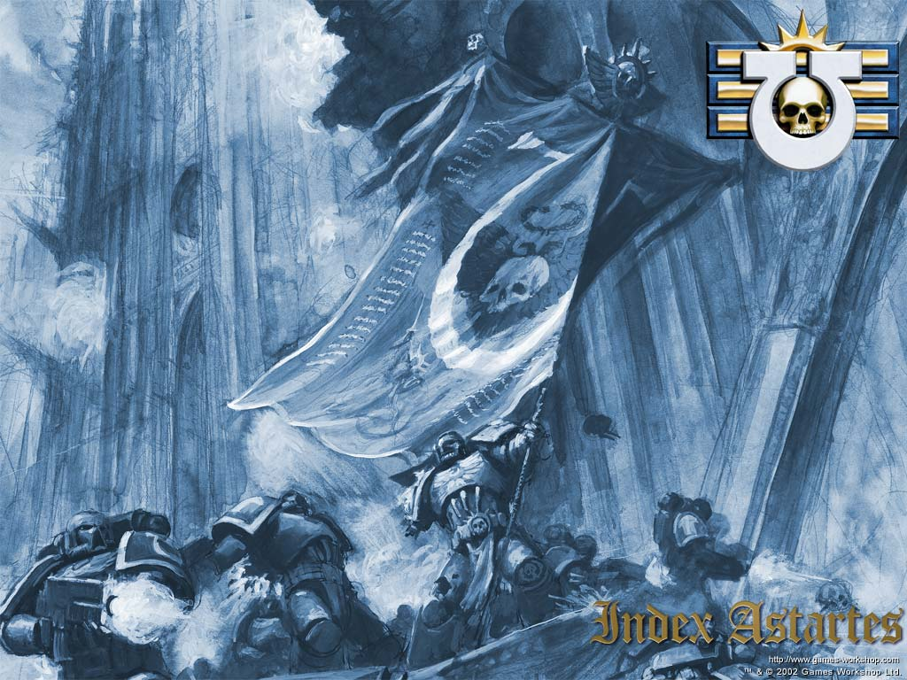
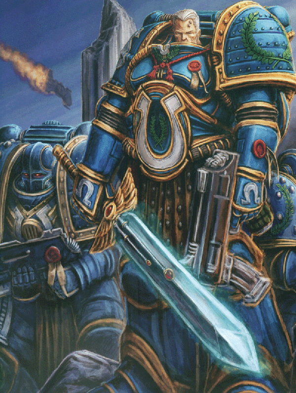
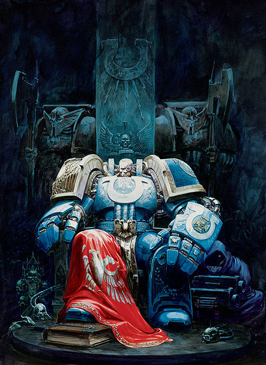
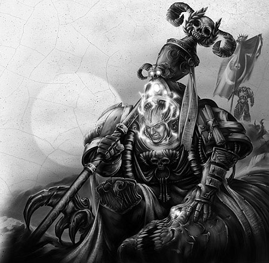
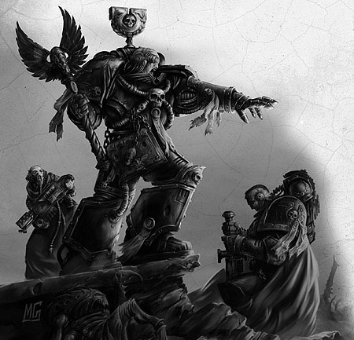

# 极限战士军团（Ultramarines）

引言

自上古之年的伟大圣战起，极限战士们就奋战在帝王军队的最前列，一万年来，这些无畏的精英勇士，虔诚的遵行着阿斯塔特圣典的教导――那是他们的基因原体罗保特.基里曼留与后世的伟大著作，从马库拉格的家园起，直到泰拉的神圣殿堂，他们辉煌的战绩为帝王的子民所传唱，每当人类的敌人威胁帝国的疆域，极限战士们都准备着给予他们无情的痛击。

## 起源(origins)

在所有初创的星际战士军团中,惟有极限战士的史料保存相对完好,其中包含着关于这支最杰出军队的种种宝贵信息――在有关星际战士基因原体们的诸多传奇之中,以他们与帝王分离的详情最为神秘,这个谜题困扰帝国的学者数千年之久,许多的野史逸闻流传于世,但无一能够完全解释这诡异的灾祸是如何临到,这秘密也许永远都无法解开,但罗保特.基里曼在马库拉格所发现的东西,被认为也许是能够指向真相的最重要线索...

马库拉格是个满覆石砾的荒凉世界，位于银河的最东边缘，星球表面的四分之三为山脉纵横的严寒高原所覆盖，其余的部分则是蓝光粼粼的海洋，马库拉格在动荡之年里成功的保护了自己，大部分的工业设施都得以保全，并且保持着与邻近星系的联系，星际飞船有规律的往返于其间。马库拉格由两位执政官共同统治，他们的命令就是星球的法律，胆敢对抗权威者都被残酷的镇压，但诚实劳作的人可以得到当有的回报，而最有才能的效忠者则被委以重任。马库拉格的生存环境严酷非凡，只有最强壮者才能熬过脆弱的童年长大成人，因此马库拉格的孩童无论男女，都必须生来就健康壮实，而那些虚弱的婴儿，则被遗弃在荒山中等待死亡。

成为马库拉格的人民意味着简朴，严格和忘我的生活方式，这里的人们自视为人类最优秀传统的真正继承者，他们鄙夷奢华享乐和无所事事的生活，并视对先进科技的依赖为带来分裂，怯弱和道德堕落的根源，这种价值观甚至对马库拉格周围的星系也产生了深远的影响，许多人都羡慕马库拉格那种严格的秩序。

为了持守这种生活方式，马库拉格的儿童不论男女，在六岁时就被送入军体学院，在那里，他们要学会战斗、锤炼身体、严守纪律、忍耐痛苦和荒野生存，学院的生活是残酷的，只有素质优秀的学员才能生存下来，而当他们经历了这些人类所能想象的最严酷训练之后，到他们14岁时，他们将正式成为军人。

凭藉这苛酷的体制，马库拉格的军力在当时无与伦比，其周边的星系也纷纷仿效马库拉格的训练方法，因此，在动荡之年里，整个银河陷入混乱与黑暗之时，马库拉格和它的盟友们获得了成功，由训练有素的战士组成的纪律严明的军队，一次又一次的击退了异族侵略者，人类的叛徒以及宇宙海盗的袭击。士兵们在军队服役直到30岁，然后他/她们被允许离开军队，去开始自己的家庭生活，然而这并不意味着平和日子的来临，因为不论马库拉格的军队取得了多少辉煌的胜利，行星的表面却还是那永恒不变的荒凉旷野，并且不断有匪徒和强盗从北方称为伊里瑞姆的蛮荒之地而来，劫掠南方的居民，马库拉格最伟大的执政官康勒，曾经率军讨伐过北方蛮族，但他最终也未能为这片土地带来平静。

罗保特.基里曼的降临，对于马库拉格的人民，是早有预兆的伟大事件，长久以来，文士们记载了有关于此的诸多异象，而执政官康勒日记上的某些章节，更为围绕星际战士基因原体们的难解之谜，提供了至关重要的线索，这些手迹都被极限战士的智库长官们小心保藏，并且一直以来，对帝国的史学家们起着重要的启迪作用，当然，也在相当程度上，带来了他们之间的分歧：

文献中的一段记录如下：

“这样的梦境会令人怀疑自己是否已经失去心智，或者更糟一些――去向邪魔祈祷，这梦夜夜纠缠着我，每一夜，黑暗的魔物，长着长牙与利爪，它们撕碎我的血肉，啃噬我的灵魂，连续三个月，我没有一夜不从尖叫中惊醒，那叫声如此可怖，甚至我无法相信那出自我自己的口，医生给我服用了大剂量的历山根汤，但丝毫无助，我觉得我就快要疯掉了――但就在那一夜，当我如常梦到那些每夜吸食我骨髓的妖魔时，我看到一个高大的身影，他身穿钢铸的铠甲，上面镶饰着鹰形的浮雕，浮雕铮亮闪耀，如同炼净的纯银，一顶精铜的头盔遮住了战士的脸，他站在那里，手握阔刃的长剑，强大的能量从剑身的花纹中流出，黑暗的野兽将他团团围住，但他给予它们致命的痛击，怪物们一个个倒下，然后嚎叫着消失在虚空中，当最后一个怪物被消灭后，战士走向我，我突然发现自己正处身莱攀尼斯山谷的赫拉瀑布下，飞溅的水花浇在我身上，然后，我看到地上躺着一个金发的婴孩，战士吩咐我保护这婴孩，但当我伸手想去抱起那孩子时，梦醒了。我感觉到数月来从未有过的舒畅，这是梦？还是异象？我不知道，但我醒来时，脸上仍带着薄薄的山溪清泉……”

在传说之中，莱攀尼斯正是马库拉格第一位执政官的登基之处，然而如今已经只余断壁残垣，次日，康勒就带领贴身护卫启程向东前往赫拉瀑布，经过数周的跋涉，这支队伍终于越过冰雪覆盖的重重山峦，抵达了那座巨大的飞瀑，冰冷的河水夹着冰块倾泻而下，砸在千尺之下的巨石上，发出雷鸣般的轰响，经过仔细的搜索，他们找到了康勒在异象中所见的婴儿，他身裹细布，静卧在岩隙之中，他是如何来到这与世隔绝的幽谷，无人能够知晓，但他在这历史意义重大的圣地被发现，却正与历代以来的预言相印证，康勒将孩子带回他的宫闱，并给他起名罗保特，意为“至上者”。

小罗保特一天天长大，他的智慧与身量一齐增长，只用了短短数年，他就掌握了宫廷教师们所能教给他的一切，在他六岁的时候，遵照星球的传统，他被带离他的养父，正式进入阿吉瑟鲁斯的军营，在那里，他以惊人的速度学会战斗的技巧，他对哲学，历史与科技的悟性无人能及，而他真正的天赋，则是在军事领导的领域。只过了两年时间，让罗保特继续军营的训练已经显得滑稽可笑，因为他已经是马库拉格最强的勇士了，他可以在格斗中轻易的战胜任何教官，而他在军事谋略方面的才华更是无出其右。

当罗保特一步步成长为伟大军事家的同时，马库拉格也正处在特别的时局之中，康勒是一位仁慈的统治者，但与他共同执政的贾兰，却是个自负而好嫉妒的人物，他暗暗策划着针对康勒的阴谋，贾兰和一群支持他的富足阶层，极力的反对康勒所推行的改革，这些肥胖的富人已经脱离了劳作，将苦活都交给奴隶，而康勒的改革计划要求他们给予奴隶更合理的食宿条件，还勒令他们出资支持首都的扩建，康勒力图通过改革为马库拉格的人民带来福利，但贾兰和他的支持者却害怕因此失去财富与权势――同样，他们还害怕罗保特的威名，贾兰知道，只要康勒的养子尚在城中，他们就无法作乱，因此他们一直秘密谋划如何将罗保特调离都城。他们贿赂伊里瑞姆的野蛮部族，鼓动他们发起一次对南方社会的强力突袭，然后贾兰对康勒鼓吹罗保特正是平定这些野蛮人的最佳人选，康勒同意了这个建议，他一直在找寻一个能配得上自己儿子的任务，而现在，他相信这正是让罗保特证明自己的最好时机。

罗保特挥军北上，进入伊里瑞姆的蛮荒之地，在那里展开了对抗蛮族的宏大战役，他尽显神话般的战略与领导天赋，仅仅两个月的时间，他的远征军不仅征服了整个伊里瑞姆的土地，更赢得了狂野部族的尊敬，罗保特与最强部族的首领巴底里斯歃血为盟，结为了兄弟，但在经过艰苦的战斗并最终与所有部族订立忠诚的盟约之后，罗保特却从巴底里斯那里听到了关于贾兰的贿赂的消息――罗保特立刻聚集军队，急速南下，赶向首都，但当城市的轮廓进入他的视野时，他所看到的是腾空而起的烟柱和四处闪耀的火光……

罗保特率领军队赶向城门，他们奋力的穿过从恐慌中逃离的大群难民，终于冲进一片混乱的城市，醉酒的士兵正四处烧杀抢掠，到处都是狂怒的火苗，罗保特一面组织扑灭大火的工作，一面向行政大厅推进，并处决掉所遇到的所有匪徒，贾兰雇佣的上百名士兵封锁了行政大厅的大门，但罗保特砍翻这些拦路者，强行杀进大厅，他留下他的部队去处理骚乱者，独自一人挥着剑穿过行政厅长长的过道，最后，他看到了已经奄奄一息的康勒，刺客的匕首还插在他的胸膛上，执政官用最后一口气告诉儿子贾兰叛变的消息，并恳求他继承自己未竟的事业，医生尽了全力挽救执政官的生命，但凶器上的毒药已经扩散到全身，他们无力回天了。罗保特的心中充满了仇恨，但他仍然冷静的指挥着恢复城市秩序的工作，那些还忠于康勒的士兵本来被包围在自己的军营中，但当他们听到罗保特归来的消息，都奋力冲破包围，来与他的部队会合。

在罗保特的领导下，叛乱很快就被平息，无数人尝到了基因原体盛怒的滋味，贾兰打算逃离这颗行星，但罗保特在太空中将他截获，绑上铁链押回马库拉格，并用康勒的佩剑亲手将他斩首，在民众的拥戴下，罗保特成为马库拉格新的执政官，他迅速的处理了那些背叛他父亲的贵族，处决了他们并剥夺他们的财富与官衔，分给那些忠诚的支持者，然后他开始着手继续父亲的工作，一年之后，叛乱就如同从未发生过，马库拉格呈现出前所未有的繁荣，被毁坏的建筑都已被重建，并且更胜从前，人民各从其业，都觉得平安和满足，军队纪律严明，装备也更加精良，守护着星球的宁静，星舰也继续往来于天空，一切都堪称人类社会秩序的楷模――而当这理想社会的传闻到达帝王的耳中时，他的星舰启航前往马库拉格，要来见一见这位传奇的执政官。

――斯拜楚伦的史书详细的记述了帝王与罗保特相逢的情形，许多史学家将此视为对“是帝王亲自将罗保特送上马库拉格”论调的强有力证明，因为帝王正是身穿银色的鹰徽盔甲，头戴精致的铜盔，佩着光芒闪耀的能量剑来接见罗保特的，而罗保特立刻想起了养父日记中的记述，意识到自己终于见到了真正的父亲――事情就这么成就了，而马库拉格的秩序与力量甚至让帝王也感到惊异，他随即下令指定这里为星际战士新的基地，以罗保特为基因模板，新的军团被创建，他们的名字，就是Ultramarine――极限战士，他们的第一个要塞建立在莱攀尼斯山的最高处，罗保特最初被发现的地方。

在整个帝国的瞩目下，罗保特欣然接过极限战士军团的指挥权，同以往一样，凭借着对战争艺术的绝卓天赋，罗保特领导着极限战士们取得了一场又一场辉煌的胜利，从外星异族和混沌信徒手中解放一个又一个星球，大大扩展了帝国的疆土――而当他的一些基因原体兄弟热衷于在征途中留下死亡和毁灭的时候，罗保特却播散着和平与繁荣，他在战役组织方面的才能，使得星球的人口和工业设施都尽可能少的受到破坏，极限战士所征服的每一颗行星，都能迅速的融入帝国并发挥应有的作用。而在马库拉格，雄伟的赫拉要塞也一天天建造成型，那恢宏的气势和神圣的氛围，足以让任何人类折服，被留在后方监督工程的极限战士们还开始着手从马库拉格以及周围的星系征兵，以前所建立的军事学院体系为战团输送了大量优秀的候选者，很快，极限战士们就接收了第一批马库拉格土生土长的战士，周边的星系也纷纷送来他们的候选者，不久，极限战士开始成为最大的星际战士军团。

当何露斯背叛帝王并将整个帝国拉入人类历史上最可怕的内战时，极限战士正战斗在银河的南端，他们的胜利推进使他们与银河东北面的何露斯军队远远隔开，直到泰拉战役打响，基里曼才得到叛乱的消息，他尽快组织军队，全速赶往地球，并在途中歼灭了一支正赶去支援何露斯的叛军舰队，但当基里曼的战士抵达地球时，战斗却已经结束了……但帝国仍处在混乱与危机中，一半的星际战士已经随何露斯一同反叛，其余仍然忠心的战团则在战斗中伤亡惨重，剩下的星际战士人数少得可怜，远不能满足需求，而人类的敌人们正准备对衰残的帝国趁火打劫，但罗保特起誓决不会让帝王的国度沦陷，并一力承担起复兴帝国的重任，他将自己的战团分派往银河各方，阻挡侵略与反叛的乱流，重铸支离破碎的帝国，马库拉格则全力展开征兵工作，很快，极限战士就占到了星际战士总人数的一半，经过近十年的全面战争，银河终于渐渐恢复稳定，而极限战士的战争之道也深刻的影响到每一个星际战士军团，在基里曼的指导下，阿斯塔特圣典逐步成书，这部伟大的著作，引导着后世每一支星际战士的军队，也为帝国常规军力的建设奠定了根基。

阿斯塔特圣典制定了帝国战斗部队的基本战略战术方针，并且在随后的千年中不断增补和修缮，最终成为一本从战场谋略到制服款式无所不包的厚重大书，而其中所提出的最重大变革莫过于星际战士军团的拆分――每个初创军团要被拆分成被称为“战团”的单元，只有一个战团能继承原先军团的名称和徽记，其他的将被重新命名并给予新的涂装，以避免再让整个星际军团掌握在一人之手――一些军团反对这种改革，拒绝接受基里曼的命令，眼看这分歧就要演变成一场新的内战，但最后，他们作出了伟大的让步。最终，大部分初创军团被拆分成五个或更少些的战团，但从极限战士军团拆分出来的战团确切数目不详，被称为萨卡罗斯伪经的古籍是阿斯塔特圣典现存最古老的抄本，其中记载极限战士共被拆分为二十三个战团，但并没有提到这些战团确切的名称。

在那以后，罗保特. 基里曼又率领极限战士战斗了一百年，直到他与叛变的基因原体弗勒格里姆以及他的帝王之子军团在泰莎娅行星的战斗，弗勒格里姆全然抛弃了他的荣光，昔日高贵的勇士已经随同他的荣耀一同死去，现在活着的是效命邪神沙历士的恶魔王子，他的堕落难以用言辞描述，他扭曲的身躯挂满了武器，丑恶的双爪握着淬毒的长刀，当两位基因原体在泰莎娅红色的土地上相遇时，翻腾的毒雾重重裹住了最后的决斗场，没有人能说清那一天究竟发生了什么，但当雾障散去时，帝王之子的军队已经消失不见，只有基里曼静静躺卧，一缕闪亮的鲜血如同鲜红的丝带挂在他的咽喉，即使基因原体天神般的体质也无法阻挡恶魔之毒的扩散，医师只能将他们的领袖装入静态场中，带回到马库拉格，直到今日，基里曼依然静卧在马库拉格的正义之殿，在静态场中永存不朽，一些人宣称基因原体的伤势正在好转，但在时间静止的静态场中这无疑并不可能，虽然这说法难以自圆其说，但很多人依旧愿意相信这样的传说，并期盼着基里曼完全康复的那一天……

以下资料来自[战锤中文论坛](http://www.zhanchui.com.cn/bbs/)

马努斯·奥古斯都·克鲁格是极限战士团的最高指挥官，无数次粉碎皇帝敌人的英勇战斗为他赢得了人类帝国最高的荣誉。其中，他组织的马克罗格防御战粉碎了第一次虫族入侵，这对所有与极限战士军团结盟行星的民众来说是一种巨大的鼓舞。

但是名声和荣耀往往会招致嫉妒，极限战士军团一次次传奇般的战斗和马努斯本人的强烈荣誉感（有人称其为难以驾驭）为他和他的战友造就了不少身居高位的敌人。就目前本人还没有找到直接证据，但是他的敌人似乎对贝塔54殖民地的镇压行动颇有微辞，成立了声名狼藉的审讯会打算彻查这次行动的经过。

在我看来，如果在座尊敬的各位允许我表达一些自己的、初步的观点，所有指控都是空穴来风。最近又有传言说他已经在埃查四号行星防御战中阵亡，但我这里可以给出最翔实的证明，证明所有传言都是基于不尽不实的谣传。马努斯·克鲁格依然带领极限战士军团在战斗，直到今天、现在，一直如此。

——阿斯塔特战团管理庭，最高机密程度的报告

孩子们，要牢牢记住，伟大的父亲正在注视着我们所有人，他知道我们的灵魂，我们的力量，唉，甚至我们的片刻迟疑。命令和指挥的链条必须完整，否则我们将不再是光荣的星际战士。战场上的纪律和秩序便是一切，以此为信条的军队才能无往不胜。

——马努斯·克鲁格 极限战士军团总团长

泰格利斯是极限战士军团众多贤者中的佼佼者，是他们的总督导官。他总是与其他同袍远远分开，过着离群索居的神秘生活，但是大家公认他的知识已经超越了战团图书馆里所记载的总和。泰格利斯是经历兽人对博拉斯行星（Borus）入侵战的少数幸存者，他对卡拉登兽人帝国（Charadon）的了解比任何人都深厚。他根据自己掌握的知识为克鲁格出谋划策，一次次击败兽人的侵攻，直到局势变得无可挽回为止。

有人说，是皇帝的灵魂在教导泰格利斯，似乎宇宙中发生的事情没什么能逃过他的眼睛。无数次先见之明发生在别人身上可能会招致审判庭的怀疑，但目睹他无数在战场上粉碎强大敌人以后，没人再怀疑他的身份甚至对皇帝的忠诚。

最近几年里，泰格利斯开始研究虫族的威胁，在好几次成功预测了虫族的移动路线和战略意图以后，人们觉得他大概已经融入了虫族的群体意识中。如果真是这样的话，泰格利斯一定是人类帝国中最强大的灵能者，因为普通人光是看到虫族意识的一点片断便足以形神俱灭。

卡休斯牧师是极限战士军团中资格最老的成员，或许只比那些无畏机甲中的先贤年轻那么一点点。四个世纪已经过去了，但他的胳膊依然有力，他的目光依然坚定，每次当他出现在战场上，那些年轻的极限战士战士心中就充满了自豪。他总是在追忆第一次虫族入侵时的战斗故事，那时他与马努斯克鲁格并肩作战，对卡休斯来说，军团长总是那个年轻气盛的“小年轻克鲁格”。卡休斯牧师伴随极限战士军团的战士转战千万个战场，通过一次次身体力行为皇帝献出无限热忱和信仰。随着战团最终恢复战斗力，他将高举马克罗格战旗再次降临战场。
