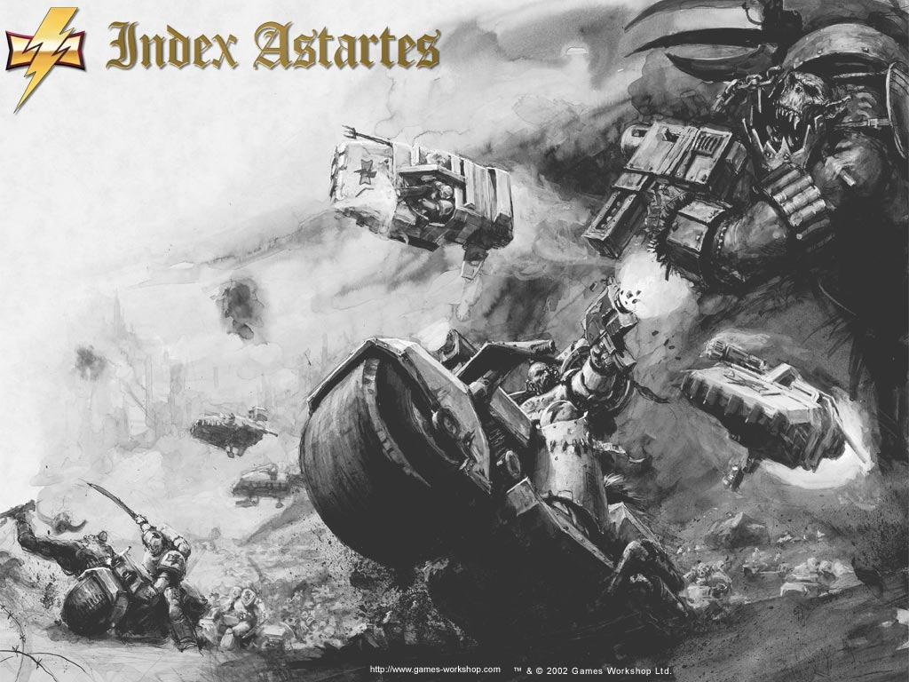
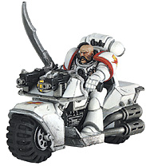

# 白色烙印战团

白色烙印战团介绍（已完成）

[加里森敢死队](http://game.ali213.net/profile-uid-348856.html)

原文还是用我上次提供的方法访问维基搜索white scars

## 起源 

> 此段翻译者:[苏联红军政委](http://sonicbbs.eastday.com/userdetail.asp?UserName=苏联红军政委)

斯卡洛斯经书（Apocrypha of Skaros）讲述了白色烙印（White Scars）鲜为人知的故事，许多甚至是战团内流传的充满传奇色彩的事情。某个传说讲述了他们年轻的基因原体一个人从泰拉（Terra）出发探索银河，但另外一个说他是在婴儿的时候被绑架了。真相似乎是存在于这两者之间，不管事实如何，史籍范吉利亚（Liber Historica Vangelia）记录了察合台可汗（Jaghatai Khan）降临某个位于太平星域（Segmentum Pacificus）的世界，由帝国绘图员标注为蒙达斯·普莱纳斯（Mundus Planus）的地方，不过对于本地居民来说，它叫切格里斯（Chogoris）。那地方曾经是现在也同样是一个美丽富饶的世界，有着茂盛的植物，高耸的山峦以及蔚蓝的海洋。在大圣战（Great Crusade）时期，那里只拥有很原始的科技。一份帝国人口普查显示，当时统治着切格里斯的是一个贵族阶级，他们征服了星球的大部分，有着装备精良纪律严明的军队。重装骑兵和步兵为他们的统治者巴拉丁（Palatine）赢得了每一场战役的胜利。

白色烙印的历史由察合台可汗开始，他是一个前无古人后无来者的军事战略家。传说他有个叫窝阔台（Ogedei）的将军在他失踪后，写了一本名叫《泉州大汗》（The Great Khan of Quan Zhou）的书，就是这本古籍为帝国史记员提供了他一生中某些最佳的事迹。切格里斯有着丰富的资源，经常有着十分夸张的使用记录。

巴拉丁帝国的西部是一个辽阔且多风的大草原，叫做绝地（Empty Quarter），数世纪以来这里是游牧部落的家乡，他们游历了整个大草原。草原上的部落住在帐篷里，根据季节的变换迁徙，从夏天居住的草原迁徙到位于可汗木·喀特山（Khum Karta Mountains）的用于过冬的山谷里。靠着技巧高超的骑兵和弓箭手，不同的部落间经常为了争夺祖先留下的牧场而战斗，或者是为了----窝阔台的作品里应该提到过-----纯粹的战斗带来的快感。切格里斯的军队从没有入侵过绝地，因为那里是一个干旱且荒凉的地方，对于巴拉丁而言没有任何价值。但是，切格里斯的贵族经常带领狩猎小队深入大草原，俘虏走整个部落带往东部，作为奴隶，又或者抓一个落单的部落男子进山里，进行狩猎运动。（《大汗》一书中的许多章节专门用于描述切格里斯巴拉丁帝国的种种暴行，这其中包括的鲜血献祭令许多帝国学者认为巴拉丁的帝国可能供奉崇拜邪神。）

察合台可汗的传说始于昆尔农河（Quonon river），就是在那里昂可汗（Ong Khan）遇见了这个基因原体，他是一个叫做达尔阚（Talskars）的小部落的领袖。他相信这个被光辉笼罩的孩子乃神赐的礼物，随后就将他带回家并取名察合台。传说察合台可汗在他幼年的时候“眼中有着一团火”，这是达尔阚部落里成为一个伟大勇士的征兆，还有传说敌对部落憎恨他，因为他能预见草原上持续不断的战争。

在《泉州大汗》中有着这么一段富有传奇色彩的章节，叫做“鲜血”（The Blooding），里面提到了在察合台还年轻的时候，一群从敌对部落呼喇也（Kurayed）来的入侵者在一次伏击中杀死了他的养父和一群达尔阚人。察合台已经是部落中最伟大的勇士，身上有着多处勇气仪式留下的疤痕，当他出发为这些死者复仇的时候，战士们聚集起来加入了他的队伍。他指挥了一次对呼喇也村庄的攻击，并将那里夷为了平地，男人，女人和小孩在疯狂的屠杀中被杀死。察合台沐浴在敌人的鲜血中，随后将他们酋长的头颅带回去挂在帐篷上。就是这些事将基因原体塑造成了一个他应该成为的人-----一个有着强烈的荣誉感，忠诚和冷酷无情的男人。在履行了血与荣耀的义务后，察合台发誓要终结这场正在毁灭他的人民的内战，为了团结绝地的人民，也为了结束兄弟间的自相残杀。

紧接着这次胜利后，察合台成为了达尔阚部落的可汗，之后与切格里斯的狩猎小队以及草原上的其他部落发生了战斗。每一个被击败的部落都加入了达尔阚以及他的军队。他的军事天赋以及坚强的个性为他赢得了许多追随者，不久他的战士就如漫天繁星一般多了，军队以达尔阚语称呼为马萨里（Mathuli），意思是“不可抗拒之力”。他实行了强制兵役并将来自不同部族的战士们混合组成单位，从而打破之前的部落社会并培养起一种对军队以及最终是对他自己的狂热的忠诚。他仅仅以个人的能力为作为提拔的基础，并且让每一个他沟通的人都有一种他们分享共同目的的感觉。

在对呼喇也的那场战斗胜利的十年后，当军队向着山里的过冬营地转移的时候，察合台和一群人因为一场雪崩从几千英尺的悬崖上坠落下去。几次悲叹过后，部落继续向前进。虽然坠崖杀了许多人，但是基因原体还是设法活了下来。切格里斯的历史记录了在这时候巴拉丁的独子在深山里发现了一个受伤的部落男子，然后就开始在雪地里对他进行狩猎。在这寒冷的山谷里究竟发生了什么无人可知，不过有个严重残废的骑手被绑在了马鞍上回到了切格里斯大陆，这就是最后全部回来的人了，巴拉丁儿子的头颅捆在他的脖子上一起带了回来，此人也从察合台处带回一条口信：“草原上的人民再也不是你的东西了。”

当雪化去的时候，愤怒的巴拉丁集结了一支军队并开始向西进军，下定决心要将这些野蛮人部落从星球的表面抹去。但是他低估了察合台可汗的足智多谋。在可汗谷的龙孙草原上，巴拉丁与察合台的军队遭遇了。据说战斗持续了一天一夜，草原上的部落战斗起来就如同打猎一样，如雷鸣般迅速的骑兵协调着他们的行动形成了一个环形包围圈并将那些人类猎物赶进了这个畜栏。和他们那些穿着铠甲的敌人不同，马萨里穿着轻皮甲，考虑到有着更少的防护，但是更高的机动性。

习惯于与他们的敌人进行肉搏决战，巴拉丁的军队根本不是可汗的骑兵与无情的箭羽的对手。虽然他们有着可观的数量，但是察合台还是运用计谋出其不意大败了他们。只有战败的巴拉丁和他的护卫设法突围出了这个死亡之环，并仓皇逃回了首都，而那些仍然在包围圈里的士兵被杀了个精光。某个切格里斯的幸存者描述到战斗的草原成为了血的海洋。部落领袖，圣人和风暴先知在战斗后集合到一起，宣布察合台为大汗，所有大陆的统治者。

察合台之后开始了对巴拉丁的帝国的入侵，三支军队攻击城市，在敌人领土的外围吸引他们。察合台和他最能干的将军，速不台（Subedei），带领着另外一支军队穿越库滋尔·泉（Kuzil Quan）沙漠的秘密路线，这是一个被认为是不可逾越的地区。新出现的军队好像不知从何而来，突袭了位于库沙巴之门（gates of Kushaba）的驻军并消灭了所有的部队。其他城市接二连三的陷落，切格里斯的史记员记录着丢在路上的尸体就象采石场的石头一样多，被破坏冒着浓烟的田地以及少数被饶恕未被屠杀的人祈祷着从可汗的愤怒中得到宽恕。

在接下来的几年里，察合台的军队席卷了切格里斯大陆，打败了他们最强大的敌人，袭击了他们那些被城墙保护的城市，杀光了那些贵族。落入察合台可汗手中的城市有两种选择：投降或者面对完全的毁灭。过去从没有人目睹过如此规模的掠夺，一些资料声称上百万的人死在了部落野蛮人的手下，但是与察合台可汗同时代的人声称这些是被极大夸张了的形象。无论如何，成百上千的人死去了是事实，切格里斯帝国认为这些“有着恶魔脸孔的野蛮人”是超自然的恶魔，对人类的原罪进行神圣的复仇。最后察合台攻到了巴拉丁的要塞克法斯塔（Cophasta），一座位于东部海岸宏伟豪华的城市。他要求将他敌人的头颅穿在长矛上否则城市将从地平线上消失。一小时后，城市里的贵族把那件东西交给了他。

现在可汗的力量威及四海，成为了这个星球上从未有过的最大的帝国，在少于20年的时间里被一个男人所征服。虽然察合台可汗统治着一片巨大的地区，但是他知道他的人民对于统治这样一个国度没什么兴趣。在他的推进下，联合了所有部落并对他的敌人进行了复仇（而不是有着想占领他们土地的欲望）后，他的帝国崛起了。最高的权力全在可汗与他的将军身上，虽然他们是组织严明的军队，但是对于统治固定人口却没有进步的观念。

史学家卡皮纳斯（Carpinus）编制了一部关于大圣战的详细历史（叫做帝国史鉴）（Speculum Historiale），注意到了在皇帝到达切格里斯前，察合台可汗的军队消灭巴拉丁帝国仅用了6个月。当两人相遇，据说可汗遇见了一个体现了他所为之奋斗的最终理想的人，一个能够统一天上所有星星的人。在泉州的宫殿里，在他所有将军的面前，他单脚跪地，并对发誓永远效忠皇帝。基因原体被授予了第5个军团的指挥权，采用了达尔阚人的那条从前额到下巴的长长的面部疤痕，并将他们自己重新命名为白色烙印（又名刀疤飞车党，兔子取的……）。大汗与皇帝一同登上天空，将可汗舰交给了他的将军窝阔台。许多察合台的追随者选择加入他们的可汗并成为星际陆战队的一分子。

白色烙印在大圣战中某些最血腥的战斗中继续战斗着，由察合台可汗在草原上使用的电闪雷鸣般快速的战斗方式证明了在遥远的世界上也同样行之有效。在贺拉斯叛乱（Horus Heresey）中，当帝国陷入了全银河血腥的内战的时候，白色烙印在二十多个不同的世界上战斗着，他们的旗帜显示了军团协助保卫泰拉以及在王宫门前的战斗。

在察合台可汗最后在大旋涡（Maelstrom）附近的地区消失之前，他的与他的战士们又一起战斗了70年。在战胜了贺拉斯后，察合台已经开始着手救援那些在大圣战期间他不在的时候，被暗黑灵族（Dark Eldar）俘虏的部落同胞。白色烙印始终认为他与他的精英战士们与最凶恶的外星人领袖之一战斗，并进入了在空间与时间之外的极度恐怖的国度，与暗黑灵族进行着永无休止的战斗。这个传说的可信度有多高不得而知，更可能的是，可汗的船只是因为穿越宇宙中充满危险的地区而在亚空间中迷失了。

## 察合台（Jaghatai） 可汗

和其他19个散落在银河各地的基因原体一样，那个叫做察合台可汗的孩子漂流到了Chogoris世界。Chogoris的居民在大圣战之前拥有十分原始的科技，星球的大部分地区由一个贵族阶层统治，由一个叫做巴拉丁（Palatine）的统治者领导。

察合台是被Ong可汗发现的，他是一个名叫达尔阚（Talskar）小部族的首领，也是他收养了当时还是婴儿的察合台，并预见了他将成为一个伟大的勇士。察合台的家人之后被居住在草原上的另外一个名叫呼瘌也（Kurayed）的部族给杀害了。尽管察合台还是那么的年轻，他已经成为了达尔阚部族最伟大的勇士，并带领着他的勇士开始了复仇。他将敌人的村庄夷为平地，杀光了所有人，并砍下酋长的首级挂在了帐篷上。

在这场战斗胜利后，察合台成为了达尔阚部族的可汗，并发誓要统一草原上所有的部族，结束内战。他击败的每一个部族都被并入了达尔阚部族，依靠自己的军事才能以及刚烈的性格，他还为自己赢得了许多追随者。他使他的军队井然有序，将来自不同部族的勇士们混合组成单位，从而打破之前的联盟并建立起一种对他的普遍忠诚。

10年后，在统一了一个名叫绝漠（Empty Quarter）地区后，察合台遭遇了一场雪崩。他被巴拉丁的孩子发现，就象许多贵族一样，他喜欢玩俘虏部族男子并在山中狩猎他们的运动。具体的过程无人知晓，但是据说狩猎小队中只有一人生还，带着巴拉丁孩子的首级以及一条口信，“草原的人民再也不是你们的东西了。”

被激怒的巴拉丁集结了他的军队并且开始向西进军与部族的野蛮人交战，但是却在一场持续一天一夜的战斗中被彻底的打败了。穿着重甲，擅长于肉搏战的巴拉丁的军队完全不是察合台的轻骑兵与无情的箭雨的对手。巴拉丁勉强逃跑了，但是最后还是被察合台的军队杀死，他的军队涌入了这些曾经被贵族统治着的地方，一路上要么征服，要么就是毁灭了阻挡在他们面前的一切东西。察合台的力量现在遍布了星球广阔的大陆上，在短短不到20年的时间里，一个帝国诞生了。

## 皇帝的到来

在察合台的战役结束不到6个月人皇便来到了Planus Mundus。在认可了皇帝统一全人类的理想后，基因原体向他的父亲宣誓效忠，作为回报，他成为了第5个星际军团的领袖。

军团迅速通过决定，以达尔阚部族的人的荣誉伤疤将他们自己重新命名为白色烙印。察合台军队中的许多人选择跟随他们的领袖，成为了他们新母星的第一代星际战士。

## 圣战与叛乱

电闪雷鸣般的战斗方式在察合台可汗家乡的草原上行之有效，在大圣战的许多战场中也证明效果卓著，在当时，白色烙印很适合参与某些极其残酷的战斗。

他们的传说伴随着贺拉斯叛乱的一系列事件，白色烙印在上百个世界与混沌的叛徒们战斗。众所周知军团的大部分，包括基因原体，在围攻王宫的时候出现在地球上。

察合台与他的弟兄们又一起战斗了70年，最后在宇宙中一个叫做Maelstrom的地方失踪了。人们相信他去追捕那些在大圣战时期攻击了他的母星的黑暗神灵族，并且自从那时起再也没人见过他。

部族是草原上人民的主要构成单位，也真实反映了白色烙印战团的组织结构。当草原上某个部族年轻的勇士被选中，对于战团以及皇帝的忠诚将取代他对于部族的忠诚。

正如他们的基因原体在统一草原时所做的一样，从不同部族来的新兵们被混合在小队里。每个小队成为兄弟会的一部分，兄弟会大致相当于一个标准的连。

由于战团所亲徕的战斗方式，战团的其余部分与大多数阿斯塔特圣典战团大相径庭。由于有着很高比例的机车小队和兰德飞艇中队，多数重武器没有被采纳使用，而无法伴随其余军队的坦克也被淘汰了。

## 母星

Chogoris是一个仍然处于半封建状态的富饶世界。当察合台可汗离开这个他一手创造的统一国度后，这个星球又回复到了他到来之前的样子，分散成了多个封建部族。人们认为这可能就是基因原体的意图，这将保证他的军团在未来拥有一批强壮的兵员。

白色烙印战团以坐落在星球之巅的泉州宫（palace of Quan Zhou）作为基地。白色烙印的风暴先知（Stormseer）每隔本地的10年就冒险下到草原，观察部族的战斗，并将最优秀的年轻勇士带走改造成星际战士。

由察合台可汗传授给部族的战斗方式在接下来的一千年里，也同样适合白色烙印。他们的行动模式（modus operandi拉丁语，意思为mode of operation）内容包含有高机动部队发动的闪电般的hit and run攻击，分割消灭敌人，永远不会与敌人发生决定性的交战。

白色烙印频繁使用机车，兰德飞艇以及装备有飞行背包的突击小队骚扰敌人，直到敌人最虚弱的时候发起攻击。虽然他们喜欢和敌人保持一定的距离，但是他们完全有能力发动一场凶残的突击，正是如此帝国的敌人惧怕他们。

## 战吼

为了可汗与皇帝"For the Khan and the Emperor!"

## 涂装

白色烙印的动力装甲主要以白色为主，辅以红色装饰。这是军团自大叛乱后仅有的细微变化。白色烙印战团的象征是一条闪电，表示他们的战斗风格以及效仿所有战团成员的荣誉伤疤。
