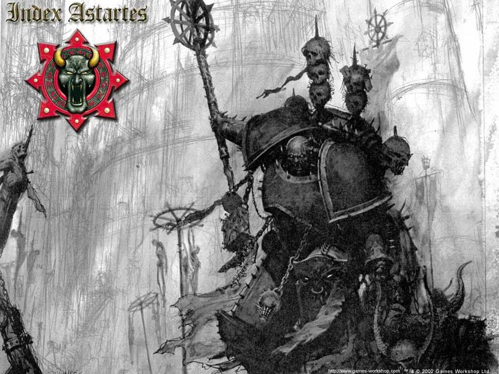

# 怀言者（Word Bearer）

怀言者是其中一支最早的二十支Space Marine军团里受到Chaos Gods感化的。他们在很多方面都是所有军团中最热诚的，他们在叛变后把他们的宗教狂热都转向了他的新主人。

## History

Lorgar (罗嘉)

一个叫罗嘉的基因种子在还是婴儿的时候在路娜(Luna)的基因实验室和其它十九个基因原体失踪了。他们为什么失踪和怎么失踪的到现在还是一个谜，不过罗嘉是在一颗叫克罗其斯(Colchis)的封建星球上被发现的。还是婴儿的罗嘉被当地主要宗教 - 可莱恩教(Covenant)的信徒给找到并由他们扶养长大。在可莱恩教的神殿里学习后，罗嘉很快见成为了一名虔诚的牧师，他精湛的讲术和魅力很快就赢得了很多的信徒。但是，随着罗嘉越来越受大家崇敬可莱恩教的人却对他越来越忌妒。

罗嘉在小时时常会看到一个有关一名身穿铜色发光盔甲的英勇战士，还有一名身穿蓝色长袍的独眼的巨人站在这名勇士旁边来到克罗琪斯的异象。这时候，他看到这个启示的次数多到罗嘉预言克罗琪斯的神就要降临了。他开始传讲这个预言，这造成可莱恩教开始瓦解因为大量的信徒相信了罗嘉传讲的道。罗嘉的敌人借着这个机会宣称罗嘉是一个异教徒。

在前去逮捕罗家的人遭到他的信徒杀害后可莱恩教分裂成两派，一场巨大的圣战爆发了，到最后全部的人民都必须选择支持其中一方。这场战争持续了六年，直到罗家和他的支持者突袭了曾经是罗嘉受训的神殿并杀光了所有的里面的修士。

## The Coming of the Emperor(皇帝的到来)

在罗嘉和他的追随者获胜后的一年内，一架载有皇帝和红色麦格拿斯(Magnus the Red)和两名千疮之子士兵的飞船穿越星球大气层并降落在神殿附近。根据传说，罗嘉在看到这群人后马上认出他们就是他在异象中所看到的人并马上对他的父亲和创造者宣示效忠。

整个可莱恩教马上改为一个崇拜他们的救世主 - 皇帝的宗教，所有的克罗其斯百姓在他们的新神下重新团结。罗嘉精心设计的庆祝活动和虔诚的宣示持续了数个月，但是皇帝并不是非常赞许这项举动因为他想要继续他的圣战。在长达数个月的庆典终于结束后，罗加当上了第十七支Space Marine军团的指挥官，也就是后来的怀言者。

## The Great Crusade(圣战)

罗嘉带领了他的军团消灭所有在帝国里毁谤皇帝和异教行为的敌人。无数古老的文学和宗教图示被他们烧毁。教堂和祭拜皇帝的神殿工程被他们督促。怀言者的牧师写了无数赞扬皇帝的文章和诗歌并给了许多伟大的演讲。虽然怀言者在圣战中的进度十分迟缓，不过那些被他们占领的地区都受到完全的感化。

但是，皇帝对怀言者的进度感到不满。他亲自谴责罗嘉，告诉他Space Marines的任务是战斗而不是信仰。根据记载，罗嘉因为皇帝的命令感极度哀伤整整一个月，他在这段时间中不和任何人说话并只穿苦行服。当皇帝准备要再次责备罗嘉的军团因为他们在圣战中的进度又再次停止时，怀言者又回到了前线，而且这次一个又一个的世界快速的被攻下来了。

## The Corruption(混沌的感化)

怀言者就是在这时候被浑沌之力给污染的。当罗嘉还在为皇帝的命令烦恼不已的时，卡尔非罗(Kor Phaeron)一个罗嘉的副官兼好友告诉罗嘉有关伟大的浑沌之神(Chaos Gods)的事，他对罗嘉说这些浑沌之神将会非常欢迎他，甚至需要罗嘉和他手下充满信心的祈祷。罗嘉慢慢的被卡尔非罗给说动并将整个宗教都改为祭拜邪神的宗教了。怀言者虽然崇敬浑沌之神，但是他们不像其它军队只支持一个神祇，他们所有的浑沌之神都被他们崇拜(Chaos Undivided)。

怀言者将他们的新信仰完全保密，直到战帅(Warmaster)贺拉斯(Horus)公开声明他在浑沌中的信仰，并开始一场后来被称作贺拉斯之乱(Horus Heresy)的星际内战。怀言者和之前被他们占领的世界很快的就加入了叛乱的军团。

贺拉斯命令罗嘉送出大部分的军团去阻止甚至摧毁无限战士(Ultramarines)军团，无限战士的大军将无法阻止贺拉斯继续往泰拉(Holy Terra)进攻。罗嘉很高兴的接下了这个命令因为在他的军团因为他们的信仰受到皇帝责骂的时候无限战士反而成为皇帝最喜欢的军团。卡尔非罗在发誓要催毁无限战士后率领了进攻无限星系(Ultramar)的攻击。无限战士在怀言者个猛攻之下被一路撤退到防御完善可夫(Calth)。其它的怀言者军团则跟随着罗嘉前往泰拉，当贺拉斯和他的军队在第五十五天的攻防战中被击败后，怀言者躲入了恐惧之眼(Eye of Terror)和其它散布于宇宙各地的次元漩涡。

## After the Heresy(贺拉斯叛乱之后)

后来，怀言者所犯下的暴行让罗嘉成功的转身成恶魔。他现在住在一个叫塞卡洛斯(Sicarus)的恶魔世界继续看顾他的军团，指挥他们继续攻击、掠夺、摧毁帝国世界和他们的皇帝。

## 战吼

怀言者没有固定的战吼，他们会从Books of the Epistles of Lorgar(使徒罗嘉之书)选出一节来当他们的战吼，怀言者用最多的战吼目前是是All praises!
