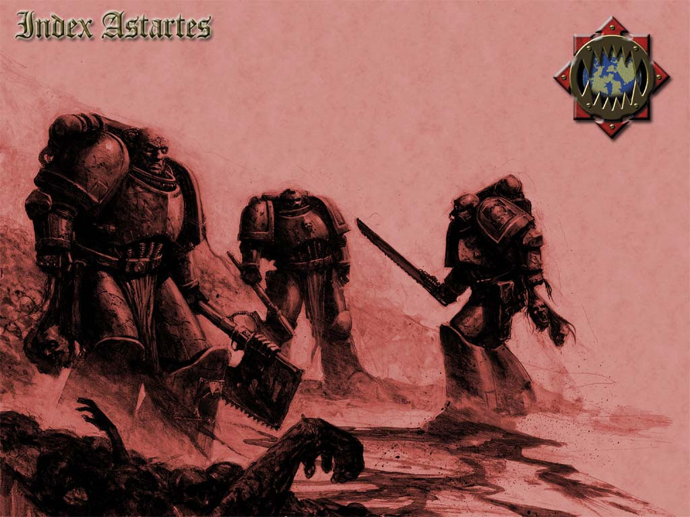
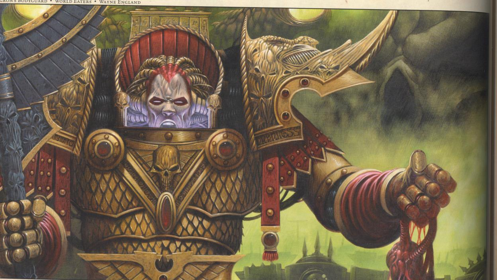
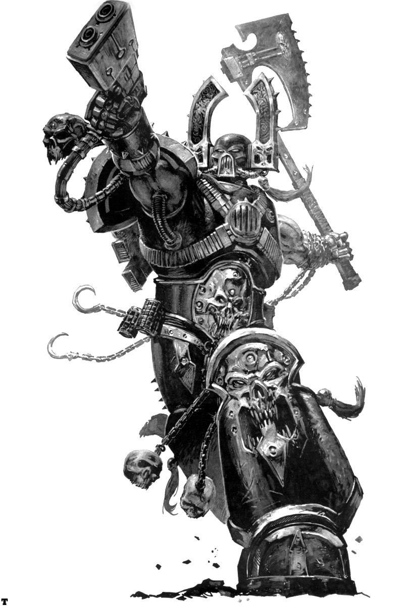

# 蚕食者(World Eaters)
 
Khorne 的选民――蚕食者

在所有由皇帝一手创立并在大远征时代对银河系展开再次征服的星际战士军团中，最令人恐惧的就是蚕食者（World Eaters）。在血腥的侵攻和最为狠毒的战斗中，“蚕食者”这个名字无疑是令人不寒而栗的大规模的血腥和恐惧的代名词。

## 起源

坐落在地球的 Sanclus 图书馆地牢里的最底下，《万疾全录（Liber Malum）》血迹斑斑的卷宗上记载着遁入受诅咒之途者的命运；甚至只是提到他们的名字也要冒着神志错乱的风险。在当中有众多亵渎侮辱的异教徒，也有其名足以玷污书页的暴君，不过在众多被诅咒的灵魂之中为首的就是星际战士蚕食者的基因原体 Angron。

Angron 的传奇为人知道的部分并不完整，故此根本难以知悉裹藏于其黑暗传奇中的真实。人们并不知道 Angron 刚被创造出来之后就如何与皇帝分离，也不知道他后来安家的行星的名字，甚至连这颗行星曾在何处、如今是否依然存在都一无所知。在 Carpinus 的《前史鉴（Speculum Historiale）》一书中记载到 Angron 的星球是一个科技先进（但并未说出名字）、等级森严的世界，统治世界的精英在高墙之内醉生梦死，蜷缩在周围贫民窟的贫民则是衣食无着。为了使大众从日复一日的惨淡愁苦中分散一下注意力，这个星球的统治阶层经常在巨大的斗技场中举行死亡比赛，让用机械装置增强过的角斗士在场中进行殊死的搏斗以愉悦大众。Angron 最终就是在这个世界被发现的，但他究竟是怎么到了那里并无记载。

无论如何这终归已成往事，已知的是 Angron 是被一位奴隶主无意之中发现这位基因原体的：其时他正在北面的一座山上，浑身鲜血淋漓，旁边躺着数十具异型尸体。正史中并没有说明这些异型生物是什么种族，但许多帝国学者相信应该是灵族，估计他们是预见到了这个基因原体未来的大概而前来袭击。Angron 伤得很重但依然活着，那个奴隶主发现他的伤势复原得很快，由此断定他必定是一位无人能敌的战士。Angron 作为奴隶被带了回去进行治疗，并且在大脑皮层下植入了生物神经器官。这些黑暗时代科技的遗物能增强一名战士在战斗中的力量和杀气，把他变成一名疯狂的杀手。Angron 被带到首都，在那里很快就被人发现他作为角斗士的潜能，被卖到了这个城市最大也投资最多的角斗场。角斗场下面的小笼子里住着数千名机械化的角斗士，Angron 在他们中间也住了下来。

就在几个月后，Angron 凭借令人畏惧的技艺和强烈的武道的荣誉感赢得了血腥的敬意。他在单挑和群斗中杀了几百名战士，但并不伤害那些战斗同样出色的人。他受到一群走投无路者的忠实崇拜；表面上他很喜欢角斗士的生活，但他无时无刻都在伺机逃离奴隶生活。他是个令人头疼的奴隶，天生藐视权威，曾好几次试图冲出竞技场的地牢。不过这些斗士都被重兵看守，一直有着全副武装的守卫在值班，故此每次尝试都失败了。

不到几年他的名声传遍星球的每一个角落，作为一名可畏的杀手赢得了人们深深的敬意。成千上万的人蜂拥而至观看他的战斗，而在他的指导下角斗士们变得越来越可怕，最终其他角斗场的战士根本不能抗衡他们。在又一次越狱失败后 Angron 终于明白他不可能单枪匹马地逃出去。他的不屈精神和训练手法早已使他成为受角斗士尊敬的领导人物。随着全星球最大规模的死亡竞技即将到来，Angron 开始策划他最大胆的越狱行动。

在这一系列比赛中 Angron 被获准和角斗场里的每一名角斗士都交手一番，在达到高潮之时人群都欢呼着涌向角斗场。Angron 的追随者迅即转向守卫，以他们自己的方式大肆屠杀。面对着荷枪实弹的士兵他们伤亡惨重，但大约有两千人成功地逃进了城市里，窃取所需的武器和补给以转战山区之中。Angron 的军队在北部山脉的最高峰弄了个落脚地――正是靠近他多年前被奴隶主发现的地方。星球上的统治者随即派出军队镇压逃亡者，但他们很可悲地低估了 Angron 的奴隶军团。几天之内这支曾经飞扬跋扈的军队惨遭屠戮，武器装备尽皆丢弃给奴隶们，只剩下少得可怜的人得以生还，挣扎着逃回城里。

随后的几年里不断有类似的军队被派遣消灭 Angron 的奴隶军，只是每一支都蒙受败绩，被这些机械强化过的战士近乎病态的狂怒切成碎片。但消耗和饥馑不断使奴隶们的阵亡名单加长，很快他们就连一千人都不到了。在一座名为 Fedan Mhor 的山上，黑夜降临的时刻，Angron 被至少五支装备精良的军队重重包围，看来奴隶们的反叛终于走到了尽头。纵使是这位基因原体也抵挡不过如此数量的敌人，不出数日他的末日必将到来。

大概就是这个时候，皇帝被这位基因原体所散发的灵力光环所吸引来到这个星球。皇帝在暗处观察着 Angron，自豪地看到他率领着奴隶们浴血奋战。如今他降临到星球的地面，许以 Angron 领导他的星际战士军团蚕食者，以及在皇帝身侧有着一席之地。Angron 拒绝了。他的容身之地就是这里，与他的奴隶战友们在一起，而只有死亡才能让他对他们撒手不管。Angron 与奴隶们在夜里挖好了自己的坟墓，对于他们的敌人而言就是意味着宁死不降。皇帝明白纵使 Angron 是一位基因原体，但在即将到来的战斗中也不免一死，于是把自己的飞船移到低轨道上，把 Angron 从 Fedan Mhor 传送走了。群龙无首的奴隶们被击败，次日清晨他们被这个星球的统治者们的联合部队大肆屠杀。而在太空，正值大远征还在进行，Angron 后来还是接纳了蚕食者的领导权，但对于皇帝把他从他的星球拐走一事，由于认为是对他的武道的背叛而一直耿耿于怀。

Angron 深知精神外科手术能够有效激发一名战士的威力，于是下令蚕食者的技术战士把他自己头颅里的植入体作为模版加以复制。只是这项技术早已失传，早期复制的试作品根本不可靠，经常诱发受体失控而发生不可阻挡的精神狂乱。其后技术人员们终于得以制造能正常运作且能激发战意和力量的的植入器官，并给整支蚕食者军团都加以植入。最初强化过的部队非常成功，迅速地成为恐怖的队伍而赢得他人颤栗不已的敬意。蚕食者们没有丝毫的怜悯，有的只是链斧最后一击所带来的血淋淋的死亡。《万疾全录》中提到多次有整个星系集体投降，以求避免遭受蚕食者的怒火的毁灭。但这支军团对新兵使用精神外科手术的事被广为人知，终究只是时间上的问题。在 Ghenna 上臭名昭著的大屠杀（整个行星的人在一个晚上被全部杀绝），皇帝责备了蚕食者并勒令其后停止这种植入器官的使用。

Angron 对此未予多少理会，下令技术战士们继续此事直到几乎军团里的每一名星际战士都接受了手术。血腥的场面愈来愈成军团的传统，每到银河一处屠杀必随后而至，在战斗中星际战士们比赛杀人也变得非常普通。许多 Angron 的基因原体兄弟对着皇帝并不讳言自己的忧虑，现在人皇犯下了致命的错误。他派遣众位基因原体最为信任的 Horus 去会见 Angron，好把他拉回正道。Horus 是一位灵力大师，但已在皇帝知情之前被混沌的力量所侵蚀。Horus 在 Angron 身上看到的是一位为愁苦愤懑所困的战士，当然无需多花力气对此加油添醋，渲染皇帝对他的背叛。他把皇帝描绘成急需被取而代之的懦夫，对着 Angron 说他最想听的话，故此 Horus 最终在第一次银河内战中对着皇帝叛旗高举之时，Angron 的蚕食者也伴随着 Horus 之子军团前进。

曾经造访过皇帝敌人的残暴与恐怖如今由蚕食者送到帝国自己头上来了。蚕食者在每一场战斗中均冲锋在前，在最为血腥的突击中奋战，他们更情愿用肉搏而不是远程火力将敌人撕碎。他们在银河中开凿出一条通向地球的血河，痛饮刀下死难者的鲜血，以他们的新主人――嗜血之神(Blood God)Khorne 的名义摘取敌人的头颅。在地球上对地球之围存留下来的纪录显示，蚕食者打破了帝国宫殿的围墙，Angron 挥舞着他闪亮的符石剑冲在前头。他们在地球取得了血肉的大丰收，只是最终的胜利还是与他们无缘。得知暗黑天使与太空野狼正在赶回地球，Horus 为求结束围攻孤注一掷，降下了他座舰的防盾，挑衅引诱皇帝前来。皇帝遂拼死一搏，迎来了决定银河命运的一战。二人的战斗用尽了所有的方式――物理的，精神的，灵力的――最终皇帝打倒了 Horus，但也付出了惨重的代价。失去大背叛者（the Great Betrayer）的约束的混沌各军顿时四分五裂，从地球上溃逃而出。Angron 是最后一个离开的人，率领着蚕食者进入了恐惧之眼的深处。战斗虽然失败，但战争仍然持续；他和他的战士们无时无刻都在寻找着复仇的机会。

## Ariggata 之涤净

在大远征起初之时，皇帝的领域持续地被他的基因原体们所推进。许多星球欢迎皇帝大军的到来，但也有一些非常愚蠢地进行抵抗。Ariggata 是一个技术高度发达的世界，脱离于帝国之外已经有数个世纪。皇帝的特使抵达 Ariggata 游说对方回归，却被对方残忍地处决以显示维护其独立的姿态。Ariggata 的军事力量非常强大，故此恢复和平的荣誉只能由三支军团――月影之狼，极限战士和蚕食者共同去承担。皇帝的战帅 Horus 统领各军，在其高明的领导之下 Ariggata 的军队很快纷纷降伏，只剩下 Basalt 城堡尚在敌手。

帝国军队对城堡展开围攻，但和平实在耗费了比 Horus 所愿意的多得多的时间，他盼望着能离开此地去追求更多的荣誉。为了尽快结束围城他从卫星轨道上对城堡坚固的城墙进行炮击，并命令 Angron 和他的蚕食者冲进缺口击杀敌军的领导人。城堡的城墙由黑暗时代的技术铸造而成，故此即使一周之久的炮轰也只能打开一个缺口。Angron 把蚕食者赶上城墙，立即招来激光器和炮塔的火雨，然而蚕食者毫不畏惧，堆积如山的尸体成了他们到达墙顶的掩体。一到了墙内渴望战斗的星际战士们挥舞着他们的链斧，把所有靠近的东西全数破坏。蚕食者洗掠城堡时人们惊恐的哀号，在古老的大厅内回荡了一日一夜。当 Angron 率部从这座停尸房中出来时，里面已经没有一个活口。

极限战士进入以扫荡城堡时，他们为他们所看到的一切而震惊。城堡的内室和穹顶就像是一个疯子的屠宰场，遍地是破碎的尸块，恶臭令人作呕。无人能够幸免；一切活物皆被狂怒的蚕食者屠宰殆尽。震惊的极限战士离开城堡时，月影之狼和蚕食者早已离开，在帝国军队到来之前只能让极限战士驻守 Ariggata 。Guilliman 还没能就 Ariggata 的屠杀与他的兄弟基因原体当面对质，叛乱就爆发了。Angron 和 Horus 都唾弃了他们以前对皇帝作出的效忠的誓言：这正是证实了 Guilliman 最为担心的事情。

## 家园

Angron 的母星至今仍然云遮雾罩。现存记录都未记述皇帝于何处遇见 Angron，而地球上的抄写员所记录的历史均与《万疾全录》中对 Angron 的星球的记载有所出入。学者们推测 Angron 自己在 Horus 叛乱时就回到自己的母星将其毁灭，以为他当年的奴隶战友们复仇。蚕食者当年在向地球进军的路上的确毁灭了好些世界，然而看起来似乎没有什么特别用意，故此这些星球之中是否有一个就是 Angron 的家园，这个谜语就是只有他自己才会知道答案的了。

叛乱结束后蚕食者逃进了恐惧之眼，这支军团很快就堕落成小股四处流浪的混沌叛教者。因此他们并没有什么特定的基地或者是母星，每一支武装部队都尽其所能地把自己血迹斑斑的双手伸向自己够得着的东西。

## 战术条例

蚕食者只想做一件事情：为了 Khorne 而在近战中杀死敌人，取下首级。在这种极端情绪中军团把远程武器一脚踢开，而拿起了链斧和手枪。对鲜血与杀戮的渴求成为蚕食者压倒一切的需要，每次进入战斗他们就在战场上狂奔猛突，嘶吼着 Khorne 的名字，在对血肉的渴求中将一切战略和战术抛诸脑后。这些大喊大叫的疯子在战斗中是暴怒直到战死的战士，只知道 Khorne 不但欢迎他们的敌人的鲜血，对他们自己的鲜血同样来者不拒。的确，据说蚕食者的信条就是要么胜利，要么死亡。

## 背叛者 Kharn（Kharn the Betrayer）

Kharn 在蚕食者中一样都为人所诅咒和畏惧，在所有以嗜血之神的名义而杀戮的人之中都是一个传奇。Kharn 凭着一次出色的屠杀行动而在恶魔世界 Skalathrax 赢得了背叛者这个头衔。蚕食者在此处与帝皇之子发生冲突，在遍布全星的电闪雷鸣、覆盖着黝黑的岩石与冰块的各个城市都有接触，最终蚕食者被分裂开来。在蚕食者狂暴的突击中一座座城市相继失陷，街道上飞舞的血肉之花仿如斩裂天空的火焰与雷电。战斗虽然在狂暴中持续进行，但 Skalathrax 冰封的夜晚还是临近了，对所有在掩体之外的人员造成伤亡。一次又一次 Khorne 的选民扑向帝皇之子，杀戮着他们怀恨在心的敌人，直到降临的黑夜迫使他们中止进攻。

凛冽的冰风掠过深谷，城市了无生气，双方都藏身于掩体以躲避致命的严寒。军团暂停了进攻，名为 Kharn 的一名领队对着天空大叫大嚷发泄自己的不满，要求允许他重新大开杀戒。Kharn 被他的同伴在还有敌人可杀时躲在掩体中所激怒，于是举起一支火焰喷射器，把炽热的死亡转而送给他的狂战士同伴；企图阻挡他的人都被他轰鸣作响的链斧所斩杀。他大步走在燃烧着的城市中，身上满遍血污的盔甲跳跃着极不自然的火焰，不但灼烧着敌人，也灼烧着友军。大火蔓延至城市的其他部分，军团把自己撕成粉碎，狂战士相互搏杀，也和掩体已经所剩无几的帝皇之子打成一团。Kharn 全身都是火焰，在 Skalathrax 燃烧着的废墟上砍开一条血路，仿佛告死的复仇天使，又像是嗜血之神活着的化身。从那一天起蚕食者不再成其为一支军团，而分裂成一个个狂战士的小群，永无休止地寻求着死亡。Kharn 如今巡弋于恐惧之眼，仿佛告死的复仇天使、全身浸泡着鲜血而未尝败绩的天神化身，只有最为疯狂的战士才敢和他一起战斗――因为这么干的人很少能够有幸活下来。

## 组织

军团自从被驱逐而进入恐惧之眼，被永远地绑缚在对 Khorne 的膜拜上，内部的血腥仪式在蚕食者的日常生活中变得更为重要，为了争取其奖赏而行使武力造成一片血海。这些星际战士传说中的战术组织已经被抛弃，随后多年的厮杀将其冲刷得了无痕迹。随着越来越多的军团军官和领队被恶魔诱惑，或者是成为追求力量的混沌战士，最后一丝纪律和组织也都被抛诸脑后。在恶魔世界 Skalathrax 上的疯狂之夜，一名叫作 Kharn 的领队调转武器对准了蚕食者同伴，这支军团在一天的杀戮中把自己撕碎，成为了许多小股流浪的叛教者，永无休止地寻求着战斗和死亡。这些小股队伍各不相同，从单独的领队到几个小规模的小队，再到有着莫名的破坏力的连级规模。率领这些掠夺者的领队会为任何一名在集结部队的混沌领主效力，仅有的要求就是能在 Khorne 的名义下让鲜血飞溅。但即使是一名混沌领主也必须时刻保持警觉，以免自己的人头也添加在他们所猎取的首级名单上。

## 信条

蚕食者只相信一件事：飞溅的鲜血。他们存在的唯一目的就是在他们的神祉的名义下杀人放火，而那鲜血究竟是来自他们的敌人，他们的战友抑或是他们自己的血管，都不显得重要。重要的是 Khorne 的黄铜宝座下的头骨堆越来越大。

## 基因核

自从数不清的千年一直从恐惧之眼中向外掠夺，蚕食者的基因核被无可挽回地污染了。许多人怀疑 Angron 的基因核从一开始就已经遭受污染，蚕食者自其诞生之日起就受到了诅咒。其他则搬出已知的 Angron 的历史，认为倘若能尽早察觉各种迹象则此军团还有被拯救的希望。不管哪一方才是正确的，蚕食者的星际战士有着生理上对血腥和杀戮的渴求，正是此驱使他们陷入渴求鲜血的精神错乱中。想要杀人的欲望如此强烈，使得在没有敌人来满足他们的嗜血时蚕食者最终自相残杀。

## 战呼

“血祭嗜血之神（Blood for the Blood God）！”
