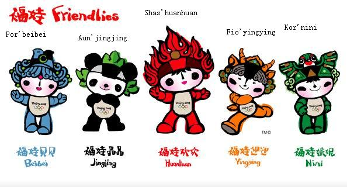

# 败者的旗帜的Tau资料

55555 俺翻译的败者的旗帜的Tau资料

工大暴走狂

首先要指出的是和这片帖子有很多地方是重合的哈[点我](http://zhihuiguan.com/bbs/read.php?tid=6857&fpage=4)

下面来进行让人兴趣盎然的翻译……功力不好，还请大家多指正

刚才是放在败者的旗帜的帖子里面的……估计没人注意，会沉的……、俺一晚上的苦工啊~~- -、

来源：[http://en.wikipedia.org/wiki/Tau_(Warhammer_40,000)](http://en.wikipedia.org/wiki/Tau_(Warhammer_40,000))

Physiology（生理学，稍微纠正一哈）

The Tau's physiology is closely tied to their society, with the Tau of each caste effectively being a subspecies of the Tau race. This was initially a result of adaptation and evolution to suit the environment each group of the proto-Tau species found themselves in, although interbreeding between castes was later forbidden by the Ethereals.

每个阶层的Tau族人都有效的作为Tau族的一个子种族/亚种（subspecy），于此Tau的生理形态与他们的社会形态紧密相连。这最初是生物适应性和进化的结果。这种进化是为了适应每一个原型种族（proto-Tau）存在的自然环境。尽管后来跨阶层间的通婚（原文为breed，繁殖的意思，觉得说成通婚更合适）被以太（Ethereals）禁止。

以下是Tau的社会部分信息，原来是一个表格，现在只能这么写，大家将就着看哈，嘿嘿

Tau Empire Tau帝国

Form of Government：Federation/Caste 政府形态：联邦/等级制

Official Language：Tau

官方语言：Tau语 

Capital T'au 首都：T'au

Head of State：Aun'Va - Master of the Undying Spirit

国家元首：Aun'Va（关于种族名称详见下文）-不朽的精神之主人（直译，召唤官方翻译）

Governing Body：Council of the Highest 行政机构：最高议会

Military Forces

Fire caste (Shas) Hunter Cadres Air caste (Kor)

The Kor'vattra (Tau navy) 军事力量

火焰阶层（Shas）

猎人组/猎人领导核心（直译，召唤官方翻译）

空气阶层（Kor）

Kor'vattra （Tau 海军，就是舰队吧）

Allies

Kroot---Mercenaries Nicassar---Fleet Scouts Vespid---Stingwings Gue'vesa---Militias

联盟军

Kroot：雇佣兵

Nicassar：舰队侦察兵

Vespid：刺翼部队（就是长了复眼的那种）

Gue'vesa：民兵

Establishment approx. 38,000 A.D. 成立时间：公元38000年左右 

Every Tau is humanoid in shape, with two arms, two cloven feet, four-digit hands (three fingers and one thumb), and a single head. Their skin is grey-blue (although this can vary in pigmentation between worlds), rough in texture, leathery, and exudes almost no moisture. Their faces are flat, wide around the eyes, with an &quot;I&quot;-shaped slit running from the centre of the forehead to where a human's nose would be. Tau vision is considered slightly superior to humans, as their receptive visual spectrum extends a little into the ultraviolet and infrared wavelengths. This apparent advantage is offset by the lack of a pupil dilation capability, which results in poorer depth perception and a slower focusing reflex. The olfactory organs are located inside the mouth. On average, Tau are slightly smaller than humans in stature and are slender in build, although this varies between castes.

Tau族人在外形上具有人类的特点，有两只手臂，两只类似偶蹄的脚，两只四指的手（三根手指一根拇指），还有一颗头颅。他们的皮肤是灰蓝色（尽管这一点可能在世界间由于色素沉淀不同而不同），肌理粗糙，如皮革般坚韧，而且几乎不渗出水分。他们的脸是扁平的，眼睛周围较宽， 有一条字母“I”形状的裂口存在于前额的中间，人类长鼻子的地方。Tau的视力推定比人类的稍好，因为他们的视力能够接受的光谱波长稍微延伸进了紫外线和红外线的波长范围之内。这种明显的优势是对缺乏瞳孔缩放能力的的弥补。这种生理构造造成了（相对于人类）稍微低一些的对于景深的感知（depth perception）和稍微缓慢的视力聚焦反映（focusing reflex，也就是说，如果在看远景的过程中突然看近景，瞳孔的聚焦速度会比人类较慢）平均来说，Tau族人比人类身材矮，体格弱，尽管这些在Tau的阶层中也有所区别。 

Only two female Tau have ever been illustrated. The first, Commander Shadowsun, appeared to have a more anthropomorphic face than male Tau; being smoother and sleeker with larger eyes, a nose-like facial feature and a &quot;Y&quot; shaped facial slit. It is not known, however, whether Shadowsun is representative of all female Tau. The second, the subject of an imperial dissection, had the facial characteristics of a male Tau.

只有两位女性的Tau族人曾经被图画描述过。（人类的图画？直译的，忘指正。）第一个是——司令官暗日（Commander Shadowsun），她的面孔看上去比男性的Tau更像人类；更平整更圆滑，眼睛更大，一个类似于鼻子的面目特征，还有一条字母“Y”形的面部裂缝。然而，Shadowsun的形象是否代表了所有的女性Tau族人就不得而知了。

第二个是……一个被帝国解剖的Tau族人，带有男性Tau的面部特征。

Currently, the Tau posess no psykers and as a result have little knowledge of the Immaterium beyond its existence. They are unaware of the perils of the Immaterium and for this reason the Tau have conducted research into the Warp on Medusa V, however, the conclusion was reached that &quot;The Warp is no place for the Greater Good and is best left to those foolhardy races who cannot pull back from that terrible realm.&quot; this means that while the Tau Empire may continue to expand, it cannot expand as dynamically as it was feared it might with full warp capability.

目前，Tau并没有衍生出心灵能力者（psykers），所以对于超越其存在的非物质（Immaterium）世界一无所知。他们对非物质世界的危险并不知晓，之所以才会在美杜沙V行星（Medusa V）上研究亚空间技术（warp）。但是研究得出了这样的结论：“亚空间技术在上上善道面前简直不值一提，最好还是留给那些从那个骇人的领域无法自拔的有勇无谋的种族吧！”这就意味着Tau帝国不会发展到拥有完全的亚空间技术那么强大，即使继续扩也不会扩张到那般被人惧怕的地步。

（最后一句比较头疼…… ）

ok，喘口气继续。

------------------------------------------

Society（社会形态）

Tau society is centred around the concept of &quot;the Greater Good&quot;; a unifying philosophy similar to Utilitarianism where individual Tau sacrifice personal gain in favour of benefiting the Tau race as a whole. It is from this philosophy that the Tau's all-purpose motto, &quot;For the Greater Good!&quot;, is derived. The castes, although different in role and organisation, work together for the benefit of all Tau: the Earth caste provide and produce, the Water caste communicate and distribute, the Air caste connect the worlds of the Tau Empire, and the Fire caste protect. The external image of the Tau is that they are altruistic and idealistic, believing in the unification of all &quot;for the Greater Good&quot;.

Tau的社会形态以“the Greater Good”为中心；一种一元化哲学，与功利主义类似。在这种意识形态下，Tau族人的个人牺牲往往是为了整个Tau种族的利益。就是在这种哲学之下诞生了Tau族人的唯一座右铭：“For the Greater Good！”各基层，虽然分工和组织不同，但他们都为了全体Tau族人的利益而工作：大地阶层进行生产劳动，水阶层负责沟通和分配，天空阶层将Tau帝国的各个世界联系在一起，火焰阶层则扮演了种族保卫者的角色。Tau族人的外部形象是无私的和理想主义的，信奉所有一切都是为了“the Greater Good”。

The Greater Good also encompasses other races, and any races the Tau come into contact with are invited to integrate themselves into Tau society and place themselves under the guidance of the Ethereals. The races and groups that choose to incorporate themselves earn the benefits of mutual protection, trade, and access to the technology of the Tau.

“the Greater Good”的理念同时被其他种族信奉，而且Tau邀请任何与其建立联系的其他种族融入Tau的社会并且接受Ethereals的引导。选择与Tau合作的种族和族群得益于相互的保护、贸易，以及获得Tau的技术。

Although accepting of other races, the Tau believe that their own way is superior to any other, and harbour extreme confidence in their manifest destiny to unite the stars. They are more likely to peaceably integrate races that show similar qualities to those promoted by the Greater Good.

尽管接受了其他的种族，Tau仍然相信自己的行事方法比任何其他的种族高明，并且沉浸在极端的信心中，认为统一众星是他们的命运所在。他们更加倾向于和平的吸纳那些与已经皈依于“The Greater Good”的种族有相似品质的种族。 

以下一段貌似卖书的广告，有关“Tau精神”、“Tau主义”，无视。

Several of the novels published by the Black Library division of Games Workshop have provided more information and detail about the Tau psyche. The novel Kill Team (Thorpe, 2001) reveals that their number of digits has led them to use a base-8 number system and that their food is similar to that of humans, although varying in taste and colour. The protagonist of the novel, Kage, notices their intricate artwork, which is so subtle that it almost goes unnoticed by humans. The Tau characters in the novel also contrast with the brutish, militant humans with their calm, patient and quiet personalities which espouse philosophies similar to the real-world religion that is a homonym of their name: Taoism.

-----------------------------------

终于要完了~~~

最后

Tau Language（Tau语）

The language of the Tau is a complex, highly evolved form of communication. In sound it is deeply lyrical and soft, with many words and meanings dependent on intonation, glottal emphasis and even posture. Its multiple arrangements of polysyllabic word groups make it difficult in the extreme for human vocal chords to pronounce. Only a skilled linguist would have any hope of speaking even the most basic tau phrases and words.

Tau的语言是一个复杂的、高度进化的交流形式。从语音上来说，它充满了深深的诗意和柔情，并有许多基于语调、发声重音甚至肢体语言的词汇和含义。它对多音节词组的多重组合排列对人类声带来说发音极其困难。即使是Tau语中最基本的短语和单词，只有经验丰富的语言学家才有渺茫的希望念出它们。

The Tau have many ways of addressing each other. To the tau, the most important part of their name is the caste that they are born into and this forms the first portion of their identity. Broadly speaking, the tau are divided into four main castes, each corresponding to the four elements, Fire (Shas), Water (Por), Earth (Fio) and Air (Kor), and a ruling caste, the Ethereals (Aun). The Tau word meaning insect or insectoid appears to be Mal, as 'spider' is Mal'caor, which is linked with the Air caste's name in the Tau term for their Vespid allies, Mal'Kor.

Tau族人间有很多种确认身份的方法。对于Tau来说，名字中最重要的部分就是它们出生的种族（caste），这个族姓构成他们身份的第一个部分。总的来说，Tau分为四个主要的族姓，分别代表了四种元素：火（shas），水（por），土（fio），空气（kor），还有一个统治阶层的族姓：以太（The Ethereals）（Aun）。Tau语中意为“昆虫”或者“像昆虫一样的”的词汇似乎是“Mal”，那么“蜘蛛”就是“Mal’caor”，与Tau称呼他们的Vespid联盟的空气阶层的名字“Mal’Kor”有关。

With the caste of a Tau established, the second portion of the name refers to their rank within society. The tau are unusual as a culture in that there is no stigma attached to any rank or profession. Each Tau has his or her place in society, and enjoys the respect of their peers no matter how menial the tasks that they perform. Each role is recognized as being part of the greater whole and a furtherance of the common good. There are five major levels of Tau rank, each of which has a subtly different meaning dependent on the caste to which it is suffixed. In ascending order of seniority, these ranks are as follows (including the best imperial equivalent of each rank based upon the nuances of the Fire caste).

一个Tau族人的种姓确定之后，名字的第二部分代表了在社会中的等级。对任何的等级和职业都没有歧视的Tau族作为一个文明来说是罕见的。每一个Tau族人在社会中都有他或她的职位，无论他们的工作是多么的卑微，他们都备受同胞的尊重。每一个角色都是伟大整体的一部分，都是共同利益的一个促进因素。Tau主要有5个等级（rank），作为族姓后缀，都具有微妙的互不相同的含义。以下等级，按照资历大小升序排列：（以下是火焰阶层的等级排列，包括了最高的等级，相当于皇帝的地位）

'Saal = Cadet 新兵

'La = Warrior战士（FireWarrior自称“Shas’La”，即，火焰&#8226;战士）

'Ui = Veteran 老兵

'Vre = Hero 英雄

'El = Knight or Noble 骑士或贵族

'O = Commander 指挥官（TauCommander自称“Shas’O”即火焰·指挥官）

There are also terms for certain buildings, such as Aun'bork'an'retha (an Ethereal Caste shrine/university on Bork'an) and run'al (a static observation post).

对于建筑，也有类似的称呼。

比如，Aun'bork'an'retha，就是以太（Aun）的神殿/大学（retha）

Run’al 静态观察站

关于Tau五大元素阶层的最贴切Illustration。。。

