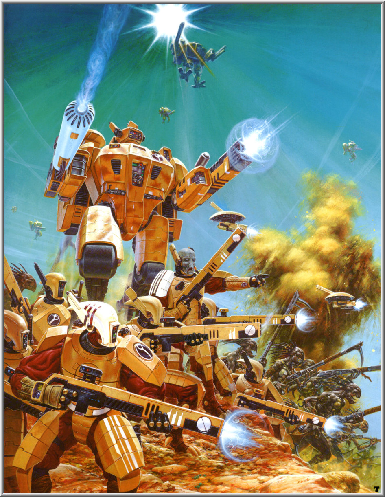
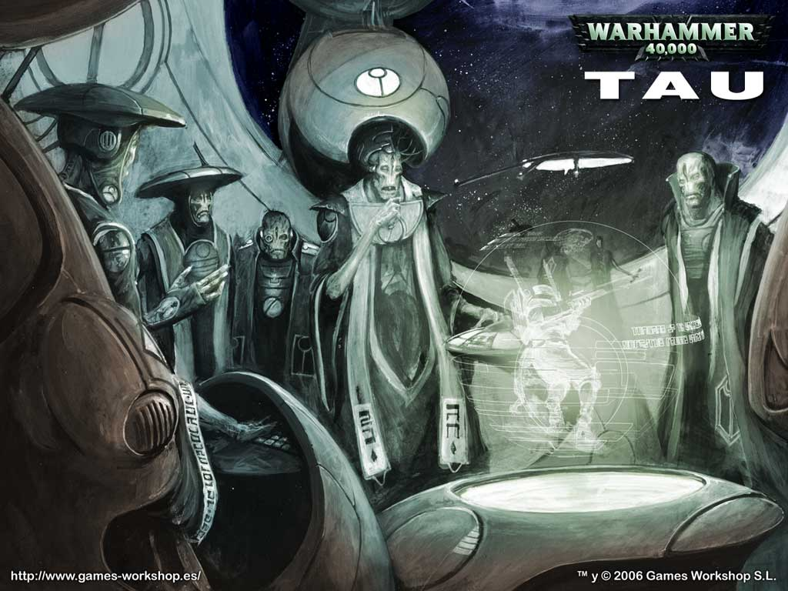
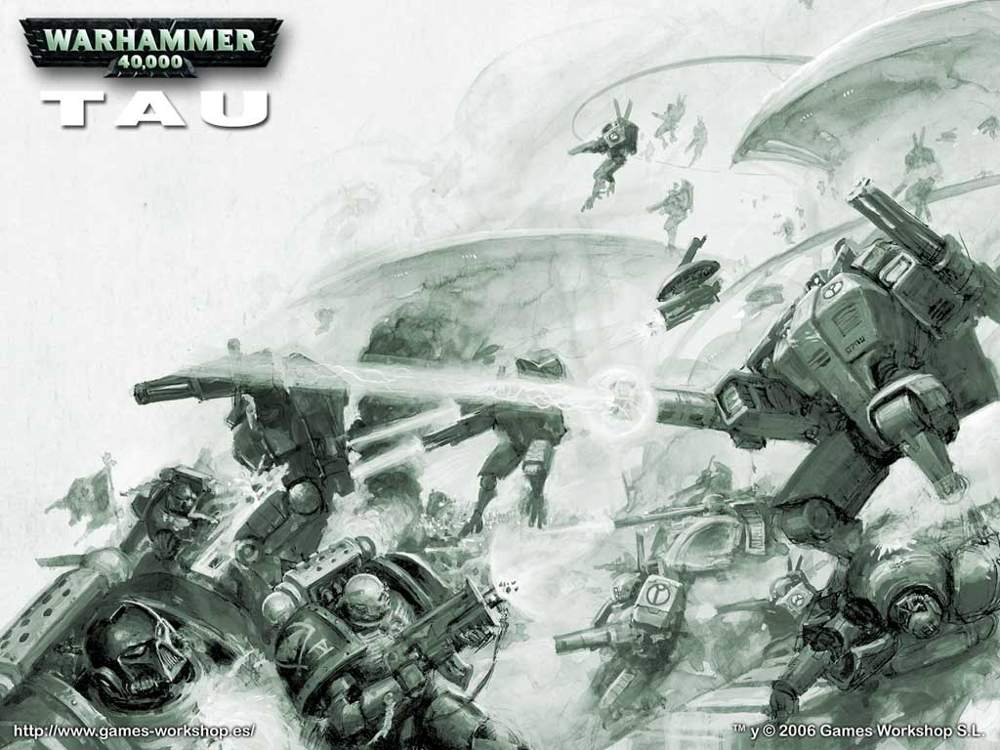

# 钛帝国（Tau Empire）简介

barbarrossa

钛帝国简介

人类帝国最早在第35个千年中已经接触到被称为钛族的异星人。在5000年前一艘机械神教的考察船发现并将他们的母星-T'au归入档案。在最初的记录中，T'au行星是一个干燥的世界，但是一些区域有茂盛的植物和大量类似人类形态的异星人。异星人中最为先进的部落也刚刚掌握用火，只会制造原始的武器，因此被认为对帝国没有威胁。T'au行星被列入例行清洗当地生物并重新加以人类殖民化的行星名单。

值得庆幸的是，前往执行清洗和殖民任务的帝国舰队毁于一次强大而怪异的亚空间风暴（多行不义必自毙，帝国的行径连亚空间的邪神都看不惯）。亚空间风暴阻止了人类帝国与钛族的进一步接触，钛族因此而获救。由于无法穿越风暴，在长达5000年的历史中，帝国渐渐遗忘了这个新兴的弱小的异星种族。

俗话说，大难不死必有后福。由于运气或者宿命逃过毁灭大劫的钛星人发展迅速。仅仅几千年，钛星人就进化发展出了复杂的文化和阶级系统。在急速的扩展中，钛星人团结一心，“为了新钛星而努力工作“(all working together towards one end)。在心中上上善道（the greater good）的指引下，钛星人在科技上取得了巨大而快速的进步。到了第41个千年，钛族已经成为一个太空种族，一个新的帝国正在形成。

钛族人雄心勃勃的在太空中发展，他们不可避免地与人类帝国发生接触。在死水一般的银河东部边界，钛族的一艘太空船进入了Delvan行星系，再一次遭遇到人类帝国。

在无视或者不理解各种警告信号之后，钛族太空船被人类帝国的Delvan行星系防御舰只攻击，在被帝国舰队击毁之前没有逃生成功。冲突的消息惊醒了帝国舰队高层。这些拥有先进太空船的，不知道从哪里冒出来的异星人到底是谁？机械神教的基因学家通过分析被毁舰船中的残存基因，发现他们与6个千年之前在T'au行星上发现的样本吻合。似乎侥幸逃生的钛星人已经急速地发展起来了。

黑市交易者和商人被派往银河东部边界进行进一步的调查（看看帝国都用些什么人啊？），发现钛星人已经从他们的母星出发，在附近比较高密度的恒星团中殖民。几个比较小的异星种族已经被感化，加入到这个小型的却是快速发展的帝国之中。更坏的消息是好多个帝国世界已经和这个异星种族贸易，钛族的谈判者学会了人类的语言和风俗，频繁地与周围的世界签订条约。这是一个不容忽视的威胁！帝国担心钛星人会使帝国的愚民开化，威胁到他的统治，决定进攻并摧毁钛族。

742.M41（公元40742年），达摩克利斯湾远征正式发起，结果以失败告终。尽管占领了几个钛帝国殖民世界，但是钛帝国先进的军事科技，凶猛的钛帝国盟友和钛族人坚信的“上上善道”给予他们坚定的信念，最终在血战中阻止了帝国前进的步伐。钛帝国在第一次巨大威胁之中生存了下来，并在接下来的几十年中持续地扩张。

钛族人的社会：钛族人的社会非常单一(homogenous)，充满了团结精神(togetherness)这一种族特质。这是钛族的力量来源之一。钛族社会分为5个阶级。每一个阶级有其专长的范围。水阶级是外交官、政治家和行政官员。土阶级是技师，建筑家和工人。气阶级是飞行员，信使和太空船船员。火阶级是战士和种族的保卫者，有选择性的培养使得这一阶级的钛族人比其他阶级的要略微高大和强壮。最后一个阶级是以太，他们的成员较少，是议员和顾问，领导着钛族人，受到了其他阶级的广泛尊敬。

不像人类遇到的其他异星人，钛族人并不显示出敌意或进攻性。钛族人活跃年轻和充满活力的社会使得他们快速发展，很快就遇到了其他异星人。据信钛族军队抵御并击溃了多次兽人的大规模进攻。他们最近也遭遇到了威胁帝国边境的虫巢舰队。由于第一次与钛帝国的接触并不愉快，人类帝国开始将钛帝国作为一个威胁（当然不是大的威胁）。人类帝国不会对钛帝国征服帝皇的世界和臣民的行为袖手旁观。人类帝国发誓将消灭钛帝国。毫无疑问，到适当的时候，地球上的12位高阶大臣（HighLord）将消灭这一小小的却又烦人的威胁。一次种族灭绝式的摧毁钛行星的远征是个不错的选择。实际上机械神教的教廷司事(Ecclesiarch of Adeptus Ministorum)已经草拟了多次布道。但是现在这样的远征是不可能的（等到可行时，黄花菜都凉了。以钛帝国现在的发展速度和人类帝国的低下效率，等上几百年帝国海军就等着被钛帝国的先进技术轰至渣吧）。钛帝国虽然相对人类帝国来说是渺小的，但是仍然拥有几百个世界。要征服钛帝国，侵略军的规模将是相当巨大的。钛帝国的军队足以对抗帝国守卫，而现在还有更为重要的战争。虫巢舰队使得帝国的人力资源大受损失，而阿巴登的第十三次黑暗远征又箭在弦上。同时钛帝国相当愿意以牙还牙。当外交努力失败时，他们相当愿意付诸武力并且对于用军事力量维护自己的利益相当有信心。在边界上与钛帝国的掠夺战，交火，侵略与反侵略的次数近来不断上升。

钛族人的生理特征：钛族人是双足行走的类人种族。体形比人类略小，肌肉也不如人类发达，皮肤为灰绿色或蓝色。他们有一对眼睛一张嘴巴，但是没有明显的听觉和嗅觉器官。每只手有四根手指，其中之一为大拇指。他们的小腿，脚踝和脚与人类有较大差别。他们的 胫骨，腓骨很短，但是距骨和楔状骨很长。有两个较大的居中的承重脚趾，钛族人已经进化为不用脚后跟站立于行走。

烈火战士有很多特性与人类相似，包括忍耐力与疼痛承受力。 
