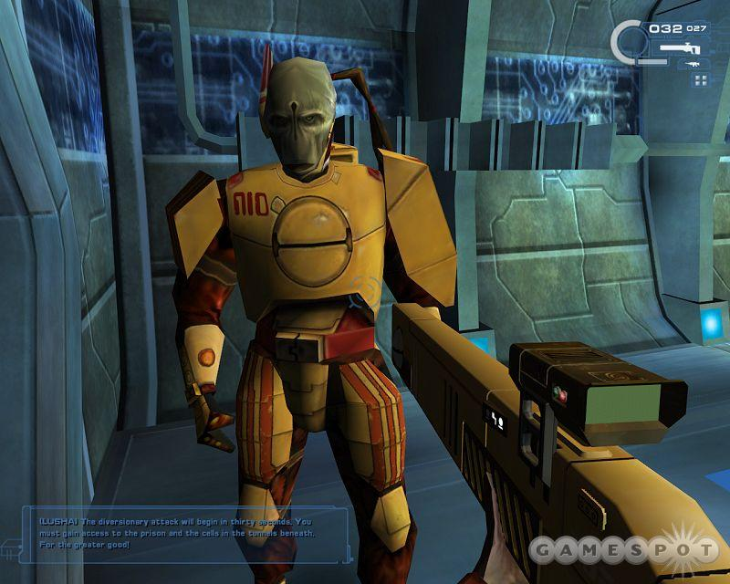
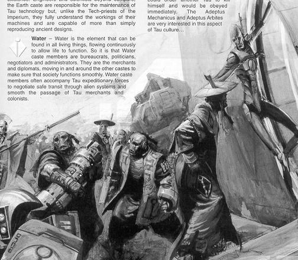
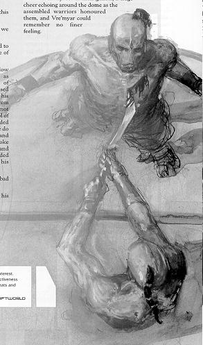
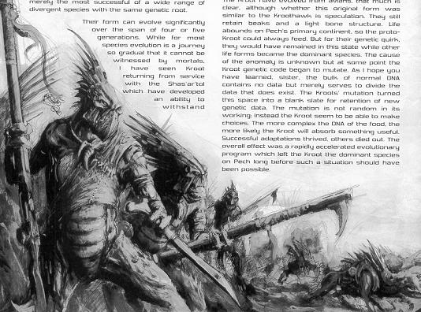

# 钛星人图解

钛星人图解

看一下先进作战服下的真面目

[Latias](http://game.ali213.net/profile-uid-386227.html)

[liujj312](http://game.ali213.net/profile-uid-382582.html)

如图。这是Tau族平民在军队指挥下撤离。 

顺带一提他们两眼间那个洞是鼻孔，所以他们游泳理论上比人类舒服

两名裸露上身的火族战士。其中一人正给予另一人荣誉而平静的死亡。 

你说的雇佣兵是这群人，Kroot（克虏族）和会飞的Visped（胡蜂族）。

他们是野蛮民族，钦慕Tau（道族）的先进文明，畏惧其强盛武力而加盟Greater Good，也就是道族语言中的&quot;Tau'ya&quot;，中译“上上善道”，日译“大善大同”。

他们仍然保留其原始习性，吃生肉，喝鲜血。他们作为道族军队中的近战武力上阵。据说他们没有军饷，奖励就是有吃不完的生肉。 

