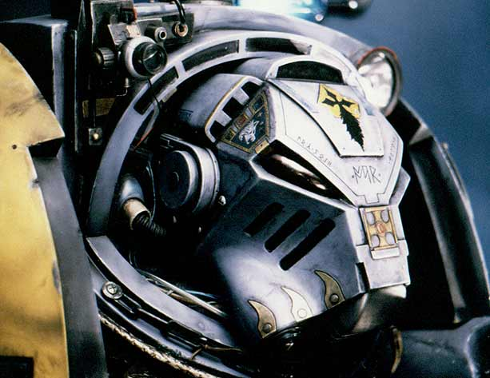
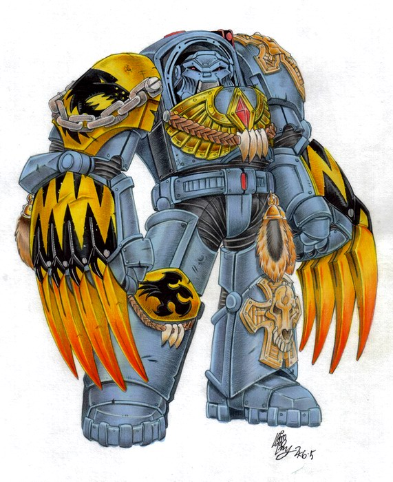

# 终结者装甲

> 兔子半妖

Astartes众军团的动力装甲是最精良的专为战争而开发的个人防护装备.在这种装甲中,一名陆战队员可以在任何环境下活动而无须担心受到伤害.原始的设计是如此的成功以致于陆战队员装甲从设计定型后就几乎未曾改变过.然而这也是Astartes众军团能获得的唯一动力装甲.对于更加厚实的盔甲的需求在长久以前就困扰着各个战团.一些特定情况要求使用重型动力装甲:登舰作战,清扫隧道中的敌人,在母巢中的战斗――这些情况下陆战队员们要在狭窄的空间中承受非常密集的火力.无畏机甲并不适合这些情形:它庞大的身形只会增添麻烦.

在几次失败的尝试后,陆战队终结者装甲初步概念性设计终于有了些进展:一型特种装甲.一些设计集合了机械神教铸造世界和陆战队军械库的资源. 
大部分特种型装甲都有这样的共同点:极其厚重的装甲,与外部隔绝,与武器的整合.而终结者装甲最终证明了这些设计的价值.与其他动力装甲类似,这些战斗服使用了人造肌肉纤维技术,对穿着者的运动少有限制.

与普通的陆战队装甲相比,终结者装甲整合了许多附加的装置.装甲的基于感觉末梢的感应器与穿着者的感官直接相连.这些感应器使得穿着者无须集中注意力就可以使用大量的扫描仪和探测器.多部装甲的感应器同样联网,使得班组成员在战斗中能够获得来自同伴的信息.

除了它强大的保护功能外,终结者装甲还拥有内置武器:暴风矢和动力拳套.暴风矢是Astartes众军团广泛使用的标准短矢步枪的一种短枪管联装版本.它的射速远高过它的原型,能向敌人喷射出一道道弹幕.因为它被整合进了装甲之中,所以它非常短小精悍,是近战的理想武器.这些整合的价值在日后的战斗中都被证实了.动力拳套是许多战团都在使用的标准装备,将它整合到特种型装甲中并不费力.

一些陆战队的战术家和学者批评这种装甲的设计中缺乏远距离作战武器.由于它的主要用途在于登舰、近距离突击和清除行动,这些批评没产生多大影响.那些认识到这种特种装甲价值的战团已经将它收入自己的武器库中.

大部分陆战队战团都在自己的军械库中存有终结者装甲,并训练一些班组来使用这些装备.当然,在使用前还得为感应器接口做些手术.然而,终结者装甲并不是他们可以随意使用的.只有在必要的时候,它们才会被取出军械库.举例来说,在清理母巢的某条走道时,普通的陆战队士兵的任务是在外围形成封锁线,而终结者小队将突入走道,实施清除行动.

帝国历728.M40（指第４００世纪７２８年）的Thule Decimation行动是最值得注目的终结者装甲的使用范例之一.灰骑士战团(一支精锐战团,下属的所有陆战队员都接受过针对特种装甲的训练和改造)派出6支装备着终结者装甲的满员连队发动作战(许多装甲是征用其他5个战团的).这次突击是如此紧迫以至于没有时间重新涂装装甲,灰骑士们穿着6种颜色的终结者装甲冲入敌阵.由于认为自己面对着6个战团,敌人在三小时内投降,而其中十分之一的城市居民因参与叛乱被全部处死.

终极战士战团(Ultramarine)对虫族巨兽级母巢舰的进攻也得益于终结者小队.他们的任务包括突破巨兽级母巢舰的外壳、彻底破坏巢室.

由终结者动力装甲武装起来的、训练有素的陆战队员可以击败几乎任何敌人.当然,特种装甲只是一半原因.没有陆战队员的热诚和技能,特种装甲也只是废铁一堆.
