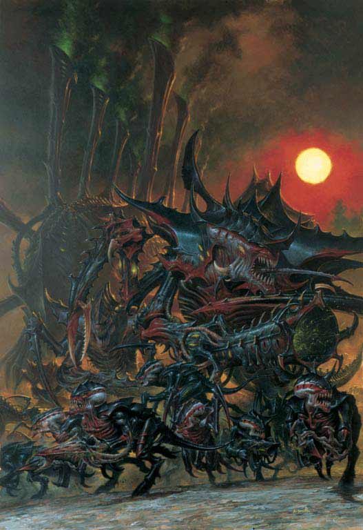
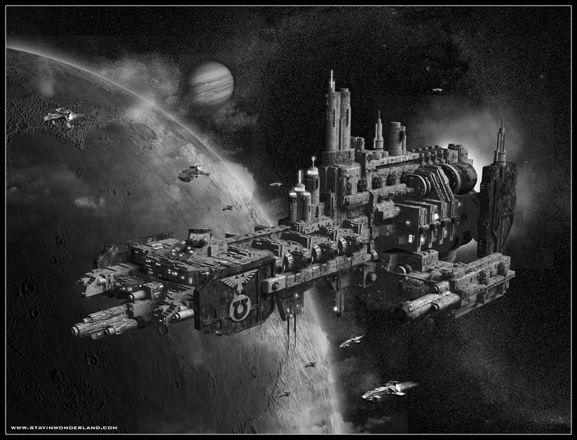
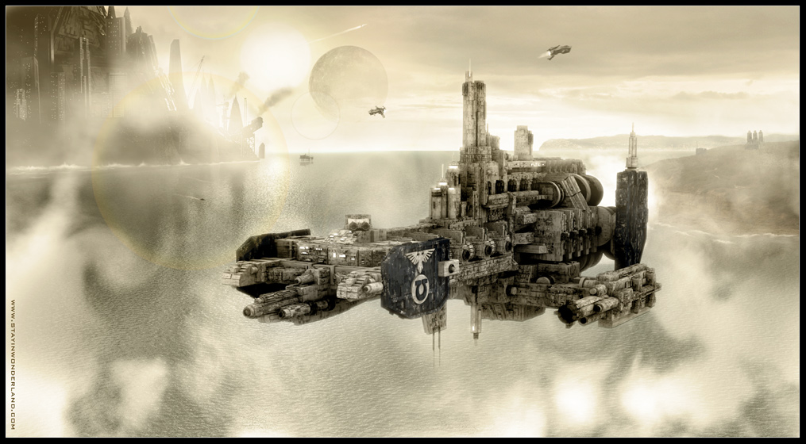
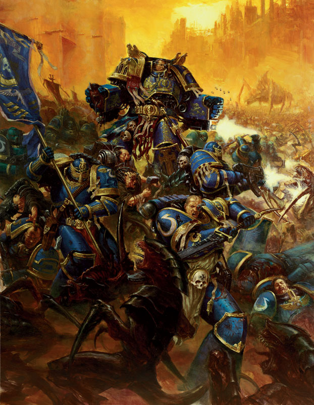
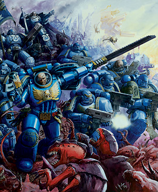
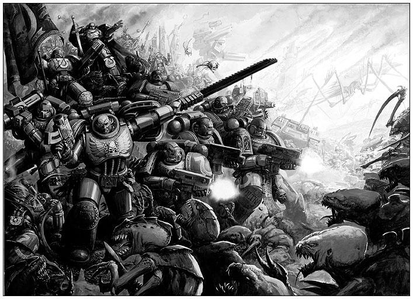
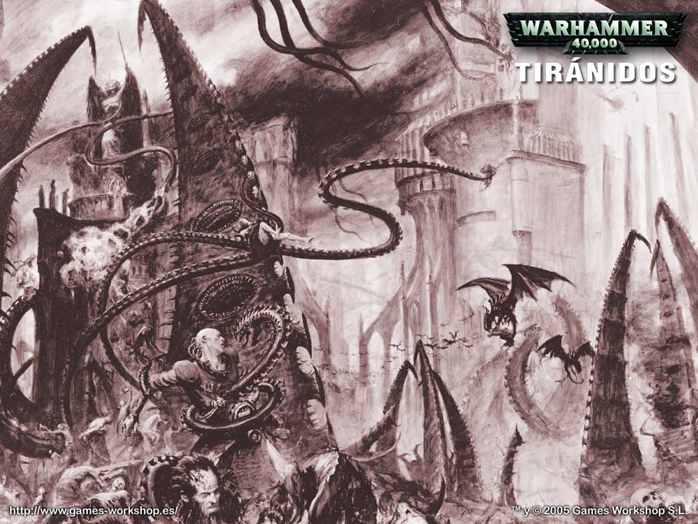
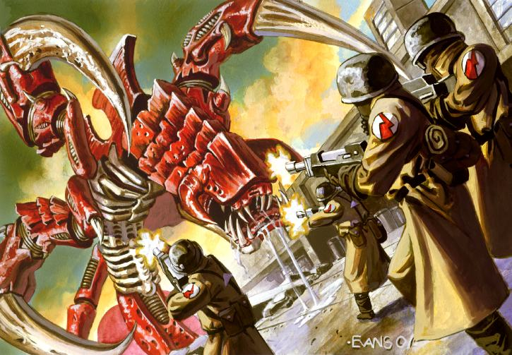
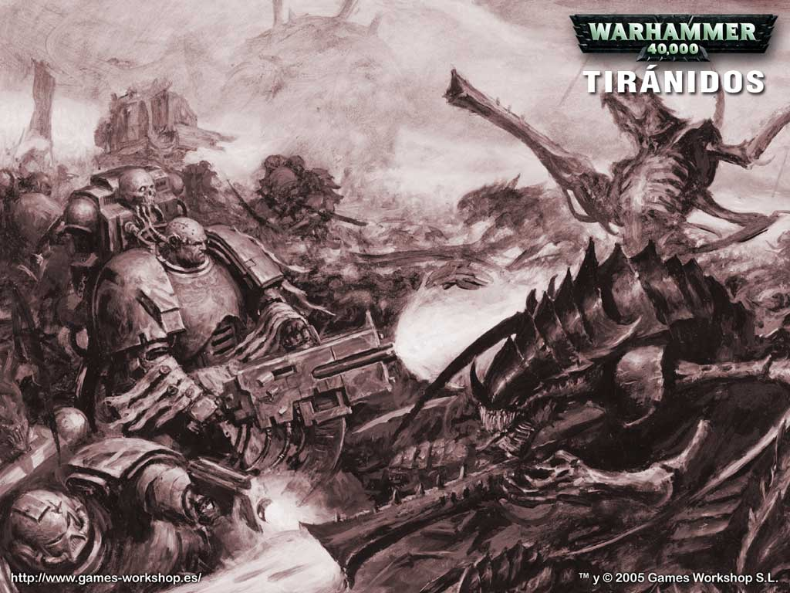

# 【原创】战锤40K 人类和虫族的战斗 全文完

bravo3313 

【原创】战锤40K 人类和虫族的战斗 全文完

特别感谢PerfectBlue, 灵魂熔炉,JUDE等人的高质量翻译 ,讲述着虫族和人类帝国间悲壮而且惨烈的战斗........正式完结

第一次入侵 HIVE FLEET BEHEMOTH 帝国历745.M41

人类帝国和一种名叫TYRANID的异形生物的第一次接触发生在一个鲜为人知的帝国前线基地，位于银河系的东南边境Tyran星系。行星Tyran是一个机械神教的中转站.其主要目的是研究一些银河系边缘的未知区域，鉴于其位置边远,该基地的防御措施相当完善,而且拥有一个星际通讯小队来保持和 60000光年外的地球的联系.

Tyran第一基地位于Tyran星球辽阔的海洋上,一个远古火山岛链的地下深处,基地被要塞化以至能够足以阻挡超大型风暴的袭击以及贪婪的海洋生物的好奇心,该基地还特别装备了四座位于装甲洞库中的巨型激光炮塔,以抵御入侵的异形宇宙船以及来自海底深处的未知生物。

THE COMING OF TYRANID

第一个让人不安的信号是一份帝国东部边界的Tyran形势报告书,文件中描述了数个处于已知空间最边远的荒凉的星球.在古代的观察中,这些星球被认为是可支持生命存在的,但是在最近的观测和报告中显示,它们只是些大气稀薄的荒土而已,最初也并没发现有什么明显的问题,毕竟之前的观察报告已经是上百甚至上千年以前的了.

经过了一段时间的调查，科学人员发现那些有着很旺盛的生态系统的行星都完全被变成了荒地，调查小组无法辨别造成这些现象的原因，而且这些报告也引起了边境上的司令的注意。这些有问题的行星上面已经没有任何形态的生命生存，而且距离最近的人类殖民星系只有数千光年的距离。在银河系里有大量充满着秘密的星球，所以一段时间后记录这些奇怪现象的数据核心被送往地球进行研究。

Tyran前哨站继续忠诚的提交着关于这些&quot;枯竭的世界&quot;的报告,奇异现象的不断增长引起了一个憎恶神秘和未知现象的组织――审判庭的注意，Kryptman，一位因为曾富有远见的谴责Macharian异端而受到尊敬的监察官，开始对遥远的东南所发生的事件提出问讯，边境事务署的官员们却只能提供很少的资料，于是Kryptman审判官开始亲自着手整理和分析所有关于枯竭世界的报告，杂乱的事件渐渐变得明朗，一幅清晰而特异的图样被展现出来：枯萎现象正在向银河的更深处蚕食，并直指Tyran星球。 

监察官向审判庭委员会展示了他的调查结果,并被授权指挥一艘飞船深入东部 边境以调查更多的数据,但是当监察官的飞船仍在亚空间中航行的时候,针对 Tyran的进攻已经开始了。 

THE DEATH OF TYRAN

监察官Kryptman一个月后收到了TYRAN受到攻击后发来的最后消息。那时他的飞船经过1年的飞行刚刚抵达到TYRAN星系。最开始他无法把眼前的这个死亡，荒芜的行星和那个海洋行星TYRAN划上等号，在经过长时间的搜索以后，他在深深的尘土下面发现了一个数据日志,里面记载了帝国未来要面对的，那无比巨大的威胁.......

日志显示,Magos Varnak，机械神教的高级成员之一,也参与了对东部边境的勘探工作,与此同时,Tyran一号基地也探测到了一个由上千个不明物体组成的星云,进入了Tyran星系.Varnak的座舰在这个星云的边缘被一种生物空雷炸成重伤,虽然他还是安全返回了基地,但是不出一个星期,第一波异形的攻击就开始了.监察官Kryptman和他的副官们观看了战场影像记录:Tyran残破的天空被激光炮塔耀眼的闪光撕裂了一次又一次,顽强的抵抗着入侵者,在这次敌人数量占据绝对优势的战斗中,勇敢的激光炮塔成员击落了数以百计的Tyran上空的入侵者,令人惊奇的是,敌人撤退了,但是Kryptman明白,更坏的,还在后面.

Varnak派出了他剩余的三艘星系飞船去追击敌人,飞船的静态场解码录象足够清晰的向kryptman展现了敌人的形象――侵略者是前所未见的异种生物，这些巨大的有机体被厚厚的甲壳所覆盖，很明显，它们能够很好的适应太空的环境。

一艘接一艘，侵略者们飞快的撕碎了星系飞船――Tyran的防御系统先前仅仅消灭了数以千计的庞大虫群中的十余只而已，Varnak被迫作出绝望的结论：侵略者将再次进攻，而Tyran基地，即将被完全毁灭……

由于未知的原因，Varnak的星际通讯组未能对外界发出任何信息，kryptman的灵能者参谋认为是异型抵达时在亚空间留下了干扰流，使得星际通讯无法进行，所以数据日志是Vanrak所能找到的保存他用整个星球的生命换来的宝贵知识的唯一方法。 

Krytpman 安静的看着微型影像显示的成千上万的孢子囊穿过Tyran的大气层,像暴雨一般落向地面.虽然激光炮塔消灭了所有可能落在基地上的孢子囊,但还是有更多的则溅落在基地周边的海水里,基地周围的海水汹涌沸腾起来,从囊中冲出的异形在包围它们的贪婪的海洋生物中杀出一条血路...通过一个探测器录下的影像,Kryptman在他的水晶数据屏上看着Magos Varnak在基地中观察异形的攻击动向。在屏幕上，分散在各处的防御系统疯狂地向这些张牙舞爪的六足生物射击，可是狂风暴雨般的弹药都被这些怪物的厚重外壳弹开，如同散落的冰雹。

屏幕上的形势还在继续恶化,电网和装甲隔离门的重重封锁对于异形来说就像纸和玻璃制成的一般,完全无法阻挡异形肆无忌惮的进攻,守卫着码头的机器奴工顽强的尝试着用喷火器阻挡异形们前进的脚步,但是收效甚微,Kryptman惊讶的看着咆哮着的大型生物挥舞着它们像镰刀般的手臂,抖去身上的火焰,继续坚定的杀向机器奴工们.

很快，Varnak的监视器上的每个屏幕里都是潮水般涌入基地的异型生物，它们摧毁了它们发现的任何物体。按照Magos的指示，数据日志被埋入星球基地的深处。Kryptman发现是Varnak他自己自愿留下做出这巨大的牺牲的，他知道这些记录下的影象，每一秒都为后人提供了宝贵的资料，来分析，对抗那可怕的敌人。

在数据日志的结尾,是一个残缺不全的片断：由赞美皇帝的颂歌和死亡前的惨叫,以及绝望的枪声交织在一起的令人毛骨悚然的交响乐,而在影像中断前,伴随着充斥着无数怪物的tyran黑色天空,Varnak以一个恐怖的预言代替了他的最终遗嘱,而我们的监察官Kryptman,在意识到他所了解的一切以后,陷入了深深的绝望之中.基于那个完全被毁灭的世界-Tyran,这些可怕的入侵者们终于有了一 个名字--Tyranids 

THANDROS

Krytpman立即命令他的星际通讯组向帝国发送影像信息，但是灵能者的能力无法穿透异形舰队穿越亚空间所留下的紊乱层，附近的Thandros星际通讯中转矩阵却仍有一些模糊的信息，在绝望中Krytpman只有把航线指向Thandros，期望能在那里重新建立起与帝国的通讯连接。

但是虫子已经在监察官Krytpman到来之前就攻击了THANDROS。THANDROS并不象Tyran那样有完善的防御体系，矿工居住在THANDROS II和III的隧道里。在虫子攻击的时候，他们无处可藏，也无路可逃，在行星迷宫般黑暗的地下，被那无法用语言形容的恐惧生物猎杀......后来，在THANDROS I发现所有的轨道防御阵列炮台，在他们被摧毁前，所有的炮塔弹药或激光武器能量都已用尽。就象Tyran一样，基地的行星联络组因为虫子的精神波干扰无法发送任何信息给附近的帝国星球。整个THANDROS星系只有孤独的战斗，和死亡......

Krytpman和他的部下对Thandros的通讯矩阵进行了抢修，开始向对Tyranid的巨大威胁还一无所知的帝国发出警告信息，Krytpman的灵能通讯官连续数日集中心神的工作，一遍又一遍的向以太质中传输着Varnak留下的记录和Krytpman的报告，终于，他们收到了异型审判庭领袖们发来的命令：向Ultramar星系的Macragge行星航行，那里是星际战士中最强的战团&quot;极限星际战士(Ultramarines)&quot;的总部，Krytpman可以在那里协助战团长官找寻和摧毁虫族舰队――依照帝国的传统，这支异型舰队被冠以了远古传说中巨兽的名字：比赫姆斯(Behemoth)

THE BATTLE FOR MACRAGGE

与此同时,行星Macragge,大量的战舰已经在轨道上完成集结,并且每天都有新的舰只脱离亚空间加入到这个新组成的舰队中来.轨道要塞和笨重的行星防御系统环绕着Macragge星球,组成了一个强大的火力网.星际战士的宇宙战舰停靠在Macragge的轨道上空,看起来就像一块装满了武器平台,鱼雷发射管和重型炮塔的蓝色巨岩,这些帝国海军的海兽们,以它们强大的火力让来自UltraMarine最边远的前哨站的突击巡洋舰们相形见拙.

极限星际战士已经准备好和Tyranids的全面战争了，当Tempestus战列舰队已经从Bakka的轨道出港并被派遣到这里的消息传到Kryptman这里时，他不得不承认自己心里已经燃起了胜利的希望.Kryptman和极限星际战士的战团长,传奇般的人物Marneus Calgar见面并经过长时间的讨论,他们同意Macragge星系已经处于虫族舰队Behemoth的直接威胁之下.Macragge星球本身已经拥有非常好的防御体系,在过去的日子里极限星际战士们和行星防御部队已经把整个星球不断的加以要塞化,现在Ultramr和帝国的联合舰队也抵达这里,一起来对抗虫族舰队的威胁.

一个月之后,Tyranid开始攻击Macragge星球,一个拥有上千艘生物战舰的舰队完全无视了保卫外围星带的极限星际战士的突击巡洋舰的攻击 ,轻而易举的攻入了星系,大量的Tyranid舰队登陆了有着Ultramar星系王冠明珠美称的绿色星球Prandium,将这个美丽的行星变成了一片废土.

尽管已经收到了监察官Kryptman的警告,但是Calgar仍然被Prandium的命运所震惊,在得知来自Bakka的帝国舰队还没有任何消息的情况下,他做了一个非常冒险的决定:命令舰队放弃Macragge,撤出星球的轨道.Calgar希望把Tyranid舰队的注意力吸引到Macragge的轨道防御阵地上,以便他的舰队能够迂回到敌人舰队后方并实施夹击.在他的指挥下Ultramar舰队在敌人集结前突击了异形舰队,成功的在其中杀出了一条血路,并努力的向Macragge方向突击,Calgar急切的希望能够回到Macragge的强大火力的庇护之中.

战斗进行到了最激烈的时刻，来自Macragge的Ultramar战斗机摧毁了一艘最大的虫巢母舰，这看起来对整个异型舰队的秩序造成了致命的打击，虫族的攻击渐渐显得混乱无序，Calgar的舰队趁势击毁了大量的敌舰，但就在此时，虫族展示了它们令人恐怖的一面，它们向Macragge星球的南北极发射了数以千计的孢子囊，那里是整个Macragge行星防御体系的关键据点所在，顷刻间，成千上万的虫子掘开厚厚的冰盖，向极地要塞发起了进攻……

在星空的深处，极限星际战士的舰队一步一步取得优势，被重创的虫巢舰队开始逃逸，Calgar指挥舰队进行追击，尽力阻止敌人逃脱，虽然他也为南北极要塞的安危担忧，但他知道那里有极限星际战士第一营守卫着，他们是装备着终结者盔甲和帝国最先进的单兵武器的最精锐部队，依托着坚固的防御，甚至还有Legio执政官提供的泰坦部队的支援。最终，Calgar决定将Macragge的命运交付给这些经验丰富的战士，自己继续执行对虫族舰队的追击。

此时,登陆于Macragge表面的Tyranid正在向潮水一般涌向极地要塞.这些疯狂的怪兽挥舞着它们的镰刀般的利爪涌过被激光扫射得支离破的平原,它们巨大的数量难以置信的变换着进攻的队形.重型机炮震耳欲聋的扫射,以及自行火炮的怒吼淹没了这些怪物原始而又疯狂的嘶喊,但是这些并不足以抵挡它们凶猛的进攻.

战士们以要塞为依托且战且退,Tyranid每前进一步都会付出大量的鲜血作为代价,与此同时Legio执政官的泰坦部队向雪原上的怪兽们倾泻着炮火和等离子光束,Calgar战团长从前线撤下来的受伤战舰也从星球低轨道进行支援射击,赭红色的光束和数以万计的高爆电磁炸弹在敌人的队形中炸出了一道道火墙,而Tyranid狂热般的攻击,还在继续着.

虫子们在用令人无法置信的方法继续进行着狂暴的进攻。在北极要塞，它们利用堆积起来的尸体作为掩护翻越要塞的保护墙，TITAN被成群的虫子推倒并被撕成碎片，就象雄师被无数兵蚁淹没一般。在那极冷的天气下，武器系统都开始份份过热，要塞为抵抗几个月的围攻而储存的弹药也开始见底了。要塞周围的雪已经被虫子们的恶脓全部染了紫色......

在宇宙中，Calgar在Macragge星系的角落，Circe星球的外围轨道上追赶到了Tyranid舰队。从Bakka星系赶来的帝国舰队Tempestus终于赶到了，把虫子死死的封锁在2支舰队的包围之中。Tempestus舰队拥有超过200艘以上的战舰，包括巨大的帝王级战列舰Dominus Astra号，但是在Circe的战斗里整支舰队也几乎全军覆没。胜利的天平终于在Dominus Astra做出了英雄般的牺牲后，倒向了帝国。她在无数炮火之中英勇的冲进了敌人舰队的心脏部位，最终引爆了亚空间引擎，Tyranid舰队的核心瞬间被产生的亚空间风暴给毁灭，但是Dominus Astra号也永远的消失在空间风暴之中。Calgar幸存下的舰队开始飞速赶回Macragge，希望回去拯救还在苦战中的战士们。

当Calgar和他剩余的战友们回到Macragge时,令人难以置信的恶战景象呈现在他们面前：Tyranid残缺不全的尸体堆积如山，损坏的武器撒满了冰面，泰坦的离子炮在雪地上烧出一个个冒着蒸汽的巨坑，死亡的气息散布在每一缕空气里。南极要塞只有少数的虫子残存，但是北极的虫子却发起了极端疯狂的反扑，极地要塞的内外都发生了血腥的肉搏战，更多的极限陆战队战士在战斗中献出了他们的生命，但虫族这次的进攻缺乏战略与协调，因此大多数的虫子在它们刚冲上战场的时候就被歼灭了。

在极地要塞堆满尸体的走廊里，已经严重减员的极限陆战队用火焰喷射器清出了一条前进的通道，他们所踏过的异型尸体，犹如牺牲的战友所留下的勇敢坚毅的遗言，经过最后的战斗，在北极要塞的深处，极限陆战队第三营剩下的战士终于抵达了第一营最后战斗的发电机室，但已经太迟了，异型的尸体在门前堆了一层又一层，而在尸体后面的房间里，终结者战士们围成一圈倒在了他们背靠背战斗过的地方――极限陆战队第一营的勇士们成功的完成了他们坚守要塞的使命，他们战斗直至最后一个人倒下，这是故事令人感伤的最后结局――那么，让我们一面默哀，一面继续轻轻翻动书页吧……

第2次入侵 HIVE FLEET KRAKEN 帝国历993.M41

第一次Tyrannic战争,帝国军在面对敌人的攻击和后却完全无法还击.而那个来自于未知区域的Behemoth舰队在Macragge一战后,就消失的无影无踪了.

火星的科学家们(注1)花费了数年时间研究和学习Macragge一役中残存的 Tyranid生物装备和尸体,可是关于这个物种的来历,还是所知甚少.但一个很明显的事实是这些怪物们用先进的生物技术组成了一个令人难以置信的多元化种族.最值得注意的发现是,Tyranid驱使了一种名为基因盗取者的生物作为它们的突击部队,这种生物最初被认为是Ymgarl星球的一颗卫星上的原生生物,后来通过大型货船才被散布到宇宙中的.它们在Tyranid部队中的存在则完全否定了这个看法,而基因样本则进一步证明了,所谓的Ymgarl&quot;原生&quot;基因盗取者也是Tyranid 生物,于是一个问题产生了,这些生物是如何穿越整个银河系出现在星系的西北区域的呢?皇帝之镰战团在Ymgarl的数个卫星上组织了大规模的猎杀行动,消灭基因盗取者,而监察官们也加大了审查力度,当然目前能做的也就这么多而已.

两个半世纪过去了，再没有虫子入侵的音信传来，虽然如此，当银河东南的殖民星球开始奇怪的流行起骚乱、破坏、恐怖主义甚至公然的反叛时，异教徒审判庭(注2)依然迅速的介入了.帝国最关心的是工业星球Ichar IV所放生的叛乱，动乱发生后不久,Agmar审判官，异教徒审判庭一位年轻而活跃的官员，带领几支小规模的战斗

部队潜入了星球首府Lomas，在那里，他们将Ichar IV所发生的事件渐渐整理拼合成完整的图画：灵能者们经过冥想与推算，发现了远比叛乱更可怕的真相――隐藏在这场起义的背后的，是一场虫族基因窃取者的大规模感染！监察官Agmar立刻以最绝密的方式向审判庭议会发出报告，请求星际战士的支援。

叛乱发生三十九天以后,Ultramarine突击登陆舰Octavius号进入了Ichar星球的轨道,并开始向星球表面部署登陆舱.而此时Ichar IV上的防御设施在由于在叛乱发生之时,审判庭部队在和叛军部队的激烈巷战中破坏了Lomas的能源系统，所以基本处于瘫痪状态。因此登陆作战并没有出现很大的麻烦,伤亡数目也不大,星际战士连队很快就占领了星球上的执政宫－叛军指挥部所在地以及几个主要的武器库.只有少量的狂热叛军仍然龟缩在炮楼和碉堡中,做着最后的也是无力的抵抗,另外,大量的基因盗取者也在Lomas的大教堂和地下墓穴深处被清理了出来,而这群自称为叛军的乌合之众在星球中心的一场激烈的白刃战中被完全击溃.自这场战斗以后,帝国军很快的清理了所有的反叛者.

Ichar IV在三个星期后完全臣服在帝国的铁骑之下.而且在Ultramarine的帮助下,所有的基因盗取者都被狂热的监察官Agmar彻底的根除掉了。

然而,在Ichar IV上还有一个谜题待解:跟随审判庭部队的星际通讯小队报告说他们曾感到一种模糊的精神扰动,这种扰动如同悠长而尖利的号叫,从Ichar IV向浩瀚的星海中散播出去,但当基因窃取者被清除之后,这种信号就消失了,而其中最年长且有着较强灵力的一位灵力者则告诉监察官Agmar:他不但感觉到了这种号叫,还感觉到亚空间中发生了不寻常的位移,那是一种沸腾着的庞大存在，那是强大可怖的力量投下的阴影――它已将它的目光，指向了Ichar IV。

Agmar向审判庭议会提交了报告，却被告知帝国正从边境逃出的幸存者那里不断收到类似的信息。经过分析与论证，黑暗的现实已显露出来：Tyranid回来了！带着它们全新的舰队――这次，虫巢舰队被命名为“Kraken”，远古神话中深海巨妖的名字。 

Tendrils of Kraken

一场新的Tyranid进攻在毫无预警的情况下展开,没有人能够确切的 指出到底有多少星球已经落入了这些怪物们的魔爪.因为这个被称之为Kraken的异形舰队由许多独立作战的子舰队构成,而且它们也有着 自己独特而凶猛的战斗方式:同时攻击一个星区中的所有星球.另外, 其位于亚空间段中的舰只生成的信号干扰也封闭了被困的世界与外界 的联系,甚至在这些地区附近进行的亚空间航行也充满了不可预知的 危险.大片的帝国辖区就在这种毫无线索的沉寂中相继沦陷,屈指可数的幸存者乘坐的飞船在亚空间扰动的作用下甚至偏离航线数百光年,他们 带回来的关于异形舰队入侵破坏的这些让人胆寒的故事成为帝国军为数不多的关于Kraken舰队这场沉寂进攻的珍贵情报. 

据说在这些被攻击的星球上,整个大陆的天空都被黑压压的有毒孢子覆盖,巨大的怪兽挥舞着它们充满着死亡气息的巨爪劈砍着它们的牺牲者.还有人说,甚至有数十亿的怪物充斥了一个星球的表面 ,吞噬一切阻挡它们前进道路的东西,整个星球沦为荒土,许多大型城市一夜之间就成为废都,那些被活捉的人们只能充满绝望的羡慕那些已经死去的人们.

Miral星系上驻扎的帝国防卫军以及星际战士皇帝之镰战团仍然顽强的抵挡着已经肆虐横行于Miral主星的丛林中的异形部队,帝国军已经撤退到一座被当地人称为巨人之棺的巨大的岩石山上,他们每天都要抵抗来自山下茂密丛林中的异形们的疯狂进攻.而树林也自敌人入侵的时候就起了变化,开始大量的落叶,也正是因为这些厚厚的落叶,阻挡了被异形孢子寄生的藤蔓和爬行生物在夜晚混入防御者们狭小的石头小岛.

一位商船船长带回了Lamarno星球的消息,这个星球已经完全被基因盗取者所感染,当一个Tyranid舰队抵达该星球时,当地的土著们居然非常冷静的登上了这些异形的生物船,为求和这些&quot;真神&quot;融为一体.这位船长还带来了建立在小行星Salem上帝国修道院(the asteroid-monastery)的情况,据说Salem的修士们为了不让自己的血肉被疯狂的异形同化,选择了破坏他们一直悉心维护的生命维持系统,而且向自己的身体里注入了毒药,现在,Salem也已经只是一个宇宙间的巨大坟墓了.

另外一名货运飞船的船长也帮助了数以百万计的民众在矿业星球Devlan逃离，直到整个星球被彻底摧毁。Devlan周围的轨道防御系统也为大量运输船的撤离争取到了足够的时间，让尽可能多的人撤退到宇宙里去。隶属于星际战士哀叹战团(the Lamenters Chapter of SpaceMarines)一个连的星际战士们一直在抵挡虫子们疯狂的进攻，直到最后一艘飞船起飞。剩下的星际战士们被虫子分割包围，战团指挥官决定向皇帝奉献他们的灵魂，在最后一个人倒下的时候入侵者也付出了极其惨烈的代价，他们宝贵的基因种子也被Tyranid吸收了....

无人能从这场浩劫中逃脱,即使乘上飞船也是一样,一艘从Devlan逃出的巨型采矿飞船,带着不祥的黑暗和沉寂抵达了目的港口,它没有发出任何通讯信号,只是以很不正常的方式完成了自动着陆,调查人员撬开舱门进入飞船,却发现那里已经成为浸透鲜血的屠杀现场,男人,女人,孩子,全被无情的杀害在飞行的铁棺中,数百,也许上千,数字已无法统计,审判庭猜测有一只异型从检疫隔离舱的一处裂缝潜入了飞船,但他们在飞船上没能找到什么,这只凶残的杀手究竟是什么,它又逃向了何处,至今仍是一个谜.

与此同时，Graia行星的轨道防御部队暂时抵挡住了虫族舰队的进攻，但侵略者们攻 占了Graia唯一的卫星，现在恐怖的孢子雨不断的从它的轨道上向行星洒下，每颗孢子都带着杀戮与毁灭而来。观测部门则报告说他们还发现东部边境深处的一颗行星 早在数十年前就被投下了异型幼体，那些挥舞着镰刀巨爪的披甲野兽已经杀死了星球上所有的活物，现在它们正因其嗜血的本性而自相残杀。

从星图上看，Kraken分成许多个独立的舰队推进着，战线的总长度达数千光年之巨,它们绕过了一些星球，一些星球则被孤立，也有一些遭到突如其来的袭击，这种行动方式使得帝国根本无法建立起全方位的防线，只能把主要兵力集中在战略地位较为重要的工业世界和人口聚集中心，同时撤离其他星球上的人员;或者，仅仅是将它们遗弃在异型面前听天由命，任由虫巢舰队的巨大触手扫过这些无助的世界。Agmar的预见能力和Ichar IV叛乱中的事件使得帝国能够判断Tyranid舰队大致的行动方向，而这，导致了993.M41年发生在Ichar IV的可怕血战……

由于之前镇压叛军的行动,Ultramarine得以在Ichar星系中构筑了一道坚固的防线.帝国舰队在他们英勇的团长领导下,在和异形舰队的战斗中取得了决定性的胜利,同时帝国军投入了大量兵力攻击Ichar IV上的异形巢穴基地,其中更包括了在Macragge星球防卫战中表现突出的许多精英战士,一系列惨烈的白刃战持续了将近一年.Ichar为此也付出了残酷的代价,帝国军和平民伤亡惨重,整个星球也成为一个充斥着毁灭和死亡的恐怖停尸房.

与此同时,帝国监察官Czevak也汇报了关于Eldar创造世界（craftworld）(注3)Iyanden也遭受大量Tyranid舰队攻击的情况,强大的创造世界在异形一波接一波的进攻面前也显得捉襟见肘,虽然他们目前已经抵挡住了所有的进攻,但是该星球的星际舰队事实上也已经损失殆尽.而数批异形的攻击部队已经席卷了各个星球上的精神会聚塔(slender wraithbone tower)以及巨大的水晶穹堡(magnificent crystal domes 注4).现在这个曾经令Eldar们骄傲的创造世界大部分地区已经被夷为平地,只剩下断垣残壁来印证着创造世界往昔的辉煌,这些星球上五分之四的人口已经死亡,或者,还在死亡线上挣扎,对于人口原本就稀少的Eldar一族来说,这真是致命一击.

虽然虫巢舰队Kraken的主力已经被2股来自Ichar IV和创造世界Iyanden的防御部队所击溃，不过上百个行星已经被虫子席卷一空。2个基地在东部边境的星际战士战团，皇帝之镰和哀叹战团在跟虫子的战斗里都只有不到一个连的战士幸存。尽管Kraken的2支主要舰队都已经被打散，东部边境的局势也暂时稳定下来了，但是还有相当数量的从主力舰队脱离出来的小虫族掠夺舰队依然在活动。

The Splinter Fleets

于Ichar IV星球上被打败的Tyranid进攻舰队已经向宇宙深处溃散,这些败退的子舰队正在逐渐的逃往Kraken舰队的防线,如果要说这些溃散的神子舰队和先前的进攻有什么区别的话,那么,只能说它们更危险,更加成为帝国的一个不可忽视的威胁,因为这些逃亡者们总是在它们溃退的线路上攻击扫荡那些远离战线,对战争毫无准备且防守空虚的帝国星球,这种溃散掠夺舰队通常只有十余艘虫巢母舰组成,但是这些战舰对于夷平那些孤立无援的边远世界来说,已经是绰绰有余的了.正如两个世纪前Tyran星区的那场战斗那样,追击这些溃散舰队的行动把防御Kraken舰队的战线拉得越来越长,而这些逃跑的进攻者们则通过从那些被它们吞噬的世界上获得的战利品渐渐的恢复了元气.

对于帝国来说,阻挡Kraken舰队的进攻也并不算徒劳,他们已经通过战斗了解了如何有效的对付这些来自于异星的对手.在几个星系中,星际战士小队抓住了时机,趁这些异形生物还仍然处于冬眠状态下,登上了一些刚脱离亚空间的Tyranid战舰.这些登陆小组突入了巨大异形船的核心,取得了大量有关Tyranid的情报之后,杀死了成千上万的仍在冬眠中的异形,这些英雄们所取得的资料对于正在寻找击败异形方法的帝国来说,无疑于是雪中送炭.

TOTAL WAR

位于地球的帝国最高议会为从Ultima星域如潮水般涌来的入侵报告所大大震惊,帝国的最高首脑们（The High Lords of Terra 注5）立即召开会议讨论对策,他们的结论迅速而简单:必须不惜一切代价阻止虫族的继续入侵,必须对虫族进行充分的研究,直至将它们完全消灭――帝国占卜院已经预见到了黑暗时代的来临,那是自贺拉斯反叛(注6)以来从未有过的黑暗，星球的吞噬者，已经将目标锁定在人类的银河，而到目前为止，它还仅仅展示了它真实力量的极小部分。现在，在最高议会的命令下，庞大的战争机器全面运作起来，整个帝国军队，都将目标转向Ultima星域，准备迎接全面战争的到来……

第3次入侵 HIVE FLEET Leviathan 帝国历997.M41

The New Threat(新的威胁)

帝国历997.M41年末,Segmentum星域里的几个星系神秘的失去了和外界的联系,首席监察官Kryptman比那些外星审判庭的同僚们更早的获悉了Tyranid入侵的传言.在与这些Tyranid异型们进行了整整两个半世纪的艰苦战斗之后,Kryptman可以说是对这些怪物们的习性了如指掌,它们拥有着优秀的环境适应性以及进化能力,以至于这些能力已经深深的影响而且根植于所有虫巢舰队的战术之中.就这样,帝国历史上臭名昭著的灵力调查活动,开始了,史称&quot;Krtptman Census&quot;这次调查的最终目的 是为了取得和所有帝国记录在案的星区的联系,调查过程中,数十个高级灵能长老为了尝试联络那些上百年都没有联系的遥远星区而永久的烧毁了自己的大脑，使这次行动在帝国历史上写下了非常不光彩的一笔.通讯的时间从开始的数星期延长至数月以后,那些在调查过程中突然中止通讯的星系逐渐的在帝国星图上构筑出了一个图形,基于这个结果,Kryptman得以了解了这个拥有惊人数量的虫巢舰队的构成,以及它们的进攻方向。 

眼前形势令Kryptman陷入忧思苦虑。与Tempestus、Ultima和Solar星域都失去联系，似乎预示着一场横扫银河的攻势即将到来。然而扰人的事物不仅止于此――虫族舰队集中力量，剑走偏锋，避开帝国坚强的东部前沿，直接插入了其柔软的下腹部。

但是这些并不足以说明全部问题,这个被命名为Leviathan的攻击舰队在数百光年之外便组成了两个巨大的分支.慢慢的,处于这个钳形攻势中的广大的星球逐个的失去了联络,而且失去星球的速度也是越来越快.但是很奇怪,这些星球和Segmentum Tempestus核心星球之间的交通并没有因此而中断(待校正),似乎完全无视越来越临近的威胁.结论只有一个,这两支巨大的攻击者舰队漫长距离之间的精神联络(psychic void)充斥了其间的广大区域,并完全堵塞了所有通信联络,而援军则完全无法通过亚空间航行前往被围攻的地区.可怕的海兽Leviathan的魔爪已经完全张开,切断了帝国的广大星区,一旦这个魔爪完全合拢,它便会肆无忌惮的吞噬它的战利品.

Kryptman明白,除非异形的单个进攻分支被完全摧毁,否则这些被围困的地区完全没有被拯救的希望了.而且现在最主要的问题不是能集结起多少支援部队,如果他们不能驱散妨碍舰队导航光束的电磁雾,则根本就无法支援这些星球.更严重的问题是,经过周密的计算和思考,这支新的异形舰队的进攻,目标直接指向太阳系的心脏-皇帝的宝座和帝国的诞生地,地球.

但是幸存的星系并没有失去他们的防御能力.Tarsis Ultra,一颗富有生命力的星球，直接位于Leviathan的一支攻击舰队的进攻路线中，一个连的极限星际战士从远古开始就誓言保卫这个地方。另外基地位于黑夜星球Posul的Mortifactors星际战士战团也加入到极限星际战士，他们已经准备好了和虫巢舰队战斗到最后一个人。死亡守望特种猎杀小队(Deathwatch kill-team 外星审判庭的直属部队)也出现在这个区域，被Kryptman本人直接领导，他认为对付这些敌人使用计策比武力会更加有效。

THE DEFENCE OF TARSIS ULTRA

大部分帝国部队赶在虫族到来之前数周抵达了Tarsis星区，当冬季的寒冷开始啃噬Tarsis星时，来自极限陆战队的老兵们正展开对帝国卫队和行星守卫军的训练，教给他们对抗虫子的经验与战术。星际舰队也集结在行星上空，以对抗侵略者们的虫巢战舰――然后，严冬降临了，大雪开始从空中飘洒而下，而伴随雪花的，是虫族孢子的狂潮……

面对难以想象的庞大虫群，帝国的部队只能且战且退，向星系的中央行星靠拢，以期在那里进行最后的死战。Tarsis遭受了持续月余的猛烈围攻，极限陆战队第四营的Uriel Ventris长官指挥守军勉强抵抗着敌军的冲击，而最后，则是由Kryptman审判官亲自指挥战局――但不论守军如何努力的消灭敌人，异形们却依旧如潮水般永无穷尽，直到Ventris率领着敢死队从虫群中活捉了一只镰刀怪，战争的局势终于开始逆转了。

有了从镰刀怪身上获取的基因代码，Magos Biologis Locard，Kryptman助手团中一位天才的生物学家，设计出了针对虫族的基因瘟疫，如果能将瘟疫投放到虫群的中心，就能够完全瓦解它们。Ventris队长接受了这个危险的任务，率领着死亡守望小队潜入虫巢舰队的核心，在那里释放了基因毒素，但刚开始似乎什么也没有发生，Tarsis星球上的帝国部队绝望的认定一切都结束了――但不久之后，奇迹发生了，瘟疫以越来越快的速度开始蔓延，虫子们陷入自相残杀之中，因为它们之间的精神联络被切断了.帝国随即展开反击，单在Tarsis的地表上就歼灭了上万的虫子，入侵者终于被击退了。

THE UNSTOPPABLE ADVANCE

在Leviathan舰队攻击地球的企图被粉碎以后,处于它的铁钳攻势下的广大帝国空间灵力通讯终于被恢复了。Kryptman尝试恢复联络的计划获得了成功.但是轻松也只是暂时的,被异型进攻的阴影所掩盖的星系屠杀的报告开始慢慢的逐条显现在异型审判庭的数据核心中.

Valedor,一个机械神教布衣僧侣和信徒建立的星系,仅仅在数个小时内就被异型的进攻淹没,不幸的人们流下的鲜血淹没了曾经辉煌和代表着机械神教的巨大广场和修道院.St.Capilene,另外一个宗教星球,在战斗修女们的顽强防御下,坚守了数个星期,这片神圣的土地最终还是屈服在异型舰队的魔爪之下,而这个时间距离Tarsis Ultra星区的胜利只有屈指可数的几天而已.这个星球上的精美建筑都被夷为平地,被吞噬的废墟为异型侵略者们的所利用,孵化出了更多可怕的猛兽.侵略者们攻击的消息像瘟疫一样,很快就传遍了帝国上下-对皇帝的坚定信念并不能抵挡异型们的疯狂进攻,很多人在这些消息下开始动摇.

在帝国领土一点一点的被吞噬后,帝国军的士气也变得相当的低落.Kryptman的部队在这种情况下也显得捉襟见肘,顾此失彼的四处奔波,而Tyranid异型舰队在每淹没一个星球,就变得更加强大.由于Kryptman一直借助原来防守帝国东部的UltraMarine实行自己的计划,东线的防守现在则变得相当的空虚,兽人们在Charadon星系建立了一个新的兽人战争部落,形势岌岌可危.

在这种严峻的形势下,Kryptman监察官作出了一个艰难的选择,在他的命令下帝国军建立了一个巨大的警戒区域.他的计划是,沿着异型舰队进攻的路线,放弃所有可能被攻击的星系,只要毁灭了这些星系,入侵者们的舰队就无法获得任何的补给,这样就能拖住这些进攻者足够长的时间,直到Solar和Tempestus这两支舰队集结完毕.一旦发现警戒区内的星系被攻击,帝国舰队便会在异型登陆星球,扑向绝望的居民们的那一刻炸掉整个星球.Kryptman预计,在这样的情况下,虫巢舰队将会消耗巨量的资源以期夺取一个星系,而为了完成毁灭星球这个目标,则必须用飓风鱼雷和病毒炸弹密集轰炸,抹掉星球表面上的一切活物.就这样,一道坚决而冷酷的命令被下达了,因此,Kryptman也被指责消灭了数十亿无辜的生命.直到现在,这次行动也是帝国历史上自贺拉斯叛变之后帝国内部发生的的最大的有计划屠杀行为.

这个在异型进攻前放弃上百个星系的决定引起了各方面愤怒的呼声,许多非常有影响力的监察官要求将Kryptman定性为&quot;被逐出教会的叛徒&quot;.特别是在这些被放弃的,已经被炸成废土的荒凉星球在异型的进攻前就被兽人抢先占领之后,那些恶意的诽谤者们还称Kryptman是一个&quot;激进分子&quot;,&quot;叛徒&quot;和&quot;傻瓜&quot;.一纸驱逐令也很快到达,剥夺了他的所有职务,并且逼迫他像一个最低劣的罪犯一样四处躲避追捕和愤怒的人群.

但是,事实上,Leviathan舰队无情的闪电般推进现在已经变成了爬行.在被放弃的星球中,有一个值得我们记住的名字,Tesla Prime(Prime 为该星系主星),一个曾经由Gryphonne IV星球的机械神教机构所掌管的武器实验场.好战的兽人们先于异型踏上了这个荒凉的星球,而这些绿皮肤的占领者们非常开心的发现它们占领了一个堆满了极具破坏力和非常不稳定的武器的军火库,这些兽人们迫不及待的&quot;测试&quot;起它们的新玩具,冲天的巨大火柱甚至在宇宙中都能观察到.

当Leviathan虫巢舰队登陆这个星球的时候,兽人们得到了更多它们渴望的东西...Tyranid和兽人之间的疯狂战争,为一个仍然忠于Kryptman的灵力者所悉知,而且这场战争消耗了这两个帝国入侵者的大量实力,甚至临近的农业星球Rigant也被卷入,这个曾经拥有金色平原的星球上,两个种族展开了一场宏大的战役.这个发现,加上之前对抗Kraken舰队所学到的经验,又为Kryptman的天平上增加了一个胜利的筹码.

The Battle of Gryphonne IV

当然,也有一些处于警戒圈内的人们不愿意放弃他们所居住的世界-那些拥有着能够无视监察官的命令的人们.机械神教虽然忍痛放弃了Tesla Prime,但是他们决定誓死防御Gryphonne IV-银河系中的为数不多的几个最古老的教义铸造世界之一.这是一个充斥着机械活动的轰鸣声的,由金属外壳牢牢的保护着的巨大行星,这里也是传说中的帝国泰坦部队之一,War Gryphons战团的驻扎地.综合了Skitarii战团,护教机械战团,以及机械神教的科技术士们所创造出来的传说中的战争机器.这个金属世界在对抗Leviathan的进攻时,比起其他星球来说,有着更加得天独厚的条件.于是这些机械神教的信徒们,以他们特有的冰冷的效率,孤单的在废弃的星系中,默默的准备着他们的战争.

当侵略者们的孢子囊像暴雨般落向Gryphonne IV的金属表面的时候,一场史诗级的战斗拉开了帷幕.整团的Skitarii部队带着他们的精良装备,迈着整齐的步伐源源不断的抵达战场,许多异型甚至来不及爬出它们的孢子囊就被精确的火力所消灭,而当更多的孢子囊呼啸着飞向地面的时候,Praetorian战团的重型装备也咆哮着苏醒过来,对于那些侵略者来说,这无疑是死亡的丧钟,金属制成的地面和建筑在激烈的战斗下已经被入侵者的血液漆上了一层浓重的黑色.数小时以后,地面也开始疯狂的震动起来,有着&quot;神之机械&quot;威名的泰坦迈动着他们死亡的步伐离开修道院机库,也加入了战斗.这些强大的战争机器像觅食的巨型蜘蛛一般,步履蹒跚的穿过错综复杂的金属建筑物,运用他们的魔神般的力量参加战斗.但是每次有泰坦用他们强大的火力消灭成片的对手,就有一部不幸的泰坦被海量的异型们用锋利的巨爪和他们所喷吐的酸性体液击倒,撕成碎片.巨人的脚步在战场上的撼动直震天际,最后还是归于沉寂,机械神教和入侵者们的战斗则还在寸土必争的继续着.

虽然科技神甫们有着钢铁般的决心和意志,虽然他们强大的火力让那些入侵者们付出了极其惨重的代价,但是仍然无法抵挡如潮水般的疯狂进攻.War Gryphon战团强大的泰坦最终还是被一部接一部的击垮,直到最后一部泰坦的轰然倒地,直到没有任何东西来防御它们所诞生的铸造世界...仅仅数天后,伟大的铸造世界便完全的归于沉寂,而Leviathan虫巢舰队,则继续前行,以期寻找它们的下一个猎物.

KRYPTMAN'S GAMBLE (KRYPTMAN的赌博)

尽管Kryptman已经被从审判庭遗弃，但是他不能遗弃那些在Tyranid舰队魔爪下的世界。Tesla Prime的战斗和他在Tarsis上星际战士曾经抓到了一只活的虫子，给他了一个提示，有办法减慢，甚至能阻止虫巢LEVIATHAN,而不用再付出成千上万的生命做为代价。

Kryptman和一小队依然忠于他的死亡守望再次深入进虫巢舰队的进攻路线中去。这一次不是为了战斗，也不是为星球组织防御，Kryptman已经清晰的认识到这次虫巢舰队的规模他们已经没有能力再阻止了，就算把帝国所有的军队投入都无法停止虫子的步伐。

特别攻击小组渗透进Carpathia星球的一个迷宫般的星球里，这里已经被后来接替Kryptman的审判官宣布放弃了。他们准备在那里进行一项有史以来最危险的任务：用静态力场活捉一只基因盗取者并完好无损的带回突击巡洋舰。Kryptman和他的小队经过了无数次的模拟准备和付出数位死亡守望最伟大的英雄的生命后，他们做到了。脸上永远没有表情的审判官离开了Carpathia的地下古墓，带着他那致命的客人回到了战舰上，启动了等离子引擎以最快速度离开了那个已经被毁灭了的行星。

一周以后，一艘报废的货船 Perdition's Flame号从亚空间脱离后直接向虫巢舰队飞去。Kryptman的敢死队把那只抓到的基因盗取者关在货船的最深处，然后在安全距离上释放了力场。他们使用货船的传送阵列把几兆吨高爆炸药传送进一个最近的行星卫星Gheist的核心。巨大的爆炸不仅把整个卫星炸的粉碎，也让货船伴随着冲击波深入到Octavius星系的兽人帝国内部。这个野蛮人帝国是帝国边境上的一棵毒刺，拥有跟Ultramar星域一样广阔的空间。

不久之后，兽人们就发现了这个进入他们地盘的不速之客。登陆进战舰后他们发现整船都充满着异形生物，不过他们还是带着这船特殊的货物回到了他们的母星。整个星域都充满着生命的气息，基因盗取者以极快的速度开始感染兽人的城市，并且开始大量繁殖。尽管这些虫子最终都被兽人消灭了，但是基因盗取者依然取得了足够的力量发出了灵力信号给虫巢舰队的前锋，告诉它们到这个新的有着无数生命食物场来，离开那些已经被帝国摧毁的，空无一物的世界。

帝国最高指挥官终于得到了好消息：那些无法抵挡的虫子们的进攻路线改变了，虫巢舰队开始远离帝国空间并朝着兽人帝国Octavius开去。他们没有一个人能解释虫子路线突然的改变，但是让那些几周前被重创的帝国舰队避免了被完全消灭的命运，一个宝贵的机会重组，维修舰队。兽人帝国和入侵的虫子们的战争被一个秘密潜伏在兽人行星上的突击小队监视着，到目前为止战斗没有任何停止的迹象。

只有少数非常高阶的审判官明白度过这次异型威胁的真正原因。尽管Kryptman的计划付出了巨大的代价，但是现在虫子和兽人正在全力想方设法的摧毁对方，他们2个都是为了战争而存在的种族。局势依然不容乐观，虫巢舰队可能会大量吸收兽人的那些拥有大量工程科技的DNA，让自己变的更加强大，更大规模的虫巢舰队的入侵的可能性也仍然存在。事实上，边境星球已经有文件报告说观测到了这些富有进攻性的生物正在组成前所未有的大规模舰队。所有的迹象让人对未来感到异常的恐惧。

帝国已经为自己赢得了时间，最宝贵的喘息的机会，但是代价是数百个星球的生命和让人深深恐惧的，未来的命运。

注1:The technomagi of Mars 帝国内有一很重要的组成部分就是机械神教,他们负责研究开发新的科技和武器,势力非常的强大,大本营在火星.所以战锤游戏里IG造最终坦克被叫做来自火星的礼物~

注2:人类有5大审判庭,他们的地位相当的高简单的理解就是类似于现实中的国家安全局,审判庭的监察官可以调动任何数量的帝国军队来完成他的任务.5大审判庭是 the Ordo Xenos 外星人审判庭,专门处理外星生命威胁,下属死亡守望部队,这次翻译故事的主角;the Ordo Malleus 恶魔审判庭,专门对付CHAOS的威胁,下属灰骑士;the Ordo Hereticus 异教徒审判庭,下属战斗修女.这3个审判庭分工是&quot;对外,对叛徒,对内&quot;还有2个是绝密的审判庭Ordo Sicarus and the Ordo Hydra,负责管理刺客,传说他们甚至可以监视每一个人的思想....本次主力登场的是the Ordo Xenos,the Ordo Hereticus也小小的出现了一下.

注3:craftworld 原本神灵族eldar生存的星系已经在坠落时变成了恐怖之眼，目前的资料中没有该星系原本的名称。（毕竟坠落到现在已经过了一万多年，就连帝国的纪录中，也只有一次流星群的撞击，摧毁了原本灵族所在之地。）灵族目前的生存地是创造世界(Craftworld)，是灵族在坠落前为了星际航行与商业经济所建筑的大型人工天体，散布在宇宙各角落。人类所知道的创造世界也才5-6个.

注4:这些东西是为了保护自己的灵魂在死后不会被恶魔给吸收掉，每名灵族人都会配戴着一种被称做“次元之石”(Waystone)的灵石。如果他死亡了他的灵魂会被次元之可所吸收。然后这块次元之石会被送回到该名灵族人自己所属的创造世界。它将被嵌入一个由死灵骨所构筑的、更大的灵石之中。一旦进入这块灵石，灵族的灵魂 能够自由地穿过死灵骨，与其它的灵魂相混，形成创造世界本身的核心部分。在创造世界内的所有灵魂就以这无限的轮回存在下去。个体的灵魂能够进入创造世界中的一些专门部分，以提供由许多装置所需要的能量和控制的智能。其它灵魂能够进入次元之石，然后藉由放置在机器人身体之内的次元之石能短时间离开轮回。利用机器人的身体，死亡的灵族人可再次移动，甚至为创造世界作战，这就是我们所熟知的死灵护卫(Wraithguard)。

注5:High lord of Terra是由12个有着帝国最高权力的人组成的最高议会,负责代理行使皇帝的权力来管理帝国,有9席固定,3席浮动.分别是

9席固定

1. Master of the Administratum 2. Inquisitorial Representative 3. Ecclesiarch of the Adeptus Ministorm 4. Fabricator General of the Adeptus Mechanicus

5. Grand Provost Marshal of the Adeptus Arbites

6. Paternoval Envoy of the Navigators

7. Master of the Astronomican

8. Grand Master of the Assassinorium

9. Master of the Adeptus Astra Telepathica

3席浮动,从下面7个人中选举产生

1. Lord Commander of the Segmentum Solar

2. Lord Commander Militant of the Imperial Guard

3. Cardinal(s) of the Holy synod of Terra

4. Abess Sanctorium of the Adeptus Soriatas

5. Captain-General of the Adeptus Custodes

6. Chancellor of the Estate Imperium

7. Speaker for the Chartist Captains

注6:这就是著名的the Horus Heresy.这次反叛把帝王送进了金色棺材,也诞生了chaos space marine,人类有史以来最接近灭亡的时刻.
