# 各族泰坦合集

各族泰坦合集

河豚baby

首先是帝国的：

战犬级泰坦(Warhound Titan)

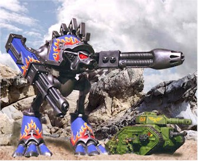

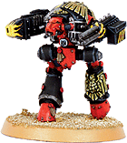

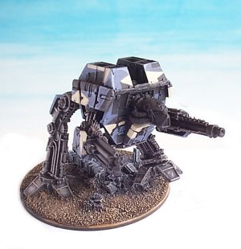

战犬级MKII型泰坦(Warhound Titan MKII)

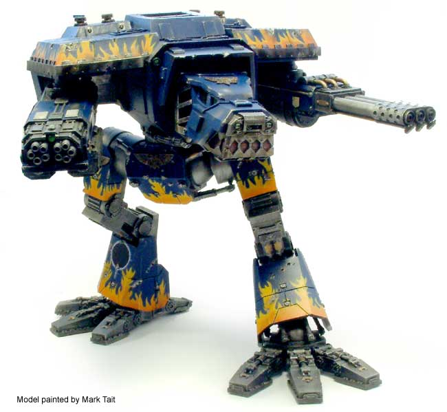

金星版本的战犬泰坦(LUCIUS PATTERN WARHOUND TITAN-JACKAL CLASS)

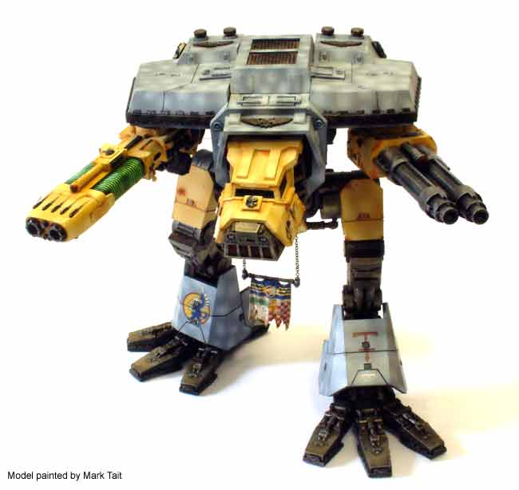

产地同上，不过是战狼型(LUCIUS PATTERN WARHOUND TITAN-WOLF CLASS)

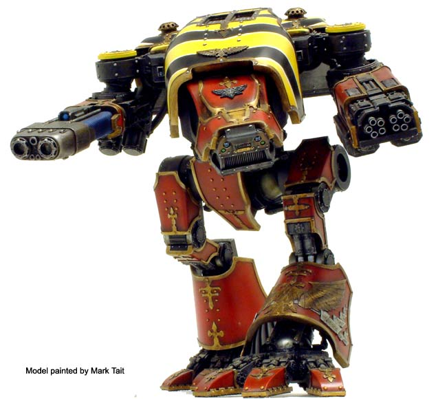

火星版本的战犬级泰坦(Mars Pattern Warhound Titan)

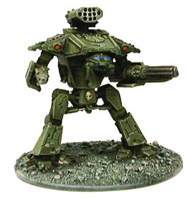

金星版本的掠夺者级泰坦(LUCIUS PATTERN REAVER TITAN)

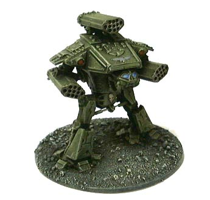

产地同上，不过是重火力型

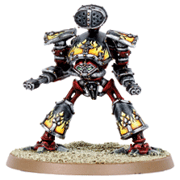

火星版本的掠夺者泰坦(MARS PATTERN REAVER TITAN)

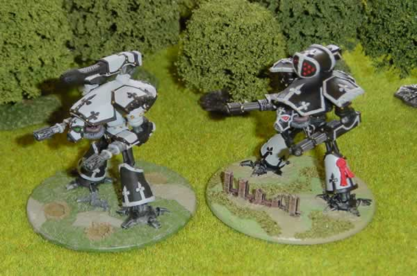

火星版本的掠夺者泰坦双机小队

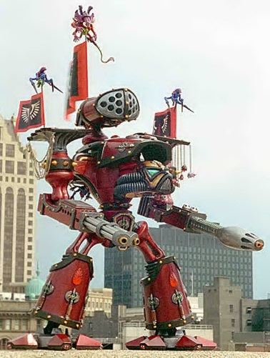

圣血天使所属的掠夺者泰坦(BloodAngel Reaver Titan)

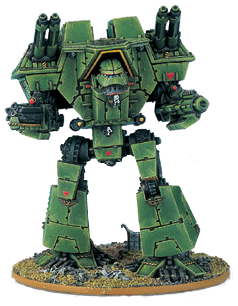

战将级泰坦(Warlord Titan)

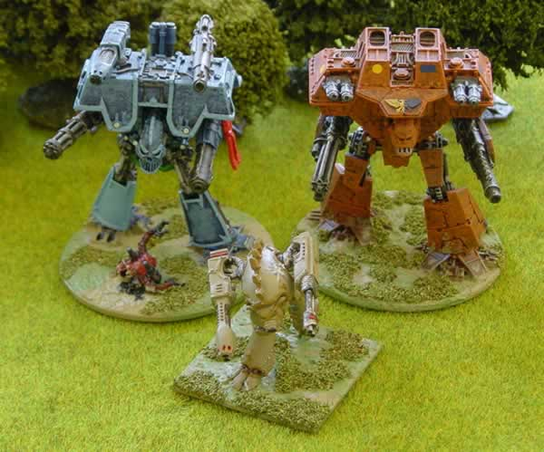

战将泰坦MKII和III型(前面那个是战犬级，这下知道两者差多大了吧～)

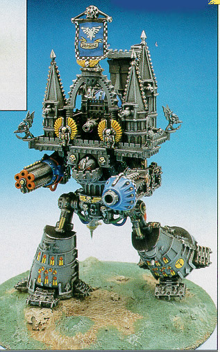

战将级泰坦(Warlord Titan)

接下来是混沌的：

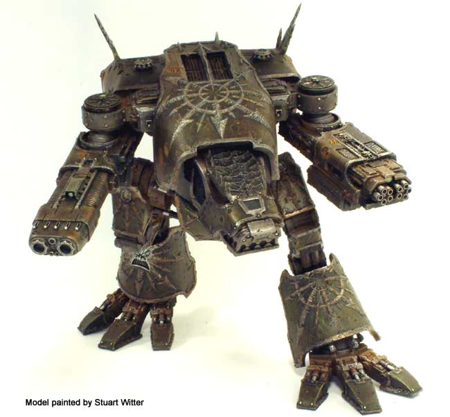

混沌战犬级泰坦(CHAOS WARHOUND TITAN)

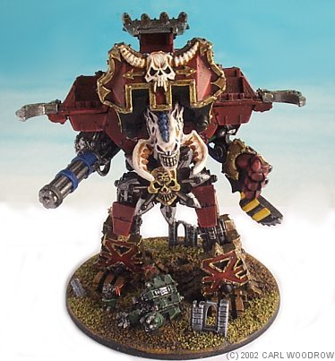

Banelord级泰坦(译作什么好呢？剧毒之王？还是前人的“破坏神”？)

Eldar的：

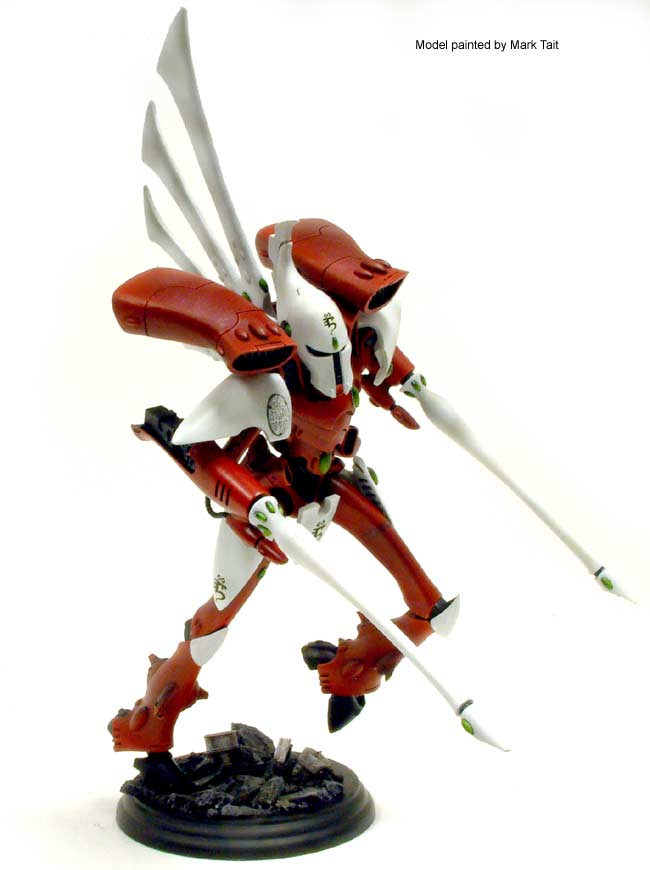

亡魂式泰坦(Revenant Titan)，装备脉冲炮(Pulsar)

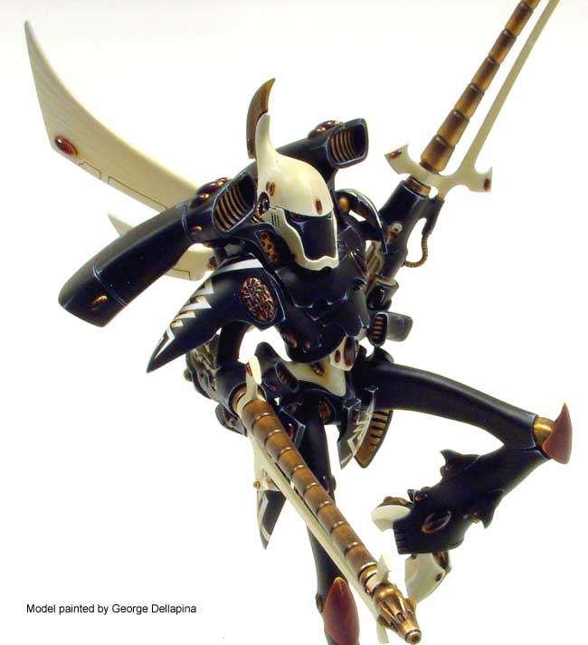

同上，换装了音速长枪(Sonic Lance)

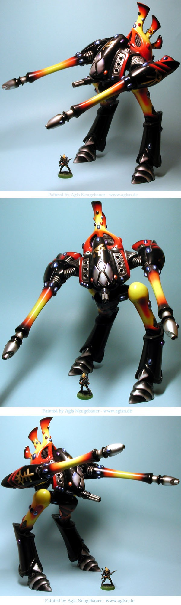

同上，脉冲炮版本

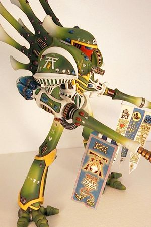

幻象式泰坦(Phantom Titan)，装备了飞翼式镭射加农炮(Wing Lascannon)和震撼式加农炮(Tremor Cannon)

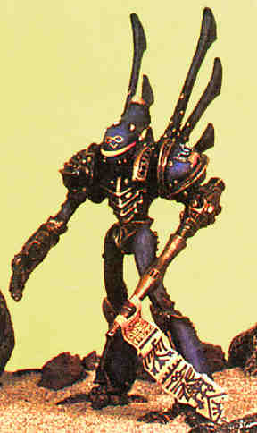

同上，装备了热力长枪(Heat Lance)和幻象式动力拳套(Phantom Power Fist)

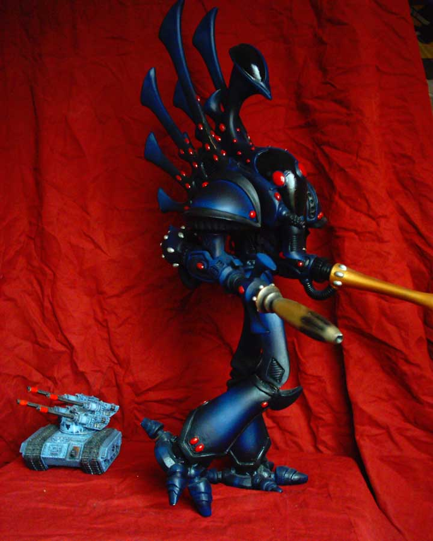

巫师式泰坦(Warlock Titan)，装备脉冲炮(Pulsar)和泰坦D型加农炮(Titan D-Cannon)

偶口爱的虫子滴：

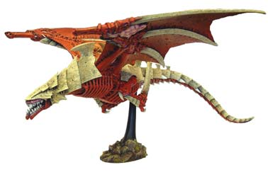

空之虫后(HARRIDAN)

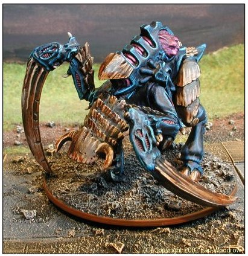

泰坦巨虫(bio-titan)

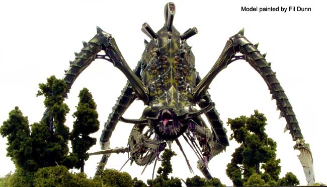

同上

令人无语的Ork：

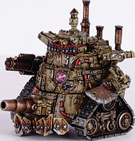

蒸气铁皮巨人(Steam Gargant)

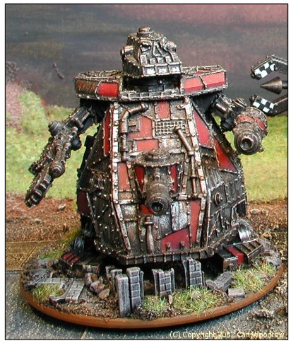

铁皮巨人(Gargant)

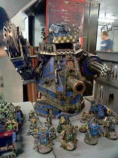

同上

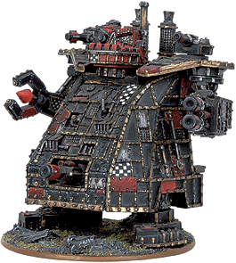

大铁皮巨人(Great Gargant)

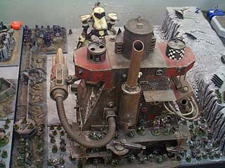

同上

最后一张

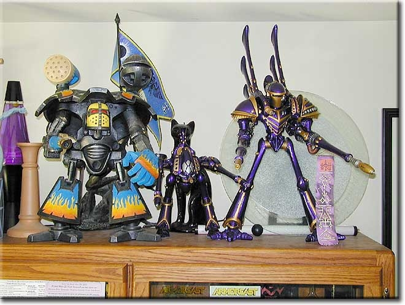

从左至右：

战将级泰坦(帝国)，亡魂式泰坦(Eldar)和幻象式泰坦(Eldar)

补充一下：

帝国的泰坦分为三个等级：侦察型、主战型和帝王型。战犬和掠夺者是侦察型，战将是主战型。泰坦是有着自己灵魂的作战兵器，车组成员通过精神链接来操纵泰坦，他们的灵魂与泰坦是一体的，一台战将级泰坦的车组成员包括车长，大副，战术指挥官，以及其他的操作人员和机械技师。一台战将级泰坦的武器包括150mm多管机关炮（手臂），火山炮（手臂）和增压镭射炮（双肩），且还有空间立场的保护，WA里用来轰杀骷髅的大炮，似乎仅仅是泰坦的近战轻型防御武器而已。 

再PS. 多谢流放的卡尔提醒～～～
