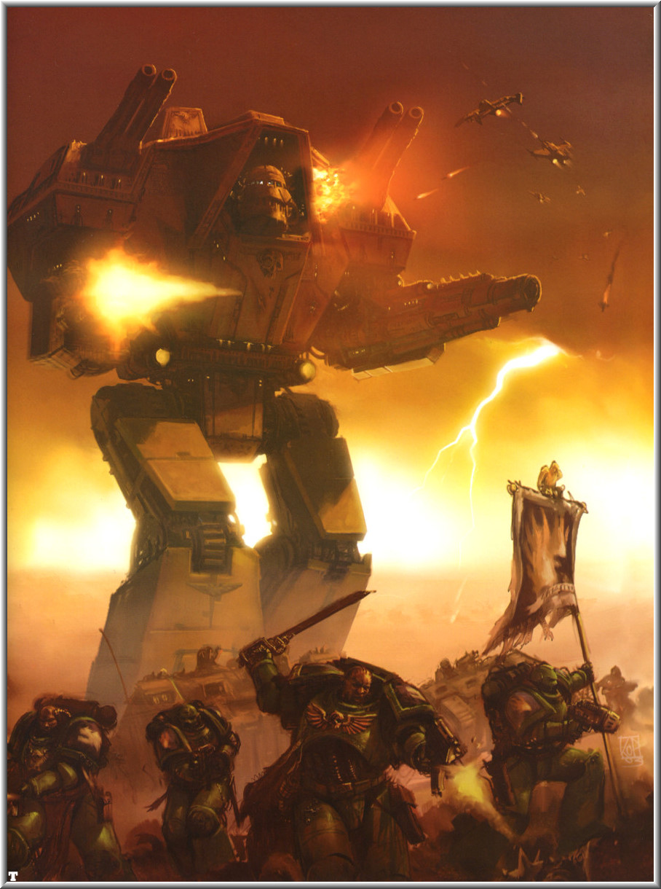

# 泰坦

boltgun

TITAN，是人类的黄金时代尚存的武器之一。当时是作为地形比较复杂的危险环境殖民地的保安设备，是双足行走装甲武器（只是行走而已）。除了特别的装甲之外，还有叫做虚空盾的能量护盾（在40K的地面武器里不是很常见）。有侦察、主战和帝王三个主要的大级别，其中每个级别里又有不同型号的CLASS。现在帝国里的型号似乎很乱，可能因为各个锻造世界各自的技术和风格长时间演变的结果吧……

关于所谓“启动战魂”

boltgun

你说的是机械魂吧？

应该是一种辅助AI或者OS，起人机交互界面或者一定程度自主辅助战斗的作用。在机械会宗教化之后于是就叫了这个。

在一个泰坦故事里，可以看到的是泰坦的机魂是有一定自主的，但是绝对需要一个主指挥放在驾驶位上连接精神链才能开动。而且看起来机魂还有一些积累类型数据库的特点，一台经历过很多驾驶者的泰坦的机魂有时会把几位驾驶员的性格糅合继承的情况发生。甚至在故事里发生的比较极端的是，一个死在了驾驶席上的主指挥把自己的意识残留在了机魂里。 

泰坦, 他们是各个锻造世界直属管辖的部队, 从建造到补给到调度都归他们的老家锻造世界管. 会应帝国军方的要求派遣到各个战场上去, 虽然他们会配合其他部队作战, 但是自主性却十分强, 有时候随军的机械会代表甚至会因为担心泰坦的白白损失而拒绝出战.

关于泰坦的机组成员, 按不同的大小规格, 人员数量也不同, 但是基本会是这样的结构: 两名或者以上的辅助驾驶, 负责武器系统的辅助操作和探测系统的辅助操作; 一名主工程师和若干机械神甫组成的机轮组, 负责引擎和机体维护; 机仆若干, 硬性安装在泰坦内部, 负责一些重复性劳作. 然后最核心的一名成员是泰坦的主指挥, 也就是它的驾驶员. 他通过泰坦的精神链和泰坦的机魂连接到一起 (需要移植特殊接口) , 使他和泰坦溶为一体, 能够象操作自己的身体一样驾驶泰坦, 并且象感受自己的身体一样接受泰坦机体的各种状态和信息. 主指挥的工作不但需要巨大的精神韧性, 能够承受泰坦精神链和高级机魂操作带来的海量数据流, 而且还要和机魂协调同步, 按他们的话说就是&quot;被接受&quot;. 主指挥还需要在专门的学院中度过漫长的培训学习生涯, 然后进入实习阶段, 完全毕业之后再成为后备的主指挥. 有时一名后备人员可能要等上几十年, 亲自坐上泰坦驾驶席的那一天也不一定会来到.

泰坦是有驾驶舰桥和机轮舱的, 也有各种出入通道, 供组员登降来往和执行检修. 由于主指挥在驾驶泰坦的时候, 自己感受到的和驱使的完全是泰坦本身的强大力量和身体, 他们在断开精神链之后, 有人会得一种综合症, 由于突然变回自己的身体和感官, 人体和泰坦的感官系统反差巨大, 会让人感到强烈的脆弱和迟钝, 随之而来的是一些生理和心理上的痛苦. 这些也是泰坦驾驶员在战场之外要克服的困难之一.
