# [混沌诸神的荣耀]混沌舰队大型战舰介绍(全部补图完毕)

[混沌诸神的荣耀]混沌舰队大型战舰介绍(全部补图完毕) 兔子半妖

掠夺者级战列舰Despoiler

掠夺者级战列舰是M36中期发展的一型战舰，准备作为Gareox Prerogative的一部分。根据风暴舰队（Tempestus）在战斗中取得的经验，设计者将战舰内部携带的小型攻击机看作太空战中的终极武器，并计划建造15艘掠夺者级战列舰。然而历史告诉我们，“纯血的真正战列舰”并未因为攻击机队的出现而变得过时，因此掠夺者级的建造计划在完成3艘战舰后被终止。掠夺者级在服役的初期很少遭遇战斗，大多被用于在大范围的相对平静的星系中进行长途巡逻。在这样被闲置了大约250年后，“Merciless Death”在Amerikon区的一次长途航行中失踪。过了30年后，它在Banardi星系的冲突中出现，突袭并摧毁了前往支援Banardi主行星的16艘帝国运输舰。此后这艘战舰多次出现，而且出现的位置逐步接近恐惧之眼，直到M39早期它才再次消失。在它第二次消失后不久，另外两艘掠夺者级战舰也突然在向友舰开火后遁入亚空间。随着哥特战争的展开，关于目击“Merciless Death”和它的姐妹舰的谣言又再度出现。

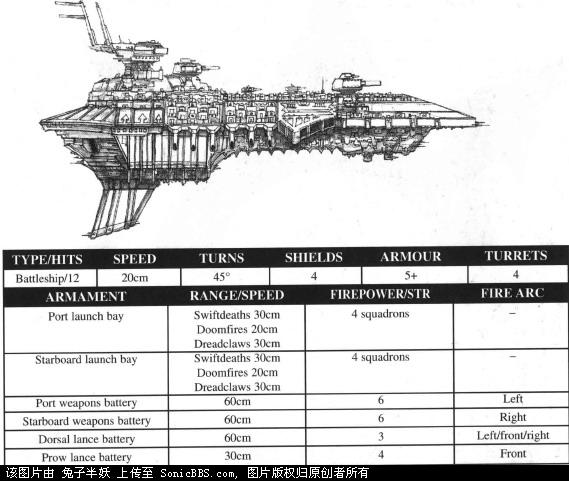

Merciless Death Damnation’ Fury Fortress of Agony

浩劫使者级战列舰Desolator

浩劫使者级战列舰的诞生可追溯到帝国创立的初期，它应用的科技在机械神教中早已失传。现在帝国舰队中已无此型战舰，但是在M31-M34之间至少有5艘浩劫使者级背叛了皇帝。其中最为臭名昭著的是被它的叛徒舰长改成现在这名字的“Eternity of Pain”。从453.M33起，至少7艘帝国战列舰在它强大的光矛攻击和远程炮击下被撕成碎片，而葬身在这星海巨兽口中的小型舰艇更是数不胜数。比“Eternity of Pain”更古老的“Torment”号在Spartan战争中，由于动力系统受损，舰体飘入太空雷区后被海盗缴获。在被缴获后的第78年，“Torment”号毁灭了GhoriVI上的轨道防御系统，让灵族海盗轻而易举地攻击了这个星球。“Torment”号还曾在阿尔提玛星区被目击，甚至还在银河东北端的Jobe区攻击过帝国的船队。

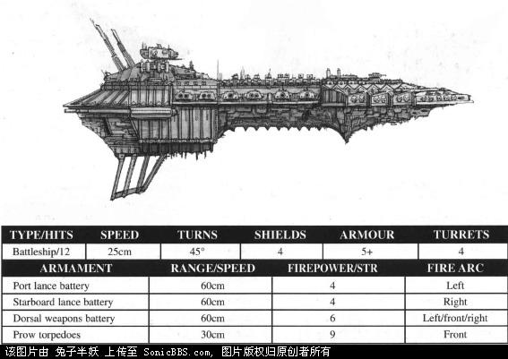

Eternity of PainTorment

憎恶级超大型巡洋舰Repulsive

超大型巡洋舰是现在广泛部署于帝国舰队中的战列巡洋舰的前身。它的抗打击能力几乎堪与战列舰匹敌，而火力也是相当的强大，然而由于已无法再制造出足以驱动它的强劲发动机（新近制造的版本无法使它达到足够的战斗速度），超大型巡洋舰逐渐失宠。一些古老的超大型战列舰仍然被保留在Obscurus星区和Pacificus星区的预备役舰队中，但它们已接近被废弃了。有25艘超大型巡洋舰在M34服役后背叛了皇帝，其中大约有12艘仍然被掌握在异端叛徒的手中。这些巡洋舰里最为活跃的是“Foe-Reaper”号，在它被黑暗势力腐化后的23个世纪中，它曾在十数次大型舰队的遭遇战中露面。同样，最臭名昭著的也是这艘战舰，它曾攻击了AFR-74上的机械神教研究设施，一瞬间便夺走了超过5万名机械神教成员的生命：它用一种特制的鱼雷粉碎了这颗卫星上的人造生物圈护盾，将居民们暴露在有毒的空气之中。

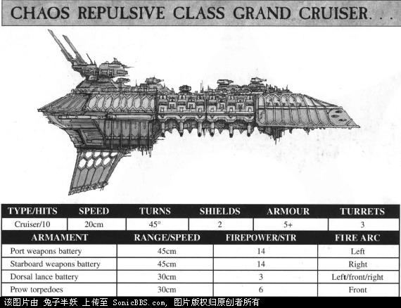

Bloodied Sword， Foe-Reaper， Bringer of Despair

冥河级重巡洋舰 Styx

在M32到M33之间，冥河级重巡洋舰曾广泛地服役于Obscurus和阿尔提玛两个星区的舰队中。在火星建造了更新型的战列巡洋舰后，冥河级开始退役。冥河级拥有相当强劲的远程武器，同时还容纳着数量可观的攻击机队，它的表现远超出了这一吨位的战舰的正常水平。在哥特战争以前，就有7次冥河级在Obscurus星区攻击帝国舰队的记录。而在哥特战争中，冥河级曾在大规模的舰队战中出现过39次。这足以证明了混沌诸神的仆人们对这些战舰的重视。虽然此次战争中至少目击过5艘冥河级战舰，但只有两艘被辨认出来：“Horrific”和“Heartless Destroyer r”。这两艘战舰都在M33早期被派往Cypra Mundi太空港，作为二线战舰使用。它们时常并肩作战。在299.M35，较老旧的“冷血的毁灭者”在对抗叛徒的袭扰时突然撤退，导致它的姐妹舰被瘫痪并俘获。它们再次出现是在哥特战争之中，虽然这两艘战舰仍一同出没，但它们之间的罅隙已经永远存在了。在Duran之战中，“Horrific”报了以前的仇。它突然抛开了混沌舰队，撤离战场。而此时已经被瘫痪的“Heartless Destroyer”则无助地漂向行星轨道，被轨道防御平台的炮火彻底粉碎。

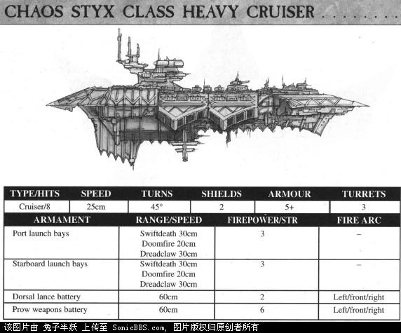

Horrific Heartless Destroyer

冥王级重巡洋舰Hades

“Warmaker”号曾是哥特舰队中备受赞誉的一艘战舰，然而现在却成了哥特舰队的死敌。在哥特战争发生前，“Warmaker”已作为第4重巡洋舰分队的旗舰服役了13个世纪，声名远播。此后它被改为舰队训练舰。然而混沌力量的侵蚀是无处不在的，先是原本前途远大的海军军官，继而是战舰的全体船员，都被混沌所蛊惑。尽管如此，直到哥特战争爆发时，它才露出自己的真面目，“战争制造者”在驶离Jarnu行星的轨道站后突然向轨道站开火。轨道站的残骸坠入Jarnu的首都，造成接近325万帝国公民死亡。在周围的少数舰艇组织起截击阵型之前，它便迅速逃离了。它再次出现是在Savonis星系，伴随着一支袭击舰舰队。它曾两次被击中并瘫痪，但在护卫舰艇的掩护下它还是成功逃离了被俘获或摧毁的命运。

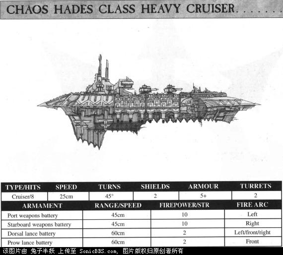

Malignus Maximus， Injustice， Warmaker

冥河渡者/冥界级重巡洋舰Acheron

“Chaos Eternus”是一艘非同寻常的战舰。因为根据记录显示，冥界级战舰只建造过这一艘，目的是作为武器试验平台。在51区（恶名远扬的Portis Cthulhus就在此区，这个名字让你想起什么没？）发现的疑似外星人遗物的远古飞船上获取的科技被运用到冥界级上并进行试验。帝国海军的学者们曾为此争论不休，认为这些外星科技正是造成冥界级在哥特战争中背叛的原因。起初“Chaos Eternus”是没有舰名的，只有一个BF/67-A的代号。给它起这个名字的是海军上将Grove，因为它曾在Scharnhorst冲突中接连4次突破Grove上将舰队的围追堵截。

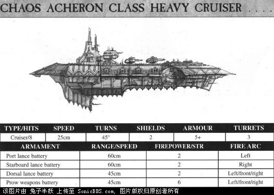

Chaos Eternus

破坏级巡洋舰 Devastation

“Unforgivable”在M37发生的莫迪安事件中赢得了这一绰号。那时它还被称为“righteous Fury”，与欧伯伦级Oberon战列巡洋舰“正义之神”号一起为14艘海军运输舰护航（这些运输舰装载了32000名帝国卫队士兵，5500辆主战坦克，以及超过10000名的后勤人员和随行车辆）。当时“righteous Fury”报告它的远程探测器发现一个不明目标，并发射了战斗机和轰炸机前去截击。然而这只是为了掩盖它发射所有轰炸机中队的真正动机。在机群经过“正义之神”时，他们突然向战列巡洋舰发难，并将其瘫痪。然后战列巡洋舰的船员们就只能眼看着“righteous Fury”将炮口转向较小的护卫舰只，摧毁了其中4艘，赶跑了剩下的2艘。接下来它将屠刀挥向无助的运输舰，轰炸机群发动了持续13小时的残忍进攻，将所有运输舰全部击毁。只有3000人通过救生舱和太空救生筏得以幸存。这些军队的损失直接导致Gestenbal落入兽人手中。在被命名为“unforgivable”后，这艘巡洋舰四处肆虐长达3000年之久，最后在哥特战争中，被Grenfeld舰长指挥的“Hammer of Justice”号堵截在港口中并摧毁。

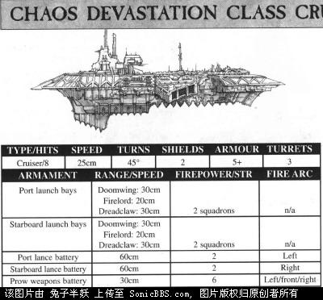

Deatbane ,\unforgivable

谋杀者级巡洋舰Murder

在被月神级巡洋舰替代前，谋杀者级曾是Obscurus舰队的主力战舰，在M33-M37年间生产了近500艘。但是，相当一部分该型战舰叛逃到混沌手中。它装备了大量的机械神教所能生产出的最好的离子炮阵列，在长距离上是一个相当可怕的对手。而强劲的发动机又足以让它与那些武器稍差的敌人保持距离，发挥它的远程火力优势。当几艘这种战舰协同作战时，他们的远程火力能轻松瘫痪最强大的战列舰。由“Doombringer”、“SteelFang”、“Monstrous”三舰构成的联合舰队曾在哥特战争中携手摧毁了从Ardekka区前来支援的帝国战列舰“Relentless Persecution”

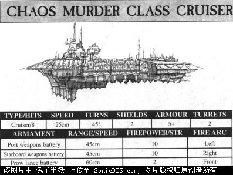

Doombringer， Deathblade， Steel Fang， Monstrous，Unholy Dominion， Plagueclaw， Despicable Ecstasy

残杀级巡洋舰Carnage

残杀级巡洋舰被设计成一种舰队火力支援舰，通过它们强劲的远程火力来巩固阵型，为其他战舰提供支援。在如何为它的远程舰炮提供能量这个问题上存在着不少的技术难题，结果它不但险些难产，还差点引起了Obscura舰队内部的严重分歧。第一艘残杀级巡洋舰是“Relentless”号，它在Skalathrax登陆战中首次参战，为6艘正在努力建立滩头阵地的运输舰提供火力支援。然而“无情”早已叛变，它混入运输队后便掉转炮口，迅速摧毁了其中的3艘。幸存的3艘登陆舰在到达地面后却发现着陆点已经被攻占，随舰的帝国卫队士兵迅速被叛军所淹没。“Relentless”在此战后更名为“Initite of Skalathrax（打响Skalathrax的第一炮！）”，在长达3000年的时间里四处袭击运输队，或是在星际港口外进行伏击。最后它被帝国海军堵截在Priam区的叛军要塞“黑暗据点”中并摧毁。还有其他一些残杀级巡洋舰也背叛了帝国，其中的“Anarchic Vendetta”号上的船员发动了大规模的兵变，把他们的军官尽数杀死后弃尸在26/A号空间站上，然后驾舰冲出港口。兵变的战舰造成了相当大的破坏，幸而启示录级战列舰“Duke Helbrecht”号的出现迫使他们逃离了战斗。

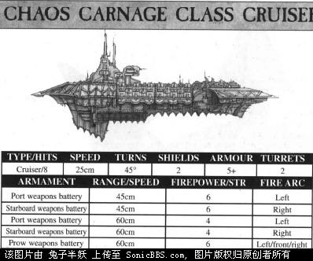

Initite of Skalathrax，Wanton Desecration，Excessive，Anarchic Vendetta

屠夫级巡洋舰slaughter

凭借独有的Scartix线圈（Coil），屠夫级巡洋舰获得了远强于其他任何战舰的强劲推进力。于126.M34退出主力舰队的屠夫级巡洋舰“Dutiful”号叛变并轰炸了铸造世界sethelan，将Scartix线圈的设计模板付之一炬。有些人推测此举是为了断绝继续生产该型战舰的一切可能。同时“Dutiful”号也因此被海军上将Dorez命名为“Soulless”号，并被帝国海军毫不留情地追击了七千年。它最终在Orar袭击战中被火星级战列巡洋舰“Imperious”号摧毁了等离子引擎，随即被彻底毁灭。令人闻风丧胆的“Killfrenzy”号得名于它独特的广播。每当帝国舰队遭遇到这艘战舰时，都发现它在所有频率都重复地发送着一条信息…killfrenzy killfrenzy killfrenzy……据信这艘战舰的指挥官依旧是Abraham Thurst，他是个对战舰的安危毫不在乎的家伙，在多次战舰遭受重创的情况下都选择继续战斗而非撤退

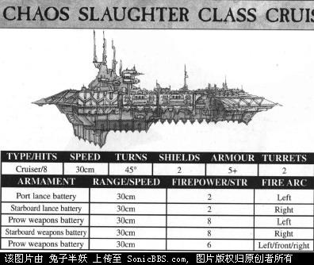

Deathskull  Killfrenzy  Soulless  Heathen Promise

报复者级超大型巡洋舰Retaliator

报复者级曾在Galan五号行星防御舰队中服役，该舰队于M35发动叛乱。在行星的三颗卫星见证了叛军与帝国舰队长达两天的激烈拼杀。最后叛军以牺牲4艘战舰为代价摧毁了截击他们的3艘帝国巡洋舰，随后在分舰队旗舰Foebane号的带领下逃离了该星系并驶入亚空间。在Galan分舰队（现在已改名为Foebane分舰队）背叛之后，它们有过3次在叛军的袭击舰队中被目击到的记录，还曾参与过Obscurus星域、太阳星域和阿尔提玛星域的舰队交战行动。Foebane和它的姐妹舰最后一次被确认的目击是在一百年前，对Magdellan主行星的突击行动。此战中报复者级的火力摧毁了50%的行星轨道防御部队。

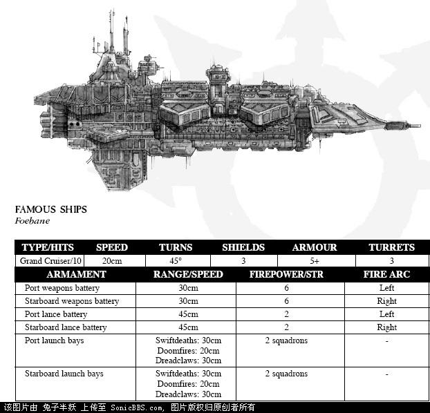 

Foebane

行刑者级超大型巡洋舰Executor

目前帝国海军的序列中已不再有行刑者级的身影。这级战舰的产量很小，大部分是在Hydraphur港及其附近的铸造世界中完成的。

行刑者级以大量的光矛作为其唯一武器，舰队指挥官通常喜欢用其掩护火力更凶猛的巡洋舰。

年复一年，行刑者级的数量随着战斗损失的增加而不断减少。最后一支由旗舰Blood Royale号指挥的分舰队加入了镇守卡迪安之门的庞大舰队。在对抗来自恐惧之眼的混沌舰队的过程中，Blood Royale和它的姐妹舰参与了对混沌战舰的追击。它们组成战列线，以强劲的火力迫使敌舰调头逃窜。但是，在追击战中，它们和其他十余艘战舰一同失踪了，它们的命运成了一个难解之迷。大部分人都相信这些战舰落入陷阱并被摧毁了。但是在五个世纪之后，包括Blood Royale在内的三艘失踪战舰又再度出现，并加入了叛军统帅Arca Vilespawn的舰队。这应该是最后几艘幸存的行刑者级战舰。

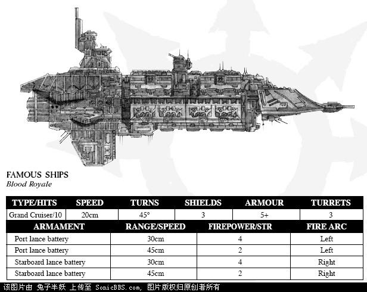 

行星杀手PlanetKiller

即使是对于帝国海军的权威们而言，这艘被称为“行星杀手”的超巨型战舰的来源也仍然是一个迷题。它不具备任何帝国战舰的特征——根据学者们的推测，是掠夺者阿巴顿的部队在恐惧之眼中建造了这头巨兽以满足哥特战争的需要——事实上一些机械神教的成员怀疑如果不在亚空间中施工的话，根本不可能建造出如此巨大的战舰。

迄今为止只知道有一艘行星杀手被建造并作为掠夺者阿巴顿的旗舰投入到哥特战争中。它的舰体围绕着一艘无比庞大的能量炮建造，再辅以大量的远程光矛、炮塔阵列和鱼雷发射器。同时它还有着厚实的装甲和极其强劲的护盾发生器。它的唯一弱点恐怕是它迟缓的速度。

正是由于它的速度缺陷导致了它最终的毁灭。在它摧毁Kharlos二号行星后不久，它就被由欧米伽战斗群的月神级巡洋舰咬上，大量的远程鱼雷先后命中它的舰体，将它击毁。

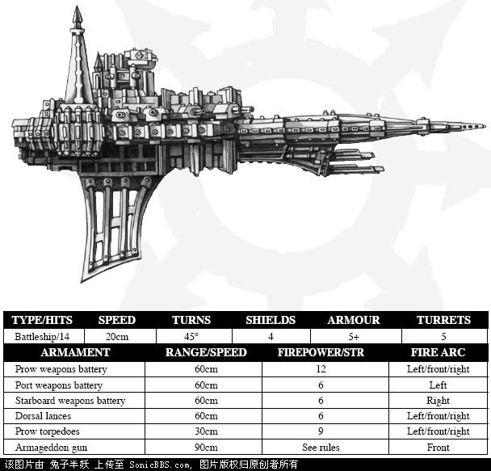 
