# 漫画集合

xyzabcd2 翻译漫画

战锤连载漫画第一本全收录

搞定第一本，废话不说，按版主大人的吩咐汇总。

故事一，暗黑之刃穆斯（WFB，连载）：

[http://game.ali213.net/thread-1363777-1-1.html](http://game.ali213.net/thread-1363777-1-1.html)

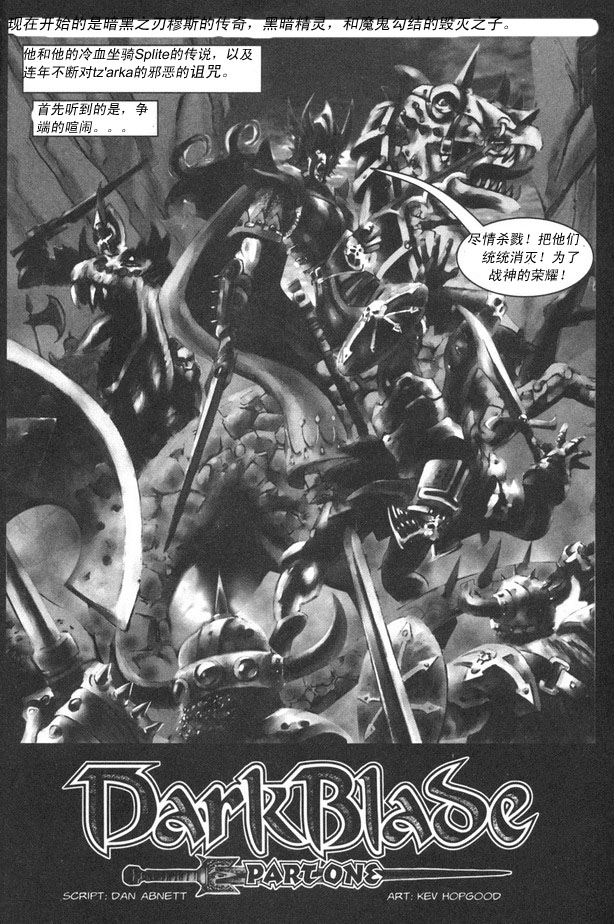

故事二，掠食者与牺牲者（貌似无连载，4k虫族的小故事）：

[http://game.ali213.net/thread-1364114-1-1.html](http://game.ali213.net/thread-1364114-1-1.html)

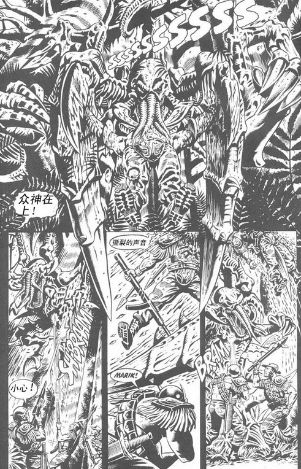

故事三，通缉令（应该是某个著名人物的冒险故事吧，短篇）：

[http://game.ali213.net/thread-1364329-1-1.html](http://game.ali213.net/thread-1364329-1-1.html)

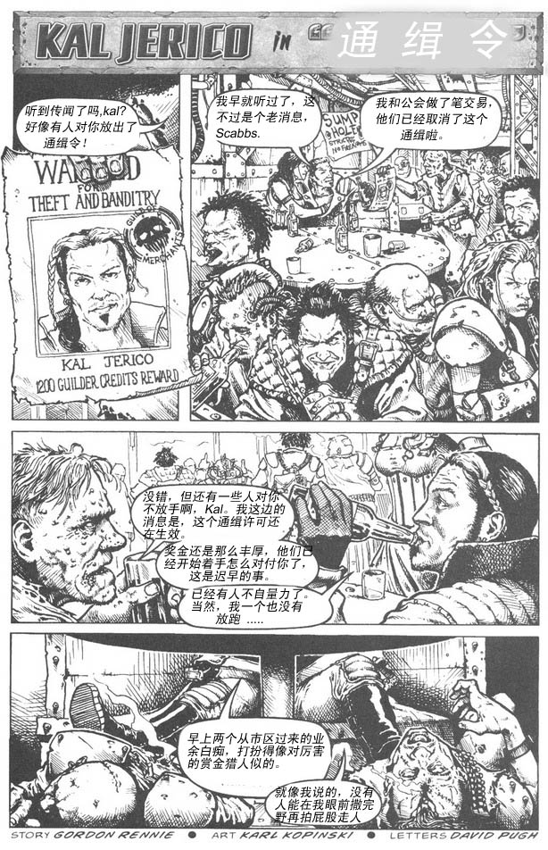

故事四，BloodQuest（关于圣血天使的某个团长，连载）：

[http://game.ali213.net/thread-1364744-1-1.html](http://game.ali213.net/thread-1364744-1-1.html)

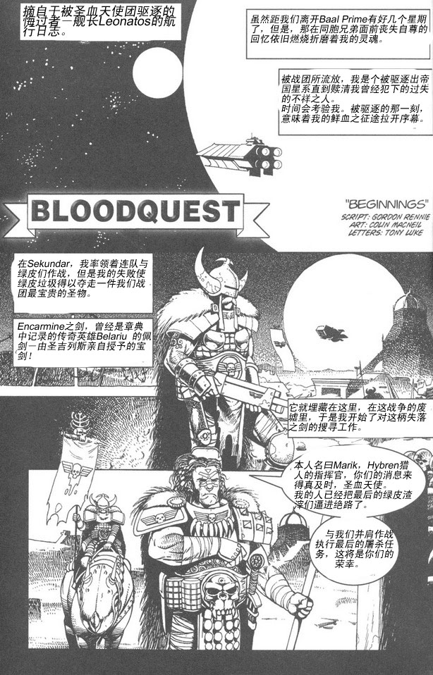

战锤40k漫画《泰坦》[已翻译]

一共是5章节,40多张图吧,网易图片防盗链,本来想一张张当附件贴的.......

算了,想看的就到网易相册看吧,以下是地址:

[http://photo.163.com/photos/xyzabcd2/115466370/](http://photo.163.com/photos/xyzabcd2/115466370/)

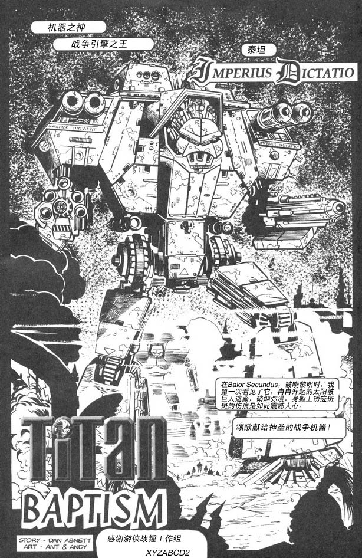

过年了,还继续翻吗?不翻吗?翻吗?......................

fenixbj 翻译

战锤40k漫画《泰坦-Cold Steel》[片段][已翻译]

[http://game.ali213.net/thread-1386670-1-14.html](http://game.ali213.net/thread-1386670-1-14.html)

此漫画情节是承接xyzabcd2兄翻译的战锤40k漫画《泰坦》

这个片段是本人在翻看Drydry兄的163相册时翻到的，分散在两本月刊里，不日前见到xyzabcd2兄翻译的漫画，决定将就翻出来

我们的泰坦机长Hekate带领泰坦军团来到了一个诡秘的地方，情形似乎不容乐观……

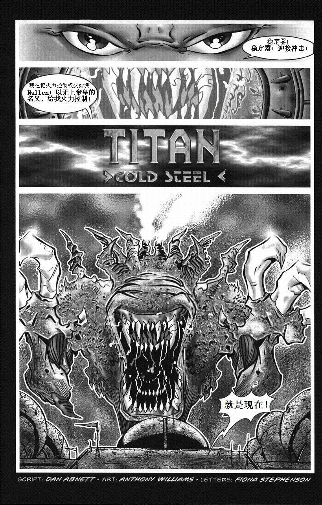

战锤漫画战斗修女《驱魔者》故事一完结[已翻译]

[http://game.ali213.net/thread-1393254-1-14.html](http://game.ali213.net/thread-1393254-1-14.html)

想看美女的要失望了，而且有点黑....

剧透下，漫画主要内容(按事件发生的顺序)：一支修女研究会发现一只被监禁的斯拉孽恶魔，研究了300年后，恶魔突然自己跑了出来，而她们被变成了一个超恐怖的

怪胎灵魂聚合体－尖叫囚笼。但是灵魂不够多，它还需要献祭更多用来返回老巢。于是炽天使爱菲拉尓.斯特恩和1000多MM，被恶魔吸引到尖叫囚笼所在的星球，

在大部分修女被诅咒的情况下，爱菲拉尓被昔日的姐妹所击杀。意外的是，尖叫囚笼(修女的意识集合体,没有丧失对帝皇的信仰,或者是一心想为受到的折磨复仇)复活了爱菲拉尓并给予她强大的力量,掩盖了她的灵魂以免遭敌人发现，同时她也失去了记忆，

成了受尖叫囚笼遥控的的行尸走肉。被救出后她被修道院当精神病关了4年，直到某天有个堕落的修女（他的情夫也堕落了,就是后文的导航员,难道有不正当关系的都会堕落?）害怕她的力量故下杀手，反而被抓爆，此次事件使她与尖叫囚笼失去了连接，恢复了正常人的意识。

随后，审判官韩德抵达....省略详细过程N字....最终以悲剧收场，虽然帝皇那一边胜利了，人也几乎全死光了，只剩爱菲拉尓.斯特恩一个孤零零地游荡着等待复仇(冤冤相报何时了)，万恶的续集.....

不负责任的结论：1.人类无需贪徒恶魔的强大，即使获得了不该有的力量，失去也比得到的多。

2.和恶魔打架时一定要叫出它的真名，它会因你直呼其名而恼羞成怒，战斗力直线下降.....

回学校了,接下的一学期得潜心修行了,暂时告别.....也可以看这里

[http://photo.163.com/photos/xyzabcd2/116168594/](http://photo.163.com/photos/xyzabcd2/116168594/)

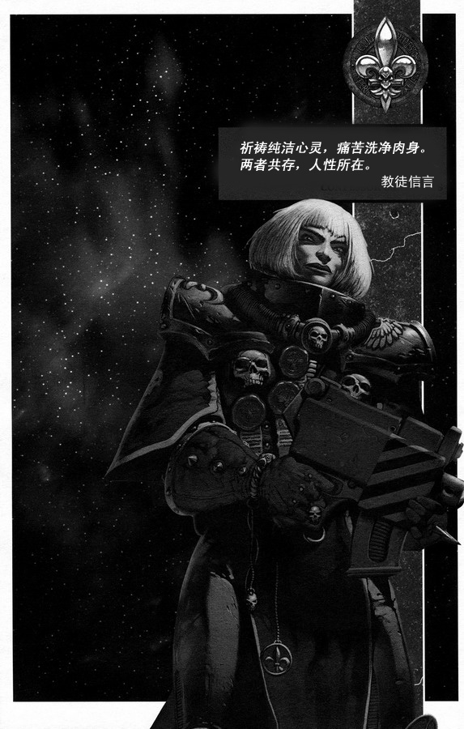

kain307 翻译

[战锤40000--孤狼][第一章：奇迹][七楼更新][第二章 噬尸者]

[http://game.ali213.net/thread-1419057-1-5.html](http://game.ali213.net/thread-1419057-1-5.html)

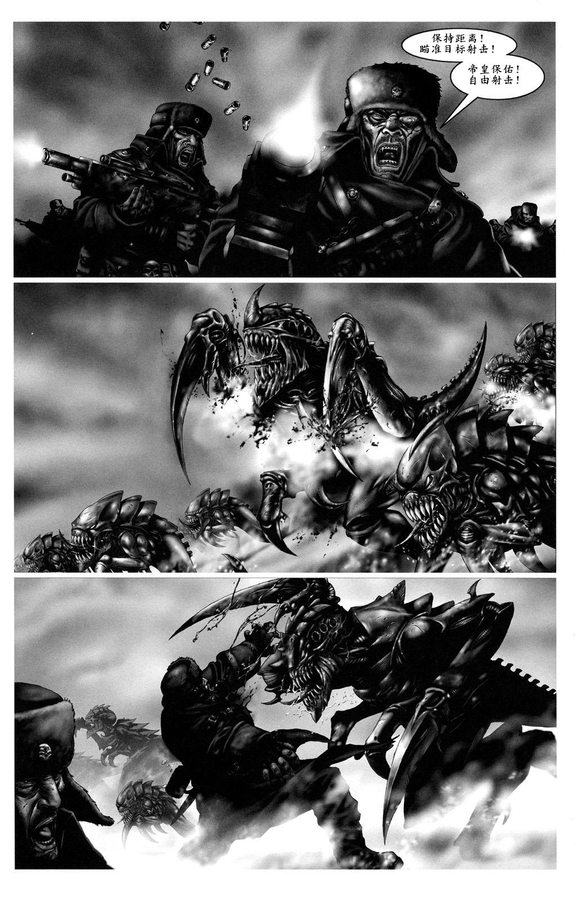

CZ75 翻译

战锤40K短篇漫画（更新：《最后一人》）

[http://game.ali213.net/thread-1461714-1-1.html](http://game.ali213.net/thread-1461714-1-1.html)

今天晚上突发奇想，想翻译几篇比较喜欢的40K漫画。下面这篇《虽死尤校》（The dead still serve）的编剧是Andy Johnes，由Jeff Rebner绘画，字符由Fiona Stephenson粘贴。

本次翻译中得到了BrazenMKK和exar_kun的大力协助，特此鸣谢！

这是我第一次汉化漫画，由于我不会用PS改图，只会用画笔修改，修改技术不好，请大家见谅……

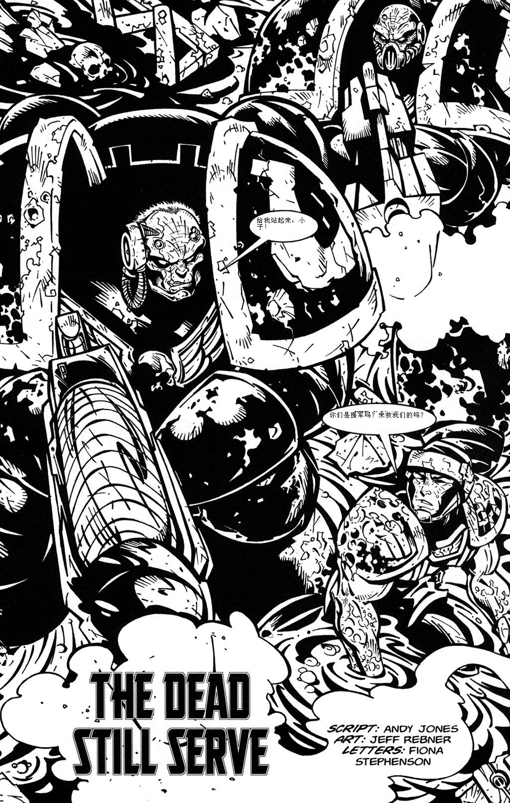

更新：

《别无选择》（Zero Option）

编剧是战锤圈子里很有名的Dan Abnett，绘画和字符由David Pugh负责。

这篇漫画虽然只有短短三页，然而结尾却非常震撼人心，充分显示了Dan Abnett的功力。

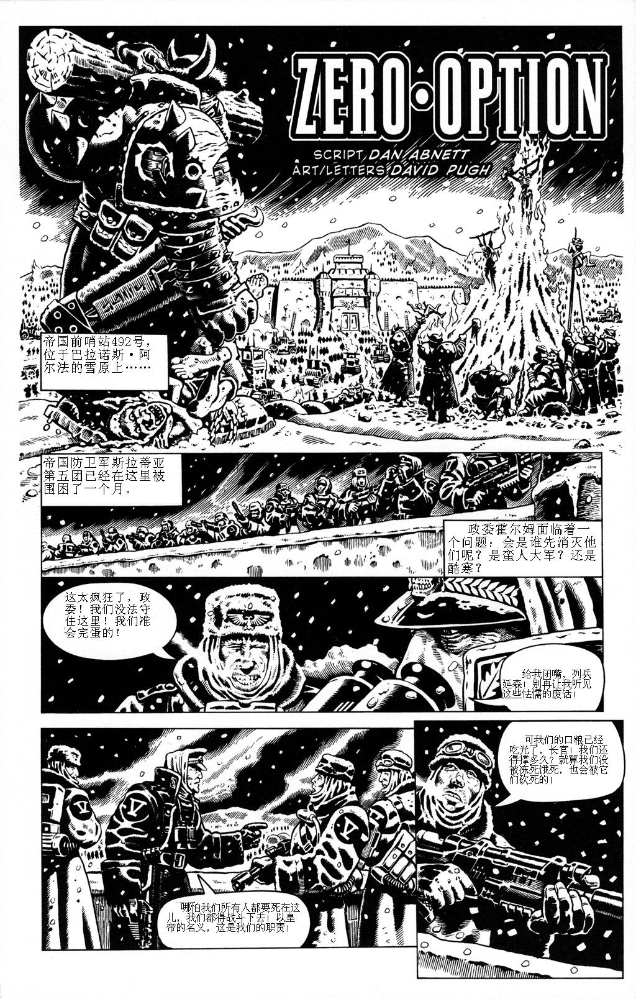

接下来是今天翻译的《最后一人》（Last Man Standing）

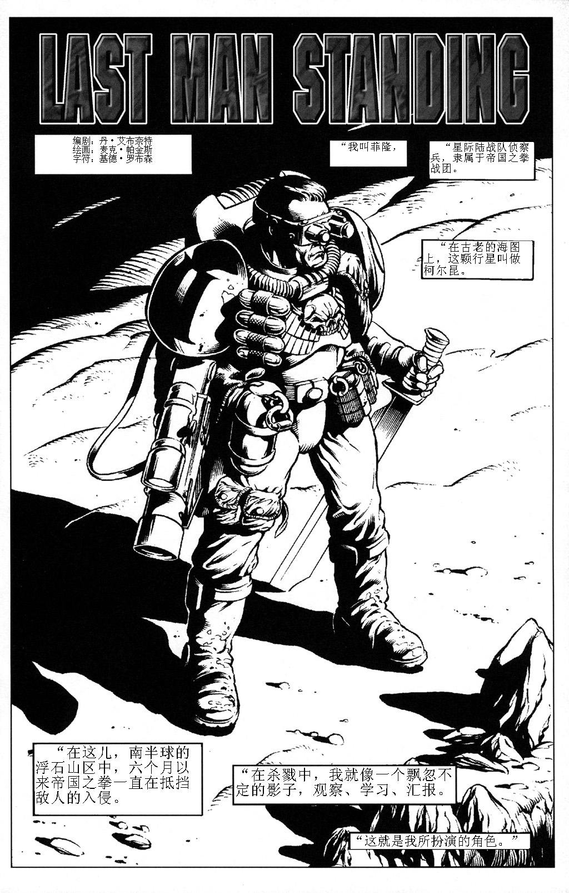

fenixbj & sovietred & 翻白眼的猫 翻译

DC同人漫画The Horror[原作连载中未完]

[http://game.ali213.net/thread-1372464-1-1.html](http://game.ali213.net/thread-1372464-1-1.html)

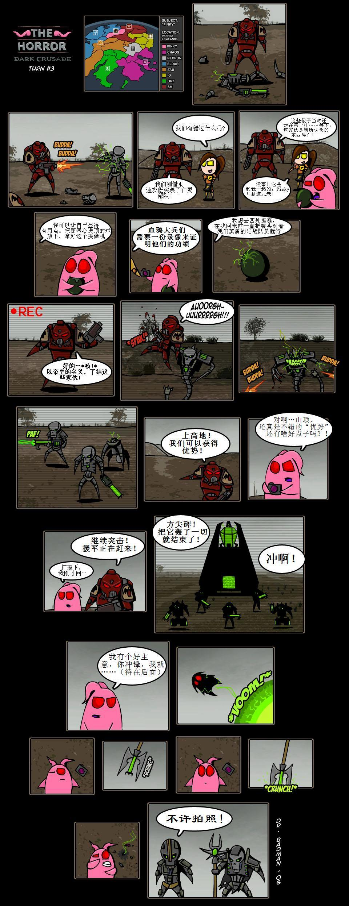

[战锤40K单行本：孤狼]88P中文大全集！（相册已修正）

wwcomic 

[http://game.ali213.net/thread-1531112-1-2.html](http://game.ali213.net/thread-1531112-1-2.html)

【声明】

本漫画版权归属其出版单位所有，本汉化版仅供个人学习、研究或欣赏之用，请于下载后24小时之内将其删除。

任何组织和个人都不得将本汉化作品用作商业目的，违者造成的一切后果自负！

【施工人员】

翻译：文文&Lin

制作：Lin

【作品看点】

波澜壮阔的世界设定，气魄十足的战斗场面，惊心动魄且感人至深的剧情，男人间的友情、生死间的抉择…………

施工人员一致评定两个字：好看！

【剧情简介】

在冰雪星球“沙德拉克”上，一小队帝国防卫军被寒冷、饥饿、伤病以及残暴的异形生物所包围，正当他们陷落绝望的同时，传奇的太空之狼星际战团奇迹般出现并拯救了他们。接着，他们并肩付出血的代价对战强大的异形生物，又险象还生逃离开“沙德拉克”，可是，他们乘坐的小飞艇出现了能量不足的危机……在生死之间，他们决定孤注一掷！ 

【在线观赏】

[http://photo.163.com/photos/wwcomic/127280573/](http://photo.163.com/photos/wwcomic/127280573/)

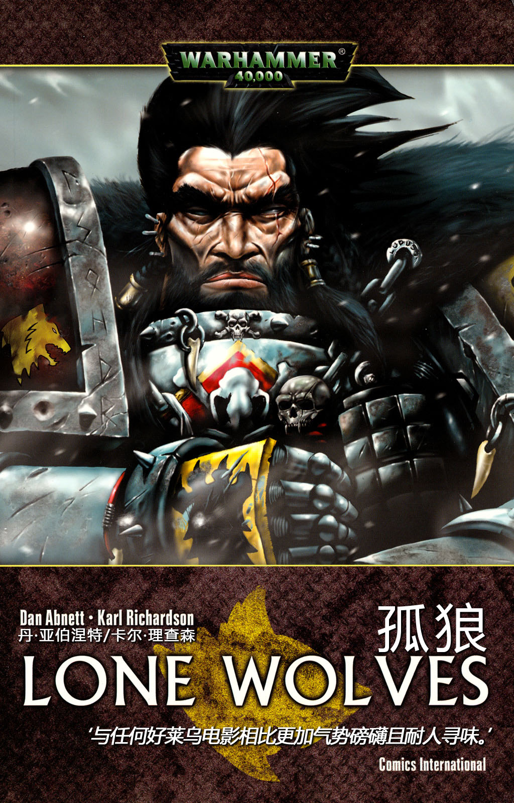

漫画 姐妹， 走好

drydry 

[http://game.ali213.net/thread-1564068-1-1.html](http://game.ali213.net/thread-1564068-1-1.html)

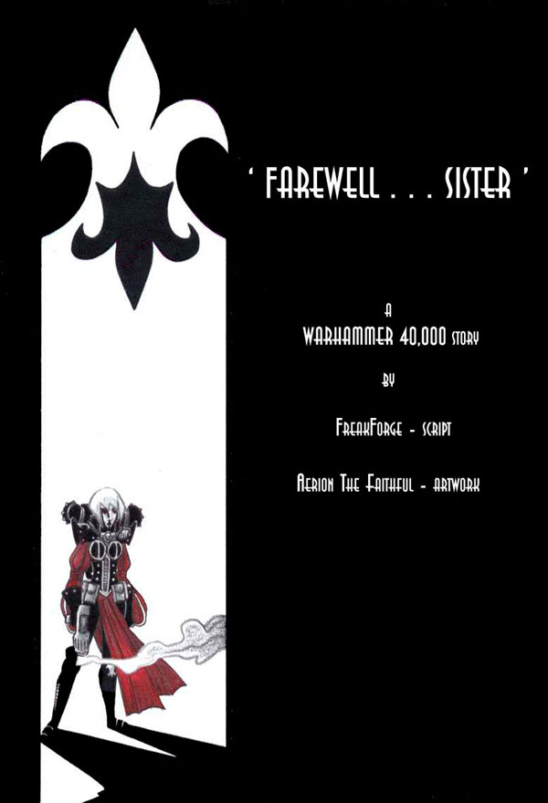

漫画-咒缚圣战

加里森敢死队

黑色圣堂战团的生活写照

1已经完成，后面的介绍就不翻了，很简单很简单，为了不破坏整体感就不改图了，看不到图的去这里看

[http://photo.163.com/photos/d.zeta/128755005/](http://photo.163.com/photos/d.zeta/128755005/)

此为英语交流，请勿用于商业用途，转帖请注明或者PM，否则全家遭天谴

[http://game.ali213.net/thread-1548145-1-4.html](http://game.ali213.net/thread-1548145-1-4.html)

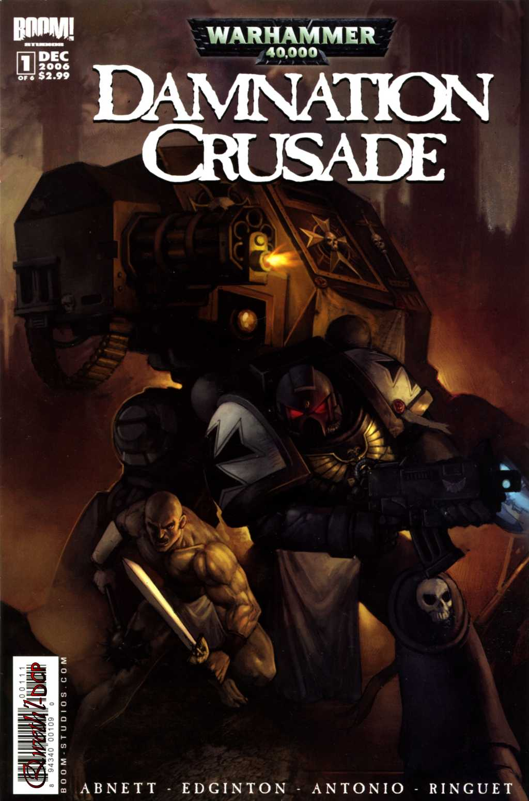

看不到图的可以去这里，[http://photo.163.com/photos/d.zeta/131026350/](http://photo.163.com/photos/d.zeta/131026350/)

未经许可不得随意转载，不得用于商业用途

第一集在这里看，[http://game.ali213.net/thread-1548145-1-1.html](http://game.ali213.net/thread-1548145-1-1.html)

[http://game.ali213.net/thread-1577349-1-1.html](http://game.ali213.net/thread-1577349-1-1.html)

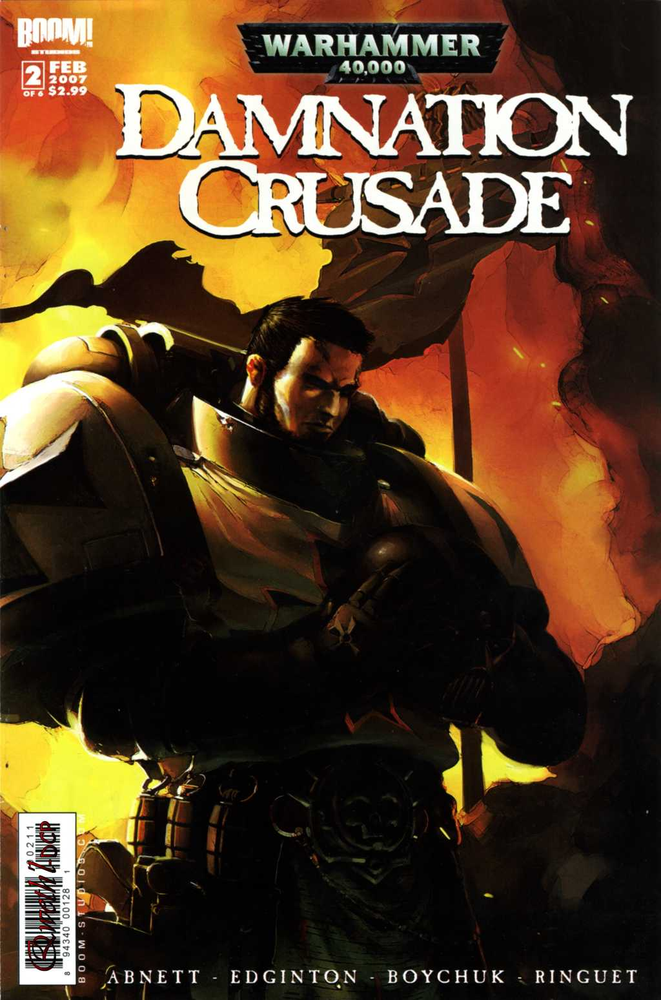
