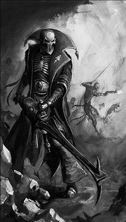
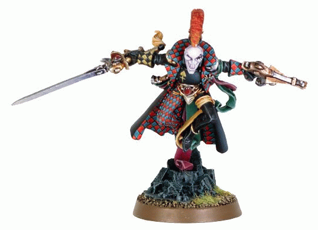
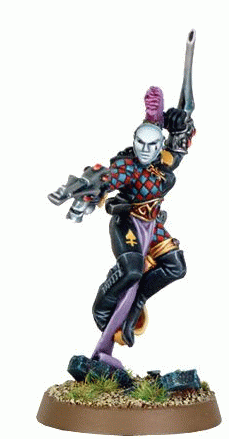
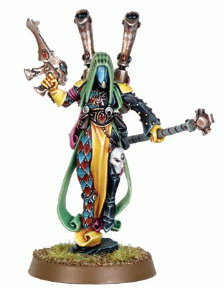

# Harlequins，丑角，舞者，迷药，etc

<H4>Harlequins，丑角，舞者，迷药，etc</H4>

嘉拉迪雅

40K宇宙里面，丑角们是艾达一族的子群。他们是黑图书馆的守护者，欢笑之神的仆人。他们自视作整个艾达民族的力量，献身于守护他们的种族，并通常扮演不同艾达派系之间的调停者和仲裁者的角色。其他的艾达人对他们的感情混合了敬畏、恐惧和尊重。 历史与社会 丑角（Harlequins）是艾达的一个派系，而且也是那个神秘民族里最神秘的一群人。他们在隧道网路（艾达们用于超光速行使的空间，里面网路复杂交错，一不小心就会迷失其中）里漫游，与混沌殊死战斗。他们的主要目标是找出他们最憎恨的敌人，混沌，并在所有可能的地方毁灭他们以保护灵族的世界。为了达成此目的，他们掌握了包含一切关于混沌秘密（包括其力量来源，及消灭混沌的方法）的禁断知识的黑图书馆。 丑角们在正式成为丑角一员之前，必须经历一个只知名为“典仪”的试炼。这种试炼的细节外界无从得知，然则，有传言说这种试炼可以让他们摆脱对邪神色孽（Slaanesh，乃艾达一族永恒之敌手）的恐惧。不似其他艾达人，当他们死时其灵魂不会为色孽所吞噬，反成为欢笑之神的一部分。这是他们不必配带灵魂石（也叫道路石，waystone）就能在隧道网路（虽然他们曾经需要配带灵魂石）里旅行，而不必忍受长时间在隧道网路里而遭受其他艾达人（尤其是黑暗艾达）所承受的倦怠魂吸（Tiring Soul-draining）之苦。 丑角们的生活方式很像中世纪漫游的吟游诗人和剧团演员。他们以“剧团（Troupe）”为组织在隧道网路里游荡，有时会造访艾达人的定居地（包括方舟世界，暗黑艾达的巢穴黄昏城——Commorragh，和外放者们建立的殖民世界等）。他们会为居民表演舞蹈，又叫化装舞会（Masque）。他们的表演描绘了他们民族的历史，以免艾达人忘却。他们的舞蹈还包含了艾达陨落前的秘密（包括了对Necrons和C'Tan的战争），堕落本身，以及艾达的神系为色孽所毁灭的故事。 战争之法 丑角们是武艺高超的战士，每个丑角都以团员（Trouper）的身份进入战场。丑角的战术通常建立在机动性之上，快速打击敌人，并以灵能攻击敌手。每个剧团，无论在战时还是和平，都由大舞师（Great Harlequins，有时候也叫丑角神体Harlequin Avatar——不可与Khaine的化身混淆）所领导，他们在舞会中扮演欢笑之神的角色。其他重要的剧团角色将在后详述，包括死亡小丑，独角，影视者和模仿士。 装备 艾达民族以其优雅和迅捷驰名，而丑角因其生活更精于此道。在战斗之中，这类特质被所谓的舞空腰带（flip-belt）所强化，它产生一个小的反重力场。这允许他们使用不可思议的身体技艺，移动更迅速，跳跃更高。 而且，丑角们与其穿着笨重的装甲，都会配带微光力场（holo-field，艾达语里叫“dathedi”）——方舟世界居民用于保护装甲部队的装备——的单兵版本。此种微光力场产生装备者的虚假全息影像；误导敌人，让他们打击空处（其实我一直很好奇，如果是像是扫射或高爆炸范围的如炎晶的范围攻击模式，他们怎么办，靠高速度躲闪么）。一种更加高级的型号，被称作假面力场（domino field，这里不是骨牌的意思，又叫D力场d-field）：这个版本产生更复杂的图像，完全是一团混乱炫目的光芒碎片，让装备者基本上不可能被打中（同样的问题，密集火力扫射……）。 丑角们也喜欢使用被设计来恐吓其敌人的设备。一种主要的方式就是他们配带特殊设计的面具；这种面具可以侦测目标的恐惧并放大。这些面具有许多专门的类别，如创造死亡气氛的，或者在配戴者身上闪现目标最害怕景象的，让对手被迫面对其最害怕的战斗。或许其中最险恶的一类是“死亡之痛（Death Throe(s)）”。当丑角打倒对手的时候，他们的面具会重复敌人先前倒下的同伴所发出的惊骇尖叫和哭喊。这配合幻象和情绪影响，丑角的面具以可怕的死亡与恐怖的暗示来击垮敌人的感觉。 丑角们有时会配带内含一个强力迷幻剂的手雷（影视者们的最爱）；此手雷的受害者会看见虚假的敌人（包括虚假的丑角），然后更容易被放翻。 丑角们的武器大体和他们方舟世界的表亲相同，然则，许多丑角独有的武器表现出了惊人的残忍。一种武器，名唤厉啸魔炮（Shrieker Cannon），朝目标发射单分子薄的刀刃，这刀刃在飞行之中放出尖利的啸声（由此得名）并附带一种可怕的毒素使得受害者爆裂，伤害并恐吓周围的敌人。另一种声名狼藉的武器是撕咬刃（Riveblade），乃是一套附着在前臂的刀刃，这种强力武器不仅能轻易切开重型装甲，还可以深入切咬，让敌人因伤口过大而死亡。不过，最可怕的武器可能是丑角之吻（Harlequin's Kiss）了，这种武器看上去就像是附着在前臂的一根简单的管子。然则丑角一旦将这管子对准敌人，它就会喷射一堆单纤维的丝线，切入目标的体内，然后疯狂地搅动冲击，使目标内脏溶解、组织粉碎而死亡。 因为隧道网路的制约，丑角们只掌握少数的车辆。他们通常会驾驶喷气机车（jetbike）和一类轻装悬浮的运输车“剧毒”。也有报告说丑角们也偶尔使用很像方舟世界里的“亡魂领主（wraithlord）”的步行机甲。不像一般的亡魂领主，这些家伙们装备更好的微光力场和独特的武器系统（在4版里被取消了）。 影视者（Shadowseer） 与方舟世界里的预见者不同，影视者并没有获得看见未来的能力。然则，他们获得了强大的影响他人心智、制造幻象、心灵传讯的灵能。在表演之中，这些力量用来调动观众的情绪，而在战争中，这些力量会用来迷惑混乱敌人。影视者很好辨认，因为他们带着毫无特色的银色面具。 死亡小丑（Death Jesters） 剧团里的另一个特殊角色就是死亡小丑，在和平时期的舞会里，死亡小丑扮演死亡的角色。他们的装束包括了前代死亡小丑的骨头。。死亡小丑们通常带有一种病态的幽默感。 在战斗里面，死亡小丑会配备远程武器来支援剧团。死亡小丑通常装备可怕的厉啸魔炮，也有反坦克的导弹发射器和闪光长矛（Brightlance）。他们在战场上独立行动，更像是独立的狙击手，从远方就击倒敌人和敌人的装甲部队。 模仿士（Mimes） 模仿士，也叫distaur，是在丑角剧团里扮演恶魔和奥术角色的人。如同他们名字所暗示的，模仿士不能说话，出于一种特质，他们被迫运用一种复杂的手势语言“Lambruith”来沟通。尽管外表上缺乏发声能力，但是来自千疮之子的术士阿里曼和Callidus刺客神庙的助手证明了若以正确方式强迫，模仿士也是可以说话的。模仿士通常担任剧团的斥候，无论是平时还是战时。模仿士先于剧团去以标志性的舞蹈通知别人剧团的到访是一个古老的传统。大多数情况下，模仿士只是出现在重兵守护的方舟世界里，而没人知道这些人是如何到来。当然，模仿士也不说。在战斗中，模仿士担任渗透和刺杀的任务，并通常也会担当一些更为极端危险的使命。模仿士，有一条规则，绝不脱下面具，面具会不断地变化来掩蔽他们的身份，只有训练他们的独角能够识别他们。 独角（Solitaires） 剧团中最重要和最可怕的身份当属独角。独角担任剧团的先导，寻找其他艾达人派系里潜在的丑角成员。其他人对他们非常恐惧，也为其他丑角所惋惜。一个独角无论何时都离群索居，此种天性也在战场上展现。一个独角一直孤独战斗，绝不加入其他的队伍（包括丑角）。其原因为在稀少的描述堕落的表演中，只有独角可以扮演艾达大敌（the Great Enemy）色孽（Slaanesh）的角色。其他轻率地担当此角的人将陷入疯狂。这也意味着当独角死亡之后，他的灵魂将为大敌所诅咒并陷入永恒的折磨和痛苦之中。欢笑之神有时会离开隧道网络去诈骗色孽，以此从永恒的诅咒中解救死去的独角的灵魂。然则欢笑之神的努力罕有成功，绝大多数的独角必须忍受永恒之苦。有时候，若一个独角被拯救，他的灵魂会被移植到一个上面描述的亡魂领主般的机器里。 独角的地位对于一个艾达来说非常困难。只有最强大的能够忍受此折磨并早有觉悟他们将在死后被色孽摧毁的人才能担当此任——那些不够强大的人将立刻死亡或者陷入疯狂。因其命运早已注定，独角全无畏惧，他是第41千年里战场上能找到最强大的战士。有要穿说最古老和最强大的独角最终会成为黑图书馆的守护者，全宇宙最重要的地方之内的无敌战士。 黑图书馆 在艾达堕落之后，许多该种族的知识已经遗失了。然则，艾达人保有一个最后的知识库，特别是关于混沌的知识——对于打败混沌或者强化他们都非常有用的只是。这个知识库，隐藏在隧道网路的最深处，只有丑角的最高阶层知道，名叫黑图书馆。其确切位置不为非丑角所知晓；它只能通过隧道网路到达，很可能图书馆就处于亚空间或者外空间。 图书馆一直被抄写护卫所守护，他们也负责誊写书籍，防止其中信息遗失；他们也要确保图书馆中的知识不落入邪恶之手。许多堕入混沌诱惑的人愿意付出任何代价来看一眼图书馆里的书卷。在掠夺者阿巴顿的第十三次黑暗远征期间，千疮之子的巫师阿里曼设法进入了隧道网路并尝试掠夺图书馆。但是他被丑角们阻止了。 而且图书馆也由一个强大的近乎拥有自我意识的灵能护罩保护。这个护罩可以自我防护，并拒绝那些它认为“不够格”——不能掌控自己的，或缺乏自制力抵御混沌污染的。很少人能被允许进入图书馆，而在那些人之中，非艾达人更是少之又少。值得注意的是，一个人类的秘密组织“先觉派”的成员（那些曾经被亚空间实体占据过，但是凭借其强大意志力将之驱逐，而今拥有大量关于混沌的知识来对抗之的人）被获许进入。同时，很少的一些审判官也允许进入，例如Jaq Draco和Czevak。帝国官方相信在第十三次黑暗远征前的一段时间里，Czevak被阿里曼抓住并审问，以此阿里曼可以了解图书馆的部分地区。 黑图书馆的禁断知识描述了混沌的诱骗，感染，形态，生物，危险，承诺和恐怖。那里有着关于混沌邪神的恐怖知识。那里有背叛的军团的记录和名册。在哪里阴影的最深处，埋藏着艾达堕落的真相。那里还记录着艾达和人类的黑暗灵魂，还有银河即将成为的世界的可怕真相。若是这知识落入邪恶之手（如阿里曼），他将成为一个强大的暗黑邪神。 死亡小丑

剧团长

 带着丑角之吻的丑角（左手）

 影视者

 
