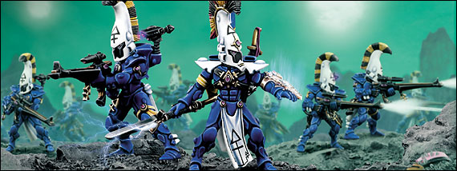
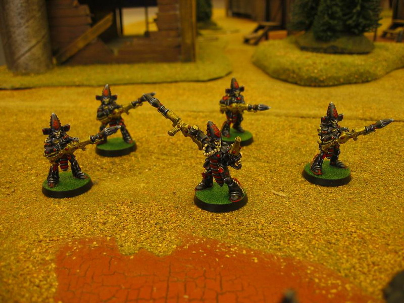
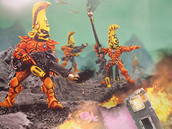
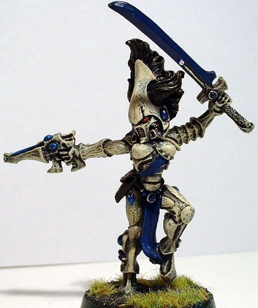
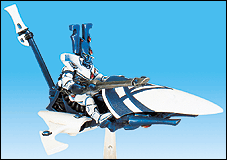
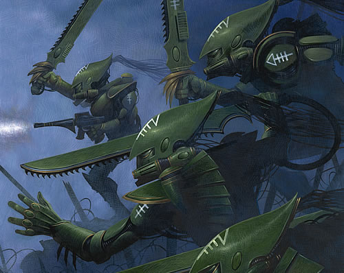
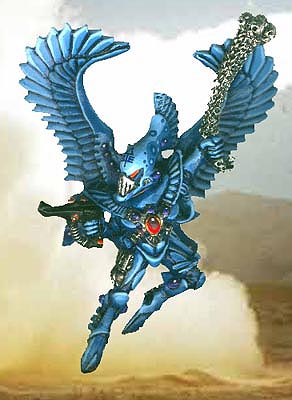
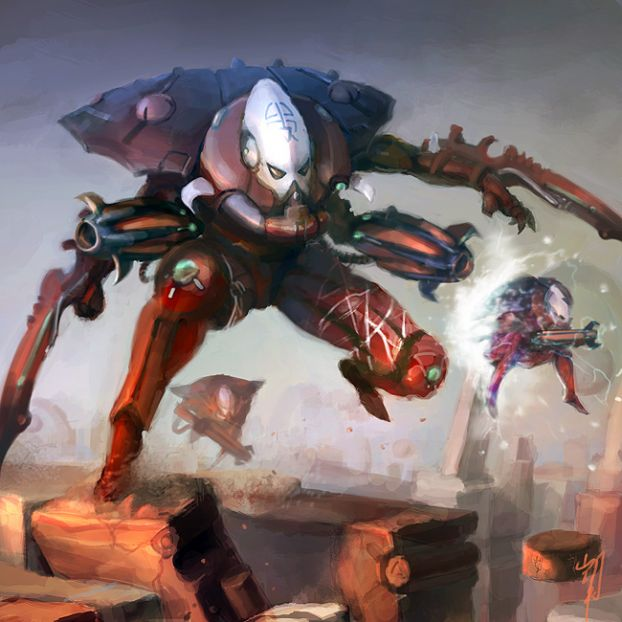
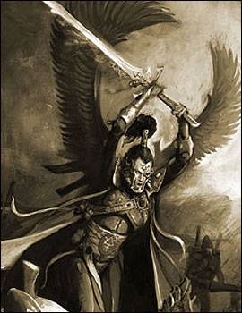

# ELDAR战士之道（Path of Warrior）

<H4>Path of Warrior:Aspects</H4>

嘉拉迪雅

似乎目前背景资料ELDAR的比较少…… 至少在战锤中文网翻的宝典里面就“神道无视” 正好平时从wiki上扒了不少东西，就翻译下资料里ELDAR的战士之道（Path of Warrior）里的各支派介绍罢（有WIKI的，也有宝典的） PS：如果火星了，就请处刑…… 再PS：本来想用宝典上的图的，但是不知道怎么一次性上传T T 凶暴复仇者（Dire Avengers） 

 凶暴复仇者是最古老和人数最多的支派，也包含着更传统的战争观。他们将Khaine看作高贵的战士。他们以装备精良的步兵加入战场，配备着艾达传统的武器，星镖射枪（Shuriken Catapult），虽然它们被强化了，比一般的星镖射枪射程更远。凶暴复仇者的主教（Exarch）可以配备一把恐剑（Diresword，灌注了一名艾达人的灵魂，当命中对手的时候，艾达人的灵魂就会尝试摧毁对方的意志）和一把星镖手枪来替代标准装备，或者一件微光护盾（Shimmersheild，注：一种光学防御装置）和能量武器来强化近战能力。凶暴复仇者的凤凰领主（Phoenix Lord）是Asurmen（注：凤凰领主是各个支派中最伟大的战士，通常也是该支派的创造者。他们的灵魂会附着在盔甲之上，一直流传下去，所以从某种意义来说，凤凰领主也是永生的），Asuryan之手。他是第一位凤凰领主；也是他教导其他被发现的凤凰领主战斗的技艺。凶暴复仇者通常被用作艾达军队的核心部队。许多凶暴复仇者在离开他们的神坛（Shrine）的时候也在长袍底下带着星镖，所以通常即使是空手的凶暴复仇者，也能轻易将敌人打倒（小李飞刀 ）。 黑色死神（Dark Reapers）  黑色死神们在他们的支派里把Khaine描绘成一个毁灭者，自远方便无情地击灭敌手。他们精于长程火力。在战斗中他们身着可怕的黑色装甲，携带着速射的小型导弹发射器“死神射筒（reaper launcher）”，用来摧毁大量的敌军步兵。黑色死神擅长消灭大规模的重装步兵；例如星际战士。黑色死神的主教通常配备导弹射筒或者暴风射筒（Tempest Launcher）。黑色死神的凤凰领主是灵魂收割者Maugan Ra，来自 Altansar 方舟世界（Craftworld），一个在他的帮助之下从恐惧之眼内部逃离的世界。 黑色死神的武装还包括了减少后坐力的支架，头盔上的高级扫描仪可以帮助他们锁定高速移动的目标，而且他们可以通过心灵链接从发射器的发射口观察。 火龙战士（Fire Dragons）  火龙战士，因艾达一族神秘的传说而命名（艾达神话中，龙是一种修长喷火，象征毁灭的动物……恩），为Khaine烈焰般的愤怒的具现，而且他们穿着红色或桔色的装甲，配带着短距离的热能武器“热熔枪（Fusion Gun）”（类似帝国的热熔枪，不过更精确和稳定）。他们的武器和训练使他们精于摧毁敌军的坦克和重装甲士兵，主教会装备一件强力的龙息火枪（Dragon's Breath Flamer），让他们可以轻易对付轻步兵。火龙战士的凤凰领主是燃烧之矛Fuegan。 火龙战士的热熔枪是很可怕的武器，可以将敌人分解成一团高温的蒸汽。而且为了弥补射程近的缺陷，火龙战士也会配备可以附着在任何表面的热熔炸弹，可以在一念之间引爆。 呼啸女妖（Howling Banshee）  呼啸女妖是一种多半由女性艾达战士组成的表现艾达传说精神的兵种，意味着带给敌人迅速的死亡。她们因其佩戴的会伴随战士的进攻而散发灌注灵能的尖啸的面具而文明；这种尖叫会让敌人胆寒，使他们更容易被打败。女妖精于机动（以耐久为代价），并且使用能量武器，可以轻易切开重装甲，甚至是终结者装甲。女妖主教配备更致命的镜刃（Mirror Blade，成对的能量武器，近战中非常致命）或者强大的处决者（Executioner，强力的双手能量武器，貌似俗称赶猪棒）。呼啸女妖的凤凰领主是静寂风暴Jain Zar。 在艾达的神话传说之中，丑陋的女神Morai-Heg，试图获得她圣血之中的智慧。而知道只有一个人可以伤害神灵，她让她的女儿（就是Banshee）以尖叫去骚扰Khaine（血手战神）。为了解除这样的诅咒，Khaine不得不答应Morai-Heg切开她的手，让她得以饮下她的血液。因此Morai-Heg得到了血的智慧，而Khaine获得了呼啸女妖支派作为回报。 闪耀之矛（Shining Spears）  闪耀之矛代表着Khaine的长矛，一件战神配带的无敌兵器。他们是独一无二的骑乘喷气机车的支派——喷气机车是一种摩托类型的运用类似反重力坦克技术的悬浮车辆。他们也配备特殊的长枪，激光长枪，可以射出强力短程激光的武器。因此，他们和中世纪的重装骑士很像。到目前为止，闪耀之矛的凤凰领主依然未知。 闪耀之矛和他们机车的连接使得他们能够轻易地完成高度复杂的机动，他们就像雷霆一般冲入敌阵，然后迅速离开。他们擅长连打带跑的战术，就像是殖民世界（Exodite World）的龙骑士一样，很少有敌人能够抵挡这样毁灭性的冲锋。 突击蝎（Striking Scorpions） 

 突击蝎是另一种擅长近战的支派武士，更为坚固而且擅长搏斗。他们比呼啸女妖迟缓，但是更为强壮，穿着厚重的装甲，类似星际战士。而且，不像女妖那样配带骇人的面具，他们配备着头盔搭载的“曼迪爆枪（mandiblaster，关于mandi，这个不认识……只好音译了）”；他们的头部装备空出手来使用另一件近战武器，通常是一把链锯剑，而主教通常使用蝎爪（Scorpion's Claw，一种能量爪，可以轻易装在手上或者配在一把星镖射枪的后部），一件啮咬剑（强力的带锯齿的武器，可以轻易撕裂装甲）或一对链锯刀。最后，他们精于消灭大量的轻步兵，而不是像呼啸女妖一样消灭重装甲步兵。突击蝎的凤凰领主是暗影猎手Karandras。 但是，Karandras不是原始的凤凰领主。原始的那一位叫Arhra，毒蝎之父，并且是唯一一个完全离开艾达和他的神坛的。许多理论将他和神秘的男魅魔（Incubi）的“黑暗之父（Dark Father）”连系起来，那是一个与突击蝎有许多相似之处的黑暗艾达战士教会。Arhra被认为“弃明投暗”，并且在发狂并摧毁了他第一个支派神坛后逃入了隧道网路（Webway，黑暗艾达居住的地方）。 在黑豆芽宝典之中，从主教Koradhil的记录上看来，男魅魔是“堕落”的突击蝎。 突击蝎在近战之中先发射一团尖针般的碎片，作为激光的引导物，然后再从头盔发射出高能的激光打击敌人。 翔鹰部队（Swooping Hawks）  翔鹰是一种高机动的支派，代表了古代艾达传说中的狩猎的鸟类。他们装备复杂的飞翼装备让他们进入战场的制胜点并提供火力支援。像女妖们一样，翔鹰们牺牲了防御来获得机动性。他们的激光枪让他们成为对付轻步兵（例如IG或者绿皮）的好手。同行值得注意的是，他们也装备了固定在腿上的设计巧妙的榴弹发射器，让他们在飞行的时候可以轰炸敌人。翔鹰通常装备缠丝手雷（Haywire Generade，一种用来瘫痪电子设备和能量系统的手雷）来瘫痪车辆而非反装甲。翔鹰的凤凰领主是风泣之Baharroth。 古代的艾达人相信被谋杀的艾达人的灵魂会进入飞鹰之中，盘旋在杀手的头上，因此飞鹰成为了审判罪行的象征。他们的飞翼由震动的羽型碟片和连在一起的小型反重力悬浮设备构成。他们飞行的速度之快让他们看起来像是一团模糊的色块。 次元蜘蛛（Warp Spiders）  次元蜘蛛以那些守卫无限轮回（Infinity Circuit，指艾达人死后灵魂从灵魂石进入方舟世界里的轮回，如此方可避免大敌的夺魂）的小型蜘蛛为原型。这些蜘蛛拥有在灵骨建筑里瞬间移动到任何地方，他们使用这种能力来狩猎叛徒和尝试污染轮回的恶魔实体。次元蜘蛛外表相似；他们穿着装备了战场瞬移设备的重装甲，突然袭击并在敌人反应过来之前撤离。使用亚空间跳跃技术很危险，因为艾达人可能被亚空间捕获，为了防范此情况，他们的装甲也装备了次元抵御咒文。因为他们的危险不只是其生命，而且是他们的灵魂。次元蜘蛛被认为是支派战士中最勇敢的一种。在战斗之中，他们装备了短距的“织亡者”（Deathspinner，一种喷射高温金属细丝网的武器，被网住的敌人就等会被钉在地上化成肉泥……）”，能够轻易消灭步兵，特别是轻甲或者无甲的，因为死亡编织者发射一团单纤维的网，经过压缩并可以在射出后依靠本身弹性展开以切开血肉，但是容易被盔甲阻隔。现时也没有关于次元蜘蛛的凤凰灵族的信息，因为此支派还是很新的。 次元蜘蛛的主教通常是在身后从腰部伸出两把射速更慢但是穿透力更大的织网枪（Spinneret Rifle），而且双手装备一对的能量刃。 ============主教Exarch============= 在战士之道上失落的艾达人就成为了主教。因为艾达人的敏感，所以在战斗中他们通常会产生一种强烈的兴奋，这对于他们而言是毒品。支派战士们都会接受训练来控制这样的快感，以控制自己的战士自我。而当一个支派战士迷失了自我的时候，他将无法再控制自己的战士人格。这是很严重的后果，因为他将只专注于发动战争，其他的感受仅仅是他们致命天性中几乎可以忽略的部分。 主教们是血手战神和支派战士神坛的看护者。主教平时不离开神坛，除非是战争期间或者至高密会。即使是最小的神坛，也是很巨大的，包括了众多的训练区，教导区和仪式区。每个神坛都有自己的军械库，和自己的圣地——是主教们在血手之神的祭坛前执行战争仪式的地方。那也是主教们诵唱古老的战歌和在战士们着装战斗前为他们画上血之神符的所在。如此主教们既是战神的祭司，也是重装的士兵和战士之道的导师。 主教们通常配备古老而精致的战甲。他们以神秘的战斗装备来强化他们那超人的战技，同时也戴上了过去曾经使用这些装备的主教的灵魂。每一个主教都会被冠上与这件装备相连的圣名，且他的灵魂将混合那些从神坛起初就穿着这件装备的艾达先民的灵魂。因此一个成为主教的艾达人就是古代英雄的重生。先代主教的记忆和经验将传给下一代的主教，而他们崇高的理想也因此而代代流传。 主教们的技艺比战士中最强大的还要高超，也正是那些灵魂中原始的灵能力量连接了主教和他们的装甲，给予他们超凡入圣的战技。 ===========邪恶的分割线，战之道的妖孽================ 司战者（Autarch） 

 司战者（统帅之道）是一条严苛的道路（Path，艾达人为了避免陷入过去的堕落而在生命之中都要行走在道路之上，如此可以自律戒除堕落并为民族贡献力量，道路类似于职业，灵族人一生里可能经历许多的道路。而且每一条道都有完全抓攫灵族人灵魂的危险，使他们终生只能在某一条道路上行走到底，这通常是因为灵族人过于专注在某条道路上所致。这称之为“迷失lost”，比较著名的迷失就是成为各种支派战士的主教Exarch，或者成为预见者之道中的先知Farseer）。成为一个司战者需要在战士之道上行走过许多支派道路，并且还能够保持清醒而没有迷失成为主教。司战者（异常难以行走的道路）是军队的指挥官，并且可以运用广泛的战斗装备，反映了他/她在所有支派武器上的造诣。他们几乎可以运用所有支派的战斗装备，除了那些专门为主教保留的之外。 著名的司战者如Yriel，Iyanden的前舰队指挥官，在Iyanden保卫战最后关头拯救了这个方舟世界的海盗王子。 ============邪恶的分割线================== Eldar各Path简介 预见之道，又叫巫术之道（Path of the Seer，Witch Path）：最漫长最艰险最复杂的道路，也是最罕有人行走的。它的成员是使用灵能的先觉者（Seer）。灵魂先知（Spiritseer）们是专精于操作灵魂石来引导死灵护卫（Wraithguard）和亡魂领主（Wraithlord）的。战灵者（Warlock）是曾经行走在战士之道上，而今行走预见之道的人，他们也是艾达军队的指挥阶层。先知是在预见之道上迷失之人，而且也是艾达一族最强大的灵能者。据传说很多先知随着技艺的精进，身体会逐渐晶体化，最后成为传说中的水晶先知。他们通常会在方舟世界的林地里化作水晶般的树木，只余一张人形的水晶脸。他们的灵魂游走在世界里面，保护方舟世界不受侵害。 战士之道（Path of the Warrior）：由支派战士组成的道路，是艾达军队的主力。那些迷失在战士之道的人成为主教。最广为人知的支派是凶暴复仇者，呼啸女妖，突击蝎，火龙战士，翔鹰战士，黑色死神和次元蜘蛛。也有几个较小的已知支派，甚至有些只属于某个方舟世界。其中著名的入闪耀之矛，又称作飞鹰驭者（Eagle Pilot），乃是艾达一族的战机驾驶员。 我们必须知道，守护者完全不是这条道路的。他们是遵循其他日常道路，在战时被方舟世界紧急征召来渡过危机的部队。 统帅之道（Path of Command）：艾达灵族之中热衷于军事指挥和战略战术的人就会走上统帅之道，其成员成为司战者。要行走在此道路上，一个艾达人必须先完成数门战士之道的修行。 工匠之道（Path of the Artisan）：最普遍的道路，负责制作武器、艺术品、舰船等。许多艾达人一生之中都会行走过这条道路。而其中比较著名专业人士为吟骨者（Bonesinger），操控灵骨生长，维护灵骨制造的设施的人。据说吟骨者们的音乐非常刺耳可怕，导致听到的人余生都会感到恐怖。 航行之道（Path of the Mariner）：艾达星舰舰组成员们所行走的道路。 水晶先知（Crystal Seer）和阴冥诗人（Bards of Twilight）是在未知的道路上迷失的人的称呼。 流浪之道（Path of the Outcast）：有时那些年轻而缺乏经验或者蒙羞的艾达人会离开他们的方舟世界在群星之间漫游。因此他们离开了道路的保护而经历一段异常危险的时间。这段历程有时被称作“流浪之道”，漫游之道（Path of Wandering），或诅咒之道（Path of Damnation），但是这些名字都是错误的，因为这些艾达人已经完全在道路之外。 很多人在此期间成为游骑兵（Ranger，或者叫游侠）。有些人会回归方舟世界并踏上安全的道路。那些因某些原因无法回归的，都会成为寻路人（Pathfinder）。 其他的流浪者包括海盗、掠袭者和私掠海盗。 流浪之道之所以危险，是因为他们在方舟世界以外的时候，艾达人本身的灵能天赋让他们散发出对恶魔等亚空间生物强烈的吸引力。许多艾达人都在流浪的时候被恶魔所吞噬了，所以某种意义上讲流浪是对心灵最困难的试炼。Prince Yriel也当过很长一段时间的流浪者（在Iyanden保卫战前50年，以及战后离开的那段时间），他的海盗团也成为了宇宙中最大的艾达海盗集团。
