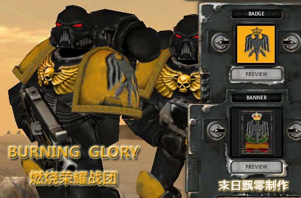

# [自设定战团]Burning Glory（详尽附图）

[自设定战团]Burning Glory（详尽附图）

末日飘零

首先必须说明几点：

１、以下纯属虚构，绝无雷同，没有巧合！请新人注意，纯属ＹＹ，切莫当真！

２、由于知识及时间所限，草成版本，看过一笑了之，不必过于计较。

３、如效果良好，将考虑进一步加工及添加更丰富内容。

４、如有转贴，还望注明，虽是拙作，亦是劳动成果。

————————————————————————————————————————————————————

Index Astart: Burning Glory

炽炎烧尽污秽，洗涤世界，净化人心。

——战团导师：鲁西法·依格努斯(Lucifer·Ignus)

如其名，燃烧荣耀（Burning Glory）战团视荣誉与纯洁为真理，尊重知识，他们如火焰般席卷一切。他们光明、正直、充满智慧，这为战团赢得了许多人的好感，不管这是出于无意抑或是有意为之，都为他们争取到很有力的外部支持，因而在大多数的战役中，他们都拥有优势的战略环境。由于战团的特点，他们的行动往往考虑许多因素，从行动的政治、战略后果等各方面都进行了详尽的调查、分析才制定行动计划，并尽可能使得计划准确的被执行。

起源·Origin

战团建立之初的情形早已湮没在历史中，对于一只年轻的战团来说，这种情况并不多见。但他们并不为此而迷惑，正如战团智库吉恩·维兹逖（Gene·Ｗiztim）所言：若每个人都执著于自己的来处，谁来照看我们的去处？不管怎样，从其他战团及有过接触的各势力所反映的资料来看，能被证实的事情是，在第３７个千年（有些说法要更早些，但没有明显的证据支持）燃烧荣耀之名已经活跃在对抗帝皇的敌人的各个战场。

战团不知道他们源于哪个基因原体，但这不是迷惑的理由。他们的血液中流淌着对帝皇的无限忠诚，他们在思想的疆域里探索人类的精神财富，他们睿智、审慎却绝不缺乏勇气，最重要的是，他们看重兄弟的生命，并极端仇恨混沌及他们的爪牙！这些或许都是战团导师鲁西法·依格努斯(Lucifer·Ignus)在经历了被战团后世称为“变革时代(TIMES)”的那段历史后，留给燃烧荣耀的宝贵财富。

据有些传说表明，战团在变革时代之前过份执着于对知识的寻求，甚至与偏执，如此间接的影响的战团的成员，使得他们总是满怀理想主义的情愫，对荣誉，对敌人，甚至对战斗都带着太多天真浪漫的想法。这样的作战风格在面对狡诈的混沌势力是致命的，这也直接导致那场灾难。经历过变革时代的他们，更懂得知识不仅是一种思想，更是一种武器。由于他们掌握众多的知识，并天生光明亲和的气质，获得很多势力的亲睐。也许从另一方面说，他们变得更现实，更善于利用手中的筹码。同时他们利用自己掌握的知识，丰富了战团战略战术，并由于崇尚知识、鼓励思考之风，作战时也广纳良策，几乎等于有重多的参谋随军，为每次战役的胜利做出巨大的贡献。

燃烧荣耀拥有详尽的各类知识档案库，并且热衷于与其他战团或机构交换各自的资料，尤其是与血鸦与审判庭等机构有密切的往来。有些人猜测，燃烧荣耀或许与血鸦有着共同的起源，而有些人指出他们彼此只是志同道合罢了。另外的一些传言指出，变革时代是时，燃烧荣耀与审判庭间曾达成过一些协议，又或者是发生了其他的什么，但没有明显的证据证明之。

●变革时代·TIMES

陨石之战

历史的洪流的滚动也许只因滴水。在第３８个千年后期，燃烧荣耀一边探寻失落的知识，一边不断的与混沌或其他任何帝皇之敌战斗。是时，在帝国西部星域卡迪亚（Cadia）与贝里斯考戎纳(Belis Corona)之间的一个陨石带，一只战团的探索队找到一处神秘的遗迹，遗迹处于陨石带的一颗超大陨星之上，领队的智库和其他灵能者都感到遗迹之地强大的灵能波动，出于对获取知识强烈的渴望，他们在向此时正在卡迪安之门附近的总部发送情报以后立即着手进行探索。这本是一次常规的科学考察，但在于探索队失去联系后事情就变得复杂起来。首先是卡迪安之门附近开始频繁出现混沌爪牙的袭击，而后，几个同远方探索队进行精神联系的灵能者被怀疑遭混沌腐蚀。数周之后，恐惧之眼内席卷而来的亚空间风暴对冲击整个战团。尽管如此没有什么能阻挡帝皇的战士，燃烧荣耀在鲁西法·依格努斯领导下，来到遗迹之处，他发现了或者说掌握了什么已经无从得知，后世所能知道的是，燃烧荣耀与混沌爪牙展开了一系列战斗，由于情势突然且低估了敌人的数量与狡诈，战役初期战团遭受了巨大的损失。在战役持续到第三天时，战团指挥部遭到混沌手足部队的突袭，由于前期作战失利，指挥部附近实际上只有一个预备连队及侦察连队的兵力。在第八连队决定牺牲以掩护其他人撤退，因为战团不能承受失去整个指挥部的巨大损失，指挥部刚撤离不久，第八连队犹如命中注定般，得到从天而降的一只部队的帮助，这队身着白色动力盔甲的星际战士加入了第八连队，共同抵御数倍于己的敌人。这里的战斗持续了很久，碎石，碎甲，破碎的武器和肢体四散，其中很多已被暗红的鲜血所覆盖。

英雄连队

在燃烧荣耀战团，除加强班以外有两个连队的盔甲上涂装了英雄连队徽章。其一是同增援而来的灰骑士部队共同抵御混沌而结成深厚情谊的战团第八突击连队，他们中很少有人幸存。而另一只英雄连队则是侦查连队。当时，战团指挥部在撤离突袭区域往安全地点撤离的过程中，第二次遭到混沌军团的阻击。尽管敌人数量庞大，但这个区域地形较为复杂，并不容易展开优势兵力发动攻击，但是第八突击连队的情况不明，背面何时会被突破很难预计，于是当时指挥部决定以侦查连的狙击埋伏吸引敌人主力，阻止敌军前进，同时打击敌军的士气，与此同时，指挥部人员，迅速脱离战斗，从绕过敌军侧翼尽速与其他作战连队汇合。他们的精确致命的射击在复杂狭窄的环境下，发挥出意想不到的作用，敌人死伤惨重，士气完全溃败。正当他们庆幸将圆满的完成任务之时，暴戾而无畏的恐虐狂徒发动了全面扫荡，他们中没有人活下来，但后来的侦查连队却一直以他们为荣，并以此自勉。

知识的代价

敌人对指挥部的疯狂打击一方面由于鲁西法掌握的秘密的价值，另一方面也反映出混沌力量在此处的无力，他们想尽快结束战斗。指挥部安全转移之后获知了此事波及较大，一开始已引起兄弟战团及审判庭的注意，而实际上无论什么原因，真正到达支援的除了此前的一支灰骑士部队以外，只有血鸦战团的一些连队。但随着战事的持续，混沌的力量越来越力不从心，在双方都付出巨大的代价之后，燃烧荣耀最后取得的胜利，打退了所有的混沌爪牙。一位审判官被秘密派遣到此，而后的一切都已成为秘密，相关的资料也已被无限期的封存。燃烧荣耀战团在这次战役中，受到了致命的打击，甚至几近覆灭，但在帝皇的庇佑之下得以存续，得以思考知识真正的重量及代价。

母星·Home World

燃烧荣耀没有明确而唯一的母星。出于和血鸦一样的状况，是否是由于母星的资料从他们的历史中删去了还是别的某些更加黑暗的原因就不得而知了。他们的战团修道院就在名为Infinity Arcanum的强大的战斗母舰上，就如同它的护航舰一样，战团的其余部分也都在攻击巡洋舰和战斗母舰之上。

没有固定的军事基地并没有影响燃烧荣耀的发展，相反的，这使得战团的知识构成更为丰富，并使得他们无论必须面对何种环境，都有相应的经验去面对。

战斗条例·Combat Doctrine

燃烧荣耀喜欢详尽而全面的战前研究，对于战事的起因、发展及影响都做出调查和分析。尽可能搜集敌人个方面的情况，找出弱点，发动全面进攻。燃烧荣耀典型的作战方式是先通过轨道轰炸、召唤友军炮击（如果有的话）全方位打击敌军士气，同时利用战机等配合侦查部队定点拔除的敌军的关键据点及部队，然后从敌方战线弱点开始发动全面攻击。

在作战中，燃烧荣耀偏好使用火焰喷射器，爆矢交叉火力及准确的狙击打击敌军的士气，从而收到事半功倍的效果。这样的作战方式出于他们对战团兄弟的保护，在准确完成作战任务的前提下，零伤亡是他们追求的目标，尽管这很难。

组织结构·Organisation

燃烧荣耀基本遵守的阿斯塔特圣典里的组织条例，战团官方声称他们有１０个连，但人数可能要超过１０００人的标准，有些资料反馈出这个超过的部分可能远不止他们声称的那些。这１０个连除了第一连及第１０连（Scout侦察连）以外２、３、４、５为战斗连(Battle Companies)，６、７、８、９为预备连（Reserve Companies），都配备相应的高速运输工具。其中６、７连含１０个战术班，而８连、９连则分别为突击和火力连。

除了这些官方数据以外，有可靠的资料表明，战团还有１个加强班的编制，这个班着白色动力盔甲，装备STORM BOLTER、Nemesis Force Halberd或Nemesis Force Sword，有人说他们其实就是审判庭派驻给燃烧荣耀的灰骑士——这样的说法可能太浮于表面。据说加强班的所有队员都来自于英雄连队第８连队的精英，至于装备着灰骑士的动力盔甲与武器则是为了纪念在变革时代中战团与一只灰骑士队伍之间的情谊。也有人说，加强班的队伍中有当时幸存的８连战士甚至灰骑士，更有传言表明，加强班的队长其实就是当时的灰骑士队长。不管怎样，考虑到审判庭对燃烧荣耀的信任，或许将之当作是一只独立的灰骑士部队也未尝不可。

作为英雄连队的侦察连，尽管都是一些基因改造过程中的战士，但他们都反映出其他战团侦察并所罕见的高士气及素质，对于隐蔽及精确而致命的射击有着易于常人的理解和控制力。燃烧荣耀的侦察班在很多行动中常会携带火炮定位装置，在渗透或支援作战中常常可以精确定位炮火打击。

另外有些资料反映战团可能还拥有一支独立的装甲与火炮连队，这种可能性颇高。结合实际战例中炮火支援及装甲作战的情况来看，这种可能性颇高。

值得注意的是，出于对知识的热爱，燃烧荣耀与血鸦一样都拥有高比例的智库馆员，在各阶层中都有高比例的灵能者。不过与血鸦不同的是，燃烧荣耀关注的知识范围更为广泛，而在禁断知识的研究上不及血鸦的水平，这似乎是战团导师有意为之。

信仰·Beliefs

总体上看，燃烧荣耀并不关注是否认为帝皇是神这个问题，战团导师鲁西法·依格努斯和智库导师吉恩·维兹逖对这个问题并无明确的表态。战团里多数人的观点认为帝皇至少是最强大的人类，因为他一直守护着人类，领导着人类，但不否认也许他超越了现世人类的能力极限。由于态度模糊且战团较为成功的外交手段，使得与帝国教会并无太大嫌隙，与机械神教等势力关系更为友好。实际上，有人说战团导师依格努斯与智库导师维兹逖在变革时代所阻止并了解的事情，已经远远超过其他人认识的信仰本身。

尽管如此战团牧师在燃烧荣耀里依然受到大家的尊敬和信任，因为为帝皇尽忠，消灭帝皇之敌的心情与信仰无关，且牧师们总是与战团战士一同奋战在帝皇需要的地方！

基因种子·Gene-seed

相对于战团高比例的灵能者现状，燃烧荣耀战团的基因种子还是比较稳定的。有变异迹象的基因个体很少，并且没有明显的证据表明是由任何已知的原因所引起的。

许多人对燃烧荣耀的创建之初的基因来源，有过一些猜测，其中对来源自暗鸦守卫（Raven Guard）的猜测最为普遍，当然这主要立足于燃烧荣耀战团的动力盔甲涂装主要以黑色为主，而说到徽记是皇冠凤凰同是鸟类则太过于儿戏。因而实际上，并没有任何较为令人信服的来源证明。这件事连燃烧荣耀代代相传的记录档案中亦完全未有提及，至少时至今日已无书面记载。所有人都相信，这样的情况，至少意味着，曾经有过很重要的原因，使那些记录被人为的销毁了。而对于战团内部而言，他们并不特别执着于寻求自己的来源。

战吼·Battlecry

Feel my wrath！ 怒了！

Burn！ 烧之！

Activity is the only road to knowledge .

惟行可求知！
