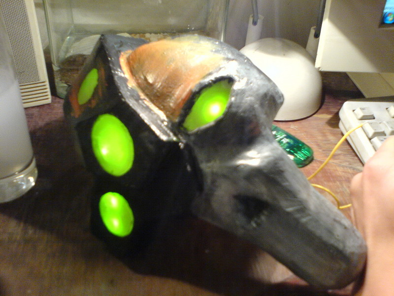
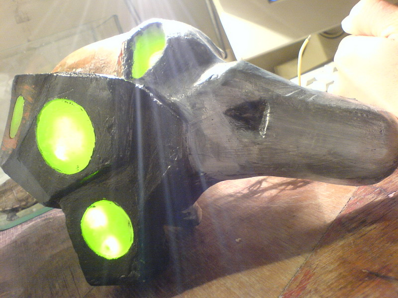
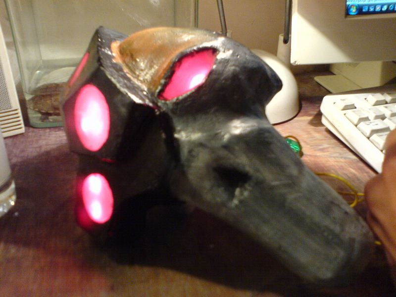
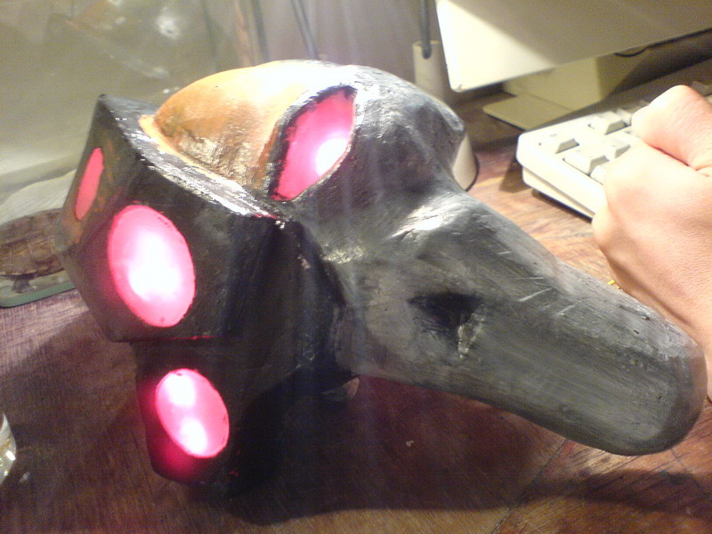

# 我做的宇宙骷髅

我做的宇宙骷髅

701263

蜡做的蜡半热状态下是软的!.用丙烯颜料上色...呵呵不过已经做好风尘很久叻....现在献出给大家欣赏..........有双色LED灯的.....后悔不装蓝色LED

暴走天使

楼主，你要小心帝国军队中有这么一条不成文的规矩：永远不要把太空骷髅带回自己的住所，即使碎片也不行，因为你不知道他们什么时候会活过来。。。。。。有很多火星的机械教牧师，就是因为把骷髅的碎片带回去研究，结果不明不白的去了我个人很担心楼主的生命安全。。。。。。

kobe2me 

 
