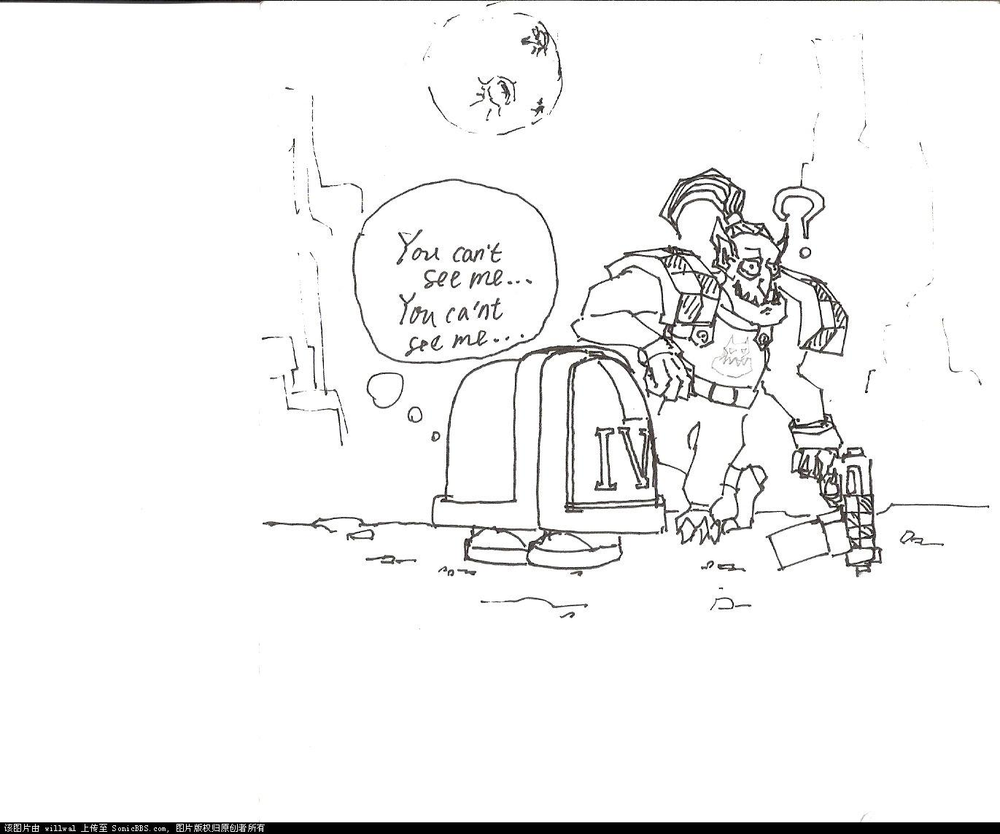

# 为什么sm肩甲这么夸张

为什么sm肩甲这么夸张

willwal

为什么sm肩甲这么夸张?这是我第一次接触这些猛人时就开始感兴趣的问题.....

想了很久之后,终于在一次熬夜上自习的时候想出了下面这个答案:

CZ75

哈哈哈哈太有意思了，表扬一个，希望今后能多画几张。

其实我觉得SM肩甲设计成那样很大程度是为了偷懒，这样可以免去制作上臂的很多细节部分，省了很多活。

红莲法师

楼主太有才了

苏联红军政委

油菜……

Imlixinyu

大能啊

Z_xb

太有才了！！！

据说是为了防护，而且大的弧度可以跳弹

BTXP

肩部是重要防护部位,现实中子弹破片从腋下进入是致命的
