# 帝国装甲 [Imperial Armour]之Eldar的装甲单位2.24更新

帝国装甲 [Imperial Armour]之Eldar的装甲单位2.24更新

Sanguinius为了头衔，我要精华，所以BZ，给个精华鼓励一下吧说明一下，我下的这个帝国装甲专题里只有一部分Elder的装甲单位，不多，哪位有全的，传给我，谢谢另外，很多地方我可能都翻译的不准确，望达人指点。1.曲蛇坦克（wave serpent第一个就不知道怎么翻好）长：11.25m宽：3.62m翼展：7.31m重量（估计）：10吨（似乎很轻）炮管长（barrel length，不知道这么翻对不对）：此例：2.5m装甲：10~15mm，材质未知战斗速度：80kph最大速度（估计）：320kph成员：1（驾驶）运载容量：10名步兵武装：可变，此例中使用了双联闪矛炮和双联星镖炮主炮弹药：估计由能量匣供能，4000发，其它变种未知Lieutenant Shtava 的日记，第187Valhallan团：Colonel Letchev死后第3天，异星人（应该指Eldar）开始攻击后的第5天我们连已经减员至60人，防线也越来越薄。团里其它部队的已经撤退到新位置，留下我们殿后。我们的坚守，完全依赖于地动炮阵地和散落在阵地前方的异星人的尸体。两波步兵的进攻已经被勉强击退。Colonel Letchev死后第4天，我们的煎熬开始后第5天异星人再次发起了攻击，我们的阵地被夺。这次他们用一种快速滑行的载具来发动攻击。我们再次呼叫了地动炮支援，炮弹对他们似乎无效。他们的突击由一堵能反射掉所有弹片并打乱枪手目标的能量墙推进。由于力场的作用，我们无法瞄准任何目标，直到其碾碎我们的战壕。（后面还有一小段是破碎的，大概就是说他们要被灭了）帝王拯救我们的灵魂（The Emperor save our souls）

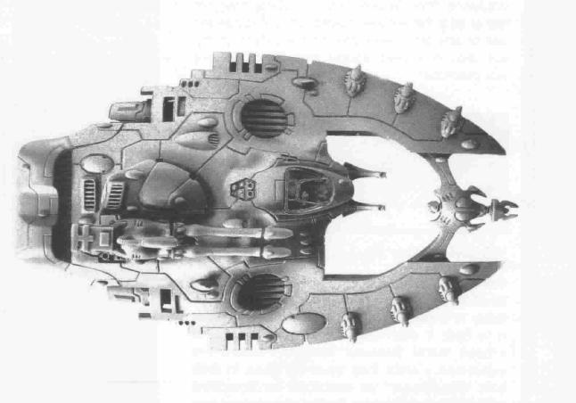

2.Night Spinner坦克（夜晚纺纱工？）长：11.25m高：5.62m翼展：7.31m重量（估计）：11.5吨炮身长：5.3m装甲：10~15mm，材质未知战斗速度：80kph最大速度（估计）：290kph成员：驾驶员 1，炮手 1武装：两门night spinner炮，双联装星镖炮主武装弹药：估计200轮，未经确定。我可以确定的是，像焰晶和Wave Serpent一样，Night Spinner是更常见的猎鹰坦克的一种特别发展型。战场报告说明，Night Spinner能为快速打击的Eldar部队提供长距离的火力支援。这种车辆的武器将一团细丝状的网射入空中，然后浮动到目标上空。这种网的细丝能割开装甲，并把任何被它捕捉到的目标切的支离破碎。此种攻击的破坏效果使得对Night Spinner的协同反击比较困难。我注意到相比一般的常规攻击方式我们的士兵更加畏惧这种网状武器的攻击效果。值得注意的是，这种细丝网通常意味着Eldar攻击的开始，先用其从远距离进行火力压制，然后Eldar的步兵跟进扫荡。这种神秘而又恐怖的技术同样运用于Shadow Weaver上，但是Night Spinner的武器从大小和威力上都要强很多今天暂时到这，明天继续。

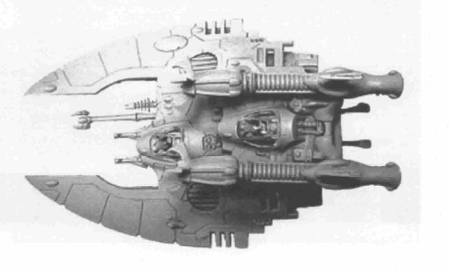

今天继续，Eldar的两大NB装甲单位隆重登场3.蝎子坦克长：18.43米高：6.8米翼展：10.31米重量（估计）：70吨炮身长：10.31m装甲：10~15mm，材质未知战斗速度：60kph最大速度（估计）：280kph成员：驾驶员 1，炮手 1武装：双联脉冲炮、闪矛炮主炮弹药：估计2000发，未经确定Eldar视蝎子坦克为Engine of Vaul（Vaul的引擎？不懂。。。），这个名字本身的含义并不清楚，但相信是参考了异星人（Eldar）的某位神。蝎子超重型反重力坦克基本上是最大的反重力车辆。其同时具有精密而又强大的武器和我们（帝国）的超重型坦克所不能比的操作性。它们是独一无二的火力和速度的结合。相比于蝎子优雅的（“优雅的”是我自己加的）“滑入”战场，Eldar人认为帝国和Orks的巨型机械即粗糙又笨拙。蝎子车体本身的抗打击能力并不强，防御主要依赖于它的速度、操作性能以及holo力场（holo--field）的神秘力量。holo力场制造幻像来规避直接命中。holo力场制造一个移动中的蝎子的幻象。肉眼看起来holo力场就像突然出现的五颜六色的涡流。炮手们报告说，很难瞄准一个由holo力场保护的目标，不知道该从哪个角度射击，也不知道能否命中。即使是最受祝福的寻的和追踪仪器也会被这种破坏性的能量所蒙蔽。蝎子的脉冲炮是一种巨型武器，技术原理和闪矛炮类似，但尺寸上是后者的4~5倍。经证明，脉冲炮的每一击都能击穿最厚重的装甲，将Leman Russ坦克撕成两截，并能一炮就毁掉一座建筑物。受帝皇祝福的装甲指挥官们都畏惧这种武器，并给它起了很多绰号，比如造坟者、死亡之橇。这种恐怖的火力在蝎子高级的传感和寻的装置帮助下更加强大。即使是在高速飞行，或是仅从掩体中探出一瞬间，蝎子都能锁定目标并以致命的精度开火。Eldar经常用蝎子作为倾力进攻的矛头，，特别是进攻重点部防区，需要用它的脉冲炮来消灭堡垒和坚固目标的时候。同时还能作为快速打击部队的远程火力支援,在Eldar的部队进攻前从远距离就消灭掉有威胁的目标。Albo Bede（一个想法：我要重蝎！！！）

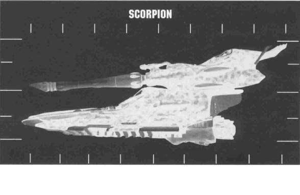

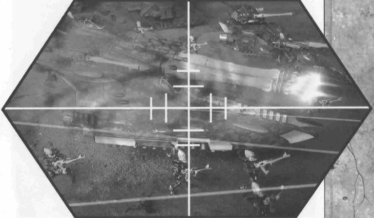

4.眼镜蛇坦克长：18.43米高：6.8米翼展：10.31米重量（估计）：70吨装甲：12~15mm，材质未知战斗速度：60kph最大速度（估计）：280kph成员：驾驶员 1，炮手 1武装：绕曲加农炮主炮弹药：未知蝎子重型坦克的姐妹型号（也是经我研究确认的两个Engine of Vaul中的另一个）是眼镜蛇重型坦克。眼镜蛇重型反重力悬浮坦克和蝎子使用的是同一底盘，并经由我研究发现两者也是同一种反重力引擎。像它们的近亲----猎鹰坦克及其发展型一样，眼镜蛇是不同武器适用的一种发展。正如我估计的，眼镜蛇车体本身的防御力由于其装甲厚度并不高，它的主要防御手段同样依赖于速度、操控性以及holo力场。眼镜蛇的主要神秘之处在于它的巨型绕曲加农炮的技术.我已经派遣了一个搜寻小组去最近的Eldar的战斗区域找回一台战损的眼睛蛇以供我日后研究使用。绕曲加农炮背后亵渎的技术能够将时间和空间扯开一个洞，用恐怖的毁灭性的力量将实体卷入虚空之中。这就是Eldar寻求的使大敌（Great Enemy  沙厉士？）的力量转而攻击它自己和任何阻挡Eldar道路的不可逆转的神罚。战场报告说它能将一个实体完全撕碎，片甲不留。被绕曲加农炮直接命中即使对最大级的泰坦或其它战争机器来说都是灾难性的,它能轻松就瓦解装甲、内部结构以及成员，将机魂拖入另一个世界（Otherworld，这里用了大写，应该是有专门的含义，达人指点）。虚空盾（void shield是不是虚空盾？我猜的）也无法防御（这种武器）。信仰是我们唯一的防盾。由于这种毁灭性的力量，我相信Eldar会部署这些武器来摧毁他们的敌人的战争机器。眼镜蛇没有携带其它任何武器以及步兵单位，因为它在战场上的任务只有一个：那就是切入敌军，靠近敌人的战争机器，然后释放毁灭的力量。Albo Bede 

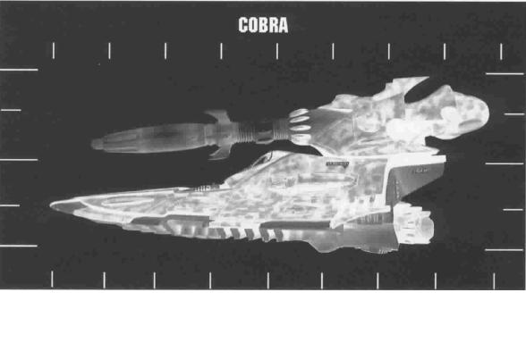

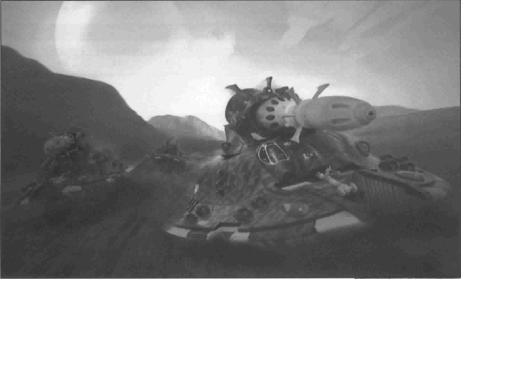

由于本人懒惰而且还在别处挖一个更大的坑，所以有些天没更新了，抱歉。今天是Eldar的空中部队5.夜翼战机长：12m高：4.37m翼展：15.43m重量（估计）：5吨，空载装甲：5~10mm，材质未知最大记录速度：3200kph----收翼2900kph----展翼成员：1 驾驶员武装：双联装闪矛炮，双联装长管星镖加农炮主炮弹药：未知有效荷载：未知

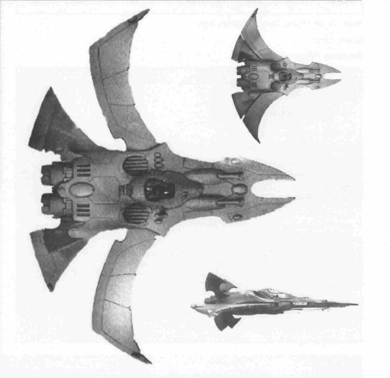

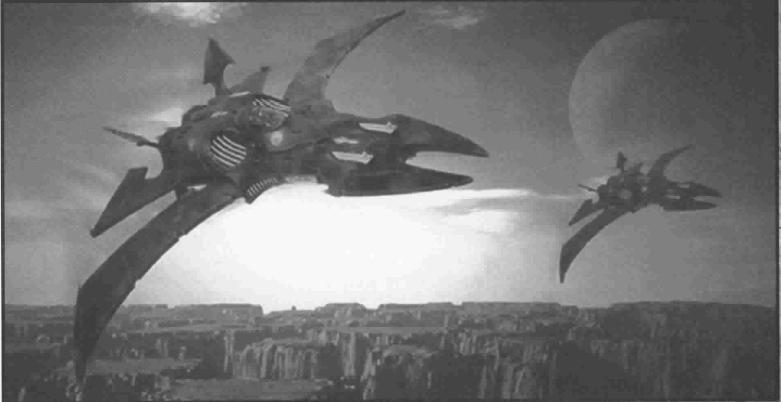6.

吸血鬼突袭者长：26m高：7.1m翼展：13.2m重量（估计）：56吨装甲：8~10mm，材质未知最大记录速度：3200kph成员：驾驶员 1，航法士 1武装：2x双联装闪矛脉冲激光炮，1x扩散激光炮主武装弹药：未知有效荷载：未知当帝国将Eldar卷入战火时，Eldar最强大的威胁之一就是他们的空中力量。由于Eldar反重力技术上的不对称优势，意味着他们的飞行器比我们的要更快、更灵活。从夜翼截击机到巨大的吸血鬼突袭者运输机，在至关重要的空中战场，Eldar拥有明显的优势。我的研究表明，Eldar的海盗（黑暗Eldar？）最喜欢的就是吸血鬼突袭者，因为它能轻松突入大气层。数倍于音速的速度，以及如捕食中的鸟雀一样的灵活性使得其即使没有通常的夜翼战机护航，也能充分的保护自己。跟夜翼一样，吸血鬼突袭者是大气层内外两栖的。突袭者一般作为从轨道上的星际战舰运送Eldar突击部队的主要运输工具。未经确认的战场报告指出吸血鬼突袭者也换装不同的武器，用于对地攻击。我曾听说吸血鬼突袭者装载着大型中置激光炮和导弹。

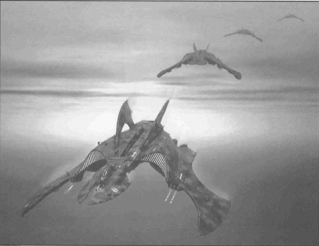

drydry

来了兴趣，在FW查阅了VR的资料，发现。。这真是个大东西！

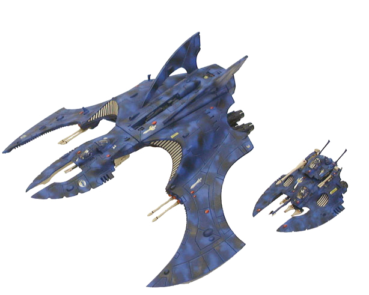火鹰一比变成渣了。。

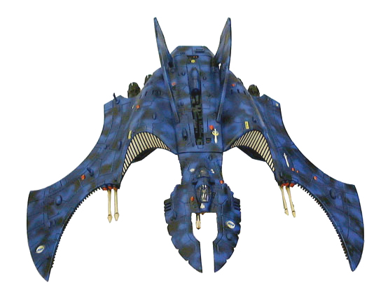

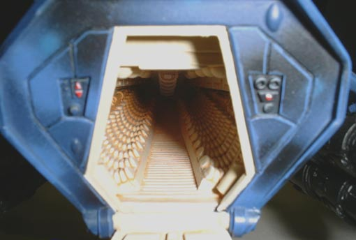坐椅截面圆圆的，不留神会滑到两边来。。。

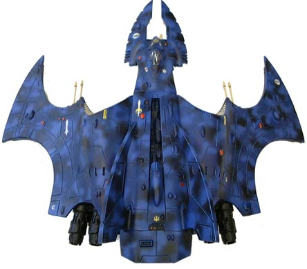漂亮的翅膀轮廓关于eldar海盗，这词大概是帝国对于来去无踪的eldar掠袭者的畏称，无论是eldar还是darkeldar，战术是几乎一样的打了就跑，但是de可能会做出停留，掠夺物资和俘虏生还者，因为他们是蓄奴的。。。eldar估计不会为了破坏装备/寻找情报以外的事情停留。还有navigator这个词可以直接译作导航员，“航法士”这个词是不是稍显生涩了点？还是楼主想措词形容下eldar和人类的不同？^_^
