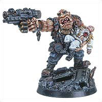
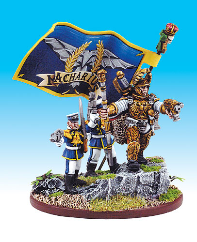

# [官方]帝国英雄——帝国卫军特殊人物

[官方]帝国英雄——帝国卫军特殊人物

BrazenMKK好吧这些天都虚度在做锤子棋上了，我有罪。这是GW主页上的人物介绍。诺克·迪道格

巨人向着伤痕累累躺卧在地的葛瑞斯上校蹒跚走去，老上校在运兵车失控倾覆时幸运的被甩了出去。肇事的奇美拉现在底盘朝天翻在一条排污沟里，蒸汽和浓烟从载员舱中滚滚而出。爆炸的气浪将葛瑞斯掀进了另一侧的壕沟。硕大的欧革林走到他的小小的长官身边，意识到后者受伤严重。他盯着那些扭曲的肋骨和浸血的制服看了一阵，轻轻碰了碰了老人想搞清楚这是不是一个玩笑。葛瑞斯痛苦的呻吟起来。诺克只觉得一阵痛苦堵满了他巨大坚定的心：葛瑞斯是诺克的朋友，葛瑞斯对诺克很好，葛瑞斯带着诺克打仗。欧革林人摸出他的水壶，笨拙的拔掉塞子，小心地把壶嘴凑近上校的嘴边。清凉的水流了葛瑞斯一脸，“诺克”，上校低声说：“别再继续灌我了，去拿医疗箱来。”“准命，长官！”诺克大叫一声，本能的先用左手，又用右手，最后同时用两只手敬了一通礼。诺克高一脚低一脚的向运兵车跑去，趟过车组和指挥小队成员残缺不全的尸体，自己腿上传来的刺痛让他略微分心，许多弹片撕破并嵌进了那里结实的厚皮。他不假思索的抓住奇美拉后履带挡板上的扶手猛地一提，沉重的装甲车些微动了动。欧革林再次发力，一阵金属扭曲变形的吱嘎声，运兵车抵着壕沟边沿翻了个身，重又履带接地。葛瑞斯上校想抬起双手，没有用，他试着抬起头，顿时天旋地转失去了意识。他清醒过来，不知自己究竟昏迷了片刻还是几分钟抑或几小时。爆炸的巨响另他耳鸣不已，只能听到有什么又大又重的东西被缓慢的拖过粗糙的地面。一大片阴暗遮住了他的视线，随后他意识到那是诺克正站在他身边，背后是那辆报废的奇美拉。欧革林把运兵车弄出壕沟拖了足有20码远。“诺克，我说拿医疗箱，不是拿运兵车”，葛瑞斯低声说，他手脚的知觉有些恢复了，那不是什么好感觉。“医疗箱在车子，长官”，欧革林争辩。“好脑子的诺克”，上校咬牙忍痛暗骂了一句，“现在把医疗箱拿过来。”“准命，长官！”诺克钻进奇美拉，突然想起自己忘了敬礼，于是钻出来补敬了两次。然后回头继续捣鼓车上的医疗补给箱。诺克是时代的传奇人物，他的战斗技巧和智力水平都令人惊奇。以欧革林人的标准来衡量，诺克属于天才，据说他能写自己的名字、算术、甚至通顺的说话。[译者按：……]如此出众的表现立刻引起了政委们的注意，诺克随即发现自己被抽出一线部队，转而承担特殊职责。在接受了包括人工智力强化在内的大量训练后，诺克被指派到在巴勒尔作战的卡塔昌第2团。团指挥官葛瑞斯上校让他当了自己的警卫兵，这个欧革林在四年的战争中一直跟在上校身边。在这段时间里葛瑞斯和诺克成了著名的战场一景：瘦削的老上校咆哮着下达命令，呼啸的弹片在他身边开花，在诺克的硬脑壳上跳飞。欧革林不止一次的救过上校的命，最有名的一次是他扛着自己重伤的指挥官从断背山[译者按：这名字……]大惨败的战场上撤了回来。[原文]The huge figure shambled towards where the thin and tangled body of Colonel Greiss lay. Luckily the ancient colonel had been thrown free of the carrier as it veered out of control. Now the Chimera perched up-ended in a drainage ditch, steam and smoke pouring from its crew compartment. The force of the explosion had pitched Greiss into a ditch on the other side of the track.As the massive Ogryn towered over the tiny body he sensed that his master was badly hurt. He looked for a moment at the oddly twisted limbs and blood-soaked uniform and poked the old man a couple of times to make sure he wasn't fooling. Greiss moaned faintly.Nork felt a tide of misery well up inside his huge and faithful heart. Greiss was his friend. Greiss had been good to Nork and let him fight by his side. The Ogryn fumbled with his water bottle, breaking off the cap with clumsy hands as he gently proffered the bottle to the man's lips. Greiss murmured as the cool water splashed over his face. "Nork," he whispered. "Stop trying to drown me and fetch the medi-pack.""Yus, sarr!" shouted Nork, saluting instinctively with his left hand, then his right hand, then both hands together.Nork shuffled to his feet and loped back toward the carrier. He picked his way past the crumpled bodies of the crew and the HQ squad, noticing with only passing curiosity the pain in his own legs where numerous shrapnel hits had penetrated his thick hide. Without a second thought he grabbed hold of the Chimera behind its rear track guards and heaved. The weighty vehicle shifted slightly. He heaved again. There was a creak of tortured metal as the carrier pivoted against the soft edge of the ditch and came to rest on its broad tracks.Colonel Greiss tried to flex his hands. Nothing. He tried to raise his head but as he did so his vision swirled and he lost consciousness. He came round moments later, or minutes, or was it hours, it was hard to tell. His ears were booming from the noise of the explosion. All he could hear was a sound like something large and heavy being slowly dragged over an unyielding surface. His sight seemed to be growing dim and shadowy. Then he realised Nork was standing over him and beside Nork was the wreckage of the Chimera. The Ogryn had dragged the armoured carrier out of the ditch and twenty yards down the road."I said fetch the medi-kit, not the carrier, Nork," whispered Greiss. He was regaining the feeling in his arms and legs and didn't like it much. "Da medi-kit is in da carrier, surr," beamed the Ogryn."Good thinking Nork," grunted the colonel through clenched teeth and mounting pain. "Now bring the medi-kit over here.""Yus, surr!" came the loud and snappy response as Nork plunged into the Chimera, remembered he had forgotten to salute, came back, saluted twice for good measure, and busied himself searching for the vehicle's medical supply chest.Nork is a legend in his own time, as Ogryn whose fighting abilities were as astonishing as his mental development. By Ogryn standards he was a genius and said to have been able to write his own name, count, and even speak with reasonable fluency. Such precocious development in one of his race inevitably came to the attention of the Commissars and Nork soon found himself pulled out of the main line and placed on special duties.After extensive training, involving artificial mental enhancement, Nork was assigned to the 2nd Catachan fighting on Balur. The regiment's commander, Colonel Griess, adopted Nork as his personal bodyguard, and the Ogryn accompanied Griess through the four years that the war lasted. During this time the sight of Griess and Nork became a familiar one: the ancient bone thin colonel bawling out his orders whilst shells burst around him and ricocheted off Nork's dense skull. The Ogryn saved the colonel's life on more than one occasion, most famously when he carried the badly wounded commander back from the disaster at Breakback Hill.太阳统帅马卡里乌斯

“某些人给此人冠以怪物和狂徒的恶名。诚然，忠勇决绝和愚莽残暴之分野不过模棱一线。此人对不降之世界轨道轰炸，趋疲痹之官兵一力赴死，屠抵抗之星球鸡犬不留种种行径也均系确凿。但凭此企足定论其人？但凡胜利之时，他无不宽宏大量，那些抵抗勇敢顽强足堪钦佩的世界最后大多蒙其开赦。他亦乃血性丈夫，之所以披荆斩棘奋勇向前者，非为图一己私誉，实望耀帝皇之至荣。此人胸中豪情万丈，为实现征服梦想可以不惜一切。时当帝国重归辉煌气象初开，于是有此人应运而起。叛教时代已成既往，色雷斯协定将地球和火星再次团结，阿马拉斯山秘密会议见证了对帝国未来的伟大构想[译者按：这里提到的事件时间顺序似乎有点乱]。而正是他使伟大构想一昔成真，令帝皇声威复扬寰宇，是他推开血火战争的产房大门，为帝国广颂黄金时代到来的初啼之声，人类伟力的巅峰尽展于斯。非赖此人之力，则国运横舛，信仰土崩，岂可逆料？他所创立之奇迹伟业如斯，无一人胆敢对其不怀敬畏。那些勇于将先贤勾画的图景付诸现实的伟人，大抵不能免于被庸碌之徒讥为疯子，太阳统帅马卡里乌斯正是如此伟人。”节选自赛雅努斯[译者按：GW的人大概翻开罗马史附录人名索引点到谁的名字就用到战锤里来……]将军著作《冲破黑暗》太阳统帅马卡里乌斯毫无疑问是超越时代无可匹敌的帝国卫军指挥官。他的征服带领帝国的兵锋扫荡了整个星河，一直推进到星系的辽远边界。短短七年的征战将近千个世界纳入了帝国的制下，但在马卡里乌斯死后，这些新征服的世界陷入了他手下跋扈的将军们挑起的内战。他的军队追随他征服了一个又一个世界，完成了空前绝后的伟大壮举。站在宇宙的边缘，马卡里乌斯仍渴望着继续推进，然而面对着黑暗可怖的巨大未知，他那未尝一败的无敌军队终于动摇不前。这是马卡里乌斯征服的尾声。如此多的征服，如此多的胜利，唯有帝皇伟大远征的传奇岁月能与其比肩。Some called him a monster, a madman. Indeed the line between ecstatic determination and insane ruthlessness is vague and wavering. It is true that he ordered the bombardment of worlds until they submitted. It is also true that he would have driven his men into the jaws of death for all eternity had they not finally grown weary. It is true that he would sometimes order the butchering of whole worlds that opposed his force. But this was not all that he was. He was magnanimous in victory and many were the times he spared a world that had impressed him with its courage and resolve. He was a deeply spiritual man too, driven ever onwards for the greater glory of the Emperor, not only his own fame. He was consumed by his desires, a passionate man who was willing to pay any price to fulfil his dreams of conquest. The Imperium needed such a man at that time, as it stood on the threshold of greatness once again. The Apostasies had passed, the Treaty of Ceres had reunited Earth and Mars once again and the Conclave of Mount Amalath was witness to such great promises. He was the man to fulfil those promises, to stretch out the Emperor's grasp once more. It was he who dragged the reborn Imperium through the fires of battle, screaming a new birth cry as its golden age came about, the zenith of Mankind's power. Without him, who is to say what might not have come to pass, what doubts would have been seeded in the heart of the Imperium once more. No one can dare say they think of him without humble gratitude for the marvels he performed. Many men have been dubbed insane for putting into practice what many Saints have preached. Solar Macharius was such a man." Extract from General Sejanus''Breaching the Darkness'Lord Commander Solar Macharius was undoubtedly the greatest Imperial Guard commander of all time. His conquests took the armies of the Imperium across the galaxy to the very borders of intergalactic space. Nearly a thousand worlds were brought under Imperial control within only seven years of fighting, yet upon his death the newly won territories erupted into civil war as Macharius' generals fought over the spoils.His troops followed him from world to world on one of the greatest human adventures of all time. At the edge of the galaxy Macharius prepared to move onwards but his armies, never beaten by the enemy, wavered and crumbled at the prospect of exploring the psychic darkness at the galaxy's edge. The conquests of Macharius came to an end. No man has ever conquered more worlds nor won so many battles, not since the legendary days of the Great Crusade itself.
