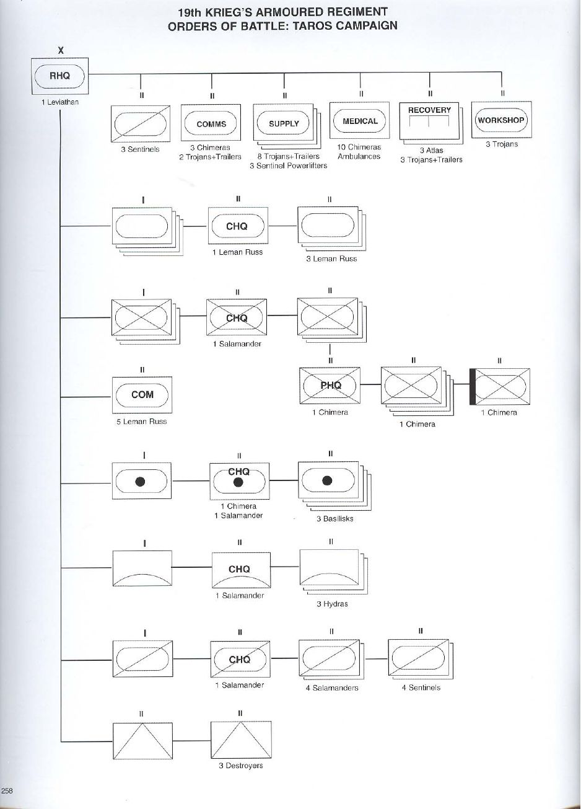
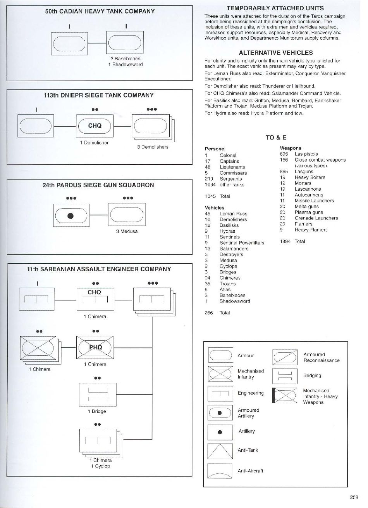
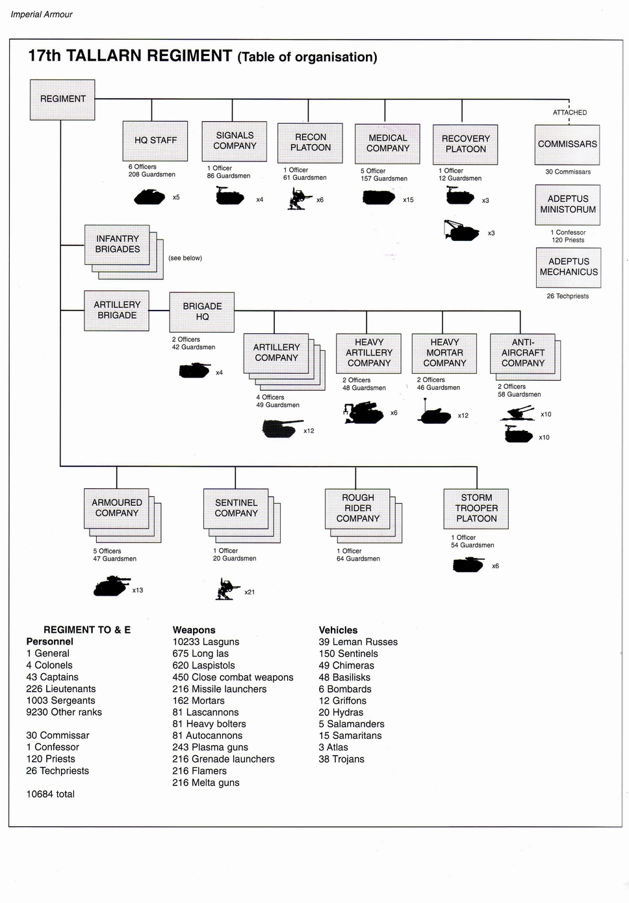
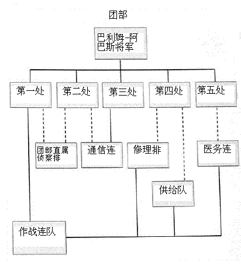
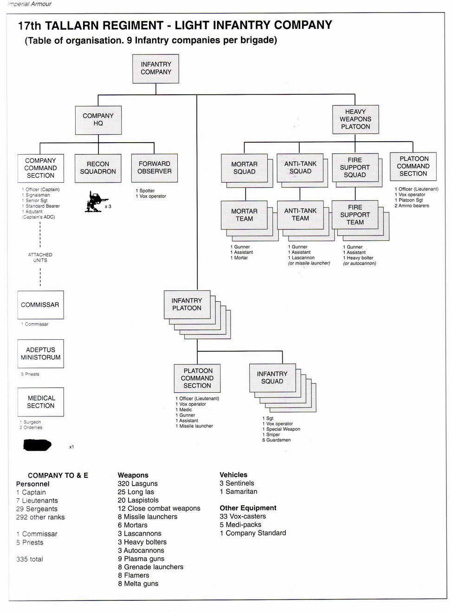
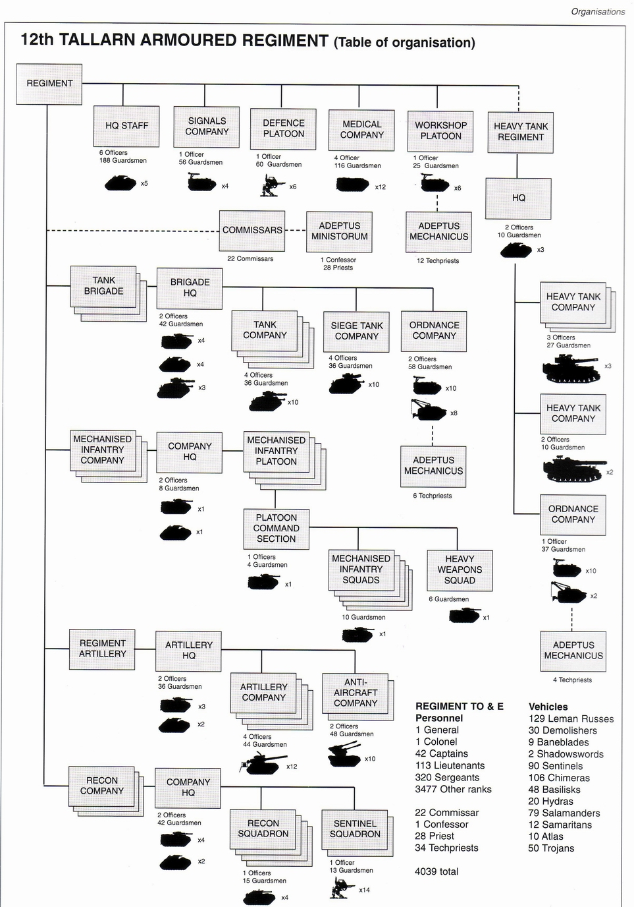
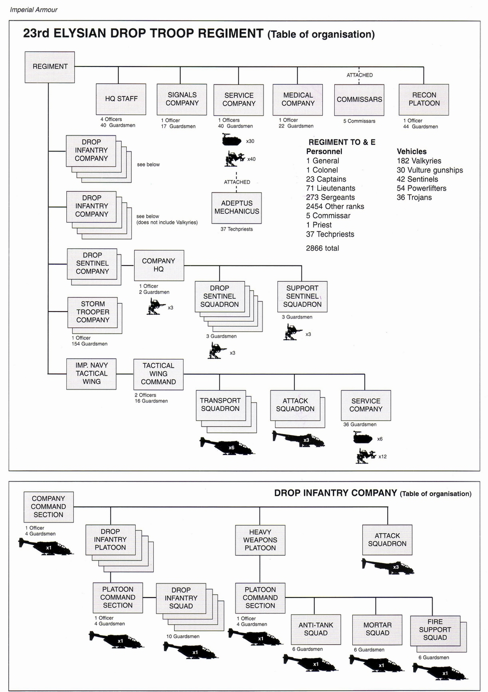
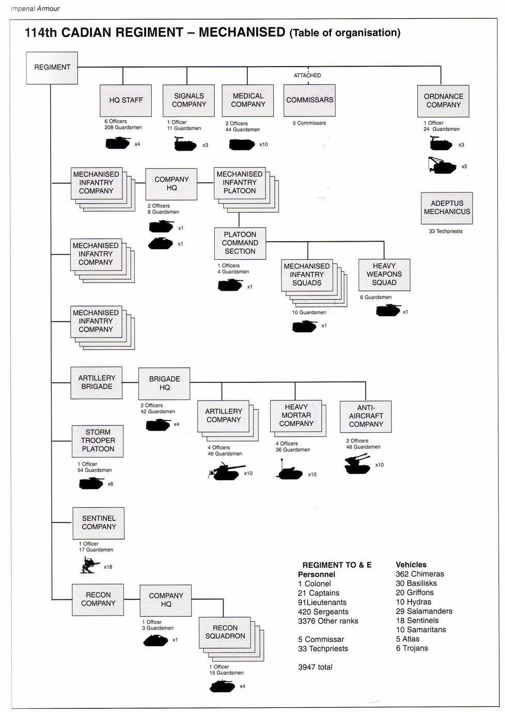

# 帝国防卫军团级编制初探

<H4>帝国防卫军团级编制初探</H4>

CZ75

帝国防卫军（以下简称“国防军”）的最大固定编制是“团”（Regiment），由于人类帝国统治着上百万个世界，每个世界组建的团编制都不太一样，帝国装甲第一卷、第三卷列出了几种比较典型的编制，我就以此来进行一点肤浅的探讨。本文中的“军官”包括将军、上校、上尉、中尉；“士兵”包括军士和列兵。克里格第19装甲团（19th Krieg's Armoured Regiment），塔洛斯战役中的编制：[bgcolor=black][/bgcolor]

为便于对照，不修改原文，直接在下面贴中文翻译：团部（RHQ，Regimental Headquater），1辆利维坦（Leviathan）指挥车。团部直辖单位：装甲侦察小队（Armoured Reconnaissance Squadron，*1），3架哨兵（Sentinel）机甲。通信排，3辆奇美拉（Chimera）装甲车，2辆加装拖车的特洛伊（Trojan）装甲车。3个供给排，每排8辆加装拖车的特洛伊装甲车，3架哨兵工程机（Sentinel Powerlifter）。医疗排，10辆奇美拉改装的医疗车。2个修理排，每排3辆阿特拉斯（Atlas，*2）抢修坦克，3辆加装拖车的特洛伊装甲车。1个维修车间（Workshop），配3辆特洛伊装甲车。*1 小队（Squadron）是装甲车辆的最小编制，相当于步兵和机械化步兵的排（Platoon），目前能确认坦克连、装甲侦察连的下一级编制是小队，而机械化步兵连的下一级编制是排，其他部队尚未清楚，原文中并未说明 其他装甲车辆的最小编制究竟是“小队”还是“排”，故下文中，将自行火炮、防空炮等由装甲车辆组成的最小编制一律翻译成“小队”。*2 阿特拉斯是希腊神话中的泰坦神。4个装甲连（Armour Company），每个连共有10辆莱曼·拉斯（Leman Russ）主战坦克，其中连部1辆，3个小队各有3辆。3个机械化步兵连（Mechanised Infantry Comapny），下辖3个机械化步兵排，每个排辖4个班和一个重武器班，各个班搭乘一辆奇美拉装甲车，排部也有一辆，一个排共6辆奇美拉；连部配一辆火蛇（Salamander）指挥车。1个指挥排，5辆莱曼·拉斯主战坦克。1个装甲炮兵连（Armoured Artillery Company），连部配一辆奇美拉装甲车和一辆火蛇装甲车，下辖4个小队，每排3辆毒蜥（Basilisk）自行火炮。1个防空连（Anti-Aircraft Company），连部配一辆火蛇装甲车，下辖3个小队，每排3辆九头蛇（Hydra）防空坦克。1个装甲侦察连（Armoured Reconnaissance Company），连部配一辆火蛇装甲车，下辖4个小队，其中2个小队各有4辆火蛇装甲车，另外2个小队各有4架哨兵机甲。1个反坦克小队（Anti-Tank Squadron），配3辆毁灭者（Destroyer）坦克歼击车。塔洛斯战役期间临时配属的单位：

卡迪亚第50重型坦克连（50th Cadian Heavy Tank Company）：3辆毒刃（Baneblade）坦克，1辆影刃（Shadowsword）坦克。第聂伯第113攻城坦克连（113th Dniepr Siege Tank Company）：连部1辆粉碎者（Demolisher）坦克，下辖3个小队，每个小队各辖3辆粉碎者坦克。帕尔杜斯第24攻城炮小队（24th Pardus Siege Gun Squadron）：3辆美杜莎（Medusa）。萨雷尼亚第11突击工程连（11th Sarenian Assault Engineer Company）连部1辆奇美拉装甲车，下辖3个工兵排，各排排部配1辆奇美拉装甲车，下辖3个机械化步兵班，每班1辆奇美拉；1个舟桥班，配1辆舟桥车；3个工兵班，每个工兵班各配1辆奇美拉和1辆独眼巨人（Cyclop）遥控爆破车。人员及装备表（TO&E):人员：1名上校17名上尉48名中尉5名政委210名军士1064名列兵合计：1345人武器：695把激光手枪166件格斗武器865枝激光步枪19挺重型爆矢枪19门迫击炮19门激光炮11门自动炮11门导弹发射器20挺热熔枪20挺等离子枪20具榴弹发射器20具火焰喷射器9具重型火焰喷射器合计：1894件车辆：45辆莱曼·拉斯坦克10辆粉碎者坦克12辆火蜥自行火炮9辆九头蛇防空坦克11架哨兵机甲9架哨兵工程机13辆火蛇装甲车3辆毁灭者坦克歼击车3辆美杜莎攻城炮9辆独眼巨人遥控爆破车3辆舟桥车94辆奇美拉装甲运兵车35辆特洛伊装甲车6辆阿特拉斯抢修坦克3辆毒刃重型坦克1辆影刃重型坦克合计：266辆塔兰第17团（17th Tallarn Desert Rider Regiment）：

团部：6名军官，206名士兵，火蛇指挥车5辆团部直辖部队：通信连：1名军官，86名士兵，特洛伊装甲车4辆侦察排：1名军官，61名士兵，哨兵机甲6架医务连：5名军官，157名士兵，撒马利亚人装甲车15辆修理排：1名军官，12名士兵，3辆阿特拉斯抢修坦克，3辆加装拖车的特洛伊装甲车配属人员：督军处（Commissariat）：30名政委帝国国教（Adeptus Ministorum）：1名司祭（Confessor），120名牧师（Priest）注：牧师（Priest）包括传教士（Missionary）和布道师（Preacher），传教士与布道师是帝国国教的最基层神职人员，司祭（Confessor）地位高于前两者，无固定教区，教会授予司祭以可以在他们愿意的任何地方传教的权力。机械教（Adeptus Mechanicus）: 26名科技教士（Techpriest）3个步兵旅（编制见下文）：第1旅（第1-第9步兵连，其中第1连为机械化步兵连）第2旅（第10-18步兵连）第3旅（第19-27步兵连，其中第27步兵连为训练与补充连）1个炮兵旅（Artillery Brigade）：第4炮兵旅（IV Artillery Brigade）：旅部（Brigade Headquater）：2名军官，42名士兵，4辆奇美拉装甲车4个炮兵连（Artillery Company）：第1-第4炮兵连，每连4名军官，49名士兵，12辆毒蜥自行火炮1个重炮连（Heavy Artillery Company）：第5重炮连，2名军官，48名士兵，6辆轰击（Bombard）重型攻城迫击炮1个重型迫击炮连（Heavy Mortor Company）：第6重型迫击炮连，2名军官，46名士兵，12辆狮鹫（Griffon）自行重型迫击炮2个防空连（Anti-Aircraft Company）：第7、第8防空连，每连2名军官，58名士兵，10门九头蛇（Hydra）防空炮，10辆特洛伊装甲车注：该表中不知为何将10辆九头蛇防空坦克拆为10门九头蛇防空平台和10辆特洛伊装甲车3个装甲连（Armoured Company）：第1、2、3装甲连，每连5名军官，47名士兵，13辆莱曼·拉斯主战坦克3个哨兵连：第31、32、33哨兵连，每连1名军官，20名士兵，21架哨兵机甲3个蛮骑兵连：第28、29、30蛮骑兵连（Rough Rider coy），每连1名军官，64名士兵1个暴风突击排（Storm Trooper Platoon）：1名军官，54名士兵，6辆奇美拉装甲车人员及装备：人员：1名将军4名上校43名上尉226名中尉1003名军士9230名列兵30名政委1名司祭120名牧师26名科技教士合计：10684人武器：10233枝激光步枪675枝长管激光步枪620把激光手枪450件格斗武器216具导弹发射器162门迫击炮81门激光炮81挺重型爆矢枪81门自动炮243挺等离子枪216具榴弹发射器216具火焰喷射器216挺热熔枪车辆:39辆莱曼·拉斯主战坦克150架哨兵机甲49辆奇美拉装甲车48辆火蜥自行火炮6辆轰击重型攻城迫击炮12辆狮鹫自行重型迫击炮20辆九头蛇防空坦克5辆火蛇装甲车15辆撒马利亚人装甲车3辆阿特拉斯抢修坦克38辆特洛伊装甲车配属31个军务部补给队（Supply Column）塔兰第17团的团部人员（《帝国装甲3》第257页）：

团长：巴利姆-阿巴斯将军（General Barim-Abas）为该团的成败负最终责任，他对该团工作中各个方面具有最终决定权，无论是在作战中还是日常驻防勤务中。为此他需要他的团部提供建议，团部由军官和员工组成（这些人都是由他自己的团中提拔上来的，也有许多来自内政部的下属部门的人），负责组织、协调、准备、编辑和记录团的所有工作。团部的处：第一处（作战处）：作战处是团的高级参谋处。第一处负责准备野战命令和状况地图，策划作战行动，汇编团作战地域内有关各种情况的数据，并估测敌军的作战能力和运动方向。该处工作由副团长、作战主任哈迪尔参谋上校（Staff Colonel Haddir）领导。第二处（情报处）：情报处负责收集、评估、编译有关敌军的信息，随后还要负责传达这些信息。他们要对侦察单位和前线军官提供的情报、战俘的口供、缴获的文件进行整理和审核。该处还要向作战处和巴利姆-阿巴斯将军提供每日情报更新，包括可能影响部队行动的地形与气候报告。该处工作由情报主任兰姆塔参谋上尉（Staff Captain Ramtha）领导。该处配有帝国海军的一个联络组，负责航空侦察业务。该处还包括一个由来自修女会语言教团的钛语专家组成的翻译小组。该小组是在塔洛斯战役期间临时配属于该团的。第三处（通信与联络处）：该处负责维持团部、团部的下属单位、不隶属于国防军的其他作战单位以及战区司令部之间的通信联系。该处控制并调节全团的通信网络。该处还负责监听敌军的联络，并从截获的通信中收集情报，然后将情报报告给第二处。该处工作由通信主任法利克参谋上尉（Staff Captain Farriq）领导。该处配属有一个由1名机械教通信专家及他的奴工组成的小组。第四处（运输与供给处）：第四处负责协调运输和供给，并且要估测供给的需求情况。该处要为作战处和团长准备简报，还要规划并调节团后方地域内的交通。该处还要负责保障后方梯队、补给线以及后勤仓库周围的安全。执行这些保障任务的部队由作战处调派。该处还要策划并控制非战斗情况下的大规模部队调动（比如将部队装载到帝国海军运输机上）。该处工作由军务部调派的军需主任领导，军需主任与负责为该团服务的军务部供给队保持直接联络。第五处（统计与行政处）：第五处负责处理人事事务、编制与装备表（TO&E，tables of organisation and equipment）、实力报告以及部队的补充。该处还负责保存所有单位的记录与历史。该处工作由配属的内政部官员、一位军事副长官（Prefect Secundus Militant）领导，军事副长官手下领导着来自内政部的办事员和文书。注：内政部的工作人员中，“长官（Prefect或Prefectus）是中层工作人员，分三等（Prefectus Primus长官、Prefectus Secundus副长官、Prefectus Tertius长官助理）。办事员（ordinate）是内政部最常见的低级工作人员，负责内政部的一般日常事务。文书（scribe）是内政部的最低一级文职人员。（团部直属的）非作战连队这些团部直属的连队不负责作战人物，它们的规模往往比作战连队要小，但却在团后勤梯队中承担着重要的支援任务。医务连：医务连由团的医务上尉（Surgeon Captain）领导，负责为伤员提供急救和治疗。医务连必须为步兵连提供医务兵，医务兵是（连、排级）指挥分队的一员，与指挥分队的人一起参战。医务连还装备有一种用于急救任务的奇美拉装甲车的变型车，叫“撒玛利亚人”（Samaritan），撒玛利亚人装甲车由医务连的勤务兵驾驶，在战场上把伤员带到医务连的急救站或后方的野战医院。每个野战医院都有来自修女会医护教团的慈悲的修女为其工作。通信连：通信连总是隶属于团部第三处，他们是个小型的负责通信联络的连，装备有大功率的传声器和联络装备。侦察排：侦察排直属于团部，直接接受第二处调遣。所有的连都要进行侦察和观测，但该排并没有指挥链上通常有的延迟。副团长可以立即命令他们到一个地方去执行侦察任务，并迅速得到情报。该排是一个混合有资深步兵、蛮骑兵和哨兵支援小队的比较小的排。修理排：一个比较小的排，当该团的车辆损坏、因发动机故障或困难地形而被困住或被击伤时，该排就得抢救并修理这些车辆。军务部供给队：该团的供给和运输都是由军务部的供给队进行的。供给队并不直接接受将军的命令，而是通过团部第四处直接指挥。供给队把军需品从后方军需仓库运到前进供给点，如果情况允许的话，就直接运到前线。步兵旅：出于行政需要，该团分成了三个步兵旅。旅不是作战编制，他们的存在只是为了方便行政管理和再供应、训练以及补充之类的非作战任务。塔兰第17团的轻步兵连（Light Infantry Company）编制：

连部（Company HQ）：  连部直辖部队：  连部指挥分队（Company Command Section）：1名军官（上尉），1名通信兵，1名资深中士，1名旗手，1名副官（上尉的助理）  配属单位：  督军处：1名政委  帝国国教：5名牧师  医疗分队：1名军医，2名勤务兵，1辆撒玛利亚人装甲车  注：在上一表中，统计撒玛利亚人装甲车的数量时，似乎忘了计算各连医疗分队的撒玛利亚人装甲车。  侦察小队（Recon Squadron）：3架哨兵机甲  前方观察员（Forward Observer）：1名弹着点观测员，1名传声器操作员5个步兵排（Infantry Platoon）：  各排下辖：  排指挥分队（Platoon Command Section）：1名军官（中尉），1名传声器操作员，1名医务兵，1名射手，1名副射手，1具导弹发射器  5个步兵班：每班1名中士，1名传声器操作员，1名特殊武器手，1名狙击手，6名士兵重武器排（Heavy Weapons Platoon）：  排指挥分队：1名军官（中尉），1名传声器操作员，1名排级军士（Platoon Sgt.），2名弹药手。  2个迫击炮班（Mortar Squad），每班3个迫击炮组（Mortar Team），每组1名射手，1名副射手，1门迫击炮  2个反坦克班（Anti-Tank Squad），每班3个反坦克组（Anti-Tank Team），每组1名射手，1名副射手，1门激光炮（或导弹发射器）  2个火力支援班（Fire Support Squad），每班3个火力支援组（Fire Support Team），每组1名射手，1名副射手，1门重型爆矢枪（或自动炮）人员及装备：人员：1名上尉7名中尉29名军士292名列兵1名政委5名牧师合计：335人注：这个数字是错误的！！！即使不算3名哨兵驾驶员，一个轻步兵连的兵力也应该是337人！武器：320枝激光步枪25枝长管激光步枪20把激光手枪12件格斗武器8具导弹发射器6门迫击炮3门激光炮3挺重型爆矢枪3门自动炮9枝等离子枪8具榴弹发射器8具火焰喷射器8枝热熔枪车辆：3架哨兵机甲1辆撒玛利亚人装甲车其他装备：33套传声器5套医疗包1面连旗塔兰第12装甲团（12th Tallarn Armoured Regiment）：

团部（HQ STAFF）：6名军官，188名士兵，5辆火蛇指挥车通信连（Signals Company）：1名军官，56名士兵，特洛伊装甲车4辆防御排（Defence Platoon）：1名军官，60名士兵，6架哨兵机甲注：不清楚该单位的具体作用是什么。医务连（Medical Company）：4名军官，116名士兵，12辆撒玛利亚人装甲车车间排（Workshop Platoon）：1名军官，25名士兵，6辆特洛伊装甲车；另外该单位还配有12名科技教士该团附属人员还有22名政委、1名司祭、28名牧师重型坦克团：团部:2名军官，10名士兵，3辆火蛇指挥车3个重型坦克连，每连3名军官，27名士兵，3辆毒刃（Baneblade）坦克1个重型坦克连，2名军官，10名士兵，2辆影刃（Shadowblade）坦克歼击车1个军械连（Ordnance Company），1名军官，37名士兵，10辆特洛伊装甲车，2辆阿特拉斯抢修坦克3个坦克旅（Tank Brigade），每个旅下辖：旅部（Brigade HQ）：2名军官，42名士兵，4辆奇美拉装甲车，4辆火蛇指挥车，3辆莱曼·拉斯坦克4个坦克连，每个连有4名军官，36名士兵，10辆莱曼·拉斯坦克1个攻城坦克连（Siege Tank Company），4名军官，36名士兵，10辆破坏者（Demolisher）坦克1个军械连，2名军官，58名士兵，10辆特洛伊装甲车，8辆阿特拉斯抢修坦克，另外配属6名机械教士3个机械化步兵连（Mechanised Infantry Company），每连编制为：连部（Company HQ）：2名军官，8名士兵，1辆奇美拉装甲车，1辆火蛇指挥车4个机械化步兵排，每排编制为：排指挥分队（Platoon Command Section）：1名军官，4名士兵，1辆奇美拉装甲车5个机械化步兵班，每班10名士兵，1辆奇美拉装甲车1个重武器班，6名士兵，1辆奇美拉装甲车团属炮兵（Regiment Artillery）：炮兵司令部（Artillery HQ):2名军官，36名士兵，3辆奇美拉装甲车，2辆火蛇指挥车4个炮兵连，每连4名军官，44名士兵，12辆火蜥自行火炮2个防空连，每连2名军官，48名士兵，10辆九头蛇自行高炮3个侦察连，各连编制：连部（Company HQ）：2名军官，42名士兵，4辆奇美拉装甲车，2辆火蛇指挥车4个侦察小队（Recon Squadron）：1名军官，15名士兵，4辆火蛇侦察车2个哨兵小队（Sentinel Squadron）：1名军官，13名士兵，14架哨兵机甲人员与装备：人员：1名将军1名上校42名上尉113名中尉320名军士3477名列兵22名政委1名司祭28名牧师34名科技教士总计：4039人车辆：129辆莱曼·拉斯坦克30辆破坏者坦克9辆毒刃重型坦克2辆影刃重型坦克歼击车90架哨兵机甲106辆奇美拉装甲车48辆火蜥自行火炮20辆九头蛇自行高炮79辆火蛇侦察车12辆撒玛利亚人装甲车10辆阿特拉斯抢修坦克注：又错了！应该是8x3+2=26辆！50辆特洛伊装甲车艾里西亚第23空降团（23rd Elysian Drop Troop Regiment）：

团部（HQ Staff）：4名军官，40名士兵通信连（Signals Company）：1名军官，17名士兵勤务连（Service Company）：30辆特洛伊装甲车，40架哨兵工程机（Sentinel Powerlifter），配属37名科技教士医务连（Medical Company）：1名军官，22名士兵配属：5名政委      1个侦察排：1名军官，44名士兵4个空降连（Drop Infantry Company），各连编制如下：连指挥分队（Company Command Section）：1名军官，4名士兵，1架瓦尔基里空降突击运输机（Valkyrie）4个空降排（Drop Infantry Platoon）：  排指挥分队（Platoon Command Section）：1名军官，4名士兵，1架瓦尔基里空降突击运输机      4个空降班：每班10名士兵，1架瓦尔基里空降突击运输机1个重武器排（Heavy Weapons Platoon）：  排指挥分队（Platoon Command Section）：1名军官，4名士兵，1架瓦尔基里空降突击运输机  1个反坦克班（Anti-Tank Squad）：6名士兵，1架瓦尔基里空降突击运输机  1个迫击炮班（Mortar Squad）：6名士兵，1架瓦尔基里空降突击运输机  2个火力支援班（Fire Support Squad），每班6名士兵，1架瓦尔基里空降突击运输机1个攻击小队（Attack Squadron），3架秃鹫（Vulture）炮艇4个空降连，编制同上，但不配瓦尔基里空降突击运输机8个空降连分别是1-8空降连2个空降哨兵连（Drop Sentinel Company）：连部（Company HQ）：1名军官，2名士兵，3架哨兵机甲5个空降哨兵小队（Drop Sentinel Squadron）：每小队3名士兵，3架哨兵机甲1个支援哨兵小队（Support Sentinel Squadron）：3名士兵，3架哨兵机甲2个空降哨兵连是第9、10哨兵连2个暴风突击连（Storm Trooper Company）：每连1名军官，154名士兵2个暴风突击连是第709、第1344暴风突击连1个帝国海军战术联队（Imperial Navy Tactical Wing）：联队部（Tactical Wing Command）：2名军官，16名士兵3个运输小队（Transport Squadron），每小队6架瓦尔基里空降突击运输机2个攻击小队（Attak Squadron），每小队3架秃鹫炮艇1个勤务连（Service Company），36名士兵，6辆特洛伊装甲车，12架哨兵工程机该联队是帝国海军第184战术联队人员与装备：人员：1名将军1名上校23名上尉71名中尉273名军士2454名列兵5名政委1名牧师37名科技教士总计：2866人车辆与飞机：182架瓦尔基里空降突击运输机30架秃鹫炮艇42架哨兵机甲54架哨兵工程机注：又错了……应该是52架36辆特洛伊装甲车卡迪亚第114（机械化步兵）团（114th Cadian Regiment - Mechanised）：

团部（HQ Staff）：6名军官，208名士兵，4辆奇美拉装甲车通信连（Signals Company）：1名军官，11名士兵，3辆特洛伊装甲车医务连（Medical Company）：2名军官，44名士兵，10辆撒玛利亚人装甲车配属5名政委军械连（Ordnance Company）：1名军官，24名士兵，3辆特洛伊装甲车，5辆阿特拉斯抢修坦克，配属33名科技教士12个机械化步兵连，各连编制为：连部（Company HQ）：2名军官，8名士兵，1辆奇美拉装甲车4个机械化步兵排（Mechanised Infantry Platoon）：  排指挥分队（Platoon Command Section）：1名军官，4名士兵，1辆奇美拉装甲车  5个机械化步兵班（Mechanised Infantry Squad）：10名士兵，1辆奇美拉装甲车  1个重武器班（Heavy Weapons Squad）：6名士兵，1辆奇美拉装甲车炮兵旅（Artillery Brigade）：旅部（Brigade HQ）：2名军官，42名士兵，4辆奇美拉装甲车3个炮兵连（Artillery Company）：每连4名军官，46名士兵，10辆火蜥自行火炮2个重型迫击炮连（Heavy Mortar Company）：每连4名军官，36名士兵，10辆狮鹫（Griffon）自行迫击炮1个防空连（Anti-Aircraft Company）：2名军官，48名士兵，10辆九头蛇自行高炮1个暴风突击排（Storm Trooper Platoon）：1名军官，54名士兵，6辆奇美拉装甲车1个哨兵连（Sentinel Company）：1名军官，17名士兵，18架哨兵机甲1个侦察连（Recon Company）：连部（company HQ）：1名军官，3名士兵，1辆火蛇指挥车4个侦察小队（Recon Squadron）：每连1名军官，15名士兵，4辆火蛇侦察车人员及装备：人员：1名上校21名上尉91名中尉420名军士3376名列兵5名政委33名科技教士车辆：362辆奇美拉装甲车30辆火蜥自行火炮20辆狮鹫自行迫击炮10辆九头蛇自行高炮29辆火蛇装甲车18架哨兵10辆撒玛利亚人装甲车5辆阿特拉斯抢修坦克6辆特洛伊装甲车从以上几个比较有代表性的编制来看，国防军的团编制有一下几个特点：1、国防军的团是按照地域原则组建的，一个团里的官兵都来自同一个行星，好处是由于没有语言的差异（人类帝国尽管使用低级哥特语作为通用语言，但各个行星之间的口音往往相差巨大），便于管理，同乡之间的情谊也更能增加团的凝聚力。缺点是各个行星组建的团编制、装备都可能有很大差异，缺乏统一性，对于战区司令来说，很难判断各个团的战斗力；而且容易造成地方军阀拥兵自重，但这是无法避免的：人类帝国实在太庞大了，很难做到使每个行星组建的团都按照一个统一标准建立。2、团的规模可大可小，大到相当于现代的师，小到相当于现代的团或旅，一般下辖旅的团，团长是将军；下辖连的团，团长是上校。3、指挥层次少，军官、军士比例低。本文中介绍的几个团中，军官、军士、士兵的比例分别是（精确到小数点后两位）：克里格第19装甲团：1:3.18:16.12塔兰第17团：1:3.66:33.69塔兰第12装甲团：1:3.204:13.53艾里西亚第23空降团：1:2.81:25.30卡迪亚第114（机械化步兵）团：1:3.72:29.88可以看出，按照现在的标准衡量，军官和军士比例实在太低了，美国陆军的军官与士兵（军士+兵）的比例大概是1：5（2004年6月美国国防部资料，军官81618人，士兵414325人，来自《美国军界透视》系列中的《美国陆军》一书【人民出版社2004年12月第1版】第11页）；士兵中，军士又占了约一半，如此之少的军官和军士，指挥如此之多的列兵，对于军官及军士的指挥能力要求非常高，但是这国防军中又没有营一级编制，没有旅级编制、直辖连的团（如卡迪亚第114团），其团部要直接指挥12个步兵连，可是团部却只有6名军官！在信息处理能力没有比现代大幅提高的情况下，这实际上是不可能的。出现这种情况下的原因，还是在于这些编制是根据战棋游戏编的，战棋游戏中，双方玩家都能清楚地了解一线士兵的具体情况，并可以亲自指挥到班一级，而不会有任何情报、命令的延迟，何况战棋中，双方玩家之间是双向透明的，并不存在“战争迷雾”，因此，不需要复杂的指挥体系。可是在现实中，由于战争迷雾和信息延迟的存在，各级指挥官都必须拥有足够的军官和军士，来分析情报，并指挥部队，所以，指挥链上的每一级都需要相当的军官和军士。4、缺乏足够的后勤单位以上几个团的编制表中，都没有后勤单位！所有团的后勤，都是由临时配属的、由当地军务部组织的供给队负责的。而且，每个团都没有自己的后方医院，各个团仅仅配有一个医务连，而且这些医务连的士兵只能对战场的伤员进行一些简单的急救，然后就用撒玛利亚人装甲车把他们运到附近的野战医院，而这些野战医院是由修女会的医护教团设立的；1个步兵连中只有1名军医和2名勤务兵！各团的工程兵也很不完善，各团的工程连往往只能对车辆进行野战抢修和维护，而缺少布雷、设障、破障、舟桥、建筑、伪装等部门。通信兵更是糟糕：像艾里西亚空降团这样的部队，对野战通信保障的要求非常高，然而艾里西亚第23空降团的通信连居然只有1名军官和17名！综上所述，国防军在团一级的后勤保障工作很不得力，缺少足够的后勤部队，这些后勤部队只能在团抵达战区之后临时向军务部借调，往往缺乏与作战部队协同训练，很难保证后勤工作的开展。5、国防军在步兵连这一级一般采用五五制，而不是通常的三三制，这点很奇怪，不知是不是受了50年代核战争狂热时期美国陆军的“五群制”影响，但美国陆军的“五群制”是师一级的编制：“1956至1957年，出于应付所谓‘战术核战争’的考虑，美国陆军的师均实行‘五群制’，将三三制师的3个团改为5个‘战斗群’。战斗群在编制上小于团大于营，原子步兵师的战斗群由5个步兵连和1个迫击炮连组成，原子空降师的战斗群由5个步兵连组成。原子步兵师保留1个师属装甲营、1个装甲突击中队和1个可以发射核武器的火炮与导弹混成营。……”（《美国军界透视》系列中的《美国陆军》一书【人民出版社2004年12月第1版】第13页）采用五五制的国防军步兵连，由于有重武器排，拥有很强的火力，但在轻步兵中，由于没有装甲运兵车，故而缺乏机动性。
