# [翻译]《帝国步兵入门读本》截选(Chapter Three)2.26更新

[翻译]《帝国步兵入门读本》截选(Chapter Three)2.26更新

kobe2me

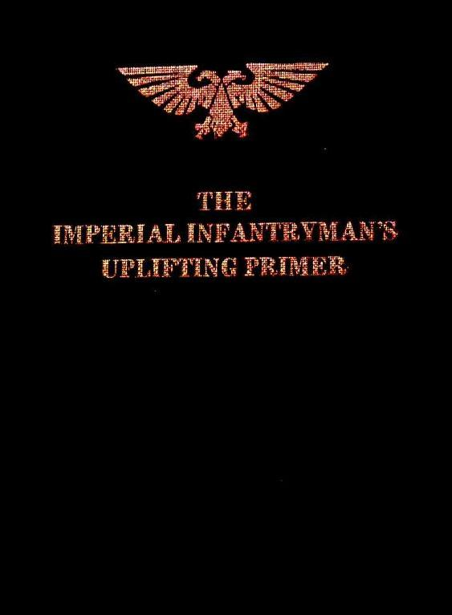

原英文版是由CZ75同学在本区提供的下载链接，具体见这里：[http://game.ali213.net/viewthread.php?tid=1378008&highlight=](http://game.ali213.net/viewthread.php?tid=1378008&highlight=)

我挑了书中号称“最最重要的一章”中的一小段翻了一下。主要因为自己E文水平不咋地，也不知道大家对这个感不感兴趣,所以就不敢多翻，先凑合着看看吧。。。

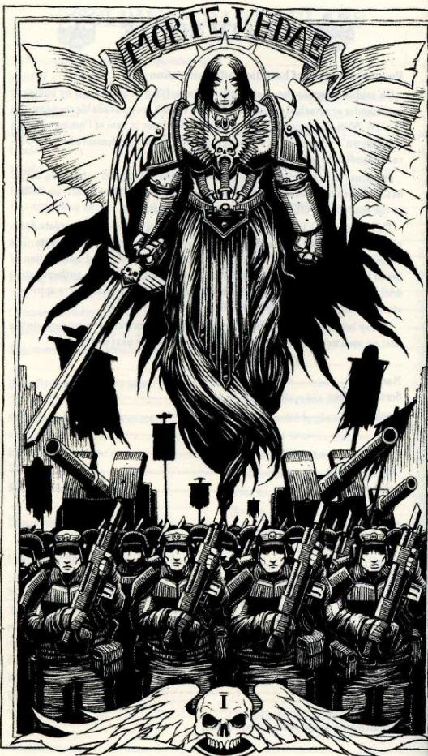

Section 1    General Introductions

The Imperial Guard is a venerable and glorious army, steeped high in history and honour. The armies of the Imperium span the galaxy, and have done so for millennia. Imperial Guard methods in the art of war are fixed, the dogmas of strategy and battlefield policy have secured the Imperium and stemmed the brutish tides of the foul and heretical. This book will outline what every soldier in the teeming mass needs to know to ensure man’s place in the galaxy remains unopposed. The most important thing to maintain is the security of the Emperor’s war machine.

引

帝国防卫军是一支古老而又光荣的部队，受到历史的肯定并享有很高的荣誉。帝国的军事力量遍布银河，几千年都是如此。而帝国防卫军的作战方式也在漫长的岁月中不断完善，军事策略的正确选择和战场方针的及时下达，确保了帝国长久以来的安定，也使帝国防卫军得以抵挡来自异端和邪恶势力的无数次潮水般的攻势。这本书将会告诉你，作为帝国防卫军数以千万记的战士中的一名，你所赖以保护人类在银河中的地位不被他人所撼动的必要的知识。对于你来说，最需要维护的，正是伟大帝皇的战争机器的安全不要受到威胁。

Battlefield security during a war campaign is a matter of paramount importance. Every infantryman will take sufficient precautionary measures, whether he is resting, marching or fighting, to prevent the enemy from taking him by surprise. Any man found lacking will feel the wrath of the Emperor, through the actions of His most just commissars.

在一场战役中，战地警戒通常被视为是极其重要的。对每一个士兵而言，无论在休息时，行军时，还是战斗时，你都要采取有效的预防措施来防止敌人发动偷袭。对于任何疏于防范的士兵，政委都会通过自己的方式来向你宣泄帝皇的怒火。

Always remember, no matter how stupid and inferior your enemy is, it can never be assumed that they are not capable of taking you by surprise. The foul ork, although nothing more than a savage beast, does possess low, animalistic cunning. The ignoble eldar will use cowardly spring attacks and hit-and-run tactics. The base tyranids are so bestial and degraded an enemy that we cannot precisely predict what they may do. The dark force that warp the minds of men and prove the previously pure of mind to be unclean, will sink to any level in order to douse the Immortal Emperor’s holy light. And other enemies exist on the fringes of our domains that may yet prove to be threats in their own right.

牢记，无论你的敌人是多么的愚蠢或是多么的次，永远不要妄想他们没有能力对你发动偷袭。好比那野蛮的兽人，尽管它们和凶残的野兽并无二致，依然可以像狐狸一般狡猾；以及那卑鄙的eldar，他们通常会进行小规模的跳跃式攻击并使用打带跑的战术；还有tyranids，这些异型是如此的残忍以至于我们根本无法准确地预测它们的行动；而黑暗的力量，这股足以扭曲人心，把原本纯洁的心灵变得肮脏的力量，会渗入到帝国的任何角落里，企图玷污帝皇不朽的神圣之光。此外，还有许多其他的敌对势力，在我们伟大帝国疆土的边缘地带蠢蠢欲动着。

It is imperative that measures are taken to protect yourself and your comrades as much as prssible. There are two ways of doing this. The first -having adequate knowledge of arms and equipments, and the necessary skills to use them-has already been covered(see chapter 2). This chapter covers the second. It explains the structure and working of the Imperial Guard, and all who fill its glorious ranks. It will ensure you have a strong understanding of your place in its vastness. It will teach you how to conduct yourself on the battlefield.

采取必要的行动尽可能保护你自己和你身边的同志，这可以说是你作为一名帝国的战士必须做到的事。你有两条途径可以做到这一点：第一，掌握武器装备的知识和使用它们的技巧（这已经在前面一章中详细说明），而接下来这一章，则是向你说明帝国防卫军的人员配备和组织结构，以及那些为军队赢得荣誉的人所能得到的军阶。在此，你将明确地了解到自己在帝国庞大军队中的位置，并将学会如何在战场上更好地展现自己。

This chapter is the most important one in this book. Read it carefully.

这一章是本书最为重要的一章，务必认真阅读。

Section 2    Command structure of the Imperial Guard(sector level)

*Lord General Militant(or equivalent)

*General staff(Lord Marshal, Captain General, Lord Castellan and Staff Officers of Ranks from General to Lieutenant)

*Regimental Commanders

*Company Commanders

帝国防卫军的指挥系统（战区级）

*战区总司令（或同等级别）

*战区司令部（元帅，上将，中将以及级别从中尉到将军不等的参谋长）

*团部指挥官

*连部指挥官

Section 3    Ranks& Insignia

Given the immense size and complexity of the command structure of the Imperial Guard, and the fact that it is spread throughout the entire Imperium on many different worlds and amongst many different cultures, only the most prevalent ranks are listed below. In fact there are a lot more. The most important thing to remember is your place on the list, and the fact that an order given to you by anyone above your rank is to be obeyed without question or delay.

*Warmaster                       *Lieutenant Colonel

*Lord General                       *Major

*General                            *Captain

*Marshal                            *Lieutenant

军阶和勋章

向你展示帝国防卫军繁多的军阶和复杂的指挥系统。在帝国的许多不同星球上，尽管文化背景不尽相同，这些军衔制度和系统都被大量采用。当然，本书中所列出的仅仅是实际当中最最普遍，常见的一些军阶，事实上还有更多更多。对于你来说，必须铭记两件事是：明确你自己在这张军阶表上所处的位置以及对于任何你的上级军官命令的无条件即时服从。

Warmaster 战帅           Lieutenant Colonel中校

Lord General 总司令       Major 少校

General 将军             Captain 上尉

Marshal元帅             Lieutenant 中尉

Lieutenant General 中将    Sergeant 中士

major General 少将       Corporal 下士

Colonel 上校            Trooper 列兵

Section 4    Other Ranks, Specialists& Abhumans

其他军阶，特殊职位及亚人类

Imperial Commissars

1. 帝国督军（政委）

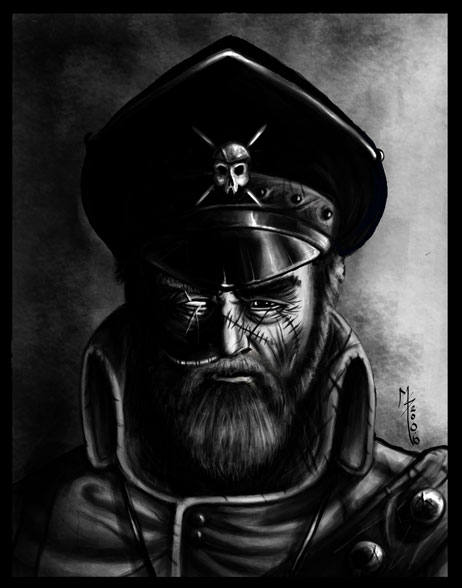

The commissar is the living embodiment of the Immortal Emperor’s own will. He is charged with maintaining morale and discipline in the ranks in any way he sees fit. A commissar retains the absolute right to administer justice both on and off the battlefield. For you, as a trooper, they are the highest example of faith, and to be a full adherent to the Imperial Creed you should follow their peerless lead. They will stimulate zeal and enthusiasm in you as you prepare to enter the fray, and will be fighting with you at the very front of the battle. How else can they judge your mettle and courage?

政委，可以说是伟大帝皇意志的最鲜活的化身。这些政委的任务是到他们认为合适的任何部队中，去保持部队的士气并维持那儿的纪律。无论在战场上还是在非战斗期间，他们都拥有任意审判一个士兵的绝对权利。对于你，一个士兵来说，政委就是信仰的最高象征；同样地，想要成为帝国信条的忠实拥护者，你就应当服从政委出类拔萃的领导。当你准备进入战斗的时候，政委会用激昂的演说来激发你内心对帝国的热诚和对战斗的狂热渴望，并与你一起奋战在战场的最前线。除此之外，还有什么能让他们来判定你的勇气与精神呢？

You may find your squad being led by a commissar. If so, count yourself lucky! No enemy can stand to look a commissar in the eye! For in them they see the light of the Immortal Emperor and the righteousness of humanity which burns within his soul.

当你发现你的班组正被一名政委所领导，那你就是幸运的！没有一个敌人能够活着正视政委的眼睛！因为在他们眼中看到的，是伟大帝皇耀眼的光芒和人类至高无上的正义，而这些足以将敌人丑恶的灵魂燃成灰烬。

When the battle is at its hardest and thoughts of retreat enter your mind, think of the commissar, and let them be an inspiration to you. Be assured, if that doesn’t work and you try to flee from the battle, a justice-seeking bolt from the commissar’s gun will pass judgement upon you. A commissar shall judge you fairly, but any sign of cowardice or weakness shall be purged from his sight. A commissar is the bearer of the Emperor’s Law, and holds the irrefutable right to mete out judgement, sentence and punishment.

当战斗进入白热化，你心中开始萌生撤退的念头的时候，想想政委吧，让他来激励你的斗志！可以肯定的是，当这样做并不能激起你的斗志，而你企图当逃兵的时候，一颗正义的子弹将会从政委的爆弹枪中射出，给你送上最后的审判。政委会公平地看待每一个人，但任何怯懦或是软弱的人，他都会将其从视线中抹去。政委是帝皇法则的传达者，拥有执行判决和惩罚士兵的绝对权利。

Whether you obey the commissar through fear or respect, you must remember that they are an imperative part of the Imperial Guard, whose job it si to look after the well-being of the Imperium, and thus, the well-being of every soldier in the army.

不论你是因为惧怕还是敬畏而服从于政委，你都必须牢记：他们是帝国防卫军不可或缺的一部分，他们维护着帝国的正常运作，同时也保证军队中每一个士兵的绝对服从。

Priests of the Ecclesiarchy

2. 教会牧师

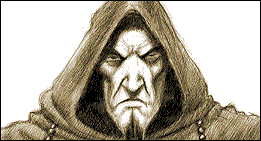

Where the Imperial Guard regiments fight for the glory of the Imperial Guard and the Immortal Emperor, it is common sense to take with them members of the Ecclesiarchy. A priest accompanying your regiment into the fray is indeed a boon. He will use his fire and fervour to motivate and cajole the troops into a pugnacious frenzy. How better to fight for the Imperial Creed than with the flames of purity buring strong within your breast?

每每帝国防卫军的师团为伟大的帝皇和自身荣誉而战的时候，部队通常都会配备来自教会的人员。对于你的师团来说，有一名牧师与你的部队一同冲杀敌阵，着实是一种恩惠。他会以自己的怒火，激情来激发和引导部队进入一种渴望杀戮的狂暴中。同样为了帝国的信条而战斗，还有什么比胸中燃烧着炽热而又虔诚的怒火的战士表现得更为出色呢？

Priests are so adept at converting their righteous fury into bloodlust on the battlefield that they make superb warriors, hacking left and right with their chainswords. Truly are they a great example of faith embodying action. Take stock of the zealous priests, and follow them into the fields of glory.

在战场上，牧师们能轻易地将心中正义的狂怒转化成杀戮的欲望，他们培养出完美的战士，用手中的链锯剑左右砍杀敌人。这些牧师不愧为将信念展现在实际行动中的典范。向热心的牧师作忏悔吧…然后随着他们踏上荣耀的战场。

Techpriest Enginseers

3．机械牧师

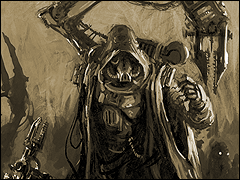

The Imperial Gurad makes much use of mechanised armour and motorised transport. This ensures that deployment is rapid, and backed up with hard hitting artillery and tanks. The techpriests ensure the well being of the precious war machine. These solitary men are privy to the secrets and sacred workings of the great war engines and their accompanying spirits that do smite our foes with deadly steel and blessed explosives.

在帝国防卫军的军队中，大量编入机械化装甲部队，并采用机动的运输系统。这确保了部队能迅速地调动和部署，同时能使指挥部及时地给予部队来自炮兵和坦克部队的支援。而机械牧师的义务，就是要确保整个战争机器的正常运转。这些独来独往的人，被获准得以接触到关于那些伟大战斗机器及它们机魂的奥秘和辉煌战绩的资料。在战斗中，这些机器会以致命的钢铁武器，和神佑的炮火轰击沉重打击帝国的敌人。

Techpriests are invaluable as they can administer repairs during a conflict, risking their lives to reach a stricken machine, and braving the bolt shells and las blasts in their endeavour through its steely throat.

机械牧师会冒着生命危险穿过硝烟弥漫的战场，去修理瘫痪在阵地上的机械武器，并勇敢地面对从冰冷的枪膛中急速射出的爆弹强枪弹药和激光波，所以对于帝国防卫军而言，机械牧师称得上是无价之宝。

Techpriests must be protected, for they are men steeped in lore, who have spent many years training in order to keep the war machines of the Guard rumbling ever forward. Watch out for them as they tend to their holy duties, and be sure to give them the maximum possible protection.

机械牧师必须受到一定的保护，因为他们是经过长年训练，维护防卫军的战争机器一刻不停地向前推进，并在这方面掌握大量技术知识的人。机械牧师往往太过专注于自己神圣的天职，所以你要密切注意他们，并确保给他们提供最大限度的保护。

Sanctioned Psykers

4. 灵能者（须通过帝国审核)

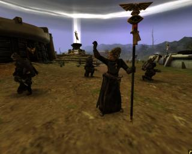

Sanctioned Psykers are used in some regiment of the Imperial Guard. These individuals have been touched by the mutating powers, but have been brought under strict control. They can be a great aid on the battlefield, but as a trooper you should have nothing to do with them. They are tools of the commanders, to do with as they will.

灵能者仅存在于部分帝国防卫军的师团中。这些个体曾受到过变异的力量的侵蚀，但现在已经被严格地控制起来了。这些灵能者可以作为一种十分有效的战场支援，但作为一名普通士兵，你最好离他们远点儿。他们只是指挥官手中的工具，任凭指挥官的意愿行事。

Do not attempt communication with them if you see them. They will be under constant guard by at least three armed troopers, for your protection as well as the psyker’s. You must overcome your natural disgust for such unnatural men and remember that the machinations of the enemy must be met with whatever weapons we can gather about ourselves.

当你看到灵能者的时候，不要尝试与他们交谈。这是为了你自己，同样也是为灵能者的安全着想，因为他们随时随地都会由至少3名荷枪实弹的大兵看护着。同样地，你必须克服内心对这些异类的厌恶情绪，并且记住：在战争中，我们必须集中可以集中的一切力量来打击敌人。

However, it si everyone’s best interests to watch these men! If they begin to behave strangely(outside of their usual strange habits)or you see them without a full guard compliment it is your duty to shoot them down, as it is likely they have succumbed to dark power.

然而，不可否认的是，每个人都会对这些异类很感兴趣，喜欢观察他们。那么，当你看到灵能者行为异样（区别于他们本身怪异的习性）或者他们的周围没有任何看守人员的时候，你就有责任将他们射杀！因为很可能这时候，他们已经被黑暗的力量所吞噬。

The use of sanctioned psykers within the Imperial Guard is a necessary evil, but one all can benefit from. Treat them with equal tolerance and suspicion. Either way, your life could depend on it.

灵能者的存在，对于帝国防卫军来说是一种必要的邪恶，因为他们对整支军队而言都有相当大的价值。谨慎地提防他们，但同时也给予必要的宽容。你的小命，便取决于这两种态度。

Ogryns

5. 欧根蛮人

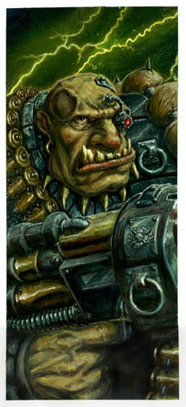

Ogryns(Homo Sapiens Giganticus) are endorsed in some regiments of the Imperial Guard because they are loyal, very strong and make extremely effective shock troops. They are a perfect combination: sheer brute force married to a completely obedient mind. Ogryns are in no way a match for a man in terms of intellect or foresight(for example, they will not have been issued woth a copy of this hand book, because they undoubtedly would not understand a single word) but they can smash any enemy foolish to stand in the way with their bare hands. And that alone, according to some, is reason enough to include these lesser creatures into the ranks.

欧根蛮人，这些巨人因为他们的忠诚，因为他们的强壮，因为他们能成为极其有效的突击部队而被一部分帝国防卫军的师团所收编。他们是天生蛮力和无条件服从的完美结合体。欧根蛮人在智力或是预见能力上都无法与常人相提并论（打个比方，你现在阅读的这本书将不会被发放到欧根人的手里，因为他们根本连上面的一个词都不认识），但他们却可以轻易将任何蠢到胆敢赤手空拳挡在他们面前的敌人打得落花流水。仅仅这一点，就有足够的理由将这些亚人类招入军队中了。

If ogryns are a part of your regiment you will not see them on all of your training courses. There is little point in teaching those incapable of learning. They do, however, make effective use of the famous ripper gun, and they already comprehend how to tear a body limb from limb, and that is all they really need to know. Those ogryns who show slight signs of initiative are given augmetic surgery to boost their brain power. If successful, these individuals will become ogryn squad commanders.

如果你的师团编制中有欧根蛮人，你也无法在所有的训练课程中看到他们。教这些没有能力的家伙学习显得毫无意义。不过，他们倒是的的确确能有效地发挥著名的撕裂者之枪的威力，也已经知道怎么把敌人的躯体扯成尸片了，知道这些就已经足够了。那些在训练和战斗中表现出哪怕一点点主动迹象的欧根蛮人，会被送去进行一道手术来增进他们大脑的思维。如果手术成功，这些个体就是欧根蛮人部队的指挥官了。

It is tempting to treat ogryns as little more that walking slabs of meat and muscle. And such they are. But their great strength, durability and ferocity in combat make them a valuable asset to the guard regiments in which they fight. It is also fair to say that their unpretentious faith in the Immortak Emperor is, in its way, an example for you to follow. Your faith should mirror theirs in its blindness and its simplicity.

你会很轻易地将欧根蛮人看作是四肢发达，头脑简单的生物，事实上他们也正是如此。但他们在战斗中表现出的强大的力量，持久的耐力和凶悍的作风，使得拥有这些部队的师团将他们视作宝贵的财富。甚至可以说，欧根蛮人对伟大帝王的淳朴信仰在某种程度上值得你们所有士兵向之看齐！你们的信仰，应该像他们一样执着而且单纯。

Ogryns, although not famous for their cleanliness and hygiene, carry no diseases or infections. The strong smell that presides around is entirely natural and should be no cause for alarm.

虽然欧根蛮人并不以干净卫生而出名，但身上从不携带病菌或传染疾病。他们身上浓重的气味完全是天生的，对此大可不必紧张。

Ratlings

6. 莱特林鼠人

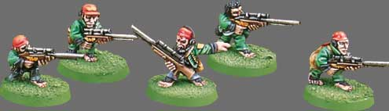

Ratlings are tolerated in some regiments because, despite their obvious short fallings as soldiers, they make excellent shot(and cook). Ratlings are natural snipers, providing covering fire for advancing column, or making use of the torn up battlezone landscape in attrition wars, often going to ground for days at time, waiting for a kill.

尽管作为士兵，莱特林人死得很快，但他们却个个都是好射手（还能烧一手好菜），所以他们还是会出现在一些防卫军的师团中。莱特林人是天生的狙击手。他们时而为部队的前进提供火力掩护，时而利用一场消耗战后留下的战场废墟作为隐蔽，在地下待上数天来等待狙杀敌人的机会。

It is also worth nothing that petty crime rates tend to rise when ratling squads are attached to regiments. Remain vigilant and report any infractions of the Immortal Emperor’s law to your squads commander.

对于一个师团来说，编入莱特林部队以后，小偷小摸犯罪率上升这种现象，已经不足为奇。但是，你仍然要对他们保持警惕，并随时向你的长官报告这些鼠人任何违反伟大帝王的法典的行为。

Section 5    Company Structure

连部人员配备

见图：

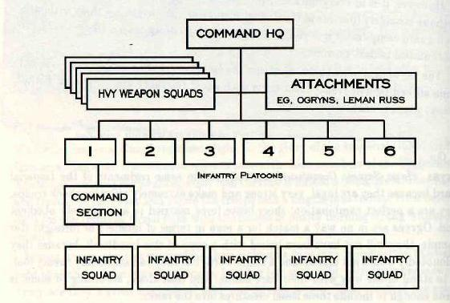

从图上可见：重武器班组和其他一些部队如猿人和黎曼鲁斯坦克均为连部的直属部队，而不是分配到各个步兵排当中去；除了以上的部队之外，一个连还由6个普通的步兵排组成，每个排又由5个班组成（至于每个班多少人？不太清楚~请老妖们赐教。。）

Section 6    Heavy weapon squads

重武器班组：

(i)General Introduction:

Men who demonstrate a certain affinity with specialized weapons are gathered together into smaller squads and given training to turn them into effective support fire teams. These teams are tasked with providing sustained and accurate fire from the most powerful hand held weapons used in the Imperial Guard, to lighter platoons as they advance. Being part of a heavy weapon squad demands skill, strength and a stout heart. They are primary targets for the enemy’s own heavy weapons and marksmen, so can expect their fair share of incoming fire.

(i) 在帝国的军队中，那些显露出对专业武器有特殊兴趣的人会被调集到一支更小的部队里，并将他们训练成有效的火力支援部队。这些重武器小组的任务是：使用他们手中的，也是整个帝国防卫军内使用的威力最大的手持式武器来给部队提供持续精确的火力，为部队前进提供掩护。要成为一名合格的重武器组的组员，你需要有过硬的技术，耐久的体力以及不屈不挠的意志。这些重武器小组同样也是敌人重武器以及神射手们的首要攻击目标，可以想象他们承受了敌人相当多的火力。

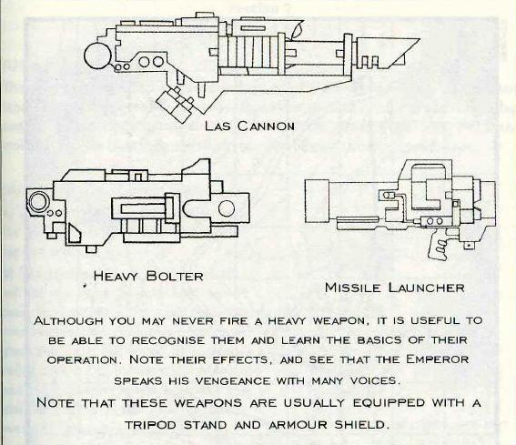

(ii) Fire support squads are equiped with heavy bolters, flamers and autocannons. These groups will advance with the rest of the column, laying down devastating arcs of fire in order to suppress enemy infantry formations that might otherwise harass the vanguard. They are also trained to spot and neutralise light scout vehicles.

(ii) 火力支援班组配备了重型爆弹枪，火焰枪以及自动加农炮，这些小组会跟随大部队前进，设立摧毁性的环行火力网，以便于压制敌人的步兵编队，同时也能对敌方先头部队进行持续打击。他们同样被训练成能够发现敌人的轻型侦察车辆并攻击使其丧失行动力。

（iii）Antitank support squads are a trooper’s best friend in the face of incoming enemy armour. They are equipped with lascannons and missile launchers. These squads will stay back from the advance, using incoming targeting information to pinpoint and neutralize enemy tanks. They play a crucial role within the army, as a well dug-in tank can completely stymie a column’s advance.

(iii)

当部队遭遇敌人装甲车辆时，反坦克支援班组便成了他们的救命稻草。这些部队配备了镭射加农炮以及导弹发射器。他们通常被部署在大部队的后方，通过前方与敌人接触的部队传来的信息，对敌人的坦克实施精确打击，摧毁这些坦克的行动力。由于在战斗中，仅仅一辆部署在要害位置的坦克，就可以成功地阻挠部队的推进，这就使得反坦克支援部队在军队中扮演了至关重要的角色。

(iv) Mortar support squads stay well behind the font lines. Their priority is to hurl down a hail of suppressive fire and pin enemy troop formations in place while the rest of the column moves in for the kill. Mortar teams rely on accurate targeting information relayed back from the scouts and forwardmost squads. They can also fire indirectly, lobbing shells over woods, hills or friendly positions to bring down explosive death on the heads of foes skulking in hiding holes.

(iv)

迫击炮支援班组，指挥官通常将他们精心部署在前线的后方。迫击炮支援班组的首要任务是向敌人倾斜冰雹般的火力，将敌人部队压制在一小块区域内，以便己方部队上前把他们给了结了。迫击炮班组的攻击往往依赖于侦察兵和前沿部队传回的精确坐标信息。不过，他们同样会有意地执行非精确打击，将弹药倾泻在树林中，山丘上甚至是友军阵地的周围，炸飞那些藏匿在掩体中的敌人。

P.S. 图中文字：

Although you may never fire a heavy weapon, it is useful to be able to recognise them and learn the basics of their operation. Note their effect, and see that the Emperor speaks his vengeance with many voices.

Note that these weapons are usually equipped with a tripod stand and armour shield.

虽然你可能永远也不会用上一把重武器，但能够成功识别出它并了解它的基本原理仍然对你有好处。注意这些武器对敌人的效果，看看帝皇是如何以各种方式向敌人倾泻他的盛怒。

注意这些重武器往往配备了三脚支架以及防盾。

Section 7    Map Reading

@使用地图

(i) General Introduction

The ability to read a map and use a compass quickly and accurately is of great importance. It is imperative to be able to coordinate your position in unknown territory. Map and compass reading is not arduous, it is no more than getting a clear idea of what the ground looks like from the map, and a clear idea of which direction to advance.

在战场上，能够迅速并精确使用地图和指南针的能力显得尤为重要。同样，你也必须具备在未知区域确定自己所在位置的能力。使用地图和指南针并不困难，你所要做的仅仅是从地图上弄清楚地形，并确定朝什么方向前进而已。

(ii) Use of the Guard Issue Compass

如何使用军队发放的指南针

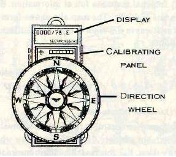

a) You must be thoroughly familiar with the compass and know how to use it during day or night.

你必须十分熟悉指南针，无论在白天还是黑夜都知道如何使用它。

b) The compass is an instrument that will tell you where the polar north lies. It must be recalibrated for each planet as soon as planetfall is achieved. The dial is graduated into 360 equal subdivisions called degrees. “0” indicates polar north and readings go clockwise around the dial. 90 degrees is east, 180 degrees is south, 270 degrees is west.

指南针是一件用来告诉你北极在什么位置的小仪器。你必须在每次登陆不同星球后，立刻对它再校准。指南针的盘面被分割成360个相等的部分，每个都被称为“度”。零度便表示北极的方向，记住沿顺时针阅读盘面上的刻度。90度的位置是正东，180度是正南，而270度则是正西。

c) Using the compass you can determine which direction you are facing, and using the map, determine where you are going. At night the compass emits a luminescent glow. Ensure this does not give away your position!

你可以通过使用指南针来确定你正面朝什么方向，然后通过观察地图来决定你将朝什么地方去。在夜间，指南针会有夜光的效果，以保证你不至无法确定自己的方位。

(iii) Use of maps

如何使用地图

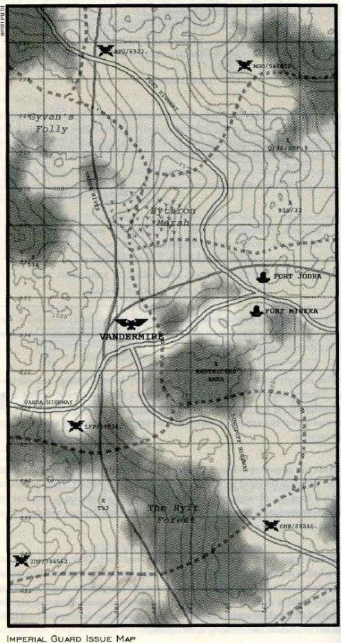

a) Maps represent part if a planet’s surface on paper. They are drawn to scale(1cm=1km,for example), and on Imperial maps this is represented in the bottom left of the map, next to the key.

地图是将星球上一部分区域的地表特征描绘在纸上。地图是按比例缩小画的（例如，1厘米=1千米），这个比例将标注在帝国地图的左下角，符号说明的旁边。

b) On Imperial maps north is at the top. This is also represented by an arrow. Your map should always be oriented; it is just as awkward to use an un-oriented map as it is to read this manual upside-down. There are two ways to orient your map:

北方在地图的正上方，这也会由一个箭头加以指明。每次使用地图时，你都必须确定地图的方向。不确定方向就使用地图，那么你和倒过来阅读这本手册的蠢货就没什么区别了。这里会告诉你两中方法来确定地图的方向：

(1)Draw a line on your map between two points you can locate: point ‘X’ and point ‘Y’. Stand at point X, sight along the X-Y on the map and turn the map until the line of sight point at Y on the ground. Your map is now oriented.

在地图上找出你肉眼所能观察并确定的两个坐标，在地图上标出这两个点，分别为X和Y，将两点连成一条直线。站在X点实际所在位置，让地图上X-Y的连线随着视线向Y的坐标方向转动，当视线指向Y坐标，而地图上的连线又与视线重合时，你的地图就能正确使用了。

(2)You may orient your map by a compass(ensure your compass has been calibrated to show polar north for the planet you are on). Place the hair-line along the north-south line on the map. Turn map and compass until the compass needle points in exactly the same direction as both lines. Your map is now oriented.

你可以用指南针来确定地图的方向（在此之前，务必先确定你已经调节过指南针的指针，使其正确地指向你所处星球上的北极）。将指南针上正北的刻度线与地图上的南北向的方格线对齐，同时转动地图和上面的指南针，直到指南针的指针准确地指向刻度盘上的正北方向时，你的地图便可以正确使用了。

c) You are oriented when you know your position on a map and the directions on the ground. If you lose your location on the map, first orient it. Select a feature of terrain(a hill), and from that draw a line on the map towards yourself. Do the same with reference to another terrain feature. The point where these lines cross will be your location on the map.

当你确定了自己在地图上的位置，并熟悉了附近区域的每一条线路，你就有了前进的方向。如果你无法确定自己在地图上的位置，先将地图调整到正确的方向（用上面所说的两种方法），选择一处有特色的地形（比如一座山），在地图上以那个点为起始向自己的方向画一条直线。参考地图上的另一个点，把这个动作再做一遍。两条直线的交点，就是你在地图上所处的位置。

d) The map is split up into a grid system. They are parallel lines, running north-south, and east-west. Beginning at the lower left(south-west) the lines are numbered, running south to north, and west to east. Using these numbers you can designate any square on the map by giving the numbers of the lines which intersect at its lower left hand corner.

地图被南北向的和东西向的许多平行线分割，形成一个平面格栅系统。这些平行线被从左下角开始一一标号。通过给出两条交错线焦点处的两组数字坐标，你就可以将自己的部队指派到地图上的任何地方。

e) If you need to designate a map position more closely(for pinpoint artillery attacks, for example) divide the sides of the square into ten equal parts. These points can be used to etablish a more accruate grid reference. Then a point becomes more accruately shown.

如果你需要得到更接近地图上某一位置的坐标（例如为了实施精确炮火打击），那么就将每块区域的边框再十等分。这些等分点可以用来建立一个更为精确的平面格栅系统，从而使地图上的坐标也能显示得更加精确。

f) Imperial maps are full of information, detailing cities, roads, rivers, gun emplacement and hills. The map also shows from lines, called contours, which represent the variations in elevation of the planet surface. This sort of information is invaluable to a soldier.

帝国的地图上充满着各种信息，在平面上详细描绘了城市，道路，河流，火力部署点和山脉的地理位置和特征。地图还通过画出等高线来代表行星地表不同区域的海拔高度。可以说，地图信息对于一个士兵来说是极为宝贵的。

Section 8    Security of the Column

@纵队警戒

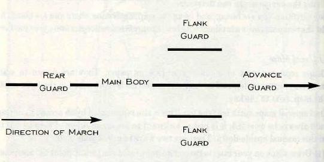

图中:Advance Guard:侦察尖兵  Flank Guard侧翼保护  Main Body纵队主体  Rear Guard垫后部队  Direction of March行军方向

(i) General Introduction

Information regarding the enemy’s whereabouts is imperative if a commander is to use his troops properly. If he does not know where they are, he cannot reach out and mortify them. For this reason he must ensure the security of the column, whether at rest, on the march or in combat.

关于敌人行踪下落的信息，对一个想带好部队的指挥官来说是极为重要的。如果他不知道敌人在哪，自然也就无法接近并给予打击。也正是出于这个原因，他必须保证：无论在休息时，行军时还是进入战斗，他的部队都是安全的。

(ii) The Role of the Scout

侦察兵的任务

a) You may be appointed as a scout, either independently or in a detachment. Your principle role is to prevent the main body of the column from being surprised. You become the eyes and ears and you must prepare yourself to watch out, report on, and engage the enemy if necessary, all in the greater interest of the troop column.

你有可能会被指派为一个单独的侦察兵，或是加入一个侦察小分队。你的基本任务就是避免大部队受到敌人奇袭。你就是部队的眼睛和耳朵，你必须做好充分的准备，要密切注意周围的动静，随时汇报情况，并在必要时与敌人交火，一切均以部队的利益为重。

b) As a scout you must be able to see and hear things others would miss. You must pick up indistinct and motionless objects, as well as moving ones. Long periods of painstaking search are often needed before a hostile is located.

作为一个侦察兵，你必须足够敏锐，以便看到和听到常人察觉不到的东西。你既要能看清运动中的物体，也要能辨别静止和模糊的物体。在确定敌人方位前，通常需要侦察兵进行长期而又艰苦的侦察工作。

c) You may be sent out to the advance, flank or rear, and a great amount of flexibility and independent thinking will be required.

你可能被指派为先头部队，也可能负责侧翼或者垫后。你将会碰到很多需要你灵活机动和独立思考的时候。

d) When the column moves forward to attack, it is a scout’s job to precede it and ensure it follows the correct path, you must investigate danger areas, neutralise enemy scouts and select areas where it may be protected from enemy fire. You must also ensure against counterattack and surprise fire, and select firing positions and spot targets. As a scout you take on enormous responsibility, and the safety of the column and success of an action may rest on your shoulders. Failure to carry out your duty will have severe consequences.

当部队要前行展开进攻的时候，侦察兵的任务便是先于部队行进，确保队伍选择的是正确的道路；查探前方危险区域；消灭敌人侦察兵；并寻找可以为部队提供火力防御的地形。你还必须要保证能对付敌人的阻击和暗处的冷枪，为部队选择合适的射击位置并及时发现敌方目标。部队的安全和行动的成功与否都取决于你，作为侦察兵你将肩负巨大的责任。如果你玩忽职守，则会导致极其严重的后果。

e) As a listener, spotter or sniper you may enter the enemy lines to get information on them. It is also your responsibility to neutralise enemy scouts attempting the same thing. If you see an enemy scout, assess the situation immediately. Is he alone? Has he spooted you? Can you kill him silently? The last question depends on a number of factors: his position in relation to yours, terrain, light conditions and so on.. If you decide to kill him, try to do so silently so as not to warn the enemy and give away your position. Remember, the safety of the column is top priority. Try to manoeuvre around behind him, using cover as explained in section 9. Recite the Litany of Stealth(refer to Emperor’s Benedictions) to decrease your chance of being heard. Creep up behind him, pull his head up sharply to expose his neck then thrust your knife deeply into the side of his throat. This should ensure he does not cry out and betray your position. Try and hide the body by covering it with leaves or debris.

如果你要执行窃听，观察或是狙击手的任务，那么你将需要潜入敌人的防线内以获取信息。反过来，你也需要去消灭那些企图以同样的目的，潜入我方阵地的敌人侦察兵。在发现一个敌人的侦察兵时，你要迅速对事态作出判断：他是一个人吗？他有没有发现你？你能不动声色地干掉他么？最后一个问题取决于以下一些因素：你们之间相对的位置，地形，周围光照程度等等。如果你决定干掉他，尽量要做到不动声色，以免打草惊蛇暴露你自己的位置。记住，优先考虑整支部队的安全！你可以尝试迂回到他的背后，找一些掩护（在第九节的一些段落中会给出详细解释），从背后慢慢地逼近他，扑上去猛地扭起他的头，朝他他暴露的脖子上捅上一刀。这样他就没法叫出声来，也就不会暴露你的位置了。随后用树叶或垃圾把尸体掩埋了。

f) You may be ordered to advance ahead of the column, keeping visible and perhaps shouting or firing your weapon to draw fire from hidden enemy gun emplacements. This forces the enemy to play his hand, negating any plans he had of surprising the column.

你有可能奉命带领部队前行，确保你自己在友军视线范围内。你偶尔可以叫喊几声或者放一阵空枪，引诱敌人的隐藏火力点开火，从而迫使敌人提前动手，取消原先的偷袭计划。

g) A great deal depends on the scout. Always remember your commander’s orders. Courage and faith will be required in the carrying out of your duties. Often you will find yourself in situations you could not have anticipated in advance. Remember your mission, consult relevant prayers in the final chapter of this book, and keep faith in the Immortal Emperor, and you will succeed.

大量的事情都需要依靠侦察兵来完成。时刻牢记上级的命令。在执行任务时，需要你有足够的勇气和信心。你时常会发现自己的处境在先前根本不曾预料到。这时，牢记你的任务，参考本书最后一章中相关的祈祷，并怀着对伟大帝王的坚定信心，你就能够成功！

附:侦察基本过程图解

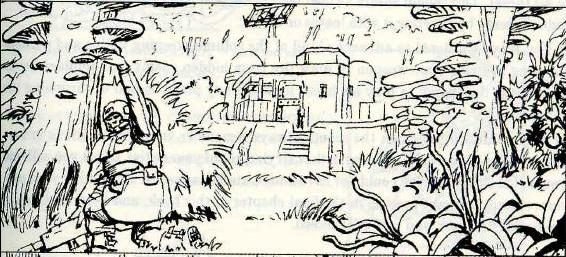

侦察兵发现前方开阔地,并示意部队停止前进

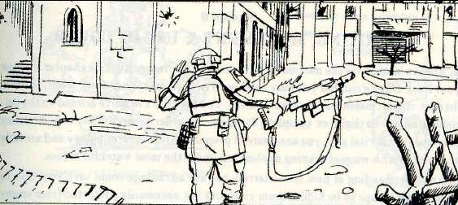

侦察兵发现危险区域,示意部队加速前行

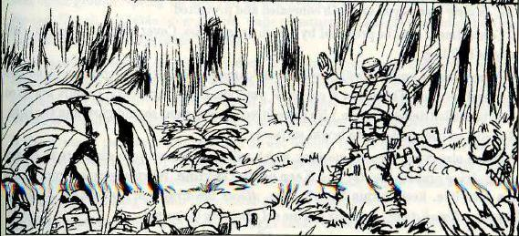

侦察兵确认区域安全,十一部队继续前进
