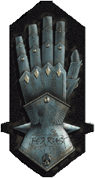
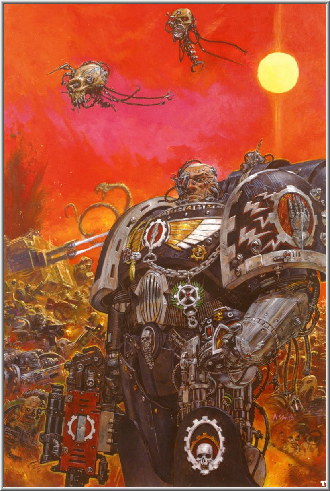
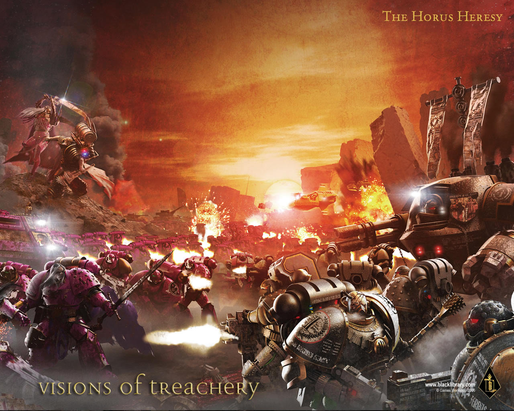
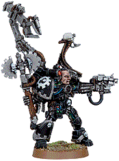
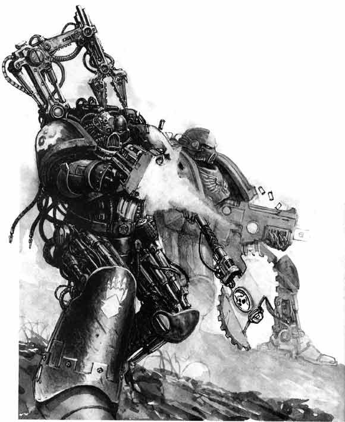
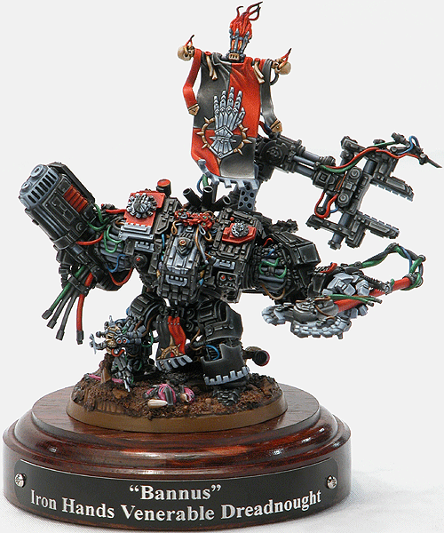

# 星际陆战军战团史补完——钢铁之手Iron Hands

星际陆战军战团史补完——钢铁之手Iron Handsfenixbj

额……翻得费力啊这是18个没消失的原军团最后一个没现成翻译的，于是自己动手补完，结果发现这个团真的很怨念的说～～～～先不剧透，各位自己看吧文字资料来自维基Iron Hands钢铁之手

基因原体  Ferrus Manus战嚎  “肉体唯有软弱！”("The Flesh Is Weak!")颜色涂装  黑色与银色在战锤40000的动荡宇宙之中，钢铁之手是星际陆战军最初的20个军团之一，尽管他们对神皇的信仰是如此的无可动摇，但他们同时也抱定这样的信念——人类肉体虚弱而且易被腐化，因而他们倾向于将自己的身体用“绝对”可控的机械替代品替换。

历史Ferrus Manus在帝国尚处黎明之时，人皇的二十个基因原体由于一起神秘事故而散落到广大的星系之中，其中之一出现在了美杜沙的世界（别把它与那个美杜沙V混淆了，美杜沙V出现于美杜沙V陷落战役中），，燃烧的轨迹滑过烟云笼罩的天空，他的太空舱撞击行星是如此猛烈，据说山脉也差些化为齑粉。数年之后，这位伟大的战士以Ferrus Manus之名闻名于世，他大步流星，充满自豪地行走于新家园那众多的氏族部落之中，他相信竞争有益进步，因而从不干涉任何部落纷争。由此之故， Ferrus Manus作为每个部落的荣誉成员得到广泛敬重，而他伟大（经常被更加夸大）的传奇故事在人们中间流传着。众多传奇故事之一，是基因原体与巨大银龙Asirnoth之间的史诗般的战斗，这只巨龙据说拥有一层远胜任何甲胄的活体金属外壳。据传，Ferrus在耗费多日追踪这头怪兽之后，并不能凭一己之力将其击败，他的无数重击没产生任何可供辨识的战果。然而，Ferrus最终将怪兽淹没在岩浆之中，将其杀死。当Ferrus将手移出岩浆，巨龙已被彻底毁灭，而他发现自己双手已为活体金属覆盖——与巨龙外壳如出一辙。不断有暗示指出Asirnoth是C'tan的造物之一，由C'tan的“活体金属”制成，是某种部署在行星上的守护兽，以护卫可能的Necron墓穴，甚至是C'tan自己的栖息之所，Ferrus在屠龙过程中可能受到某种程度的腐蚀。Ferrus回到了部落，将旅行之所学尽授愿学之人，他也能够用金属打造各式古怪却十分强大的工具，并用自己的金属双手为之塑形。在他的指引之下，美杜沙的众部落变得强大而繁荣。帝皇降临当美杜沙历史上第二次天空被撕裂时，众部落困惑了，对这个迹象可能代表什么，他们无法给出确切的答案。Ferrus一言未发，立刻离开部落，前往异像着陆之地。数周过去了，Ferrus没有任何音讯，但在部落作出任何探寻他们拯救者命运的决定之前，天空喷泻出强大的闪电风暴，地面猛烈震动，恐惧侵入了每个人心中。这些事件持续了八天，在那之后，据传整个世界陷入不同寻常的死寂。一天之后，Ferrus回到了部落大会的所在，同时护卫在一个令人敬畏却又为之鼓舞的神秘人旁。描述两位伟人行动的故事繁复多样，但大部分有共同的主题，即一次战斗或力量的试炼，是反常风暴降临的原因所在。无论山中发生了什么，每个人都已经清楚：Ferrus与帝皇已建立了基于相互尊敬基础之上的紧密关系。大远征尽管美杜沙人民与庞大帝国之间裂隙未消，Ferrus还是接受了第十支星际陆战军的指挥权，军团被命名为钢铁之手，以纪念基因原体的金属双手。军团旋即将他们的威势加入大远征中，他们在星系之中英勇奋战，毁灭一切逆帝之言。军团的征募任务落到了美杜沙上，Ferrus早年关于有益竞争的信条，使部落战士远超能够适应星际陆战军严苛生活的水平。军团笃信帝皇在动荡时代之后再次一统人类的努力，坚信人类如果持续分裂，最大的敌人就只会是他们自身。军团也坚信，人性的弱点必须被彻底铲除，这也致使那些不愿不从帝皇领导及教诲的人被挑出后杀死。荷露斯之乱在荷露斯于伊斯塔万III上反叛开场之时，Ferrus Manus的老朋友，帝王之子的Fulgrim试图劝诱钢铁之手基因原体加入反乱，尝试失败了，而Fulgrim逃出去时几乎丧命。对叛逆的愤怒充斥了Ferrus和他战士们的头脑，因而他们对Rogal Dorn的命令十分感激，与暗鸦守卫及火蜥军团一道，同荷露斯及他的副手们对抗，并完全击溃了他们，而作为第二波，由午夜领主，钢铁战士，阿尔法军团以及怀言者的一支分遣队组成的大军会跟随并支持他们。钢铁之手，暗鸦守卫及火蜥军团在伊斯塔万III上强行着陆并拿下了着陆点，但也付出了惨重代价。Ferrus Manus无视Corax和 Vulkan的忠告，发狂般地追杀逃离的叛军，同时寻找着Fulgrim以便和他大打一战，他的精锐部队——大部分由军团的终结者和无畏机甲组成——跟随着他。Ferrus和Fulgrim，两个以前的好友角斗了起来。正是那时荷露斯收紧了他的陷阱，战帅调动了后备队，并命令“逃跑的”部队停止佯败，转入进攻。

Ferrus的部队寡不敌众，被包围了起来，Fulgrim在一对一战斗中打败了Ferrus，但无法说服自己杀掉这位老朋友，Fulgrim体内的一只Slaanesh恶魔趁此夺取了他的身体，对Ferrus进行了斩首。血雨之中跟随而来的是对钢铁之手的大屠杀，Ferrus的首级之后被Fulgrim呈送给荷露斯，作为忠诚的证明。不久之后，荷露斯之乱到达了它那无可避免的终结。荷露斯的部队进攻地球失败，荷露斯被杀而帝皇进入了黄金王座，这一切使得钢铁之手在返回美杜沙后陷入了绝望。这在之后转变成了对混沌星际陆战军和其他叛徒的彻骨仇恨，这种愤怒开始成为钢铁之手的动力，他们开始摧毁自己或他人任何可觉察的弱点，并相信他们的行动有益于人类。他们为自己在最黑暗的时刻未能身处地球感到愤恨，他们坚信如果他们当时在那儿，荷露斯无需帝皇的牺牲即可被击败。在那之后，他们与其他军团隔绝开来，任他们自己发挥，并只与其后继战团保持最低程度的联系。组织钢铁之手战团的组织在二次建军后背离了阿斯塔特圣典。战团从美杜沙部落吸取了很多组织形式，每十个部落连是一个整体，拥有自己的指挥层级，精英部队，信条和传统。每个部落连的一个战士会被提名到钢铁之手大议会以代表他们的同胞，同样的，战团没有单一的指挥官，这是一种预防措施，以便再无一人能将整个战团引入迷途，就像荷露斯之乱中发生的那样。对阿斯塔特圣典的进一步违背体现在没有牧师上，代之以由一个由陆战军战士担任的职位：“钢铁圣父”，他的角色是牧师与技术军士的复合，钢铁圣父被认为是帝皇和机械神教的双重宗教代表。

指挥部美杜沙的地质结构太过不稳，无法支持堡垒修道院，战团被迫为每个部落连创建移动基地，这些移动的巨兽在星球表面毫不停歇地旅行，并且是完全自动化的，这允许基地在占用的部落连离开，继续他们对抗软弱与腐化的远征时继续移动。招募对于新兵，这里没有侦察连，作为替代，每个部落连必须从美杜沙上相关联的部落中招募新的信徒，以保持力量。一旦教化完毕，信徒的左手会被机械替代装置替换，这只是他们一生机械化过程的开始。战斗信条钢铁之手对软弱与腐化的憎恨极大地影响战团的信条与行动，这种信念甚至延伸到身体之外。因为身体会受伤，残缺甚至屈服于肉体的诱惑，钢铁之手寻求消灭任何自己可知内在罪恶的方法，而任何就意味着可能，为杜绝可能，通常会将身体部分替换为机器。

对一切形式软弱的憎恨被钢铁圣父们在战斗中特别加以利用，只要战团无视敌人，带着荣誉感和决心投入战斗，这些充满怨念的的陆战队员就会如同机器般无情的前进，疯狂地扑向敌人。无畏机甲和终结者十分稀有，因为大部分的装备和机器在登陆点大屠杀中损失了。由于他们有机组织与机械的高度结合，幸存者们得到高度的尊敬。每个终结者小队都少有作战，但他们创造出的鼓舞感还存在于阶级和档案中，这被用于可以让精英老兵穿戴终结者装甲来领导战术小队。出于类似的原因，无畏机甲会在形势需要时领导部队，并且有几个部落连的领袖就被包裹在无畏机甲的装甲石棺内。外观钢铁之手在军团建立后从未改变，他们的动力装甲被涂成黑色，配以白色的徽章和小队标记。每个部落连都有独立的符号，涂在与战团徽记相对一侧的肩甲上，小队标记则被置于左脚下侧。战团徽记是一只铁护手，即Ferrus Manus被金属覆盖的手的象征。著名人物神圣无畏Bannus：当前Kaargul部落连的领袖，大部落议会的一员。

钢铁圣父Paullian Blantar：Kaargul部落连的一位钢铁圣父，他的生化增强技术无人可比，而他的精益求精毫无疑问直接影响着战团的前进方向，他在工业世界Kaladrone上领导了一次针对阴险的黑暗灵族的反击，救下了身受重伤的神圣无畏Bannus。一些背景对钢铁之手战团最通常的抱怨是他们的背景资料是最少的，这种情况在90年代末才有所改善；钢铁之手与C'tan的联系被援引得越来越多，他们与机械神教的紧密联系及对机械控制的投入可能使他们与

虚空之龙发生联系，那是沉睡在火星的C'tan，可能是也可能不是机械神。
