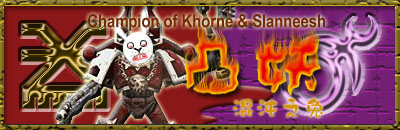

# 暗夜主宰兔妖翻译版

暗夜主宰兔妖翻译版·应某人要求

兔子半妖

暗夜主宰——黑暗的使者

暗夜主宰永远属于黑暗。从他们被创立的初期起，他们军团长那黑暗的基因种子就以暴力与绝望感染着他们。虽然他们曾在皇帝的麾下以可怕的效率四处征战，但他们最终成为了首先投靠黑暗的军团之一。他们像一场瘟疫，在数不胜数的星球上散播恐惧与痛苦。

起源

根据ＫｏｎｒａｄＣｕｒｚｅ那充斥着异端思想的自转手稿——《黑暗》，我们得以了解他关于早年生活的记忆：他被放逐出天堂，在一个闪亮的球体中降落在永远被夜幕笼罩的行星Ｎｏｓｔｒａｍｏ上。他幼小的躯体在撞击ＮｏｓｔｒａｍｏＱｕｉｎｔｕｓ城时，摧毁了无数层废墟与破败的建筑，最终穿透了地壳，在深入行星的液态核心前停了下来。他的冲击在行星那坚固的金属地表上留下巨大的灼痕，这也使得新生军团长一出生便深陷黑暗之中。冲击产生的坑洞很快被惊惧疑惑的人们填埋了，他唯一的出路便是游过岩浆，从火山中到达地表。Ｑｕｉｎｔｕｓ城里的ＡｒｃａｎａＰｒｏｇｅｎｉｔｕｍ以模糊含混的语句详细记载了当时的场景：

“…一个闪着光芒的儿童形体，通过洞口爬到破碎的街道上。融化的金属从他的肢体上滴落，嘶嘶作响……它是个恶魔，毫无疑问，一个婴儿居然以成人的方式说话……它的眼神犹如黑曜石般冰冷黑暗。”

由于大气被严重污染，Ｎｏｓｔｒａｍｏ的白昼几乎和午夜同样黑暗无光，永久的黑暗笼罩着这颗行星。只有那些富人可以享受光的奢侈——统治阶层居住的地区，高悬的天蓬散发着黯淡的光芒。行星的地表由金属构成，Ｎｏｓｔｒａｍｏ的主要出口产品也正是这些金属。因此，行星的表面覆盖着无数金属加工厂和化工厂，空气中弥漫着有毒的烟雾。社会的底层是那些深受压迫的工人。而富人们肆意镇压杀戮那些意图改变生活现状者。杀手、窃贼和诈骗犯四处横行。唯一的“法律”由那些富人雇佣的暴徒来执行，目的是消灭一切反抗者。绝望主宰这行星，让人无处可逃。阻止它人口增长的原因不是战争、疾病和法律，而是自杀。

不像他那些有人扶持栽培的兄弟，ＫｏｎｒａｄＣｕｒｚｅ是自己一步步爬上统治地位的。他钢铁般坚韧的体质和他的生存本能使他能轻松应付这座城市中的一切危险。他独自在街道上潜行，猎食四处游荡的动物。没有最好的教师教导他文化，也没有高贵的武士传授他武艺。他孤独地爬上食物链的顶端：一开始是以老鼠或其他害虫为食，接下来捕猎漫游的狗，最后他开始吞食人的尸体——那些无法适应这黑暗社会的受害者。他强壮的躯体上凝结着污血，使他的形象更加可怖。

ＮｏｒｓｔｒａｍｏＱｕｉｎｔｕｓ的净化

众所周知，ＫｏｎｒａｄＣｕｒｚｅ一生都被他的预知能力所困扰。不像那些艾达灵族人看到未来的无数种可能，他唯一能看到的便是无法逃脱的黑暗与痛苦，是他必定踏上的黑暗之路。在《黑暗》的第二卷中有如下记载：

“一次又一次，在痛苦的纠缠下，我看到了即将降临在我身上的事。在这些清醒的梦中，我空手夺去了无数生命，并取下他们的首级作为战利品。我反复被自己的父亲杀死，我的孩子们疯狂屠戮虐杀他们的兄弟。我的名字将与恐惧划上等号。但是，我看到的最多的场景是一道纯净的光如长矛般射向我的星球，将它化为飞灰。”

一些未被记载的事深刻地影响了Ｃｕｒｚｅ，将他拖入了追逐与杀戮的生活中。初期，他只是对那些他认为不对的事加以干预，像一个义务警员般追逐犯罪者。但很快地，他开始有计划地猎杀那些罪犯。

一开始，一些社会头面人物神秘地失踪了。当然，他们的位置随即被其他人取代，此事也被迅速遗忘。接着，一个燥热的夏季降临在Ｑｕｉｎｔｕｓ。一些四处演讲的煽动者也开始离奇消失。居民们便很快学会了不发表自己的意见。许多臭名昭著的罪犯被一个从不现身的杀手开膛破肚，然后弃尸街头。统治阶层官员的尸体被倒挂在高高的窗户上。无头的尸身被剖开肚腹，体内的污秽被暴露给同样污浊的大气。许多尸体无法辨认，因为猛烈的攻击将他们打得面目全非。残骸堆积在排水沟中，乞丐和贫民们的孩子们将尸体上的珠宝首饰洗劫一空。显然，Ｃｕｒｚｅ对那些触犯他的法律的人毫不留情。

一年内，Ｎｏｓｔｒａｍｏ的犯罪率迅速降到了０。社会风气大大逆转，而且向其他城市蔓延。Ｑｕｉｎｔｕｓ仿佛有一道无形的宵禁令，没人敢在傍晚后还逗留在户外。曾经喧闹的午夜街市变得如同坟墓般寂静。母亲们开始以“午夜游魂”的故事来恐吓哭闹的孩子们——这个名字迅速流传开：人们传说有一个丑恶黑暗的生物在夜间穿行于街头巷尾，随时准备用它布满血污的爪子来残杀迷路者。Ｑｕｉｎｔｕｓ的居民们生活在恐惧之中，甚至不敢随便说话，生怕自己的言论会成为午夜游魂杀人的理由。Ｎｏｓｔｒａｍｏ的统治权，就这样落入午夜游魂的手中。

黑暗王者

很快，ＫｏｎｒａｄＣｕｒｚｅ的世界获得了“救赎”。除了他本人外，再也没有任何犯罪，再也没有任何杀手。城中所有人的畏惧和仇恨都指向他一人。再没有人害怕会被打劫或者在熟睡时被射杀，因为所有人都只害怕午夜游魂。他选择一人去背负所有的罪责，并且坚强地挺了过来。他的自我牺牲给了他力量，很快他也自称为午夜游魂。下文摘自Ｇｈｅｒｅｔｉｃｕｓ的日记。此人是一名贵族，日记写于他效忠Ｃｕｒｚｅ之前。

“他在等待着，等待我们这些仅存的贵族。当他还潜伏在黑暗中时，我们曾以为他是……（日记磨损）他蜷缩在他亲手夺得的王座中，然而看上去依旧高大得难以想象。当他……时，我几乎无法呼吸。他消瘦黯淡的身影缓缓步入光与影的交界处，那一瞬间，我觉得他似乎是要扑过来……我恐惧得无法动弹。

幸好我们对他还有些用处…他让我们做他的代言人，他的命令将通过我们传达给整个Ｎｏｓｔｒａｍｏ。他的话就是不可违背的命令，胆敢违抗他的人必定死无葬身之地——不是由我们或其他‘执法者’去动手。他会亲自找到那个活得不耐烦的家伙，给其他不安分的人树立个‘榜样’。他的语调中藏着什么东西，让我想拔腿就跑……可是，我们除了服从他外别无选择”

于是午夜游魂成为了ＮｏｓｔｒａｍｏＱｕｉｎｔｕｓ的最高统治者，并以近乎贪婪的勤奋学习一切知识。他是一个宽容贤明的统治者，然而一旦他听到有任何不公发生，他便会独自去追逐那些罪犯。他在空旷的街道上紧跟着罪犯，直到疲劳和绝望将他的猎物彻底击垮，这时他才会对猎物下手。虽然这种行事方式我们不能赞同，但必须承认，他的菩萨心肠与雷霆手段的结合，使得居民们成为了诚实高效的工作者。金属的出口量成倍提高。在午夜游魂的统治下，再无不公存在，Ｑｕｉｎｔｕｓ变得繁荣昌盛。其他城市也都纷纷效法，因为他们都害怕午夜游魂会找上门来。

帝国的史学家们发现午夜游魂的遍布Ｎｏｓｔｒａｍｏ之时，大远征的前锋刚好到达Ｎｏｓｔｒａｍｏ所在的星系，在那里，灰暗的Ｎｏｓｔｒａｍｏ围绕着它衰老的恒星。以下是Ａｓｔｒｏｐａｔｈ（应该是星系导航员之类的）Ｔｈｏｑｕａｌ的个人记录，发生在帝国战列舰“天神之剑”号进入Ｎｏｓｔｒａｍｏ星系之时。曾经有十六名以上的学者因为对这段文献隐含内容的过度好奇与声张而送了命。

“在ＬｏｓｓｅｒＡｒｃａｎｃｉ牌的最终结果得出前，我想我已明白了陛下的座舰为何要改变航向，飞向这昏暗的星球。月亮、烈士与妖怪三张牌排成三角形。国王这张牌刚好在陛下的脚下。可奇怪的是，‘希望’反了过来，可怕的‘死亡’高悬在牌阵最上方。然而航向已经设定，我个人的意愿又怎敢与陛下的意志相违抗。”

Ｎｏｓｔｒａｍｏ的历史中杂乱地提到过一个被称为“光的造访”的事件。皇帝驾临Ｎｏｓｔｒａｍｏ一事产生的影响，对Ｎｏｓｔｒａｍｏ居民们的影响是如此深远，仿佛世界被整个翻转了。虽然皇帝的造访一开始给人们以希望，然而最后却是以悲剧告终。

以永远黑暗的天空作为幕布，皇帝的舰队在光芒中降下。Ｑｕｉｎｔｕｓ的居民们克服了他们的恐惧，纷纷涌上街头，仰望天空——这是他们中许多人一生中第一次走出户外。光明确实到来了！成年人像是孩子般傻站着，目瞪口呆地面对着他们从未见过的光。一些人喜极而泣，一些人丧失神智，还有一些人趴在地上，以为他们都要没命了。

人皇已通过他的占卜了解了这个世界。居民们整洁而高效，为了所有人共同的理由而埋头苦干。夜晚的街道寂静无声，似乎整个星球都睡着了。显然，他们对帝国的荣耀一无所知，但他们的领袖却以无限的权威统治着这星球，使它成为工业行星的模范：无与伦比的效率，天生的高度团结以及绝对的服从。

借由皇帝的随从们的笔记，我们有机会了解皇帝与午夜游魂会面时的场景。甚至皇帝对他说的一些话都被记载下来。

光芒的化身——这是居民们对皇帝一行的称呼——步入Ｑｕｉｎｔｕｓ，酸雨突然消散，似乎它也感知到了人皇的出现。居民们沐浴在皇帝的圣光下。一张张苍白的脸，仰望着，期盼着，感受着光芒带来的温暖。那些长时间直视皇帝的人永久性的失明了——人皇闪耀的形象永远烙在了他们的眼中。

奇怪的是，在皇帝一行前进的途中，居民们都鸦雀无声。极限陆战队的ＬｙｃｉｕｓＭｙｓａｎｄｅｒ上尉在他的报告中提到：敢于抬头的居民眼中都充满着哀求，这些可怜的人怕是没见过任何真正的光。学者们推测他们大概是想从原本那种凄惨麻木的生活中被解放出来。

这条大道直指午夜游魂的无面之塔，而高大的他正在那里守侯。他平直的头发遮住了脸，让他能直视皇帝一行而不被耀眼的光芒刺退。人们如被风吹拂的麦子般散开，为走近的皇帝让开一条路。皇帝张开双臂，走向午夜游魂。

突然，午夜游魂剧烈地颤抖起来。他的手伸向双眼，仿佛要将它们挖出。他从颤抖的唇中挤出近乎无声的尖叫，猛地跪倒在地。他的顾问们赶忙退开——此情此景对他们而言过于可怕了。而皇帝依旧微笑着，缓步上前，优雅地将自己闪耀的手放在他的头上。他的尖叫停止了，手无力地垂在身体两侧，身体也不再颤抖。他的顾问们吓得赶忙上前，要不是由于人皇的威严，他们肯定早就扑了过来。

皇帝对午夜游魂轻轻说了什么，而午夜游魂的回答则响彻整个广场——从那天起，无论时间如何流逝，它依旧回荡难消。

“ＫｏｎｒａｄＣｕｒｚｅ，好了，没事了…我来了，我来带你回家了。”

“那不是我的名字，父亲。我，是午夜游魂。我知道，我早就知道你要来做什么了。”

Ｎｏｓｔｒａｍｏ的堕落

皇帝带来的希望很快随着他和午夜游魂的离开而消失了。一开始，有许多人为了黑暗之王的离开而兴奋不已——他们终于可以自由地说，自由地做，而不用单惊受怕了。虽然挂着虚名的管理层依旧存在，然而整个社会的风气依旧迅速地堕落腐化了。

根据一名不久后即自杀的官员Ｂａｌｔｈｉｕｓ的报告，自皇帝离开Ｎｏｓｔｒａｍｏ后，发展速度减慢，人群普遍陷入压抑和不安之中。

对于当地居民来说，最糟糕的事情就是皇帝的到来让他们知道，在外面还有无数光明美好的世界。而他们都明白，这些地方对他们来说，永远是遥不可及的。皇帝带来的光芒摧毁了人们抵抗黑暗的最后一道防线：无知。

午夜游魂很快适应了帝国的教化。然而即使在与其他的基因原体会面时，他依旧沉默寡言。在帝王之子的军团长Ｆｕｌｇｒｉｍ的辅导下，他轻松掌握了星际陆战队那些繁复的条例，并将它们牢记在心。他很快适应了地球的生活规律。在谈到地球时他总会说，那是一个完美的天堂。不久后，午夜游魂被正式宣布为暗夜主宰军团的军事首脑与精神领袖，回到了那些带着他的基因的孩子当中。

大远征的前锋再一次推进。午夜游魂展示了他对战略的独到见解，而他的新军团也以绝对的忠诚和效率领会了他的战术。他在军事上表现突出，但是在利用谈判的手腕解决问题时却显得捉襟见肘。于是他更倾向于在出手时全力以赴，力求一击得手。他的这种倾向很快影响到整个军团。当一次简单的外科手术式打击便可以解决问题的时候，午夜游魂往往会毫不犹豫地牛刀杀鸡。根据记载，有好几次他当着兄弟原体的面对那些与他发生争执的人大打出手。

在他担任暗夜主宰的军团长的最初数年中，他的军团像狂热的女巫猎人般疯狂地抹杀一切异端份子。他将他的孩子们改造成高效而又无情的战士，将残杀训练成他们的本能。根据记载，午夜游魂曾带领暗夜主宰突袭某个殖民地，将整个殖民地烧成平地，因为当地人崇拜某个农业神祉。

他下手过狠的另一个例证是，暗夜主宰曾经用病毒炸弹轰炸过某个大陆，只因为附近的某个小岛上突然冒出了供奉Ｓｌａａｎｅｓｈ的邪教。他鼓励他的军团在盔甲上绘制象征恐惧和死亡的徽记，以使他们的名声更加可怕。长着翅膀的头骨，死人般的面具，哀号的面孔及其他丑恶的形象被精心绘制在动力盔甲上。甚至敌人的首级也成被他们拿来装点自己的盔甲。

他的心理战术被证实是非常有效的。很快，由于他们的极端手段，暗夜主宰变得臭名昭著。只要暗夜主宰的舰队露下面，就足以将那些敢于反对帝国的星系吓得手脚发软。于是曾经的不合作者很快心甘情愿地向帝国交税，停止一切反抗行动并处死那些活得不耐烦的反乱份子——总之，只要不招来暗夜主宰的惩罚，做什么都好。

在带领着陆战队员们四处征战的同时，午夜游魂还下令在Ｎｏｓｔｒａｍｏ征召新兵。他深知他家乡的人们不敢违背他的命令，便理所当然地相信他们会像他在位时那样为了帝国的繁荣昌盛而努力工作。而事实上，Ｎｏｓｔｒａｍｏ已经不可救药地堕落腐化，一如他的降临之前。最后加入暗夜主宰的都是那些最冷酷无情、残忍凶暴的家伙。这些面色苍白，双瞳如墨的新兵接受了契约并发誓效忠——然后在暗夜主宰军团中，这样的问题新兵的数量以令人担忧的速度开始增长。

虽然作为皇帝的儿子，午夜游魂只需对人皇一人负责，可是他的兄弟原体们依然带着疑虑审视着他。Ｎｏｓｔｒａｍｏ的生活在他心中留下的伤痕日益加深。虽然他整日与诸位兄弟相处，但他总是刻意保持与大家的距离。在基因原体们的欢笑声中，午夜游魂永远是独自站在一边的寂寞影子。那些可怕的预感不时折磨着他，让他混身痉挛，疼痛难忍……即使兄弟们表露出对他的关心，他从不透露自己心中的黑暗秘密——他预见到自己的死亡，他看到暗夜主宰居然对其他星际陆战队员痛下杀手…就这样，他与其他兄弟的隔阂越来越深。

午夜游魂的秘密一直保护得很好，直到有一天，他向Ｆｕｌｇｒｉｍ（皇帝之子军团的基因原体。午夜游魂对身为前导师的他还是有一点信任的）吐露了心声。Ｆｕｌｇｒｉｍ的独特想法让他能够了解午夜游魂心中的痛苦与扭曲，能够了解暗夜主宰为何疯狂地追逐猎杀一切异端。

在一次严重的痉挛发生时，Ｆｕｌｇｒｉｍ及时赶到并伸出援手。午夜游魂终于认为自己有了一个可以倾诉的对象。通过Ｆｕｌｇｒｉｍ的转述，我们知道午夜游魂诉说着他的预感：他肯定自己会被父亲亲手杀死，原体的孩子们会自相残杀，而皇帝带到Ｎｏｓｔｒａｍｏ的光会将它永远摧毁。

Ｆｕｌｇｒｉｍ不久后又将此事转告了ＲｏｇａｌＤｏｒｎ（帝国之拳的基因原体，我认为这是基因原体最败最骄傲最喜欢打小报告的一个）。Ｄｒｏｎ认为这简直是对皇帝不敬。下面的描述记载了Ｄｏｒｎ与午夜游魂的对质，很显然，当时两人打了起来。

以下文字引自最高领主ＩｃｈａｂｏｄＬｅｔｈｒａｉ在庆祝Ｃｈｅｒａｕｔ星系大捷的宴会上做的记录（７２３２８２６·Ｍ２９）。这段记录被浸泡在油中以防止腐烂，并交由ＬｉｂｒａｒｙＳａｎｃｔｕｓ（地球上守备最严密的图书馆）严加看管。

“……ＲｏｇａｌＤｏｒｎ伤痕累累的躯体倒在石制地板上，血肉模糊，袍子被血浸透，口中发出勉强可闻的微弱呼吸声。而大汗淋漓的午夜游魂蹲伏在他胸前，模糊的身影仿佛一只面目可憎的白色石像鬼。他的脸转过来，长发遮蔽下的乌黑双眸紧紧盯着我们，尤然喘息不止。他在抽泣，可是脸依然因为愤怒而扭曲——仇恨和负罪感正在他心中争斗不息。”

至于此后发生了什么，我们无法找到正式的记载。似乎基因原体们聚集到一起商讨此事，自然，午夜游魂被关进自己的房间里。基因原体会议的最终结果我们无从得知，因为在不久后的何露斯大叛乱掀起的狂风暴雨中，它很快被遗忘了。

我们知道的是，在会议结束后，他们发现午夜游魂失踪了。看守他的荣誉守卫被杀戮殆尽。走廊、墙壁和天花板上遍布飞溅的鲜血与残肢。午夜游魂发动了自己的战舰，在其他基因原体发动足够的力量追击前，他的舰队冲入了亚空间。

许多追逐他进入亚空间深处的人因为缺乏基因原体的超人技巧与预感能力而迷航。在亚空间深处的航行是无法确切地判断与记录的，也许只用几小时，也许需要几个月的时间。这些追击者的勇气值得钦佩，但他们的追击已经注定徒劳无功。

暗夜主宰的舰队停泊在Ｎｏｓｔｒａｍｏ的轨道上，向被浓雾覆盖的星球肆意倾泄炮火。午夜游魂的旗舰引擎全力开动为主炮充能。在闪亮的光矛刺向Ｎｏｓｔｒａｍｏ的那一刻，衰老的恒星居然闪出无数道光芒，空间因为强大的能量波动而扭曲，庞大的战舰居然难以保持稳定。

一道又一道炽热的光束加入到对行星的齐射中，全部射击金属地表上的唯一一处薄弱点：午夜游魂降生时的撞击点。旗舰的激光束汇聚成最纯净的一支光枪，穿透了行星的内核。在一场惊天动地的爆炸中，黑暗的行星被撕成碎片。

何露斯之乱

在犯下这可怕的罪行之后，午夜游魂对于混沌的诱惑已丧失抵抗能力。他在极度的精神错乱中，一路肆意杀戮，在他航行路线上的星球几无幸免。当然，也有一些星球奇迹般未被染指。于是那些“午夜游魂要发动全面进攻”的谣言也被推翻了。帝国的侦察船紧追暗夜主宰舰队的痕迹，把这一切消息送到遥不可及的地球。

暗夜主宰冒皇帝之名犯下的罪行简直十恶不赦，令人发指的渎神暴行成了暗夜主宰造访的标志。舰队一边逃脱帝国的追击，一边疯狂发泄杀戮的欲望。他们不但从肉体上疯狂折磨受害者，还迷恋上了精神摧残。身着黑甲的战士们改变了以往狂暴、迅速地摧毁反抗者的作战风格。开始通过一系列精心策划的举动，让恐惧来一点点啃噬受害者。每个人都成了散播痛苦与绝望的行家里手。暗夜主宰愿意花上数周的时间，散播悲痛与惊惧，以痛饮负面情绪带来的黑暗能量。在入侵某个星球前，暗夜主宰早已用尽手段保证目标孤立无援。可怜的当地人只能在一片迷茫中等待人间地狱的降临，他们的惊悚与疑惑将被暗夜主宰吸食。

接下来午夜游魂变得对皇帝之名都不屑一顾，他称皇帝为一个软弱的伪君子，满口仁义道德，做的事却与他午夜游魂别无二致。如今午夜游魂为死亡与恐惧而战，对散播恐惧的心理战术运用得炉火纯青。他的身体也发生了变化，单薄的嘴唇逐渐消退，壮硕的身体开始弓腰驼背，而他粗糙的双手几乎变成了一对利爪。

连皇帝都为这逆子的疯狂举止而震惊，不得不调兵谴将去捉拿午夜游魂，让他对自己军团犯下的罪行做出解释。逮捕令正式下达，帝国那缓慢但却强力的制裁之手已经伸向午夜游魂。然而帝国历史上最大规模的叛乱此时即将发生。皇帝最宠爱的儿子，何露斯，公然背叛了皇帝，并带着数个星际陆战队军团投靠混沌诸神。他们在ｉｓｔｖａｎｎ五号行星上高举叛旗，帝国陷入内战之中，因此捉拿暗夜主宰一事便不了了之。

午夜游魂迅速与何露斯结成同盟，之前对暗夜主宰暴行的指控也被证实了。从东部边境的Ｔｓａｇｕａｉｓａ星，暗夜主宰发动了一系列疯狂的战役，对帝国的子民们进行有组织的大屠杀，其残暴程度令他们之前的行径都相形见绌。他们并不效忠哪个混沌之神，而是以恐惧为食。很快，曾经令他自豪的军团变成了一群冷血的屠夫，基因改造带来的力量让他们更加恣意妄为。没错，他们不为混沌服务，而是以利用混沌之力来继续他们丧心病狂的“事业”。人们在恐惧中看着暗夜主宰缓慢坚定地爬向地球，在他们身后，不可胜数的受害者血流成河。

即使在混沌的神眷之子已经兵败身死，倒在他焚烧的旗舰上之后，暗夜主宰依然以非人的残暴四处作战。他们在帝国境内不停地袭扰。以往精心策划，利用心理战先声夺人的战斗方式已被遗忘，代之以肆无忌惮的屠杀与破坏。午夜游魂依旧掌管着军团大权，但是根据记录，他发布的命令完全违背了他以往冷酷、心思缜密的风格。暗夜主宰们现在陷入了难以言状的精神错乱中，所作所为貌似一群知道自己必死无疑的绝望暴徒。也许是因为午夜游魂预感到皇帝已经下达了追杀他的命令，而他自己必将命丧Ｃａｌｌｉｄｕｓ刺客之手。的确，Ｃａｌｌｉｄｕｓ神庙派出的半数刺客都被用来追查并猎杀他，意图利用他的死来瓦解暗夜主宰。

午夜游魂的临终遗言是帝国史上最大的迷团之一。刺客Ｍ’Ｓｈｅｎ成功地渗透进了午夜游魂那扭曲诡异的宫殿。它高耸在Ｔｓａｇｕａｉｓａ星上，是一座用活人的躯体构筑的大厦。她曾想过自己会遭遇无数的卫兵与随从，然而却发现那血肉构筑的大厅空无一人。她臂甲上的数据记录器记载了疯狂的军团长与复仇天使的会面，现在，这个记录器被供奉在Ｃａｌｌｉｄｕｓ的神殿深处，调整到静止状态。以下是当时的情景：

无数张仍在尖叫的脸铺成了一张地毯，直指大殿深处的阴影中。在那里，由熔化的骨骼制成的宝座上倚坐着午夜游魂本人。即使是通过数据记录，我们依然能够感受到他身上散发的疯狂与仇恨。堕落的军团长抬起头看着刺客，让她不由得停下脚步。她的脸倒映在他暗如黑夜的眼眸中。许久，一个饱受折磨的声音开口了：

“我早就知道你会来了，刺客。当你的飞船进入银河系的东部时我就知道了。为什么我不杀了你呢？因为你要做的事刚好会证明了我的预言都是正确的！我的所作所为都是正确的！正如同现在伪帝想取我的性命一样，我也不过是惩罚那些犯罪者！死亡！既然我已经证明了自己是正确的，那死亡又算得了什么！

接下来图象变得模糊，因为她扑向午夜游魂。记录里的最后一个画面中，是一双黑暗的、充斥着疯狂光芒的眼睛和一个没有嘴唇的人（午夜游魂）的诡异微笑。

母星

Ｎｏｓｔｒａｍｏ曾是一个黑暗阴冷的行星，被浓密的沙尘与烟雾覆盖着。上面有过五个主要的城市（分别命名为Ｎｏｓｔｒａｍｏ１到５，我们的主角所住的Ｑｕｉｎｔｕｓ就是第５个），都位于人类定居点的中心。每个城市都是个自己自足的巨大工厂。它的卫星Ｔｅｎｅｂｏｒ的运行轨道会穿越它与恒星间的连线，于是这些城市即使在夏天也像处于地球上的黑夜之中。理论上说当地人在生理上与地球人没有区别。但有人提出了不同见解，因为当地人都患有白化病，眼睛的可视部分几乎都被瞳孔占据了。这刚好符合首席基因学家Ｒａｔｉｆｅｒ的集中进化假设。

Ｎｏｓｔｒａｍｏ的地表蕴藏着难以想象的庞大金属矿。通过出口这些金属，Ｎｏｓｔｒａｍｏ从临近的星球身上获得的巨额利润，然后这些星球又把金属以更高的价格卖给地球。由于整个地层都由金属构成，军团长的炮击又引发了如此强烈的爆炸，因此有人推测行星的内核相当不稳定。

在午夜游魂死去后，暗夜主宰和其他混沌星际陆战队一样在恐惧之眼中安家，最大的可能是他们找到了一个阴暗的恶魔星球落脚，当然，这也是猜测。帝国目前的资源还不足以发动一场行动来根除暗夜主宰的老巢。

战斗条例

暗夜主宰坚决地奉行他们军团长传授的战术条例，会尽力在敌人中造成恐慌。他们在动手前必定切断目标行星的一切通讯联络，并在享受屠杀乐趣的过程中不断地播放残杀对手的场景与受害者的哀号。暗夜主宰基本不与势均力敌的对手作战，他们更喜欢以优势兵力压倒虚弱且惊慌失措的敌人。暗夜领主的字典里没有“手下留情”这个词，无数事实都揭示，那些向他们投降的可怜人在苦苦哀求后得到的依旧是折磨与虐杀。

午夜游魂的军团从来不为所谓的信念之类的东西而发动战争。同样，他们也没有任何关于武德的概念。即使他们曾经拥有这些东西，也因为大量罪犯的涌入而被遗忘了。

暗夜主宰都是潜行高手，能够安静又迅速地潜入作战位置。这似乎是他们天生的本能。在他们追逐猎物的病态游戏中，这能力又被进一步强化。甚至在投靠混沌之前，暗夜主宰们就在盔甲上绘制各种关于死亡的图案。因为他们了解恐惧是与链锯剑、爆弹枪一样有效的武器。他们都有选择弱者下手的习惯，于是一个被全副武装的暗夜主宰精英战士盯上的猎物会发现自己没有任何生还的机会。

信念

暗夜主宰在使用混沌之力时得心应手，而且对赐予他们力量的混沌诸神一视同仁。无论是死亡守卫的瘟疫陆战队员，还是“百子千孙”的士兵，都曾与暗夜主宰并肩作战过。然而可以确信的是，暗夜主宰对所谓的信仰嗤之以鼻。不论是科戎狂战士的嗜血若渴，或者是帝国的信条，在他们看来都纯属脑子有问题。他们真正信奉的是权力和财富。

有证据显示暗夜主宰战斗的唯一原因就是他们喜爱杀戮和劫掠。在扫射手无寸铁的猎物，尤其是那些老弱病残时，他们能获得无比的快感。他们对于战斗本身没有什么兴趣，一支暗夜主宰的军队在被迫正面交手前会用尽卑劣伎俩来暗算对手。从军团在Ｎｏｓｔｒａｍｏ大量征召新兵起，这就已经无法改变了。因为在那个弱肉强食的世界里，幸存下来的都是卑鄙残忍的罪犯凶手。

基因种子

暗夜主宰的基因种子出人意料地纯净。事实上，在所有混沌陆战队军团里。暗夜主宰的基因变异程度最为轻微。这也许是因为他们有稳定的基因种子库存，也许是因为他们从来不和某位混沌之神合作太久。

虽然通过他们苍白的皮肤和乌黑的瞳孔就可以轻易识别一名暗夜主宰的士兵，但是午夜游魂留下的真正遗产是精神上的。在军团中，偏执狂和寻死者十分常见。据说他们的巫师都因为对未来的预感能力而备受煎熬。午夜游魂只能看到未来诸多结局中最可悲的一种，他相信这种诅咒而不试图与命运抗争，最终悲剧的预言果然实现。而继承了他基因的暗夜主宰巫师们必将受他血统的影响，同样终生被预言能力困扰。这结论还只是一种推测，不过根据午夜游魂的经历，这个结论的可信度相当大。

战吼

我们…过来抓你咯！（Ｗｅｈａｖｅｃｏｍｅｆｏｒｙｏｕ，理解成玩那种病态的猎杀游戏时用来恐吓猎物的奸笑）

格伦德尔大屠杀（格伦德尔就素那个屠龙男Ｂｅｏｗｕｌｆ传说里的某地名）

在２３５３８４３·Ｍ３４，帝国护卫舰慈悲之手号侦测到一个微弱的求救信号。该信号来自于银河系东侧，Ｙｓｏｂａｅｌ星云中一个孤独的星球。它围绕着一个闪亮的小恒星旋转。护卫舰的乘员在登陆后发现所有的居民都已死亡。许多尸体上留下了刀刻的印记，经调查后确认是暗夜主宰的记号。在粗略的调查结束后，乘员们迅速上报此事。一支隶属Ｍｏｒｔｉｆａｃｔｏｒ团侦察连的小队奉命潜入此地继续调查。根据他们的调查结果，我们获得了大量的信息，足以了解暗夜主宰是如何征服那些敌对星球的。

从他们对星球通讯中心精确无误的袭击推测，暗夜主宰一开始必定潜伏在行星轨道上进行了一段时间的观察。接下来他们便突袭通讯中心，在残暴的屠杀过后，扭曲破碎的尸体四处横陈。然而建筑和通讯设施都毫发无损，显然，暗夜主宰不愿意在这样的“游戏”中浪费弹药。

大概是从这一刻起，所有混乱的警告信号都被切断了，取而代之的是哀嚎与乞求的声音。这些令人胆寒的声音，伴随着静电的杂音与亵渎的低语，充斥了行星的通讯网络。混身浸血的黑甲战士屠戮无辜的场景被播放给惊恐的民众。当Ｍｏｒｔｉｆａｃｔｏｒ的侦察兵进行调查的时候，这些画面和声音依旧在死寂的城市中反复播放。

行星上没有遭受过明显损伤的建筑，很显然，暗夜主宰们是不屑于狂轰乱炸的。整个星球都没留下大规模的战斗的痕迹，似乎当地人都没能组织起一场象样的反击。事实上，暗夜主宰也很少对那些兵力充足的星球动手。

轨道上的暗夜主宰战舰发射了一枚威力近于核武器的强力炸弹，摧毁行星发电厂，使整个星球陷入了永久的黑夜中。爆炸掀起的烟尘覆盖了天空，整个行星被黑暗吞噬。在侦察队的调查过程中，恒星依旧被笼罩在烟雾里，街道上的辐射量高到了危险的程度。大概暗夜主宰很乐于看到无辜百姓们牙齿、头发脱落，皮肤溃烂的样子。

这种战术造成的心理压迫产生了难以想象的后果。大约三分之一的死者是自杀的——他们宁愿自我了断而不是去面对暗夜主宰。在得知他们到来的当地人陷入歇斯底里的狂乱中时，暗夜主宰的混沌陆战队员们开始了他们的“运动”。根据居民尸体腐烂程度的区别，大概能推测这场屠杀持续了几个星球。大约１４％的人死于恐惧本身——杀死他们的不是爆弹和锯剑，而是精神崩溃。男人，女人，还有孩子们的尸体，遍布着整个沉寂的星球，在核冬天的阴影和寒冷中慢慢地腐烂。这样的场景令侦察队的战士们都不寒而栗。

没有发现任何暗夜主宰混沌陆战队员的尸体。然而，那些以血涂抹成的徽记，那些倒在床上、街道上、公园里的受害者，那些遍布整个行星的苍白尸体却完成了自己的使命，为我们提供了宝贵的信息。我们只能期望从这场惨无人道的大屠杀中，能够让我们获得尽可能多的信息，以帮助我们清除这些混沌人渣。
