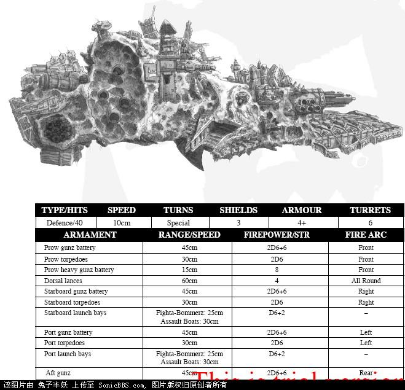
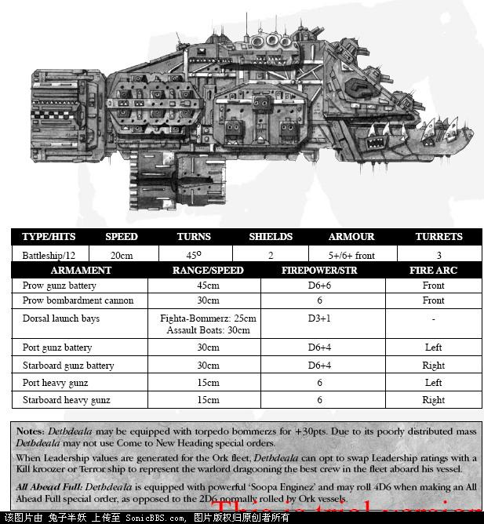
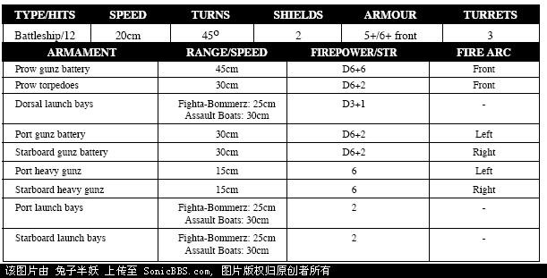
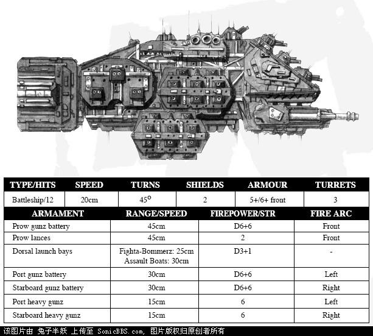
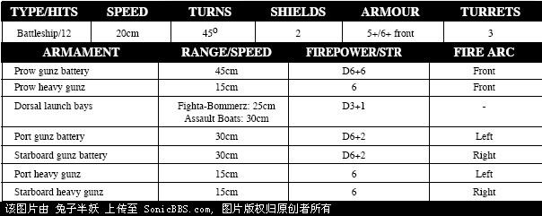
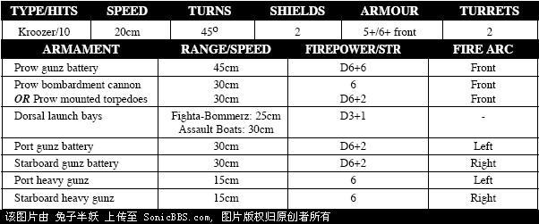
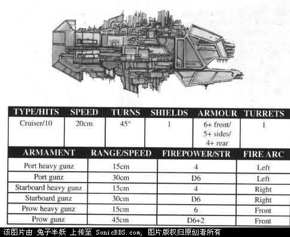
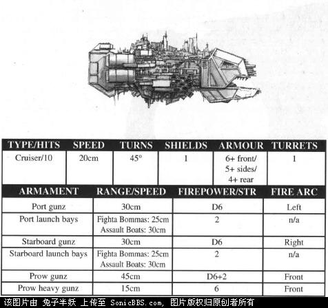

# ［绿潮风暴］［兽人舰队大型战舰］［Waaaaaagh!］

［绿潮风暴］［兽人舰队大型战舰］［Waaaaaagh!］

兔子半妖

Ere we go，ere we go，ere we go.

Ere we go，ere we go，throo the cosmos.

Ere we go，ere we go，ere we go.

Ere we go，ere we go，throo infinity.

Ere we go，ere we go，ere we go.

Ere we go，ere we go，Don’t know where ’til we get there

兽人“星际古巨圾”（Space Hulk）

Space Hulk是由远古时期的废弃飞船、小行星、浮冰以及其它的漂浮物和垃圾的聚合体，它们在亚空间中漂移出入了上千年之后凝聚在了一起。至于Space Hulk为什么会而且…怎么会从亚空间中出现而又突然消失，我们一无所知，虽然有大量的证据显示曾有一些Space Hulk被它上面的“乘客”或外部力量所操纵。尽管一些Space Hulk上面盘踞着外星生物、混沌叛党乃至更可怕的东西，但是大部分的Space Hulk都是空空荡荡的，仿佛鬼船般永远地在虚空中漂泊。虽然许多关于贪婪的太空垃圾回收者在登陆Space Hulk后惨遭不幸的故事在整个帝国范围内流传，但有同样多的故事述说者通过发掘Space Hulk上的远古科技而发财的经历。

对于兽人来说，Space Hulk是他们在群星间航行的主要的方式。只要一艘Space Hulk出现在兽人控制的星系，它就立刻被占据并改造成巨大的侵袭舰，上面凿出无数的发射孔来投放突击艇，以及数以万记的兽人战士和他们的战争机器。一旦完工，Space Hulk便会在大量的“巡洋舰”（兽人的Kroozer）和“巨石”（Rock，直接用小行星挖出的空间站）组成的攻击舰队的簇拥下驶出星系。当它到达星系外围后，它将再度跳入亚空间——如果一切顺利的话，它会凑巧遇到一个可供征服的星球。在哥特星区尚未出现目击SpaceHulk的记录，但由于SpaceHulk漂来漂去的本性，它可能在任何时间出现在任何地点。

 

兽人“巨石”Rok

兽人的“巨石”本质上说是一个被挖空内部并装上发动机、炮塔和成员居住区的大型小行星。虽然 “巨石”无法在亚空间中穿行，但任何有兽人存在的星系都会迅速出现大量的“巨石”。在147.M41，一支帝国巡洋舰分队扫荡了Kaloth星系的兽人海盗，击毁了7艘护卫舰和4个“巨石”。然而在148.M41，另一支搜索舰队在这个星系遭遇了21个“巨石”。在战列巡洋舰Stalwart Warrior被重创后搜索舰队被迫撤离，以避免Stalwart Warrior落入蜂拥而至的兽人突击艇手中。

死亡传播者号战列舰，Dethdeala(Deathdealer)

Dethdeala号战列舰被认为是现存的同一吨位级的舰船中最古老的一艘，在第三次末日行星之战前的30年与帝国首次遭遇。它最初是军阀Urgutz Dregrak的旗舰，但是现在，貌似它的舰长和舰员都发生了更替，正在慢慢地退出前台。

Dregrak是一个暴躁顽劣的兽人，以他对自己能力的过度自信以及对自己命运的过度乐观而闻名。Dregrak出现在最后一波到达末日行星的大规模兽人部队之中，他在降落前进行猛烈的行星轰炸，声称这是要为他的突击部队提供火力准备。但事实上在轰炸中损失惨重的并非帝国部队，而是他的竞争对手。尤其他对Ghazghkull的直属部队所在地区进行的疯狂轰炸绝非他所说的“巧合”。

当Dregrak最终冒险降落在行星表面时，他发动的战役被Dethskull氏族和叛变的帝国总督Herman Von Strab联手终结了。他们传送攻击了Dethdeala，乘Dregrak的部队正在发动行星突击时屠戮了大部分的舰员。由于大部分船员被杀或逃窜，Dethdeala在行星上搁浅，Dregrak也消失得无影无踪了。虽然他最后是死在人类抑或兽人手中不为人知，但看起来Ghazghkull对这个不可信赖而又麻烦无比的Urgutz Dregrak的消失并不介意。

 

戈巴格的复仇号战列舰，Gorbag’s Reveng

Gorbag’s Revenge是第三次末日行星战役中最活跃的兽人战列舰，曾参与过对Chosin和末日行星的入侵。这艘舰的前身是Gorbag在哥特星区夺取的一艘统治者级巡洋舰，Gorbag俘获它后控制了它的舰员，命令他们改造战舰，以它的系统和武器作为以后的“Gorbag’s Revenge”的基础。

Gorbag’s Revenge被证明是一艘适于大规模行星突击的战舰，它的投射能力可以让它向地面投放大量的战斗轰炸机。对大部分兽人舰队来说这个战术都是不明智的，因为投放如此多的载机将使母舰在帝国的攻击机群面前无还手之力。但是Gorbag’s Revenge的巨大体型和强劲火力使它在面临这种情况时不至于束手无策。在整个战役期间，Gorbag’s Revenge都始终伴随着所在舰队对末日行星进行轰炸。

 

爆击者号战列舰，Slamblasta

同大多数兽人战舰一样，Slamblasta也是由一艘废弃的帝国战舰改造而来的——它的前身是哥特级巡洋舰Pallas Imperious（皇家雅典娜）。由于无法正确地控制为哥特级战舰的舷侧光矛供能的大型能量线路，建造Slamblasta的技术小子们改造了供能系统，硬是在里面塞下了两套更加巨大的光矛类武器。由于兽人“科技”的一贯特性，这两套武器系统看上去庞大惊人，但实际的输出功率则小得可怜。无论如何这仍是一个惊人的成就：它是第一艘成功装备了光矛武器的兽人战舰。

在第三次末日行星战役中，Slamblasta加入了兽人入侵舰队的前锋部队，它强劲的光矛得到了实战的检验，非常适用于摧毁空间站、星系防御平台和末日星系外围的帝国哨站。

 

残暴小子号战列舰，Kroolboy

远在Ghazghkull掀起第三次末日行星战役的滔天战火之前，Kroolboy号就带领着一支海盗舰队，在末日星系的外围四处兴风作浪。不知是巧合还是兽人的计谋，Kroolboy在空间站Mannheim附近的频繁活动使空间站的成员对它最近发动的袭击放松了警惕：他们以为那又是一次海盗袭击，而实际上它是一个Waaagh!的前锋！等到其他空间站发出入侵警报的时候，Mannheim上的指挥官们已经为自己的麻痹大意付出了代价。

随着Ghazghkull的离去，Waaagh!也逐渐退出了末日行星。Kroolboy又干起了海盗的老营生，它在末日星区的许多星系中活动，最近还卷入了Monglor的内战。

 

大锤级战列巡洋舰，Hammer class battlekroozer

末日行星上汇聚的舰队中包含着各种你能想得出的吨位和型号的兽人战舰。除了我们熟悉的Kill级巡洋舰和Terror（惊惧战舰，一型巡洋舰）外，还有一级新型的战列巡洋舰：Hammer。帝国部队与该级战舰至少有15次遭遇。情报显示该级战舰是用那些曾装备过新星炮的帝国旗舰的残骸改造成的。

强大的兽人军阀们都非常喜欢把Hammer级作为他们的指挥舰。尤其值得一提的是来自Dregruk帝国的兽人暴君们装备了大量的该级战舰。Hammer级的指挥官的较高身份使得这些战舰得以配备兽人舰队中最好的武器和船员，让它们成为了难以应付的对手。最令人担忧的是下面这个：考虑到兽人们对废弃战舰进行快速（而且毛糙）改造的喜好，大量出现的Hammer级战舰很有可能意味着兽人们已经夺取了在战斗中损失的大量废船。

 

兽人杀戮级巡洋舰，Kill Kroozer

对于和平时期穿行于哥特星区的商船而言，重型兽人战舰就是一场可怕的恶梦。而在哥特战争中，由于帝国和混沌势力的激战，兽人获得了更多的战舰残骸，因而对兽人战舰的目击报告也大量增加。一般的兽人巡洋舰都装备了大量的重炮阵列，将火力集中于前方。只有一艘兽人巡洋舰（被帝国海军情报系统起了个“Butcher屠夫”的绰号）在哥特战争中多次被目击并确认，而其他的战舰由于不停的修补改造已无法辨认。在战争期间，Butcher在Quinrox Sound曾6次攻击运输船队，摧毁了15艘装有紧急物资的运输船，7艘护航舰和1艘巡洋舰Admiarl Lenox。此外，据信也是Butcher带队袭击了Bralutha空间站，并在救援部队赶到前逃离现场。

Butcher

惊惧战舰，Terror Ship

作为标准巡洋舰的一种变体，Terror级巡洋舰主要在独眼巨人星云活动，攻击防御不够严密的哨站或观测站。Terror携带大量的兽人攻击机，在战斗中一方面作为攻击机群的母舰，另一方面依旧能发挥巡洋舰强大的火力。大部分Terror级战舰都由废船改造而成，这些废船尤其适合改造成母舰：只用把残骸的侧舷切开就够了！Terror混合装载了大量的战斗轰炸机和突击艇。战斗轰炸机不但可以拦截敌机，还能挂装足以重创战舰的导弹和炸弹。兽人的突击艇坦白点说就是一个大装甲桶，一端装有发动机，另一端则是穿透敌舰装甲用的钻头。与其他种族复杂的突击艇相比，兽人的突击艇简直就是个大号的登舰鱼雷。兽人的残暴在他们对Mirrobel的袭击中可见一斑。这是一个供远程巡逻舰队使用的小型补给站。两艘Terror在半打护航舰的保护下进入星系并停泊在Mirrobel的卫星轨道上，然后向那可怜的小堡垒发射一波又一波的突击艇群。正当堡垒沦陷的时候，dauntless级轻巡洋舰Abdiel和Uziel以及4艘 Firestrom组成的巡逻舰队恰好前来补给，它们被Terror当头截住。虽然兽人的攻击机群正在行星表面进行轰炸。但Terror本身的强大火力仍然击退了巡逻舰队，并且重创Abdiel，还击沉了一艘护卫舰。

