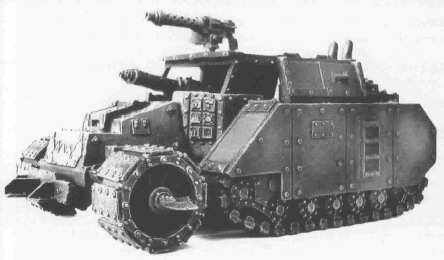
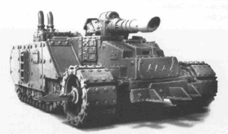
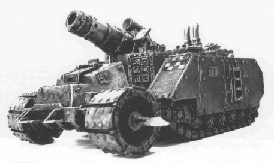
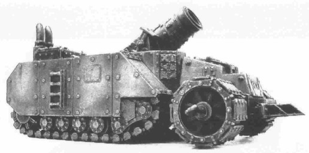
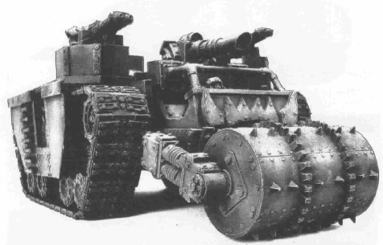
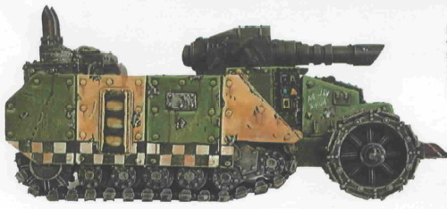
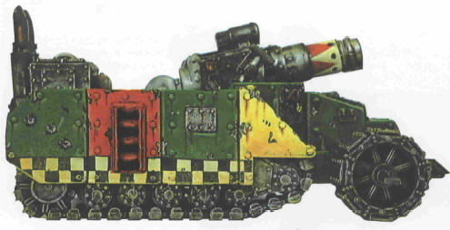
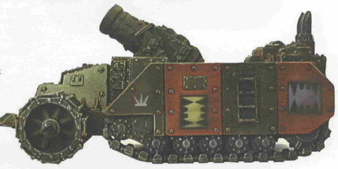
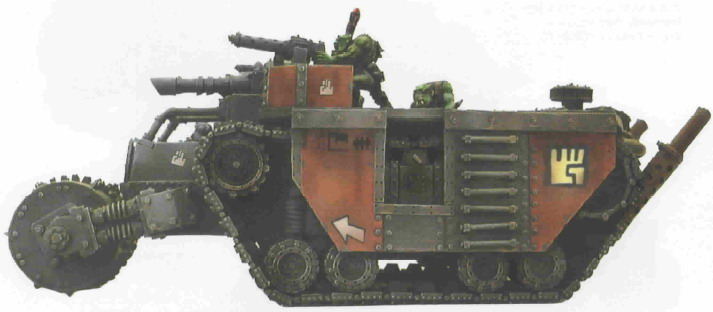
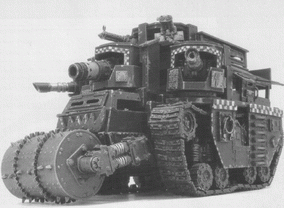

# 展示一下Codex上的Ork战车（更新彩色涂装侧视图）

<H4>展示一下Codex上的Ork战车（更新彩色涂装侧视图）</H4>

dreamerxx 关于兽人坦克和火炮的疑问我已经阐述了。这里展示一下规则书上的几种兽族战车。感觉这些战车造型非常有兽人风格，而且并不像铁罐机器人那样滑稽可笑，而是很彪悍粗犷的，完全可以替换掉游戏里不伦不类的莱曼鲁斯赃车。只装备Big shoota的半履带Gunwagon（步兵战车）

装备Zzap gun的Gunwagon（自行反坦克炮）

装备Kannon的Gunwagon（自行火炮）

 装备Lobba gun的Gunwagon（自行榴弹炮）

装备Big shoota和Zzap gun，具有近身冲撞碾压和重型运兵能力的Battlewagon

装备Zzap的Gunwagon彩色涂装

装备Kannon的Gunwagon彩色涂装

装备Lobba的Gunwagon彩色涂装

功能类似Land Raider的Battlewagon彩色涂装

嘉拉迪雅

图片：  怎么可以忘记Battle Fortress口牙！
