# 星际战士分色，徽章识别指南（补充完了）

星际战士分色，徽章识别指南（补充完了）

drydry/苍穹碎颅者

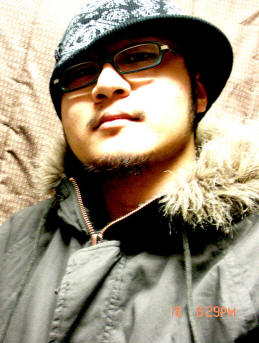

在荷鲁斯浩劫席卷人类文明之后，阿斯塔特斯圣典指引着帝国最好的战士披荆斩棘，戮妖除魔，试图重现昔日的辉煌。勇猛的战士需要精良的武备，本次，我们就从盔甲的样式和涂装说起。

1．        星际战士盔甲

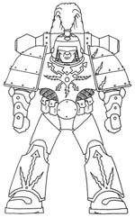

Mk1 雷鸣型动力盔甲。头顶的装饰性羽毛颇有一副古代武士的风范，身上还有夸张的闪电雕刻，早年跟随帝王南征北战的战士就是穿着这样的装备打下了银河中的半壁江山。但是这种盔甲没有全封闭的防护，也没有空气过滤-供给系统，显然是因为但是没有考虑到真空（或者大气成分恶劣）情况下的作战情况。

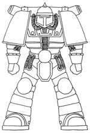

Mk2远征型动力盔甲。在第二款装甲的身上就依稀能看到沿用至今的设计模式——宽大而简洁的肩部避弹装甲，封闭而紧凑的胸-腹-胯连接点等等。在其基础上，经过细微调整，开发出来了Mk3 钢铁型动力盔甲。

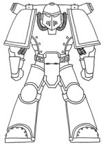

Mk3 钢铁型动力盔甲。这是为了强化在舰艇过道中激烈的，逐舱逐屋的交战而特殊改良的样式。面部的斜面设计是为了增强跳弹效果，而在Mk1和2型号上常常能见到的接缝设计也被取消了，一体化的胸甲和腿甲被后续的型号所沿用。

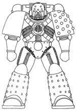

Mk4 动乱型动力盔甲。取名自“人类帝国历史上最重要的事件

它本身是一个时代终结和开始的象征——Boltgun”。其最大的特征是肩膀和双腿上的反应装甲。在各种动乱时期遗留的资料和图片表明，相当多的叛徒军团就是身着这种动力盔甲，反戈一击。这种盔甲在现今依然还有一些保存的相当完好，作为帝王时期遗留下来的财产，俨然已是各个军团的圣物，在帝王的庇护下并加以技术升级，性能甚至比后来的型号还还要出众，如今只有战功卓著的老兵才有资格分配到这种盔甲。这不仅仅是一种身份的象征，更是实力和信念的体现。

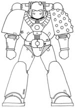

Mk5 乌鸦型动力装甲。在大动乱中后期在依然为帝王奋战的军团中配备了相当的数量。特征是鸟嘴一样的面部护甲和取消了独立的膝部护具。此型号和后来的Mk7型盔甲是如今各个战团的主要装备。

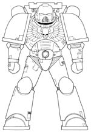

Mk6 猛鹫型动力盔甲。如今最为常见的星际战士装备，几乎是人类帝国最高战斗力量的象征，得名于胸口的鹰翼。前人遗留下来的技术在此型号盔甲上得到了全面的升华和集中。更简洁的四肢设计，恢复了独立膝部护具都是它的特征。

由于部分叛徒在乌鸦型动力装甲大量配发前发动了叛变，所以乌鸦型盔甲在混沌军团中并不常见，以吞世者团为例，大部分老资格的狂战士都是使用钢铁型甚至远征型样式的盔甲。至于猛鹫型号的技术可能是由在不断的交战中由皈依混沌阵营的星际战士叛徒和被混沌一方所回收的装备残骸所提供的。加上在混沌之眼中被叛徒掌握的铸造世界，使类似的新样式盔甲能在混沌军团中得以源源不断的补充。

由于具体到个人的差异，很多阿斯塔特斯战士的盔甲都是由不同型号组成的，除了常见的猛鹫型号，还有部分装备有乌鸦，甚至是荷鲁斯型号的配件，好比如下的极限战团动员会中所体现出的场景。

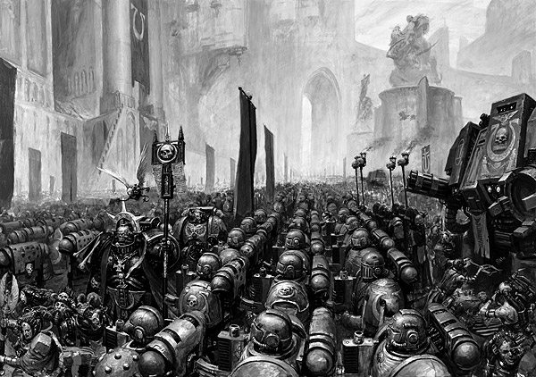

2. 阿斯塔特斯圣典规定中的星际战士涂装。

从星际战士军团组建的那一天起，每个军团的涂装就几乎等同于其的军旗，承载着军团的历史，战功和荣耀。好比白疤团头盔上的红线，火蜥蜴团的烈焰，绯红之拳双手的颜色一样，都表达了军团的特点。通过颜色和徽章能轻易的区分各个战团，但是如何区分同一战团中不同连队，或者不同职责的战士呢？通过本章的叙述，相信大家能掌握一个比较有效的方法。

但是不同于遵循阿斯塔特斯圣典的连队，黑暗天使，太空野狼，血天使甚至是黑暗圣堂武士都有一套自己的标示方法，稍后叙述。

极限战士是最标准的阿斯塔特斯战团，他们的标志方法最为规范也是目前能收集到最多资料来表示的。所以以下将着重介绍极限战士。

战术小队，战术小队是大部分战团作战力量的基石。所以需要有效的区分不同连队的不同战士，通过将动力盔甲不同部分涂装上不同的颜色，也可以通过盔甲上其他喷绘标志来区分。基本说来，就是通过肩甲护圈外缘的颜色辅助战术标志和个人饰物来区分不同的连队甚至是不同的小队。这个方法可以同样作用到快速突击小队和重武器小队上。

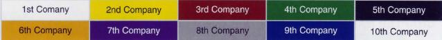

分色表，简明了当的给出了不同连队不同分色的方式。

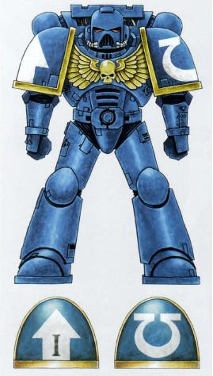

这是极限团第2连战术小队的标准涂装，第2连的颜色是金色，这里体现在该战士的肩甲护圈上。同时可以得知，该战士隶属于第2连第1小队。

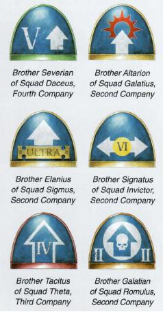

不同连队不同战术小队的标志范例。可以见到他们使用的战术识别符号都是箭头，可以是实心的也可以是空心的，方向上除了向下的都出现了，不过原则上是向上比较规范。在肩甲上还喷涂有小队数字和个性化的字，还有的会贴附纯洁圣引或者经文。这个是对所有穿着动力装甲的星际战士通用的。

左上 来自第4连 右上 来自第2连

左中 来自第2连 右中 来自第2连

左下 来自第3连 右下 来自第2连

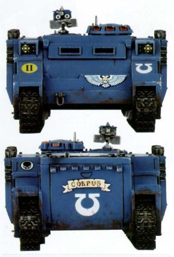

第2连Romulus战术小队的犀牛，Corpus号。

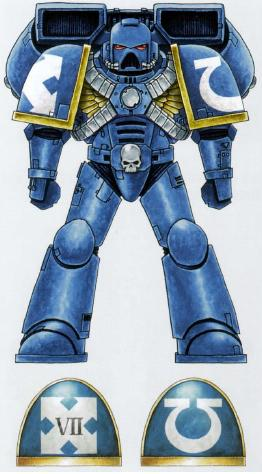

同样是第2团涂装范例的喷气突击战士。快速突击部队的战术识别符号是交叉的箭头，注意是个叉而不是十字。

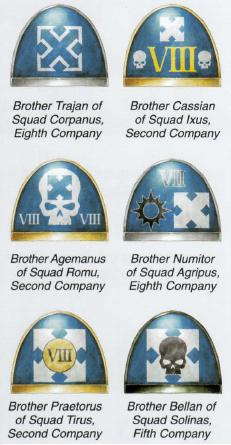

左上 来自第8连 右上 来自第2连

左中 来自第2连        右中 来自第8连

左下 来自第2连 右下 来自第5连

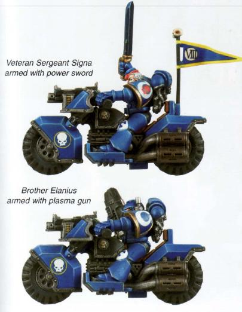

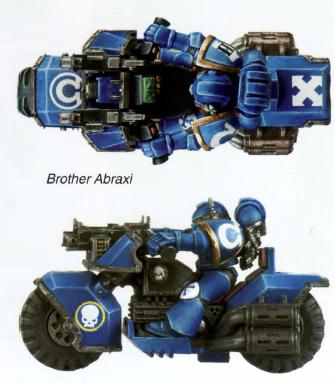

第2连的摩托部队，可见金色肩甲边框，和摩托后坐上的快速部队标志。

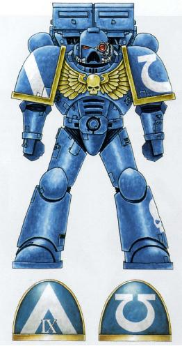

第2连的毁灭者小队涂装范例。

毁灭者小队的识别符号是倒V，和其他战术标示一样，可以是空心也可以是实心。

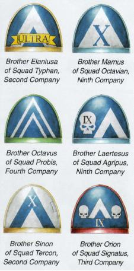

左上 来自第2连 右上 来自第9连

左中 来自第4连 右中 来自第9连

左下 来自第2连 右下 来自第3连

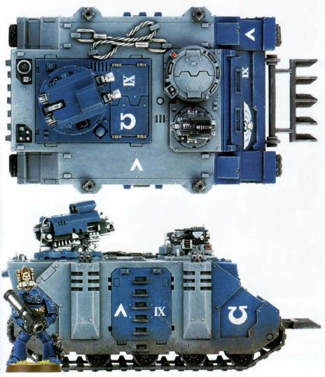

第九连支援Ixion小队的豪猪步兵车，注意车体上的表示连队的IX，和兵种识别的倒V。

注：早期版本有爆炸样式的毁灭者小队识别符号，和倒V没有本质上的区别。只是现在比较少见，同样可以空心也可以实心。

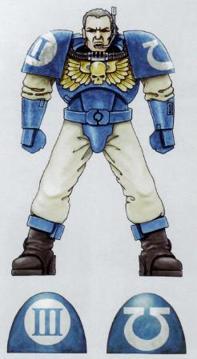

侦察兵。在遵循阿斯塔特斯法典的连队侦察兵永远是第10连，他们身上的识别符号只有战团符号和小队番号，而且身上的盔甲是简化，轻量的型号，肩甲上也没有外缘的护边。

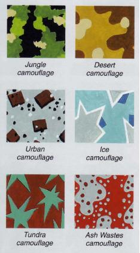

在第一次泰伦异型战争时期，侦察兵伪装服所用的迷彩类型。

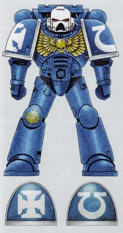

第一连的老兵涂装式样。注意铁十字形状的终结者标志。

老兵部队都是资深士官，他们数量不多，但是装备精良，经验丰富。肩膀边框的颜色代表着他们所属不同的连队。

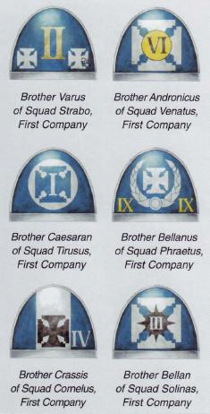

如上都是第一连老兵的不同肩部涂装。

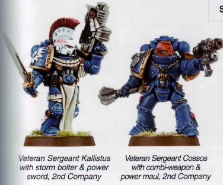

都是来自第2连的老兵。

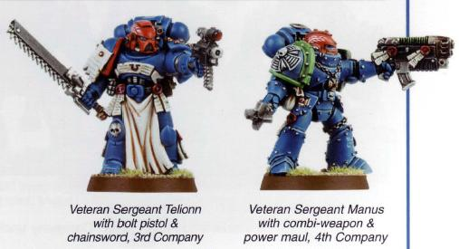

分别是来自第3连和第4连的老兵。

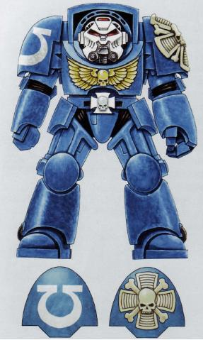

终结者是每个团的精英，只被部署在第一连。他们使用的战术无畏盔甲上装饰着连队标志和小队番号，还有代表个人荣誉的终结者徽章和纯洁圣印。终结者战士使用兰德掠夺者重型突击运输车来突入战场，撕开防线。

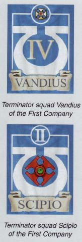

不同的终结者小队依靠队长背的旗帜来区分，旗帜上多写有队长的名字。上是第一连的Vandius小队，下是第一连的Scipio小队。

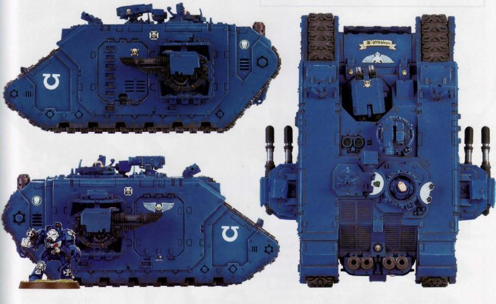

Vandilus2号兰德掠夺者运输车。

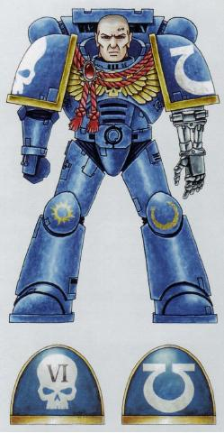

中尉连长。图中的第2连连长失去了一条手臂，他使用机械义肢来代替。

同样的，连队长的区分也是依靠颜色，不同的连队颜色不一样。而且不同的连长所使用的个人装饰也不一样。

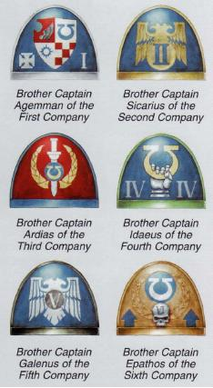

左上 1连连长  右上2连连长

左中 3连连长  右中 4连连长

左下 5连连长  右下 6连连长 注意 是全金色样式，但有兰色（连队色）箭头来表示队伍。

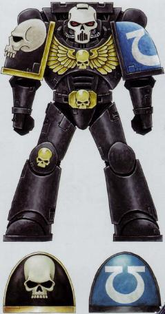

图上是第2连的牧师。但所有的牧师都没有一个统一的标准去规定如何使用，佩带连队标志。所以除了肩头的颜色外，需要看其背的旗帜，旗帜上多有连队颜色。

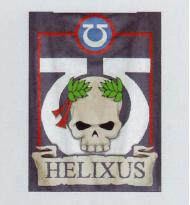

3连牧师Helixus的旗帜。

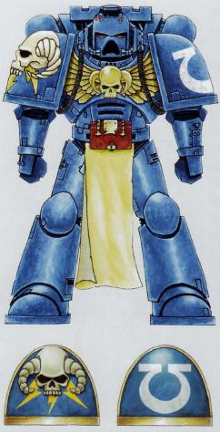

智库馆长，一般都使用兰色作为盔甲颜色，连队颜色和标志都在左肩。他们有自己的分级标志，祥见下图

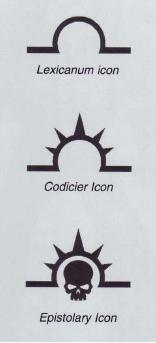

我不知这种符号代表什么，但从上往下级别愈高。

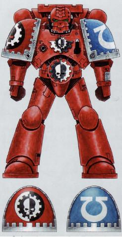

技术军士是星际战团中的特殊人群，他们有着与重不同的装备和装饰。机械神教的徽章和机械伺服手臂是他们的特征。在他们的努力下众多重型装备得以完美的状态投入战斗。

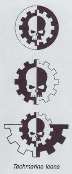

机械神教标志

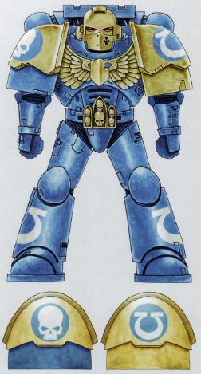

第2连的连队冠军战士

指挥小队。指挥小队是星际战士一线作战部队的移动指挥部，一般由一个医护兵，一个士官老兵，一个携带特殊武器的星际战士，一个旗手和一个连队冠军战士组成。而团队长所在的指挥小队更是汇集了全团最优秀的战士，而这些战士也会为了团长，为了战旗而舍生忘死的战斗，这就是荣誉卫队，一群将团队利益看成至上宝物的战士。

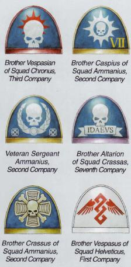

左上 来自第3连 右上 来自第2连

左中 来自第2连 右中 来自第7连

左下 来自第2连 右下 第一连医护兵

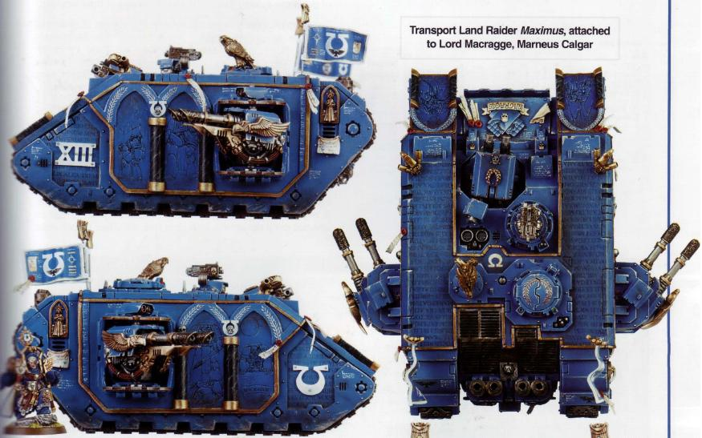

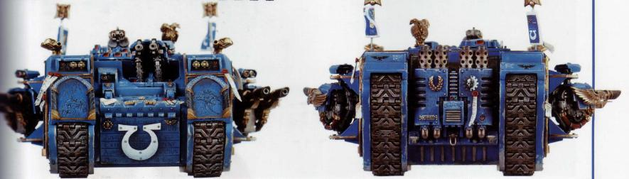

极限团团长的豪华坐驾。

关于各种车辆，原则上属于什么种类的部队，就喷绘什么战术标示。小队序号用白色底黑色字，可以是罗马数字也可以是阿拉伯数字，连队番号用该连队颜色打底，数字一般采用罗马数字。第10连因为是侦察兵连，所以他们没有重型车辆，也就不存在他们专用的颜色。

非阿斯塔特斯战团的分色介绍等改日再写。。。

那些个性的军团。

在星际战士序列中，有几个战团未遵从阿斯塔特斯圣典的要求，在部队编制和涂装上拥有自己独特的个性。这些团分别是黑暗天使团，太空野狼团，血天使团，和从钢铁之拳团中分离出来的黑暗圣堂武士团。这些团虽然装饰，战斗风格迥然，但是都有同样的特点——他们都是帝王虔诚的仆人，也是战功流芳千古的猛士。

从黑暗天使说起：

黑暗天使是帝王创立的第一个战团，作为20军团之首，黑暗天使在面对其他团的袍泽是总是带有一份骄傲。他们的盔甲曾经是黑色，但是在大叛乱中有很多兄弟失去了坚定意志，放弃了对帝王的信仰，投奔了混沌，并且转而对昔日战友刀剑相向。被一时间打的晕头转向的黑暗天使们痛定思痛，将盔甲的颜色换成了绿色以铭记这次耻辱，并发誓要追捕那些叛逃的战友，将他们捉拿回营，接受军团大师的审判和惩罚。

不同与遵守圣典教条的连队，黑暗天使的10个连队配置特别有特色。

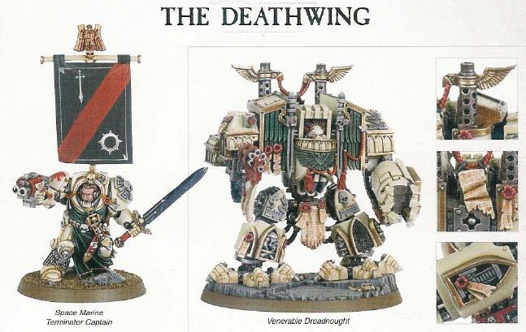

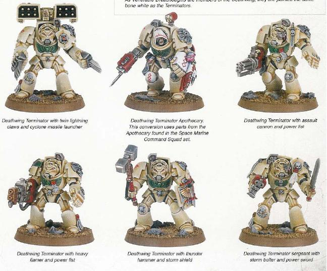

死亡之翼的无畏和终结者

第一连是死亡之翼连队，全队穿着骨白色的终结者盔甲，有20个终结者小队 拥有从无畏到兰德掠夺者的军械 作为他们的火力支援。死亡之翼的战团标志是红色，胸口有绿色的黑暗天使风格鹰翼。

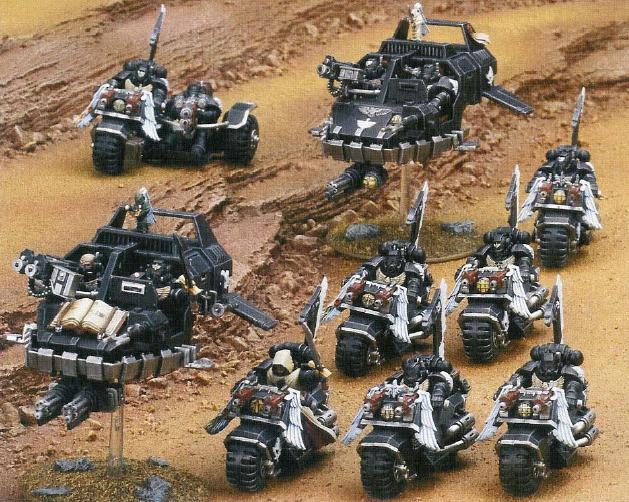

第2连乌鸦之翼是快速突击部队，是全团唯一装备兰德速攻艇，和突击摩托的单位。他们的颜色沿用了动乱之前的黑色。标志是一把插着翅膀的利剑。连队中的摩托和突击艇通常使用白色的翅膀作为装饰（超游ing~ 摩托上搭配的方式请参考波兰飞翼骑兵）。

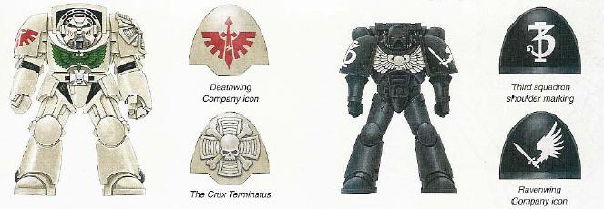

第一连和第二连的涂装示例

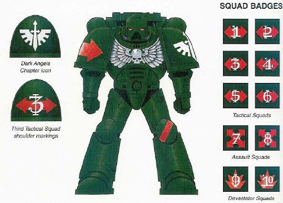

黑暗天使步兵全部穿着墨绿色（其实颜色就是特殊的黑天使绿）的动力装甲，左肩是战团标志，右肩是红色的战术识别标志。小队番号是白色，写在战术识别标志之上；黑天使的战术小队标志统一为红色横向双箭头。

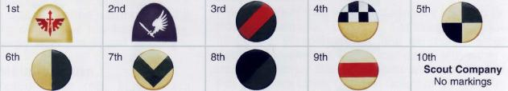

黑天使的连队识别标志是在左膝的护甲上，从第3连到第9连各不相同（PS:第一连是骨白色战术无畏盔甲，第2连是黑色动力装甲，而第10连是侦察兵连，没有独自的连队标志）。

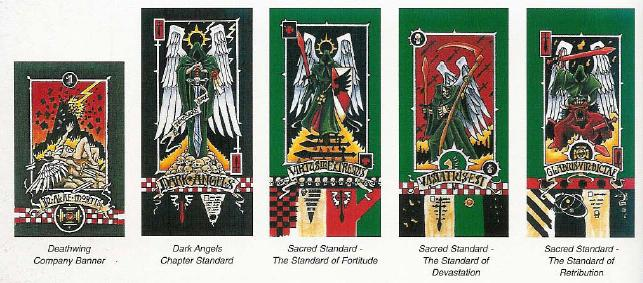

连队旗帜：黑暗天使作为一支历史悠久的连队，每面旗帜都有独特的背景和包含的意义。除了第一连所用的旗帜外，还有数面圣旗。

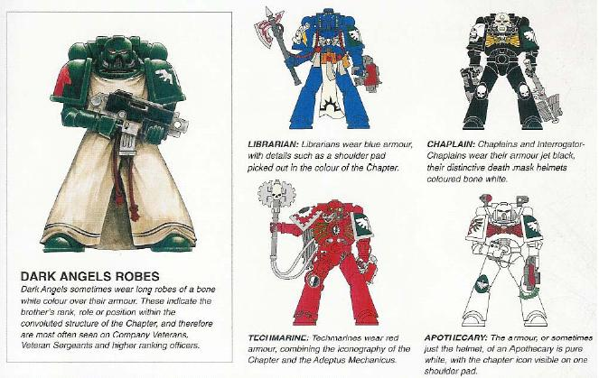

黑暗天使的老兵穿着僧袍，这是他们的标志。而各自拥有独特颜色的馆长，牧师，技术军士和医护兵，只要在肩膀上表示出来黑暗天使的特殊绿色涂装和标志。

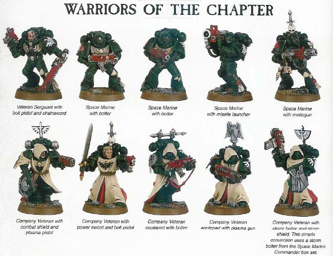

黑暗天使的战术小队和老兵队

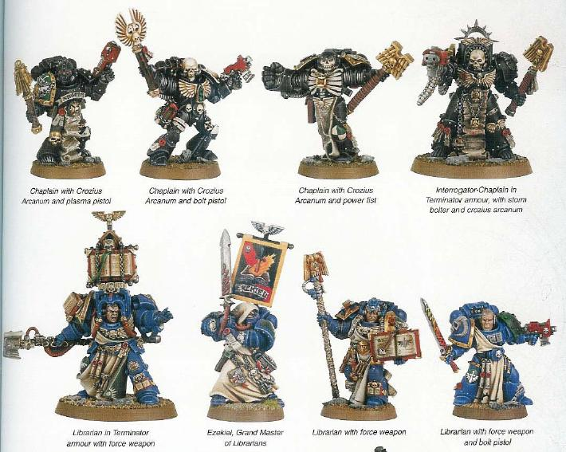

穿不同盔甲的牧师和馆长

技术军士

黑暗天使的车辆涂装示例。

太空野狼：

太空野狼是一支拥有浓厚北欧风格的军队，除了偶尔能看到的Rune风格文字

能证明之外，就是该军团北欧风格的发型，着装习惯（大量毛皮装饰）和他们野蛮的战斗风格最为代表性(这些在别的插图中都能很好的体现出来，在此不做更多描写)。

太空野狼现存12个大连(Great Company)每一个连都由其狼族领主率领，第13连进入恐惧之眼追杀混沌军团，但从此失去了和战团的联系。现存的12个领主如下：

罗根&#8226;格里纳﹡， 葛罗穆&#8226;龙眼， 布郎&#8226;红喉

冥府之狼哈拉德， 黑发拉格纳﹡， 英格尔&#8226;海魔

风暴之狼伯恩， 斯温&#8226;血嚎， 艾瑞克&#8226;莫卡尔

尹吉尔&#8226;铁狼， 卡加尔&#8226;冷血， 钢那尔&#8226;红月

（﹡注：这两个人名翻译来自战锤中文网废柴翻译的太空野狼中文手册）

每一位领主带领的大连都拥有全套星际战士军械库的装备，而每个大连都拥有如下的作战单位：

狼主（相当于连长），狼族近卫军（相当于荣誉守卫），灰色猎手（相当于老兵队），血爪分队（穿着动力装甲的新兵），长牙小队（老兵，掌管重武器的毁灭者小队），狼族斥候（老兵，强力侦察兵）。

罗根&#8226;格里纳和他身着终结者盔甲的保镖

斥候和长牙小队

太空野狼的动力装甲颜色是特殊的星狼灰，肩甲上分别标绘着所属连队的图腾（左肩），和所属小队的战术识别符号（右肩）。

一般情况下太空野狼的突击摩托都是由热血方钢的血爪新兵驾驶的，至于喷气背包，这不是太空野狼所习惯的作战工具，大部分情况下野狼都喜欢那种脚踏实地的感觉。

提示，识别灰色猎手和血爪小队的方法：

灰色猎手都是身经百战的老兵，在不停的战斗和训练中，他们掌握了一手持暴弹枪一手持近战格斗兵器的作战方式，而血爪新兵都不会这样彪悍的持枪。。。

这个就是灰色猎手

这个是血爪

至于车辆，太空野狼的车辆上往往都有其车组成员披挂的狼皮狼牙和其他战利品等装饰，凡是在战场上看到装饰着芬里斯巨狼的毛皮，驾驶风格野蛮却不啻精巧的车辆，绝对都是太空野狼。

13连的人现在多在使用缴获的混沌星际战士盔甲和装备。俘获什么用什么。

血天使：

久负盛名的军团，大动乱时期监守地球皇宫的守卫者，传说中的帅哥团，却背负着预见自己死亡的宿命。。。血红的盔甲是为了承载先人之血，为了不负桑古尼巫斯（的确是这样发音的）之名，为了将死亡播撒给帝王的敌人！咳咳，激情了下就转正体。

血天使的动力盔甲就如同其战团名称一样，通体是血红色。这个涂装从大远征前开始就一直保留了下来。在左右两肩分别标绘着战团标志和连队符号。小队符号被标示在右膝盖护甲上。

血天使的肩甲连队区别示例

血天使的小队标志

终结者部队因为是第一连专有，所以大部分终结者盔甲上没有连队标示。侦察兵部队是一如既往的没有标志。

不同兵种的战术符号在血天使团是看不到的，他们时候用不同头盔的颜色来区分：

红色头盔是战术小队。金色头盔是荣誉卫队。黄色头盔是快速突击部队。兰色头盔是重武器小队。

血天使特色的死亡连队是黑色的涂装的动力装甲，身上有骨白色的鹰翅和骨头装饰，还有红色的交叉——通常见于肩膀上（在混沌中，叛逃到邪神幡下的星际战士部队会用红色叉将鹰翅和老的连队符号遮盖掉）。武器是红色，而且被限定使用链锯剑和暴矢手枪，可装备反装甲和破片手雷，不能使用其他武器。死亡连队也可以使用喷气背包，涂装方式一样。

特殊涂装——丹特指挥官

丹特是血天使各个连队中最有经验的指挥官，他已经为帝王战斗了超过1千年。全金色的动力盔甲好比是赤阳一般，为血天使的战士们在战场上指点方向。他和他的护卫都穿着全套动力盔甲和喷气动力背包，他本人装备着毁灭手枪（热融手枪）和动力战斧，而他小队的护卫则全部装备了动力武器（旗手要抗旗子。。所以么，医护兵的工具倒也能一击必杀，所以也么）。丹特的头盔被雕刻成桑古尼巫斯的面庞，用以缅怀先者和从其身上吸取战斗的动力（他不是一个人在战斗！）

血天使的特殊装甲单位，恶神型掠食者坦克。装备有连装突击炮和重型喷火器，用来收割敌人的步兵和轻型装甲单位。

黑暗圣堂武士

帝王之拳团分离出来的2线团，但是本身人气远远高于母团。中世纪条顿骑士一般的风格让人眼中为之一亮。黑暗圣堂武士是一支喜好近战的部队，其采用的部队构成也突出了这个特点。穿着侦察兵盔甲的新教徒被编入穿着动力装甲的星际战士中接受1对1的指导，使用霰弹枪或者暴矢手枪等支援星际战士作战（在桌面上，可以看作是用来为高级兵挡子弹的。。。），经过无数次的磨砺而得到导师许可的新教徒，才有资格穿上属于自己的动力盔甲。

而精英的部队被统一称为剑师兄弟会，装备有战术无畏盔甲或者精工动力盔甲。多使用强力的肉搏兵器好比风暴锤，动力爪，动力剑等等，身先士卒。

[img]

[/img]

使用动力装甲的剑师兄弟

同时，最有黑暗圣堂特点的当数帝国冠军剑士这个兵种，他是黑暗圣堂部队中最优秀的战士，被挑选出来赐予受帝王祝福的盔甲和黑剑，在战场上以击杀敌军指挥官和其他强力兵种为己任。

黑暗圣堂的涂装是全黑为主，双侧的肩甲多使用对称涂装。请注意下图战士左腿上的阿家玛顿战役简章。

教徒                                         新教徒

快速突击部队                                   剑师兄弟（着动力装甲时）

牧师                                         医护兵

黑暗圣堂的速攻部队，未显示突击艇，但所有战士的肩甲护圈都是红色。

黑暗圣堂仇视一切灵能着和外星人，他们的主要对手是绿皮，钛星人，恶魔，叛徒和钛伦异形。

每一次战役都会有一面旗帜来记载，而参加了战役的战士，则会获得将战役盾章简章绘制在动力盔甲上的权利。下图为黑暗圣堂曾参加过的重大战役及其盾章。

黑暗圣堂武士自行研发了兰德掠袭者的十字军型号，主要装备是车体两侧共12挺重型暴失枪和车身上的连装突击炮，号称割草机，没有什么步兵能在这暴雨一般的射击下逃生。

黑暗圣堂的车辆涂装示例

附录：

圣典战团和非圣典战团肩部涂装对比

字符式样

资料来源：

How To Paint Spacemarines. 作者 Adrian Wood 出版社 Games-Workshop 出版日期2004 Insignium Astartes-The Uniforms & Regalia Of The Spacemarines. 出版社 Black Library 出版日期 2002

Free Rune Reading.

[http://www.facade.com/runes/](http://www.facade.com/runes/)

太空野狼宝典中文译本 译者：废柴[http://www.zhanchui.com.cn/bbs/index.asp](http://www.zhanchui.com.cn/bbs/index.asp)

Codex: BlackTemplar 4E 出版社 Games-Workshop 出版日期2005

Codex: DarkAngels 4E 作者Jevis Jhonson和Andy Hoare 出版社 Games-Workshop 出版日期2006

Codex: BloodAngel 4E 出版社 Games-Workshop [http://us.games-workshop.com/games/40k/bloodangels/gaming/codex/assets/codexbloodangels.pdf](http://us.games-workshop.com/games/40k/bloodangels/gaming/codex/assets/codexbloodangels.pdf)
