# 塔洛斯战役资料（已改为图片资料）

塔洛斯战役资料（已改为图片资料）

korr

Tau帝国Tau最基本的地面作战部队叫Hunter Cadre，“猎核”。一个猎核有100多个单位（Tau星人和兵蜂，猎核里不包括克鲁特和人类辅助部队），战斗力大概相当于IG一个连。注意，不是SM一个连，IG的一个连可是有300多人的。塔洛斯战役中大概有80-100个这样的猎核，也就是差不多有1万左右的Tau作战单位，克鲁特和人类的辅助部队还得另算。猎核的指挥官被称为夏司伊尔，其下有被称为夏司镭的精英，再往下是夏司钨，这三种作战单位都装备有战斗服（也有些夏司钨不穿战斗服），再往下就是被称为夏司拉的不穿战斗服的火焰战士了。除了火焰战士，猎队里还有不少被称为钶维沙的兵蜂和一些装甲车辆。以夏司伊尔SHI'ELDI的猎核为例（每个猎核在单位搭配上都有或多或少的区别）：夏司伊尔SHI'ELDI本人装备XV84危机型战斗服（在武器上和一般的XV8有一些区别）除了夏司伊尔以外，整个猎队里还有23个战斗服作战单位，包括：两个装备XV8危机型战斗服的夏司镭12个装备XV8危机型战斗服的夏司钨3个装备XV88炮击型战斗服的夏司钨6个装备XV15隐型战斗服的夏司钨非战斗服战斗单位包括：火焰战士夏司拉58人，配备了3辆魔鬼鱼运兵艇和1辆水虎鱼轻装甲突击艇。寻路者夏司拉8人，配备了2辆脂鲤侦察速行艇。双髻鲨4辆，其中两辆装备轨道炮，1辆装备离子炮，还有1辆装备了飞弹槽。兵蜂可维沙32个，其中狙击蜂6个，枪蜂24个，还有2个兵蜂炮塔。加起来就是113个士兵（火焰战士和兵蜂）28架车辆（包括战斗服）。Tau帝国的空中作战部队被称为Air Cadre，这里我翻译为“气核”。1个空队有36个空气种姓机师，机械如下：2架蝠鲼超大型空中堡垒运输机，可以直接从卫星轨道登陆行星地面。4架虎鲨，被称为泰坦杀手的重型战斗机，就是他们击毁了IG入侵军中泰坦军团的1架战犬级泰坦，把泰坦军团吓得掉头就跑，退出了塔洛斯战役。10架梭鱼，Tau星人的战斗机。另外还有杀人鲸大型运兵艇这种次一级的运输机，也是能直接从卫星轨道登陆行星表面的。

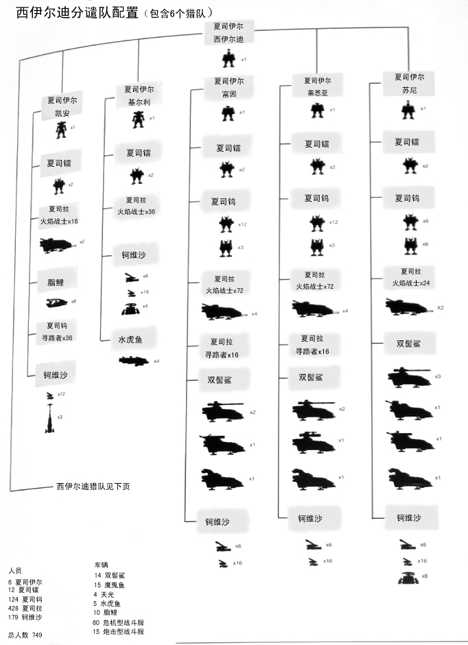

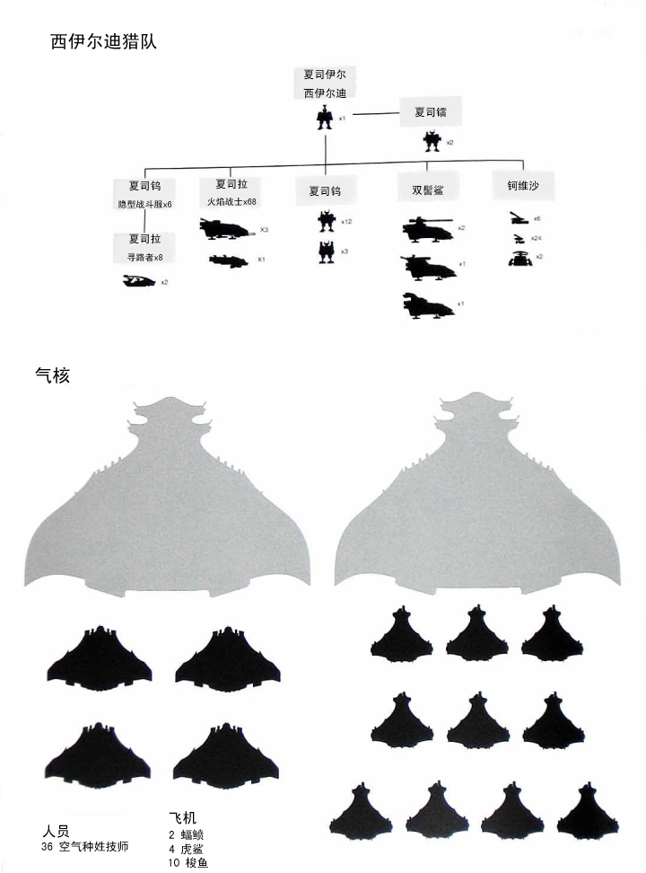

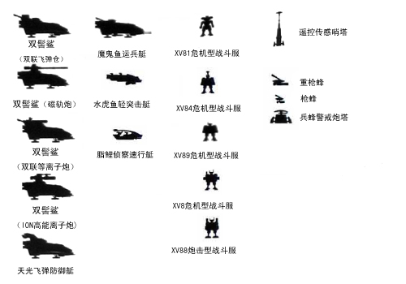

帝国部队总兵力：帝国卫队：塔洛斯战役中帝国卫队第4621军团由两个军组成，分别为第10军和第11军，每个军都辖五个师团，其中第10军还配有两个连的精锐暴风突击队。第10军是作战主力，有五个适合沙漠作战的塔兰师团，其中有两个师团为装甲师团，另三个师团为步兵师。第11军团为辅，五个师团基本都是特殊编制。第10军：塔兰沙漠突袭者第331师团，刚组建的新兵步兵师团，战斗力比较低。塔兰沙漠突袭者第17师团，主力步兵师团。塔兰沙漠突袭者第89师团，主力步兵师团。塔兰沙漠突袭者第3装甲师，主力装甲师团。塔兰沙漠突袭者第12装甲师，主力装甲师团。风暴突击队第2356连风暴突击队第2358连这两只独立部队是精锐中的精锐。第11军：伊利西亚空降队第23师团，高机动部队，非常擅长深入打击，人数低于普通步兵师，但是装备了大量的女武神武装运输直升机和秃鹫武装直升机。塞伦尼亚突击工程兵第11营，装备近距离武器，擅长突击敌碉堡群、清扫雷区和突破敌人防御阵线，也是巷战主力。人数较少，被分散到了军团的各个部队中。卡迪亚突击队第114师团，机械化步兵师，人数也低于一般步兵师团。布林洛克龙骑兵第8师团，一只有着丰富地和钛星人作战经验的师团，可惜搭载他们的运输舰在塔洛斯附近星域遭到钛舰队偷袭，还没放一枪一炮就全灭了。克瑞格死亡军团第19装甲师团，和两个塔兰装甲师一样配置的师团，开仗了都还没从驻地出发。发生运输舰击沉事件后他们被命令原地待命，压根就没参加塔洛斯战役。注：在征集部队的时候还有两个师团也被找到过，其中的曼尼恩游骑兵第12师团找来后发现只剩下一个加强连，没法组成一个完整师团，被分散到了几个塔兰师团中。另一个师团莫迪亚钢铁卫士军团第42师团在运输途中遇上了虫族舰队，全灭了。帝国海军：第83、386、1002和2774四个战斗机联队。第501和242两个轰炸机联队。第71战术联队。阿斯塔特修会（即星际战士）：复仇之子 一个连队猛禽 两个连队火星机械教教廷：224个工程师队12个工程车队泰坦军团：伊格诺特军团的一支侦察战队军需部后勤人员：2支工程师军2支劳工军78支补给队刺客总管庭有派遣间谍，但是具体内容为绝对机密。帝国舰队：五支混合舰队帝皇教教庭：6个战地医院收容所19个翻译小队总管庭：16个收尸队18个书记官42个统筹队舰队：战舰：领主级战列巡洋舰正义力量号暴君级巡洋舰仙后座之星号独裁者级巡洋舰黑色公爵号月神级巡洋舰色雷斯之锤号不屈级轻型巡洋舰奥古斯特号和塞洛巴斯号护卫舰：剑级护卫舰埃兰特中队和英文西斯中队眼镜蛇级护卫舰欧姆那中队火焰风暴级护卫舰诺文中队运输舰：武装运输舰：帝国标枪号帝国护手号帝国铁砧号格拉夫·德兹基号一般运输舰：莫德王子号马库夫号圣马基利号伊索尔德号朱查之子号重型运输舰：歌罗西号虔诚号卡古尔号重型加油舰：斯维迪格皇后号比蒙巨兽级运输舰：Honorus Rex号星际战士军舰：猛禽战团：战列旗舰 战爪号短剑级护卫舰复仇之子战团：突袭巡洋舰Proxima Justus号

帝国部队高级官员：最高指挥部成员：最高指挥官Otto Ivan Gustavus政委将军Mordred Van Horicic地面部队总帅De Stael机械教大长老Zadkine Volta舰队总指挥海军上将Kotto星际战团猛禽第3连连队长Orelius星际战团猛禽第6连连队长Kaedes情报主管参谋Scheja上校军需部粮食供给主长Nymus Dree枢机主教Velas空军元帅Denvelt泰坦军团指挥官Jernay主管庭能吏Skel地面部队其他官员：军参谋部：军需将军Wassily 第10军作战指挥参谋Nafir上校 第11军作战指挥参谋Mawhir上校师团级指挥官：10军：Braim-Abas将军（塔兰17师团）IzraOmdurman将军（塔兰89师团）Hamid上校（塔兰331师团）Hasso Raz-Aziz将军（塔兰第3装甲师团）Ahsa-Bulad上校（塔兰第12装甲师团）11军：Syckava将军（第23伊利森空降师团）Horul上校（第11塞伦尼恩突击工程队）Stranski上校（第114卡迪安突击机械化师团）Fouks上校（第8Brimlock龙骑兵师团）Weidemark上校（第19Krieg装甲师团）

猛禽战团人员和装备配置：猛禽战团战术小队士兵标配：Mark7动力甲，已调整为沙漠战适用一把Mark IV Macragge式爆弹枪20发弹夹4个1把战斗匕首2枚14式爆炸手雷2枚7式反坦克破甲手雷1枚毁灭炸弹（两人一个）猛禽战团突击小队士兵标配：Mark 7动力甲，已调整为沙漠战适用1把Mark II Macragge式爆弹手枪10发弹夹4个1把Mrak IIIb锁锯剑1把战斗匕首2枚14式爆炸手雷2枚5c微波炸弹一个Phaeton式喷气背包猛禽战团总兵力：舰队：战列舰战爪号一艘短剑级护卫舰一艘雷赢运输机8架雷赢战斗直升机12架空投仓42个指挥部：  配备一辆犀牛和一辆德莫克利斯装甲指挥车第三连：连队长Orelius牧师战术小队60人突击小队20人毁灭者小队20人犀牛运兵车8辆无畏机兵两部剃刀鲸4辆，两辆装备重爆弹，另两辆装备镭射炮。第六连：连队长Kaedes牧师战术小队100人犀牛10辆无畏机甲3部剃刀鲸4辆，两辆装备重爆弹，另两辆装备镭射炮。龙卷风式陆地速行者8辆另外连部还有4名药剂师（配备1辆犀牛），一个智库馆长，10连的新兵（无动力甲的侦察兵）10人。军备库还有4辆陆地袭击者，4辆破坏者，2辆毁灭者，2辆装备重爆弹的剃刀鲸，1辆维护者，1辆旋风和6辆Hyperios

帝国卫队：第17塔兰师团：整个师团由师指挥部、4个旅、数个独立连（包括3个骑兵连，一个医务连，一个信号连，一个侦察中队）以及各种支援部队组成。4个旅为3个步兵旅和1个炮兵旅。步兵旅1个旅有9个连。第1旅第1连是机械化连，第三旅第27连是教导连，其他连都是普通步兵连。炮兵旅有8个连。第1、2、3、4炮兵连是装备石化蜥蜴的普通炮兵连，第5炮兵连是装备射石炮的重炮连，第6炮兵连是装备狮鹫的重迫击炮连，第7、8炮兵连是装备九头蛇的对空连。步兵旅不设旅指挥部，由师部直辖，炮兵旅有单独的旅指挥部。

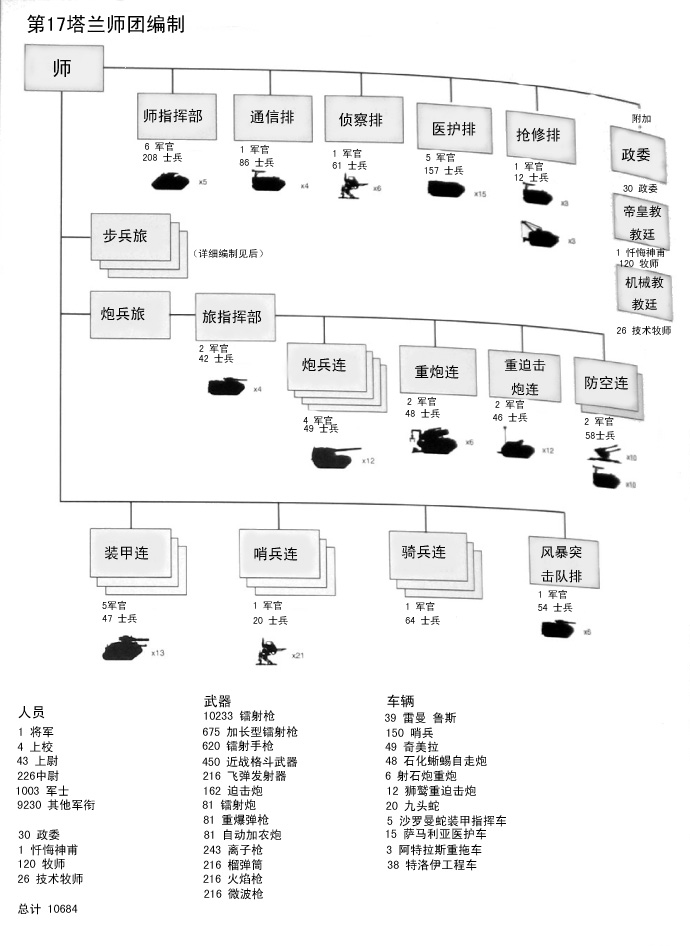

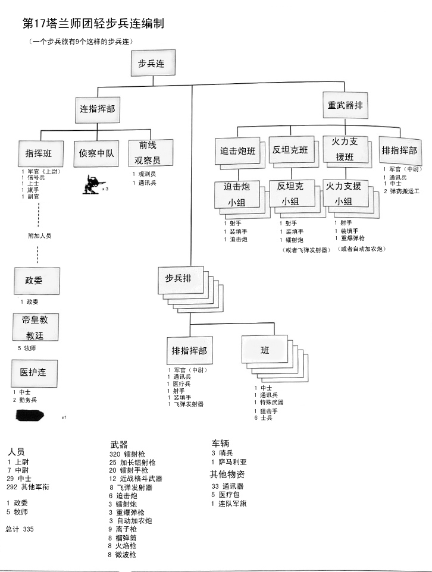

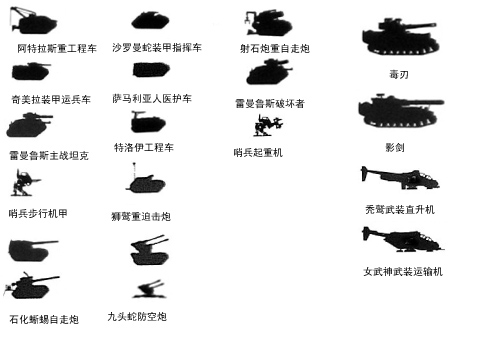

第12塔兰装甲师团编制帝国的装甲师团基本都是这样的编制

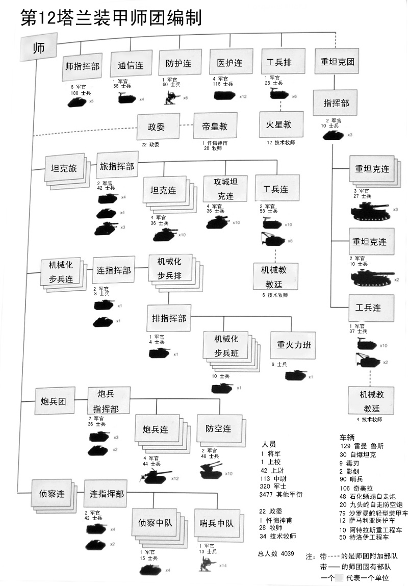

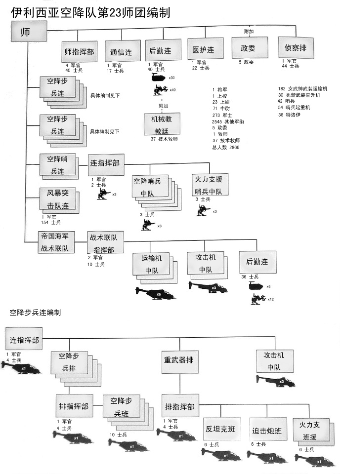

对比图

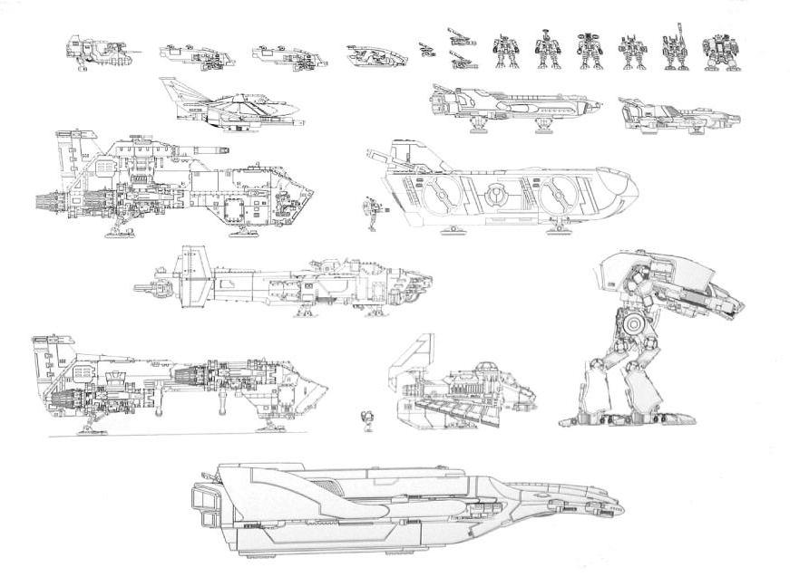

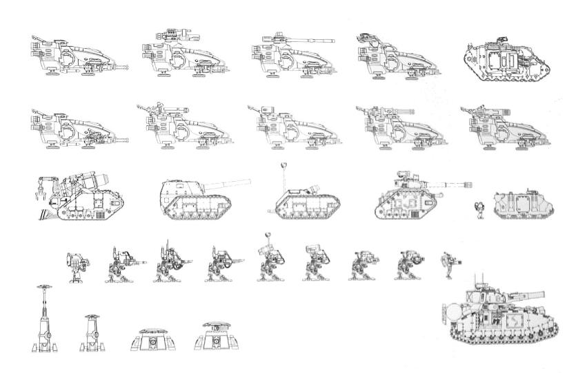

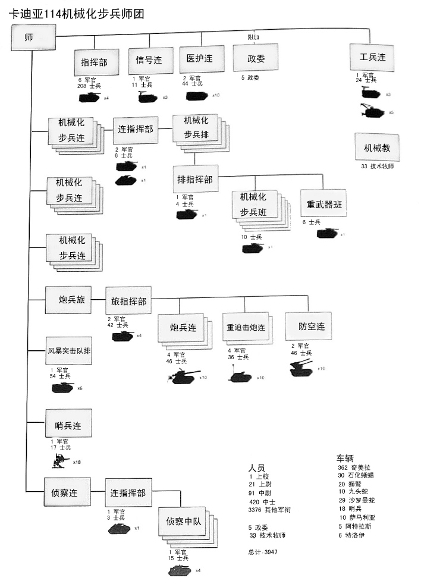

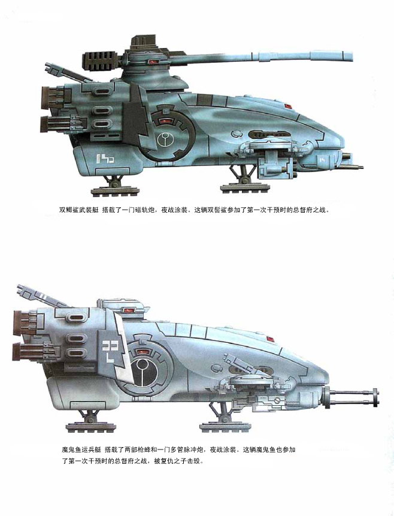

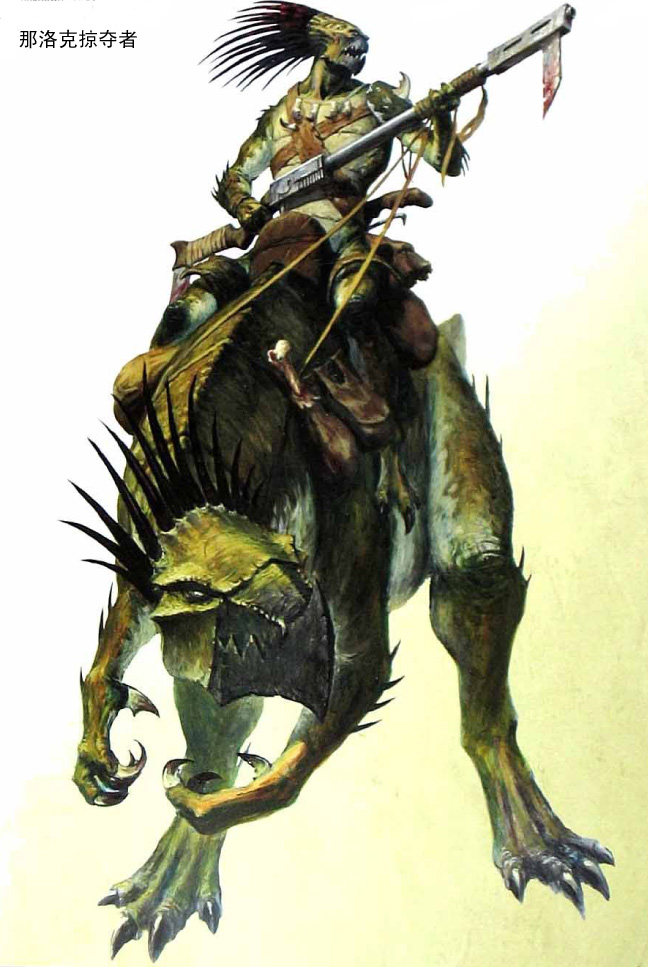

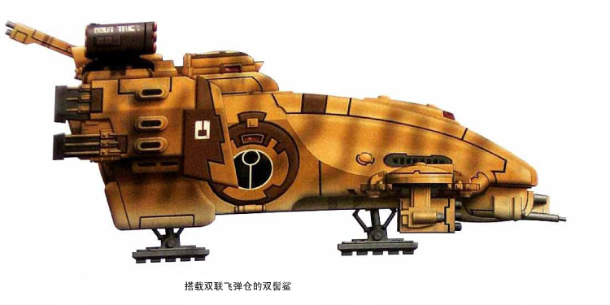

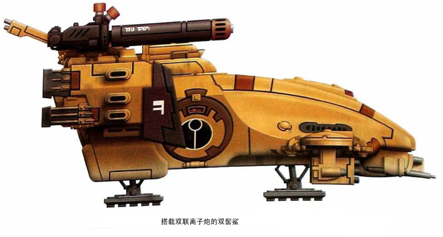

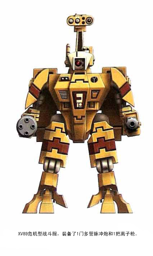

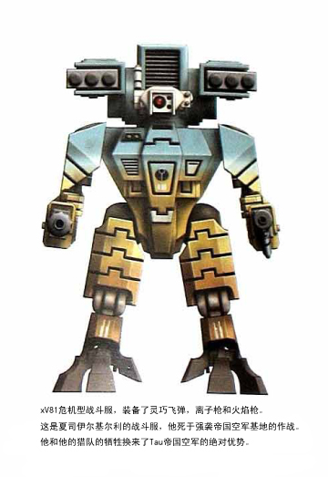

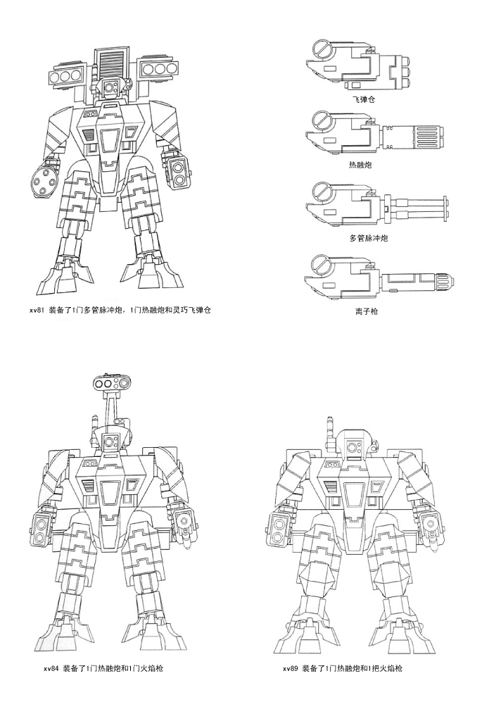
