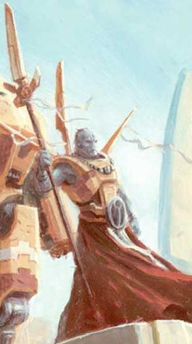
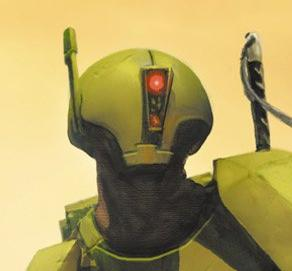

# 为什么Tau的头盔是独眼

为什么Tau的头盔是独眼

lywxx521

<H4>为什么Tau的头盔是独眼？</H4>

以太

 最近迷上了Tau 看到以太后觉得迷糊他们是人类一样的头部结构 可为什么头盔设计成独眼的？ 还在中间。。。有什么说法吗眼睛被挡住？

windyday 表面是独眼没错 但谁告诉你内置的观察装置也是独眼... 

lywxx521

那岂不是要把前面做的很厚？ 多笨重啊 这样做有什么好处

windyday

我看厚不到哪里去 虽说TAU的科技不怎么样 把观察装置2头进行连线处理的能力还是有的...可以参考下YY神作—火焰战士里装置的功能，可以锁定敌人，与武器联线，自带夜视效果

lyrespace 加强头部防御,以外挂摄像仪来进行成像+夜视...武器控制系统依附头部瞄准仪.HUD 玩一下烈火战士就知道了
