# [皇帝陛下的骄傲][哥特舰队：人类帝国主力战舰]

[皇帝陛下的骄傲][哥特舰队：人类帝国主力战舰][全文完]

兔子半妖

帝国海军，皇帝级战列舰，Emperor

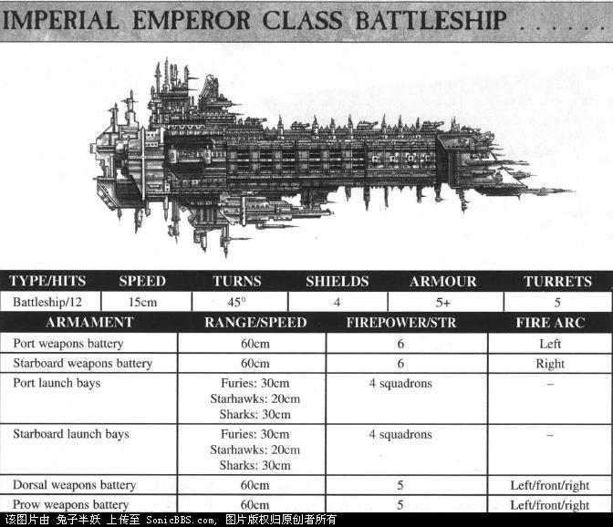

服役于哥特星区的皇帝级战列舰是Obscuras星域舰队中最古老的战舰。Divine Right号的老旧舰体来自于被废弃的Inculate Evil号，它于M36在Charos星系附近被回收并改造。虽然在亚空间中漂流了至少一万年，但Inculate Evil号的动力系统依然能够正常运作——这意味着它早在大远征之前就已经失踪了。回收的舰体被拖曳到太空港Cypra Mundi进行了全面的改造。改造完成后，全新的Divine Right号开始在Obscuras星域的各个星区间巡弋，执行巡逻任务。Legatus Stygies号诞生于Vulcanis星系的铸造世界Stygies。开始建造的时间时M30，然而随后爆发的叛乱导致Stygies上的生产设施遭受了严重的损失，因此Legatus Stygies号在空间轨道上被弃置了将近2000年。再次开工的时间大约是在M32，但是由于亚空间风暴、各种事故以及混沌叛军的入侵又使工期再度延误，直到M32结束时这艘战舰才得以完工。虽然这艘战舰的诞生过程波折不断，但Legatus Stygies号仍被在上面服役的舰员们看作一艘被皇帝陛下所祝福的战舰，这并非空穴来风：首先在Callavell之战中，它遭受了敌舰的自杀式撞击，但依然幸存了下来；然后在帝国海军损失惨重的Ulthanx清洗战中，它又如有神佑般毫发无损；此外，它还在Arriva摧毁了混沌战列舰Black Pain号。帝国海军，报应级战列舰，Retribution

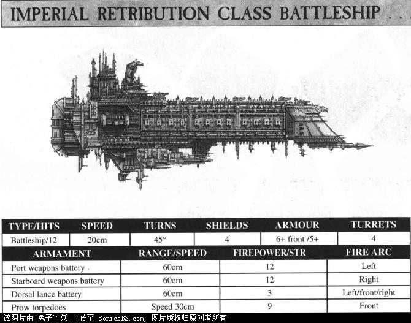

据信哥特星区舰队中的两艘报应级战列舰都诞生于帝国创立的那段时期。传统式的装甲舰首以及独特的多管等离子引擎表明它是来自火星船坞的产品。对Bloodhawk号的最早记录显示它在Merin之战中被鱼雷所重创，然后在叛乱时代它又与叛军海军上将Sehella的舰队发生激战。当时Sehella的舰队正停泊在舰队基地Hydraphur，Bloodhawk号勇敢地与庞大的叛军舰队周旋，并于8年后成功地撤退到Cypra Mundi。在那里，Bloodhawk号加入了Obscuras星域舰队。Cardinal Boras号曾作为游荡商人Ventunius探索舰队的旗舰，带领舰队前去探索银河系的北侧，然而最后包括Cardinal Boras号在内只有5艘战舰幸存。之后它先后参与了Callavell之战，Arnot登陆战。在Korsk，Bloodhawk号的轨道轰炸迫使叛变的“钢铁统治者”缴械投降。Cardinal Boras号曾在多达18个星区的舰队中服役，累计时间长达4000余年。大约在400年前，它被调往哥特星区。帝国海军，启示录级战列舰/Apocalypse

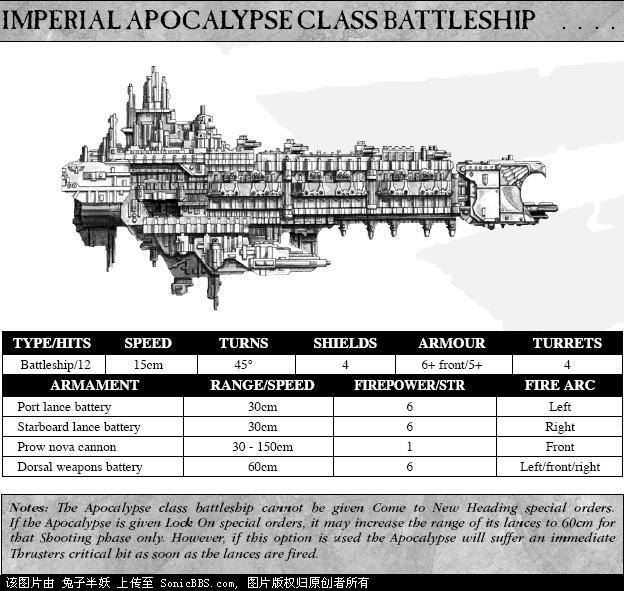

启示录级战列舰是一型非常古老的战舰，通常都认为它是报应级（Retribution）战列舰的前身，比后者早投入使用大约一千年。用以建造启示录级战列舰上的多联装光矛炮塔的高超科技早已被遗忘，因此保存下来的该级战舰成为了几乎不可替代的珍贵宝藏，即使是一艘启示录级的损失都会让帝国海军觉得痛入骨髓。海军战略家们认为帝国设计这级战舰是为了克制数目不断增长的混沌战列舰和超大型巡洋舰，它们不断率领着袭击舰队，从恐惧之眼中驶出并四处袭扰。启示录级不负帝国海军的期望，完美地承担起了这个职责。    启示录级舷侧令人畏惧的光矛阵列是它最显著的特色。值得注意的是，启示录级的光矛阵列的实际最大射程远超标定射程，因为其独特的设计可以极大地提高光矛能量供应系统的负荷能力。然而在这样超负荷运转的情况下，阵列的能量传输系统会变得极不稳定，很容易导致战舰的主推进器能量不足——这样会使启示录级在激战中成为一个缓慢爬行的靶子。因此，现存的启示录级战舰都把光矛阵列的射程限制在中距离。大部分星域舰队都保留着一些处于战备状况的启示录级战舰，虽然它们的数目正在逐步减少。第三次末日行星战役中的著名战舰：His Will, Triumph帝国海军，欧泊龙级战列舰/Oberon

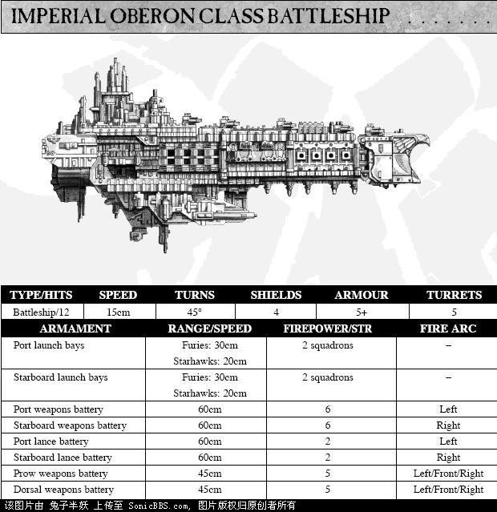

欧泊龙级战列舰是一种非常罕见的战舰，它是皇帝级战列舰（Emperor）的一种早期变体。在皇帝级取得了空前的成功后，欧泊龙级战列舰开始逐步淡出战场。设计欧泊龙级战列舰的初衷是设计一型理论上可以应对所有威胁的战列舰，而不是像现有的战列舰一样，需要护卫舰只来保护自己。虽然欧泊龙级战列舰缺少皇帝级战列舰那种无比凶猛的覆盖式火力，但它依然保留了前身所具备的强劲武器系统，此外，它还在舷侧各装备了一套威力无比的远距离光矛阵列。欧泊龙级战列舰级经常在只有少数战舰护航，甚至是没有护航的情况下执行武装巡逻任务。凭借先进的探测器，它的舰长可以在敌人尚未发现这艘战列舰时就锁定目标，这使得它比任何战舰都胜任武装巡逻任务。在战斗中，欧泊龙级战列舰缺乏报应级战列舰（Retribution）和启示录级战列舰（Apocalypse）那种压倒性的凶猛火力，也不像皇帝级战列舰那样可以投放庞大的攻击机群，但它仍多次证明自己能在舰队会战中发挥作用，击败一切面对它的敌人。第三次末日行星战役中的著名战舰：Green Lake帝国海军，火星级战列巡洋舰，Mars

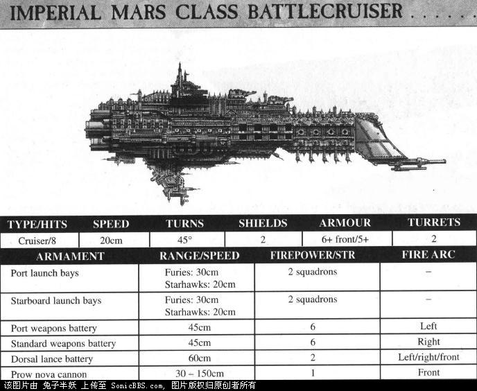

Imperious号是少数几艘幸存下来的火星级战列巡洋舰之一。远在哥特战争爆发前约1800年，火星船坞就已经停止生产该级战舰。火星级战列巡洋舰Imperious号曾在许多舰长手下服役，它在对蜂巢星球（参考蜂巢城市，恩）Orar的突袭战中一举成名。在战争前期，Imperious号设法迂回到敌后，并用新星炮重创屠夫级巡洋舰Soulless号，接下来Imperious号的光矛齐射命中了Soulless的等离子核心，将其彻底摧毁。从Imperious号上起飞的一波星鹰轰炸机群则瘫痪了第二艘屠夫级巡洋舰，使其陷入轨道防御武器的围攻并最后被摧毁。Imperious号的攻击使得帝国海军以轻微的代价重创混沌舰队，舰长Compel Bast也因他和他的舰员的英勇举动而被任命为星云总督以资奖励。帝国海军，霸王级战列巡洋舰，Overlord

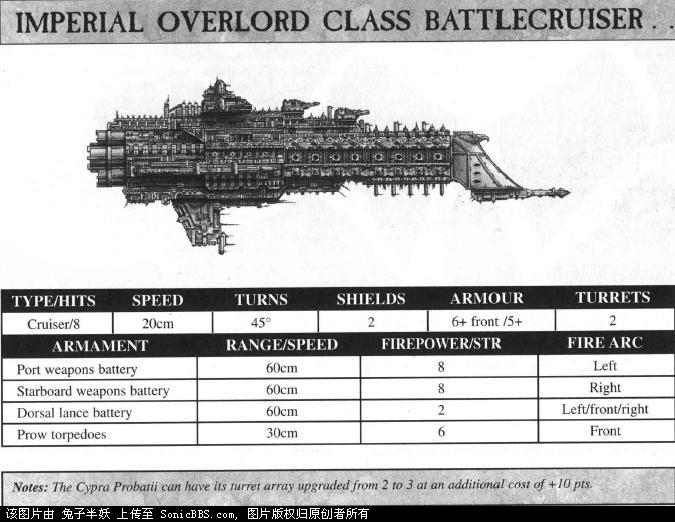

霸王级战列巡洋舰的设计基于冥界级重巡洋舰，其目的是为帝国舰队提供一种拥有战列舰级别的远程火力的巡洋舰。由于能量供应的问题，冥界级的舰首炮塔被代之以标准的巡洋舰鱼雷发射器和装甲舰首。这一改动使得霸王级的腹部光矛炮塔得以升级，获得了媲美其他战舰上的远程激光炮塔的射程。霸王级的建造显得困难重重，所以Obscuras星域舰队中服役的霸王级几乎屈指可数，且都是在Cypra Mundi船坞历经艰辛才得以完工的。哥特战争爆发时在星区舰队中服役的霸王级共有3艘：Flame of Purity，Sword of Retribution，Cypra Probatti。最后一艘完工于战争期间，在经历了一场艰辛的航行后终于抵达哥特星区。Flame of Purity和Sword of Retribution在战争中几乎从来都是并肩战斗，面临着几乎无处不在的混沌袭击舰队，它们担负起了保护重要星系的艰巨任务。帝国海军，复仇级超大型巡洋舰/Vengeance

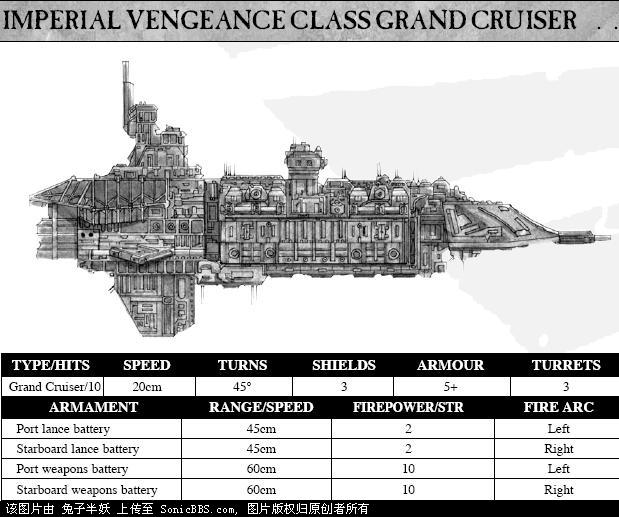

复仇级是帝国战舰设计中承前启后的一个型号。它有着标志性的装甲舰首，但却没有添加任何的附加装甲。时至今日，复仇级仍服役于帝国海军的预备役舰队中。许多海军将领都把它看作一匹年迈的军马，已经不堪重用了。此外还有在叛军舰队中目击复仇级的记录，这些战舰都源自何露斯大叛乱时期帝国海军中发生的叛乱。在叛乱后，帝国海军中的复仇级都逐渐老化了。但在亚空间中，时间轴的混乱导致战舰在服役了数千年后丝毫不见衰老的迹象。    Obscurus星域舰队中尚在服役的复仇级多是成队出动，它们沿着恐惧之眼的边缘巡逻，时刻准备迎击混沌舰队的侵袭，保护附近的星系。而其他的复仇级战舰则分散在Obscurus星域和Pacificus星域的舰队中，作为二线单位、替补中队使用，或是封存起来，作为战争储备。    一些由复仇级组成的巡逻中队在执行任务时被卷入了恐惧之眼，也许是因为追击敌舰，也许是被卷入一场突然的爆炸中。这样的巡逻中队都再也没有回来，但是在叛军的袭击舰队，乃至黑色圣战的庞大舰队中目击复仇级的报告开始越来越多。名声显赫的该级战舰The Covenanter(Scarus舰队)， Vigilanti Eternus（Cadia舰队）帝国海军，复仇者级超大型巡洋舰/Avenger复仇者级是早已过时的老旧舰队战术遗留下来的产物。根据原有的设想，复仇者级巡洋舰舰队应在轻巡洋舰或护卫舰只的保护下接敌，当距离足够接近时，舰队将全速插入敌方舰队的中央。当双方舰队左右纠缠混成一团的时候，复仇者级强大的舰炮阵列就可以在近距离对射中大显身手了。这一计划需要2到3个中队的复仇者级巡洋舰去完成重创敌军的任务（通常也会被敌军所重创）。凭借可怕的舰炮阵列，复仇者级将在近战中压倒几乎一切敌舰——这种粗暴的近战战术引起的损失和混乱将使敌方舰队陷入一片混乱，然后被帝国海军逐个击破。然而随着海军战术的变化，许多支帝国舰队中都把复仇者级看成了累赘，因此它开始慢慢地退出一线。许多战舰上的炮塔都被拆下来，挪作它用。一些巡洋舰中队被编入了预备役，但是在形势危急的时刻，这些老旧的战舰仍会义无反顾地冲向敌阵中央。帝国海军，驱魔者级超大型巡洋舰/Exorcist驱魔者级最初的设计定位是一型远距离巡逻舰，它在长时间远离舰队的情况下依然能自给自足。驱魔者级通常被派往漫长帝国的边境线，与2到3个护卫舰中队协同行动，巡视诸如银河系东部边缘或galactic halo之类的偏远地区。驱魔者级正逐渐被新型的战舰所取代，大多是火星级战列巡洋舰。还有一些驱魔者级被驻守边境的舰队保留了下来，用来完成孤独的长距离巡逻任务。许多驱魔者级被作为殖民舰使用。Brandt764号监狱殖民地的全部人口就是由一艘驱魔者巡洋舰转移到Tor Alpha星球（位于东部边境，由著名的游荡商人Foulway Tor所发现并命名），进行殖民扩张的。由Light of Ascension号指挥的驱魔者级巡洋舰中队随后肩负起护送矿石运输船返回帝国境内的任务。在该星系被一支虫巢舰队进攻时，Light of Ascension中队一直坚定地捍卫着殖民地，直到整个星系彻底沦陷。帝国海军，末日级战列巡洋舰/Armageddon设计末日级战列巡洋舰的目的是迅速增加可用的战列巡洋舰的数量。大多数审判日级战列巡洋舰都由瘫痪的月级巡洋舰改造而成，这使末日级成为了最容易建造的战列舰——虽然事实证明绝大部分舰队指挥官都不愿意削减一线巡洋舰的数量。第一艘末日级战巡在St.Jowen码头完工，它的名字是Ex Cathedra号。它原本是月级巡洋舰Orion号，在Pyran星球遭遇混沌舰队时它遭受重创，后被拖曳到末日星系。海军决定不是把这艘战舰修修就算，而是要把它改造成一艘战列巡洋舰。供能管线被重新敷设，这样主离子引擎就可以更有效地为原有的武器系统能量。在舰体腹部装上了新的远程光矛阵列。这大大强化了该舰的远程作战能力。而附带效应就是将近3500名新船员被塞进战舰，用以操作额外的武器系统，并维护那些短命的武器供能管线。帝国海军，月级巡洋舰，Lunar

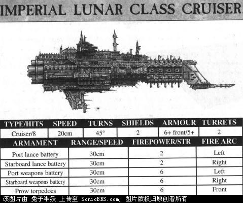月级巡洋舰以其庞大的数量无可取代地成为了Obscuras舰队的主力：超过600艘月级在该星域服役，而至少20艘投入了哥特战争。月级的简洁设计使其经久耐用，更棒的是一般来说无法生产主力舰的蜂巢星球或工业星球也能生产月级巡洋舰。最显眼的例子就是Lord Daros号，它居然是在一个遍布着蛮荒部族的星球Unloth上完工的。当地的土著为帝国挖掘并熔炼金属，然后将它们供奉给由行星总督建造的“空中神殿”作为祭品。这些稀有的材料将在每个春分或秋分时刻被送入轨道。经过11年后，土著们的努力获得了回报：他们惊喜地看着一颗明亮的新星在天空中划过——Lord Daros号飞离了这个星系，前去加入Obscuras舰队。帝国海军，暴君级巡洋舰，Tyrant

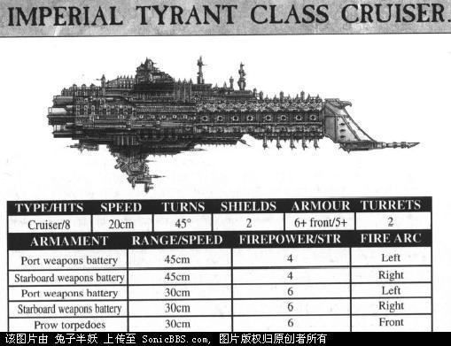临近M38结束时，声名显赫的机械贤者Hyus N’dai基于超强的等离子武器系统设计了一系列战舰。而其中最常见的就是暴君级，在M39待建的暴君级几乎充斥了帝国所有的主要船坞。它的超级等离子炮塔射程远远超出同级别的巡洋舰，又在近距离内保持了同样可怕的火力。这使舰艇设计师们大惊失色，因为制造超远程舰载武器的技术早在科技的黑暗时代失传了。但在实战中，暴君级的远程火力对任何大于护卫舰的目标都无法构成致命威胁。有两艘暴君级在哥特星区舰队中服役，它们是Zealous号和Dominion号。它们改装了在击毁的混沌战舰上获得的武器系统，直逼战列巡洋舰的强劲武器系统使它们在远距离上成为了非常危险的对手。帝国海军，统治者级巡洋舰，Dominator

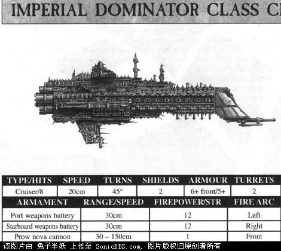    统治者级巡洋舰是一型非同寻常的战舰。它最初是作为火力支援舰设计的，专门为大规模舰队会战或者行星突击提供支援。按设想，它将停留在战线后方，用巨大的新星炮在超远的距离上轰击敌人。统治者级巡洋舰更多地出现在阿尔提玛星域舰队，而非Obscuras星域舰队——因为大部分统治者级巡洋舰都完工于Kar Duniash的舰队基地。唯一一艘服役于哥特星区的统治者级巡洋舰是由Grenfeld舰长指挥的Hammer of Justice号。虽然它在各大演习中的表现乏善可陈，一直默默无闻。但是当战争爆发时，Hammer of Justice号开始锋芒毕露。曾被视为累赘的新星炮在Grenfeld舰长手中运用自如，先后在Maw截击战和Alios突袭中大显神威。由于新星炮的突出表现，许多舰只都开始将它们的舰首武器改装为新星炮。帝国海军，哥特级巡洋舰，Gothic

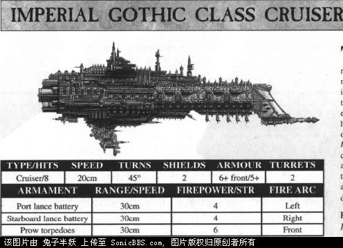    强大的哥特级巡洋舰是最常见的帝国战舰之一，因为在各个星域舰队中都有大量该级战舰服役。它装备的强大的光矛阵列令哥特星区的其他帝国巡洋舰都望尘莫及。然而在战斗中它的弱点暴露了出来：哥特级必须依靠其他战舰协同行动才能发挥出火力优势。在Righteous Fury号与混沌超大型巡洋舰Bloodied Sword号的两次遭遇战中，Righteous Fury号都遭受重创，而敌舰却几乎毫发误伤。没错，光矛的火力很强大，但它们无法在一对一的战斗中命中速度过快的敌人。因此Righteous Fury号的舰长Hodge率先改变了战术，让哥特级和一队护卫舰或者另一艘巡洋舰一同行动。遭遇敌人的时候，哥特级将舷侧的光矛对准敌人正面，而友舰则从敌舰两翼或后方包抄。当哥特级的光矛摧毁了敌舰的护盾之后，友舰就可以发动猛烈的攻击，使敌人无路可逃。通过这个新战术，哥特级先后摧毁了混沌巡洋舰Cackling Hate号和Glorious Bloodbath号，为战争的胜利做出了贡献。帝国海军，独裁者级巡洋舰，Dictator

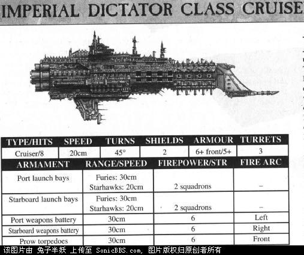    独裁者级巡洋舰基于月级的舰体设计，但是将光矛阵列替换为庞大的机库和发射平台。这个应急措施的本意为了获得向低层轨道投放大量的大气层内飞行器的能力，比如说投放雷霆战斗机或者掠夺者轰炸机来提供对地火力支援。然而在对通讯系统和探测系统进行了成功的改造后，独裁者级具有了在太空中向敌人发动远距离攻击的能力。它换装了专为太空作战设计的暴怒式战斗机和星鹰式轰炸机，开始承担舰队火力支援或星区巡逻的任务。一艘独裁者级巡洋舰和一些护卫舰便能组成一支高度机动的特混舰队，可以轻松地完成猎杀海盗或用攻击机群袭击敌对的星球的任务。Rhadamanthine号就是一个显著的例证，它同Skargul巡逻队一起巡弋于Orar分区，消灭了大量的海盗。在哥特战争中，独裁者级巡洋舰为那些脆弱的运输舰提供了坚实的保护，使它们得以安全地通过面临混沌威胁的区域。随着大规模战争对攻击机的需求剧烈增加，许多毁坏的月级巡洋舰都在大型舰队基地中被改造为独裁者级。在战争结束的时候，独裁者级巡洋舰的数量增加了7艘，如果不是Rhadamanthine号和Archon Kort号被阿巴顿的舰队击毁，这个数量还会更高。帝国海军，尽职级轻巡洋舰，Endeavour尽职级缺乏海盗清扫行动所必需的高速度，更适合于担任护航运输队的旗舰或是作为重型护卫舰只来掩护大型主力舰。它的等离子炮阵列火力强劲，其它不亚于体型更大的巡洋舰，因此在激烈的舰队会战中仍有一席之地。在最近一次兽人入侵发生后，许多尽职级轻巡洋舰被派往末日星系舰队。在对抗兽人战舰的时候，尽职级的低速度将不再是一个明显的弱点。它和它的姐妹舰一起替代了损失的战舰，成为了末日星系舰队的中坚力量。帝国海军，坚忍级轻巡洋舰，Endurance坚忍级实际上就是一艘将舰炮改装为光矛阵列的尽职级。许多舰队指挥官所常用的一个战术就是混编坚忍级和尽职级，成对搭配的这两级战舰既能相互掩护，又拥有可怕的火力。然而，考虑到坚忍级的产量较少，这种战术搭配通常都难以实现。更常见的是由一艘坚忍级和二到三艘尽职级构成的混编舰队。当末日行星战争在高重力行星Pelucidar拉开帷幕的时候，Ad Liberis号充分展示了这种战术的有效性。在收到Parol上将的命令而撤离战场之前，它已与敌人激战了三个小时，连续摧毁兽人护卫舰达九艘之多。帝国海军，挑衅级轻巡洋舰，Defiant挑衅级是铸造世界Voss生产的3级姐妹舰种最罕见的一级，但却填补了前两者的缺陷。以它的体型而言，它是一级非常出色的航空母舰，但是在没有支援的情况下几乎是不堪一击。由于缺乏用于自卫的舰炮，挑衅级通常停留在主力战舰后方，作为远程支援火力使用。作为尽职级的最新改型，这级轻型航母证明了自己的重要性，有力地支援了正绝望地抵抗着一波又一波兽人入侵者的末日行星舰队。虽然它们与庞大的兽人巡洋舰相比过于脆弱，但它们仍有能力突破兽人舰队的防御圈，并用轰炸机群重创兽人主力舰只。在St. Jowen港口上空的激战中，Forebearer号和ArchAngel号一直勇敢地停留在战场中央，为攻击机群补充燃料和弹药。虽然两艘战舰最后被蜂拥而至的兽人战舰摧毁，但英勇的驾驶员们也击沉了兽人杀戮级巡洋舰Grimzag’s Ammer号，并且重创两艘惊惧级巡洋舰。帝国海军，弯刀级护卫舰，Falchion铸造世界Voss的舰船设计风格同样在护卫舰上得到了体现，这就是弯刀级。叛党们在761.M40逃离铸造世界Monsk时带走了一型准备用来取代眼镜蛇级驱逐舰的大型护卫舰的设计方案，然而科技贤者们通过叛徒遗留的少量信息开始了复原这一设计的工作，并把它带到了Voss。从261.M41起，第一支完全采用这种新型设计的护卫舰中队开始巡弋于太空之中。虽然这型设计已逐步在机械神教的势力范围中扩散开来，但仿制工作却十分迟缓，大部分舰队都没有换装哪怕一艘该型战舰。在末日行星战争早期，只有两个中队的弯刀级在末日星系舰队服役，即Michaelis Fire和Torchbearer Patrol。这是一型基于广泛生产的剑级护卫舰所设计的全能型护卫舰，能够适应多种任务的需求，它可被用于巡逻、运输队护航，或者担任轻巡洋舰的后卫。和所有由Voss设计的舰船一样，它备受Voss星的珍视，因此没能广泛地部署于各个舰队中。但那些装备了弯刀级的舰队都发现它们获得了比普通的剑级更出色的护航舰。帝国海军，不屈级轻巡洋舰，Dauntless不屈级这样的侦察巡洋舰一直是帝国舰队的重要组成部分。一型理想的轻巡洋舰应当拥有足够的火力来击退敌人的护卫舰，同时又有充足的燃料和补给品，使其可以连续数个月远离基地而无需补给。不屈级是一型非常受欢迎的巡洋舰，它像护卫舰一样敏捷灵活，又拥有强劲的前射光矛阵列。在哥特战争中，轻巡洋舰Uziel号和Baron Surtur号最先在Formosa星群附近发现了叛军统帅Khuzor的舰队。由于它们提供的准确情报，Sartus上将的舰队得以及时赶到并阻击敌军。帝国海军，剑级护卫舰，Sword古老的剑级护卫舰在Obscuras舰队中已服役了数千年。战舰的设计和构造经受起了无数次战斗的考验。剑级的激光武器阵列和近防炮塔的备战率令人惊异地高达88.2%。剑级的等离子引擎也同样简单可靠，它在其他舰只上被大量地装备使用过，只要是接受过起码程度训练的维护人员就能保证它的正常运作。无论从哪个方面看，它都是一级经典的护卫舰，很少有战列舰会在没有两艘以上的剑级护卫舰保护的情况下出战。剑级将守卫战列舰的后方，击退来袭的敌军驱逐舰或攻击机。帝国海军，火风暴级护卫舰，Firestorm火风暴级护卫舰是Obscuras舰队中相对较新的一个型别。它的设计目的是创造一个结合护航舰的机动能力与光矛武器的攻击能力的平台。火风暴级基于剑级的舰体，只是将舰体激光武器的能源核心改为向舰首的武器阵列供应能量。只有五个中队的火风暴级投入了哥特战争，由于缺乏可以替代它们的舰只，这五个中队在大部分的战斗中都没有满员。火风暴级最大的胜利是金色中队在Veras之战中取得的。两艘火风暴拦截了一群试图从侧翼夹击皇帝级战列舰Intolerance号的异端级护卫舰。帝国海军以损失一艘火风暴级的代价摧毁了三艘异端级。在火风暴级的保护下，Intolerance号顺利投放了24个轰炸机联队前去攻击混沌舰队的浩劫使者级战列舰Eternity of Pain号。（皇帝级的机库有这么大咩。。。或者说Wings还有别的解释？再顺便，Intolerance号还是被击沉了。。。Eternity of Pain号有击沉７艘帝国战列舰的纪录）帝国海军，眼镜蛇级驱逐舰，Cobra    眼镜蛇级是Obscuras舰队中的一个重要组成部分。它的多用途特性使它在侦察、巡逻和袭击战中都能大显身手。眼镜蛇级最大的资本就是它的高速度，这让它能够轻松地追逐那些被海盗所偏爱的高速轻型飞船。这一特性在哥特星区得到过完美的展示：由Walker舰长指挥的Skargul巡逻队曾在哥特战争爆发的十二个月前摧毁了十七艘海盗船只。
