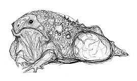
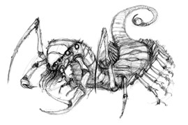
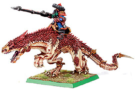
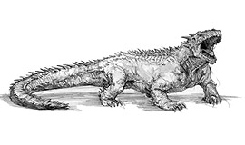
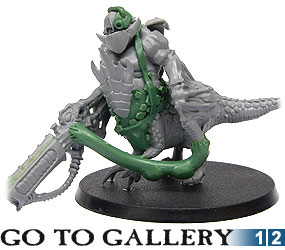

# 40K中的野兽与怪物

40K中的野兽与怪物

嘉拉迪雅

拟行蛛（Arenea Stalker）：拟行蛛是生活在Mordant Zone的小行星上的一种蜘蛛形生物。它在岩石隧道里编织失重状态下的蛛网来捕捉猎物。 小行星在帝国的领土里很常见，但是只有很少的一部分被证明具有开采价值。机械神教曾经偶遇一个在Mordant Zone的星系里游荡的小行星。它被编号为TK421，技术牧师认为这个小行星值得开采，并且随后派了一艘采矿的驳船前往。行动最初一切正常，低阶的技师指导奴工们在其中挖出一个隧道网络来连接各个矿点。当隧道完成的时候，事情就不对了。起先，一些奴工按计划没有返回维护所，然后有失踪人数超过了20。困惑的技师进入了隧道的网格里寻找他们的奴工。然后他们跟随失踪奴工的预订路线直到尽头。他们发现了许多在失重的通道里漂浮的网。最后，只有他们的记录用的伺服头骨返回停泊的驳船那里报告技师所发现的东西。 血蜂（Blood Wasp）：群居的肉食昆虫，就像是大黄蜂一样，不过可以在几小时内把人吃的剩下骨头。 异教蚁（Heretic Ant）：这是一种剧毒的蚂蚁，会从你的脚底攻击你，因为它们会寻找你的脚底（sole），所以根据这个单词的谐音soul，它们被命名为异教蚁。 脑叶（Brainleaf）：脑叶是卡塔昌的一种高危险植物。脑叶有着很长而光滑的卷须，其终端是一片单独的叶子。这种植物可以将叶子链接到活的生物上，控制它们的神经系统并且操纵它们作为护卫乃至肥料。被操纵的人会成为十分听话的傀儡。 吠蟾（Barking Toad）：吠蟾是死亡世界卡塔昌上的一种危险的动物。当受到威胁的时候，就会爆炸成一团毒云杀死周围的生物。如果是巨大的吠蟾，其爆发的毒云甚至可以延续到一公里外。迄今为止，没有任何装甲可以阻挡这种剧毒。所有被这样的剧毒包围的生物，包括吠蟾本身，会被分解成一团不规则的黏糊糊的物体，而之后那处地方就再也没有植被可以生存。 吠蟾喜欢居住在幽暗潮湿的地点，而且不喜欢被打扰。小型吠蟾是令人讨厌的东西，一会儿到处乱跑，一会儿又躲藏在黑暗的石头后面。 吠蟾

 卡塔昌恶魔（Catachan Devil）：顾名思义，卡塔昌恶魔是死亡世界卡塔昌的土生异形。这些凶残迅捷的怪物很像蝎子，由一系列的体节和成对的肢足和一条拥有毒钩的弧形长尾组成。卡塔昌恶魔会不断长出新的体节和肢足，一只成年的卡塔昌恶魔可以有30套肢足（这里应该是30对的意思），长达30米。雄性的和较大的卡塔昌恶魔的前肢可以长的很大，类似于蝎子的爪。 卡塔昌恶魔喜爱炎热潮湿的雨林，不过也成功地在很多其他的生态系统上定居。它们是极端地适应丛林环境，它们的多足的身体允许它们以惊人的速度在各种地形上飞速前进，并且卷曲弹向它们的猎物。一旦被抓住，那个不幸的家伙要么被锐利的刀形爪撕裂，要么被毒尾所扎至昏迷并进入它的口中。 卡塔昌恶魔会以巢穴为组织生活，巢穴由几个大的恶魔和几十个年幼的“恶魔幼体”所构成。整个组织会一起对抗入侵它们领土的入侵者，包括其他竞争的巢穴、掠食者、殖民者、甚至是帝国的装甲连队。 卡塔昌恶魔

 沙魔（Debilithrax）：这些Erakeen世界的沙漠生物以剧毒攻击，并且将其猎物托入沙土之内而著名。沙漠被塔兰沙漠骑兵的巡逻队在Erakeen上发现——只有一个士兵返回总部报告。巡逻队当时正在突出的岩石的阴影后面展开帐篷歇息。而睡着的塔兰人被值守的士兵被毒液侵入的尸体掉落的声音所惊醒。他立刻抓其激光枪冲出帐篷，但是只看见了空旷的沙地。更糟糕的是，他们同伴的尸体更没入沙地中不见，只留下了两个弹坑。明显很震惊地，那些塔兰人很想离开帐篷，但是他们不敢冒损失水分的危险在正午移动。因此他们占据了防御的位置来等待毒辣的太阳过去。很快的，沙土发出了响声，然后，一条痕迹伴随着沙子的声音蜿蜒而来。而那个幸存的士兵再也无法忍受了，立刻冲出了他的帐篷。他最后看到的东西就是他同伴的帐篷被无数半透明的棕色爪子拖到地底。扛起了枪，最后的那个塔兰人开始了逃亡。 它的尾巴也是像蝎子，不过上面是三片锋利的东西而不是蝎子那样的毒钩。 戈洛兽（Grox）：戈洛兽是Soloman星系的一种爬虫类生物。它的适应能力极端高强，能够吃下任何形式的食物，无论它们多么难以被吸收。它们的肉味道鲜美而且富有营养。这些因素使它们成为帝国不同世界的极佳的畜牧动物。然则，戈洛兽是独行的，如果一群这样的动物被赶到一起它们就会攻击彼此以及任何不幸插在它们中间的家伙。因此，戈洛兽通常被植入大脑电脉冲线路或者是激光防御系统，一种自动向靠近的家伙们发射警告性激光的植入体，这样能够有效地阻止它们自相残杀。戈洛兽还以其脾气而著名，俗语道：“顽如戈洛”。 强脑猫（Gyrinx，Gyrus的本意是脑回，而这种动物可以增强主人的脑力……OTZ，我实在不知道怎么翻）：强脑猫是一种大型的猫科动物，类似那些温顺的猫儿，不过可以长到一米长。它们拥有厚密的橙色或者赤黄色皮毛，而且有着闪亮的蓝色眼睛。 强脑猫有着特殊的能力来和它们所选择的主人建立一道心灵链接。这种链接在强脑猫在主人旁边的时候增强其主人思考的速度和反应能力。拥有这些链接的灵能者通常把强脑猫作为外部的灵能容器。随着时间的流逝，强脑猫的代谢发生变化，并逐渐变的像它们的主人。因为它们的天性，强脑猫是审判官、行商浪人和高级枢机院成员的昂贵宠物。 猎蜥（Hunting Lizard）：Kashann是一个年轻的世界，火山密布，山脉峭立，其上覆盖这生长迅速的丛林、海洋和原始的沼泽。猎蜥是其中最成功的猎食者，它们以集团行动，它们是早期殖民者最大的敌人。猎蜥和大蜥蜴类似，不过拥有锐利的爪牙。不过现在它们已经为人类所驯化，并且被Kashann的军团当成莽骑兵的坐骑。欧维格（Ovigor）：这是一种阿提拉土生的大型野生动物，是阿提拉牧民们所喜爱的食肉来源。它们是一种迁徙的群居动物。它们的肉和血冻都是富有营养的食物。 炎蜥（Salamander）：火蜥蜴是一种火山世界Nocturne土生的大型蜥蜴类动物。炎蜥战团就是以其母星上的强大猛兽而命名。战团的新兵会以猎获一头火蜥蜴来作为他们入团的证明。 一种特殊的大型危险品种在亡火峰定居，这些火蜥蜴能够喷火，并且有着另一个名字——“火龙”。 （详细资料暂缺） 钉刺草（Spiker）：钉刺草能在许多死亡世界生活，例如卡塔昌。它们被认为是全银河最危险的植物之一。钉刺草是圆柱状的，垂直高2米的人类大小的植物。它们被一层厚厚的类似发丝状树叶所覆盖，里面是无数突出的薄而锋利的钉刺，这些植物因此得名。这些钉刺可以刺入动物的皮肤，对其血液释放诱变化合物，能够让受害者的外壳逐渐变成钉刺草一样。一个手臂上被扎了一下的人会很快发现他的手臂变得充满毛发而且无法动了，在此后很短的时间里，他的整个身体会被钉刺所覆盖。虽然受害者能够保持移动能力一段时间，但是生理的变化摧毁了他的神志。他会无目的地到处漫游而且无法抵抗这可怕的变异。当所有活动的能力都失去的时候，宿主会完全变成一株钉刺草。 芬里斯星球上的动物： 芬里斯麋鹿（Fenrisian Elk）——有着剃刀状的锐利鹿角的麋鹿，12尺高，10尺宽。 芬里斯猛犸（Fenrisian Mammoths）——能在瞬间将人踏扁的大型猛犸。 龙类（Drakes and Wyrms）——在地热的出气口盘卷来取暖的生物，形象未明…… 血鹰（Blood Eagles）——资料暂缺 海蛇与海妖（Sea Serpents and Kraken）——巨型海生动物，很可能是泰伦虫族入侵失败的原因，具体形象可参见各 类相关的神话与传说。 灵狐（Psychic super-intelligent foxes）——能够制造精神幻觉诱使别人死亡的一种灵能生物。 大白熊（Great white bears）——巨大的白熊，能够推倒建筑物的强者，20尺高。 芬里斯狼（Fenrisian Wolf）——大小从小马到一辆装甲运兵车都有。群体狩猎的动物。雷曼努斯据说是被一头母的芬里斯狼所抚养大。 汽龙（Vapour Wyrm）：这些东西是哈拉空世界上的大型飞行动物。哈拉空战隼的战士们喜欢猎杀这些野兽。（具体资料暂缺）可以参考苏联红老爷翻译的CODEX IG里的军团介绍。 大双足龙（Giant Reptiles）：大双足龙是银河中常见的物种，尤其是在死亡世界（death world）或者野性世界（feral world），它们是主要的掠食者。一头大双足龙的体型可以从一辆摩托到一辆兰德掠袭者，有着惊人的力量和凶猛，并且有着强大的天然武器，包括锐利的骨刺和爪子，巨大的颚部，这些都可以穿透犀牛装甲运兵车的装甲。星际战士招募新兵的星球时常有这种巨大的凶兽出没，而青年们也时常以猎杀这样一头巨兽来表明他们的勇气，以及当作成年礼的证据。不用说，很少人能够活着回来。食肉龙在Triath行省的荒地游荡，还有Arcanadont，Mordant的矿业世界的进化顶端生物，在星域里被当作凶猛的宠物以及社会地位的象征而高价销售，还有许多的生命和生肉（莫非是指某些权势人物用活人喂养这些东西么）。大双足龙也被其他的种族驯养，野蛮的殖民世界的艾达人通常把这些大恐龙驯养成坐骑，并建立一种奇特的互助关系，甚至骑着它们进入战场。 大双足龙

 响尾蜥（Crotalids）：生活在热带或者亚热带河流附近的大型食肉动物。响尾蜥是大型的爬虫类动物，长长的身体覆盖满了鳞片，四肢粗短有力，能产生巨大的爆发力。响尾蜥的头部有点像龙类，它强壮的下颚布满了三角形的锯齿。终其一生，响尾蜥都在生长，而且它们长大后能够咬烂最厚的装甲。帝国的异形学者并没搞清楚响尾蜥的寿命，因为它们独特的迁徙习性让它们几乎无法被追踪。有传言道响尾蜥起源于死亡世界Lost Hope，不过这并没有得到证实。 响尾蜥是强大的掠食者，潜藏在深水之中，或者以河岸为掩护突袭它们的猎物，这些猛兽已经多次被观察到以它们的下颚和利爪轻易将同等体型的猎物击倒。它们几乎不会受到伤害的映像，其原始的神经系统能够在死亡之前忍受最严重的伤害。响尾蜥成长迅速，并且很快可以控制它们的领土，并占据食物链的顶端数十年。一旦响尾蜥的密度达到饱和，那么它们就开始了独特的迁徙。 响尾蜥的迁徙习性： 一旦响尾蜥的密度达到了饱和，以至食物开始短缺，它们就需要迁徙来避免灭绝。大多数的生物以步行、飞行或者游泳来迁徙到新的栖息地。但是响尾蜥有一种很特殊的方式来到达新的狩猎场。响尾蜥在中等深度的亚空间中穿行，抛弃几乎被吃光的栖息地并到达一个新的世界，通常可能是几光年以外的地方。而响尾蜥似乎并没有主动操控这种力量的能力，因为它们并非智慧物种，因为它们到达的世界很多时候并不适合它们居住。响尾蜥到达新的定居点的时候，会具有极端的攻击性，攻击视野内的所有生物直到它们建立起领土并统治周围的地区为止。如果遇到它们无法征服的困难，那么它们会迅速以亚空间旅行离开，找一个更加适合的地方。 响尾蜥为何能够在亚空间旅行迄今为止还是一个谜，重复的解剖研究并没有发现它们有运用这种技能的方法。迁徙的集群的数量各不相同，从四五头到上百头都有，因为在亚空间中追踪这些生物很困难，所以这个数字可能并不确切。 响尾蜥

 活死人（The Living Dead）：就是那些软绵绵的蹒跚的吃人肉的慢吞吞的呆呆的家伙…… 在恐惧之眼的战役中，纳垢的小弟们用致命的病毒感染了人类，把他们变成了瘟疫僵尸。混沌的浸染并没有让他们摆脱尘世，相反，它们以不死者的身份回归，以庞大的数量压倒一切敌人。而除了混沌以外，还有很多原因可以造成僵尸的出现。这里有一些比较著名的类别： 僵尸瘟疫：混沌干的好事。 在野的高级灵能师：他可能会杀死许多的凡人，并且以恶毒的巫术唤醒这些凡人的尸体，驱动它们作为僵尸战斗。 卡塔昌脑叶：一种极度危险的东西，能够控制人的神经，并且只靠接触就可以把入侵者变成听话的傀儡。这些植物在该行省里面非常繁盛。因此经常有帝国卫队的士兵去清除这些威胁。 潘多拉：一种古老的艾达灵族装置，可以强化植物的生命力到难以置信的地步。这种能量如果被释放，那么就可以让那些承受最严重伤害的人依然能够站立，不过他们大多不想这样，因此会寻求一种解脱的方式。 泰伦虫族的大脑皮层蛭（Tyranid Cortex Leech）：这些令人讨厌的小家伙会跳到猎物的头部，将其触须从受害者的耳朵和鼻孔进入，占据了宿主的大脑，并且将之置于Hive Mind的控制之下。 被遗忘的舰队（THE FORGOTTEN FLEET） 巨人（Colossus）：一种在克罗索斯虫巢舰队上发现的半人马形状的生物。它们很可能是幸存的外星种族奴隶，但是被用作泰伦虫族的生物武器的共生体。另一种说法是，这些怪物其实是其他泰伦虫族舰队的变种，它们有明显的进化独特性。在这些独特的特征之中最主要的就是对泰伦武器共生体的应用（虽然看起来使用这样的武器会让它们感受到非常的疼痛），以及和其他生物建立心灵感应的能力。它们对帝国的攻击开始于Zorastra-Attila战争（Attila就是阿提拉，出产阿提拉蛮骑兵的世界，Zorastra未知），在经历50年之后那个虫巢舰队覆灭。 巨人

 游啮怪（Ramblin' Snapper）：这种怪物可以在很多个世界中被找到。它们广布在死亡世界的丛林里。它们是一种安静潜行但是在用许多的利爪撕裂猎物之前会以凶猛的冲锋和践踏宣示其到来的家伙。它们也是十分巨大的生物，让它们行动很笨拙。因此它们的这个弱点也可以用来对付它们。许多帝国部队不止一次遭遇到这种怪物，不过在躲开第一次冲锋之后，就可以在它转过身来再度进攻之前就将其杀死。然而和许多其他的泰伦类分支生物一样，游啮怪也非常适应其生活的环境，一旦战士们没有发现游啮怪已经到达了他们身边…… 库姆洛克吊晃兽（Kromlok Dangler）：这些泰伦生物只在Kromlok山脉被发现。它们是迅速的以从身体伸出的倒钩攻击的生物。它们可以长到5米长，并且初步估计最大负重为65公斤。 库姆洛克吊晃兽是一种危险的泰伦变种，在Kromlok山区被发现。白天它们在崎岖的山峰上躲藏，这些怪兽在日落后用它们奇特的视觉来进行狩猎。完全安静得，这些恐怖的生物从空中扑向它们的猎物，用身体上伸出来的倒钩刺入其中。如果猎物够小，那么吊晃兽就可以用其动力将猎物带到空中并回家喂它们的幼体。很少有吊晃兽被击落的，因此很难准确估计它们最大能带多重的东西。最大的一个标本长5米，并且可以携带最大65公斤的事物。因为有比这更重的人在Kromlok山区失踪，所以不排除有更大的吊晃兽的可能。 跳棘蛇（Leaping Thornsnake）：蛇虫的退化形态，它们居住在远东边疆的世界上。它们在地底掘进，并且以角和头部发射的针刺进行攻击。它可以用强壮的尾巴弹跳到敌人的后方。它们的尾巴也可以将敌人扫到空中。而除了弹跳以外，它们还可以借助尾巴在地面上快速推进。跳棘蛇对于殖民者和探险家来说是致命的威胁，因为在它们跳出来发动攻击之前，没有人能够探测到它们的所在。 附注： 蛇虫（Raveners）：蛇虫混合了撕裂虫和虫族武士的特征，这些大型的类蛇猛兽被设计来做快速突击部队，用于对付轻装甲的敌人并且从地底挖坑道来突击。它们可以以惊人的速度挖掘坑道，它们的铲状爪可以穿越几乎所有的物质。通过感知地上的震动，它们往地面挖掘并突然蹦到敌人的阵地里面。它们的胸腔装载的生物武器，它们的进攻从无征兆。 蛇虫最大可以长到2米长，2吨重，学名：Tyranicus Ophidus Subterra Dakkar窃脑虫（Dakkarian Brain Slug）：这些寄生虫居住在死亡世界Dakkar的丛林里面。这个炎热的死亡世界是许多致命生物的家园，而窃脑虫可能是其中最阴险的。它会钻入宿主生物的神经系统里面，并且完全控制其受害者的身体和思维。当受到威胁的时候，窃脑虫可以在宿主的表皮下滑行到宿主颈部后面。一旦到了那里，它会释放一个小的呼吸管穿过颈部后方，并且可以悄悄的迅速进入未受感染的生物中。即使是最大的掠食者也可能成为这种险恶生物的宿主，并且其高速的传染速度使得对抗它们几乎是不可能的。 有谣传说窃脑虫会借助人类宿主来进行远距离旅行，甚至是在一些临时招募兵里面。有时候整个临时招募兵会被正规军用火焰喷射器所净化——因为其中发现了细微的窃脑虫存在的痕迹。 Gorzal沼泽潜怪（Gorzal Swamp Lurker）：这种怪物是一种巨型的异形生物，在Gorzal荒凉的沼泽地里被发现。这些生物把它们巨大的身体藏在淤塞恶臭的污水里面，等待毫无警觉的动物进入其攻击范围。然后潜兽突然从污水中跃出，其巨大而锋锐的肢体插入猎物体内，并且将其拖入早已张开的大口中。 很像芬里斯上缓缓漂移的冰山，几乎所有沼泽潜怪的身体都在Gorzal浑浊的水下。这些生物有类似甲壳类的肢足来小心寻找可以行走的道路（因为在沼泽里面）。幸运的观察者可能会注意到它那复眼的眼柄从水底伸出来观察四周以避免被攻击。120米长的标本也曾经被发现，有人曾说自己躲避过了同样大小的怪物的3次攻击（强者呀）。 巢穴爬行者（Brood Crawler）：类似暴虫（Termagant）和刽子手的混合体，这些生物用巨大的爪子来移动和攻击。它们拥有十分锋利的牙齿，一个很短的脖子。它们的爪子过于巨大以至通常阻挡了它们自己，因此它们在吃掉猎物之前会将其撕裂粉碎，然后把食物抛入它们狭小的口中。它们是没有视觉而靠爪上的声波器官产生声波来定位的其他生物。 Icthiam惧虫（Horror of Icthiam）：和灵化脑虫（Zoanthrope）相似，它是寄生并且使用灵能来控制宿主的虫族后裔。也有猜测说它们就是灵化脑虫的变种。当它们和宿主分开的时候，惧虫是很虚弱的，只能用其意志力来驱动身体行动。然则，一旦它们侵入了宿主，那么它们的灵能会得到极大的强化，它们会汲取宿主的精神能量，并在必要的时候爆发出来强化其奴隶的力量。 壳虫（Shelled Slasher）：在砂岩密布的Drisdan III上发现的掘穴生物。Drisdan III是一个十分荒凉的行星，处于Leviathan虫巢舰队的进攻路线上。所以壳虫很可能是泰伦虫族的后裔，它有重甲覆盖的身体，并且能够在必要的时候缩进甲壳里面。它的攻击方式是使用爪子和头槌。它们是殖民者和矿工最大的敌人。而因为它们身上厚重的甲壳，它们可以抵抗沙暴和常规武器的攻击。当其将90%以上的身体缩到甲壳里面的时候，就很难被摧毁了。它的坚硬的外壳很像沙蟹，这让它埋在沙土里时难以辨认。而一旦猎物到其附近，它就会带着砂石一跃而出，在猎物反应过来之前用高速的抓 耙和头槌将猎物干掉。 
