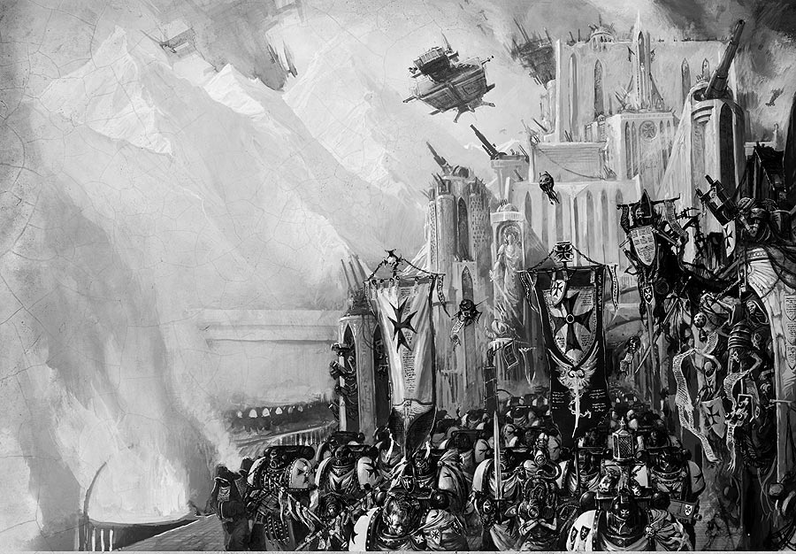
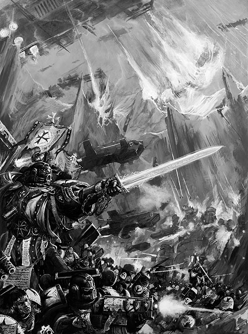
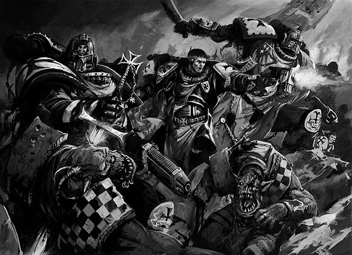
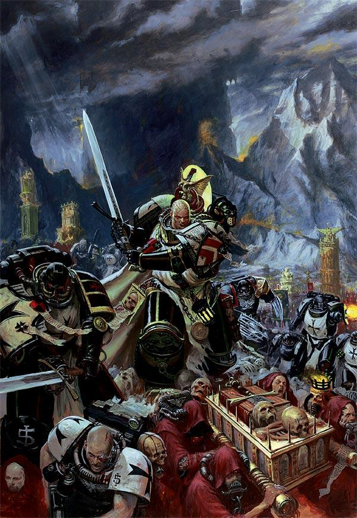
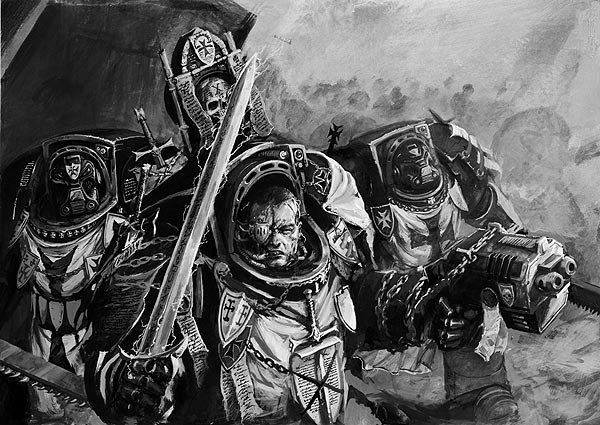
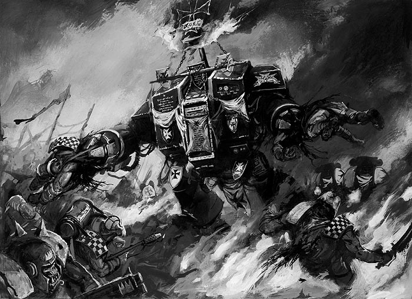
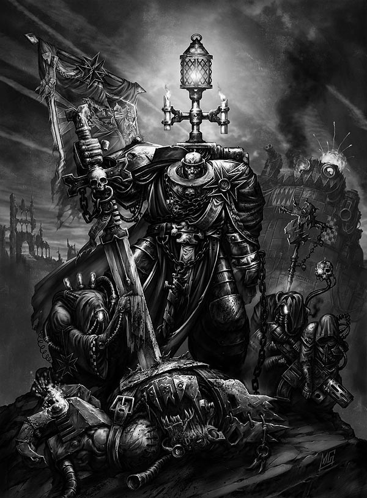

# BLACK TEMPLAR CODEX试翻译

BLACK TEMPLAR CODEX试翻译

panzerwzh

恩RT, 欢迎各位大大指正拍砖...黑色圣堂武士黑色圣堂武士战团诞生于初创星际军团的拆分，也被称为二次组建的战团。由于具体记录在那段混乱的岁月中遗失，在这次拆分中具体有多少支战团被组建起来无人知晓。 目前已知存在的战团有大约1000多支，它们中的大部分严格遵循阿斯塔特圣典中的组织，战斗条令。但黑色圣堂武士们选择了不局限于死板的阿斯塔特圣典而遵循席格门的誓言。（Oath of Sigismund） 

当战团着手准备它们永不停止的圣战时，为了避免对母星的依赖和生活在圣战舰队之外的可能性，他们建造了数十艘战略旗舰，突击巡洋舰和其他特种舰支，比如训练舰和巨型铸造船。战团最高指挥大元帅（HIGH MARSHALL）拥有自己的战略旗舰----永恒圣战者号。 这艘雄伟的巨舰充当着黑色圣堂武士们共同的精神家园，同时也承载着战团大多数神圣遗物，礼拜堂和圣物箱。 在过去的一万年里，永恒圣战者号不停进行着扩充和改装。 现在这艘巨舰装备了供护卫舰队停靠的接泊设备，供更多雷鹰和降落仓使用的发射平台，更大规模的生活设置装备能让永恒圣战者号提供2倍于普通战略旗舰的星际战士装载量。 

帝王的圣战士基于黑色圣堂武士们以舰队为基地的特点，这个战团的战斗力量很少以战团单位集结，而是分成数支十字军。 一般情况下，很少有3支以上的十字军同时出现在同一战区，当然偶尔会出现很多只十字军同时参与战斗的情况。如同在黑色圣堂战团在对平定Dalmark叛乱的战斗中所记录一样，有多达14支十字军同时奋战在Segmentum Solar上。 一支十字军的规模也有很大的灵活性，有时仅50-100名星际战士，有时相当于遵循阿斯塔特圣典战团的数个连队总和。目前，只有大元帅本人知道黑色圣堂武士战团有多少名星际战士，尽管黑色圣堂们分布在更广阔的帝国疆域内，但很明显，他们的规模已经远远大于任何一个常规战团。如果一些相关的传言属实的话，他们总共有5，000千至6，000名战斗人员。这股力量如果集结在任何一个单独战区都将会是不可阻挡的。尽管某些审判厅成员对黑色圣堂的潜在规模表示过忧虑，可是由于没有证据说明在战团悠久的历史中出现过对帝王不忠，也没有证据能让任何人在人数问题上挑战黑色圣堂，战团的规模直到今天仍然是一个迷。每一支圣战部队都在继续着星际战士们古老的第一个使命：主动找出帝王的每一个敌人，并在向下一个帝王的死敌进发之前把他彻底毁灭！所有的星际战士都因他们对帝王炽热的信仰而得名，但黑色圣堂武士们信仰之极端却常常被形容为狂热。他们渴望撕碎人类的每一个敌人，对异教徒，变异人，术师，异形和任何与帝王为敌的事物他们没有一丁点的怜悯和宽容。因此，黑色圣堂的战斗序列里没有智库馆长。他们从不信任来自Warp空间的力量，因为没有任何一位黑色圣堂会和一个灵能者并肩战斗。在过去的10，000年中，战团通过不断的圣战证明着自己的忠诚。这个信条已经是如此之深的溶入了战团的信条，以至于他们冲向任何被视为对帝王的威胁的人或事时，只剩下绝对的残忍。当战场上出现了灵能者的踪迹时，黑色圣堂们会陷入由憎恨和复仇的欲望引起的狂怒之中，此时他们会毫无顾虑的抹杀这个星球的全部居民来根除叛乱的异端。在每一个被政府或收复的世界上，黑色圣堂武士会建立起战团的要塞，这些坚固的堡垒时刻提醒着人们，帝王的注视无处不在！当然，它们更主要的用途是从当地居民中招募新的星际战士和作为聚集不同十字军的战略基点。这些尽管无法与普通战团的修道院相比，但是这些战团要塞仍然规模客观，每一个都具备了充足的空间驻扎2-3个连的星际战士。在上一个千年中无数类似的要塞被建立起来，直到今天它们中的一些仍然毅力，其他的大多被废弃或不再有人驻守，但，这些看似孤零零的遗迹却从来没有被忘记，可以预料黑色圣堂武士们会突然回到这些要塞，让任何愚蠢到胆敢在他们外出征战时占据这些遗迹的生物付出代价！战斗连队一支大型的十字军往往会在元帅（MARSHALL）的命令下分散成几个战斗连队，并在被授予’Castellan’荣誉称号的战士带领下投入战斗。但无论这样的连队是否结成，单独的小队和技术军士们（比如技术星际战士和医护兵）都会公平地按点对点的方式组成战斗队形，战斗中黑色圣堂们更倾向于与自己熟悉的伙伴和战友一起战斗，而不是按照某种上级强加的队型行动。与其他战团不同的是，经验丰富的老兵往往会被晋升并编入元帅直属的剑之兄弟会而不是战术小队。战场上的黑色圣堂武士们一直延续着战团创始人席格门的战斗风格--喜欢用近战武器解决对手，而不是远程轰击。在面对面的搏斗中用正义的愤怒和高贵的信念去粉碎自己的敌人，才能让一个真正的黑色圣殿武士得到荣誉和尊重。这一点更为战团里的狂热分子们所推崇，他们正义的愤怒让自己深以从敌人面前撤退为耻辱，战场上他们会无情的冲向敌人，每一位战友的倒下只会刺激他们战斗的神经，用更快的速度向杀害自己兄弟的凶手发动复仇。 作为自己对帝王信仰的一部分，黑色圣堂武士们会宣誓关于信仰和庇护的有力誓言，并在大战之前重温其中的一条誓约，具体誓约的内容根据战士在战场上的职责而定，鼓励他们无尽的勇气，冷酷无情和对死敌极度的嫌恶。死亡天使当黑暗圣堂武士的十字军舰队向帝王的仇敌发动战争时，主要通过两种战术来击溃对手,其中最残暴的一种是轨道打击,也被无数不多的经历过这类攻击的幸存者称为从'天而降的死亡' . 在破坏性的轨道轰炸之后,雷鹰炮艇和投放仓将黑色圣堂战士们投放到战场,利用突然袭击造成敌人麻痹混乱的同时,星际战士们通过外科手术式的精确打击消灭着他们的目标,剩下群龙无首混乱不堪的残敌只能选择投降或死亡. 如果黑色圣堂们发现有机会在战场里投放战团的重型装备， 那么此时同样毁灭性的战术----装甲矛锋就会被采用, 在前出的机动摩托小队和蓝得速攻艇把远距离侦察的结果投射在每一两重型装甲车辆的屏幕上时,这些武装到牙齿的钢铁巨兽就会用准确的轰击把敌人防线上的每一个弱点粉碎. 然后依靠装甲和速度的有优势从这些缺口上突破敌人的防线,并向两翼迅速推进扩大突破口,最后再消灭防御顽强的敌人据点. 战团的战士们黑色圣堂武士战团的编成与其他遵循阿斯塔特圣典的战团有着很大的区别，尤其是在新兵的征召和训练上。 因为战团没有向其他战团那样设立能让新兵充分展现自己勇气的侦察小队，所以不得不通过其他方式来考察他们有没有资格成为一名真正的星际战士。 分布在各个行星上的战团要塞每年都会征召一些有潜质成为一名黑色圣堂武士的当地青年，其中体格健壮心智纯洁的侯选者就会接受最初的人造器官移植，开始向一名星际战士转变的第一步。其中大约24名左右的新兵在经过战团医师和牧师的鉴定并被认为适合进行下一步器官移植和更深入的战术训练后，他们会被派遣到一支十字军舰队上接受深入的训练。

新教徒（Neophyte）当到达十字军的战舰后，新教徒（BT团的新兵）们将面对信众们（BT团正式战士）设置的种种严刻考验，期间他们的力量，忍耐力，军事技巧和生理极限下信仰的坚定性会受到检验。通过这一系列考验后的幸存者也向信众们证实了自己的价值，一名对他的表现感到满意的信众会宣所罗门之誓以黑色圣堂武士的战斗方式和信仰来全心全意教导这名新教徒，然后他全部的训练将会在这名信众的单独监护下继续进行。在战团牧师们的监督下，新教徒将和自己的信众导师在每一个战场上同生共死，他要么迅速学习并掌握导师的技巧和经验，要么就因为自己的懒惰和笨拙而死亡。当新教徒在一次次战斗中的勇气和技巧换取了自己导师和战团牧师的认可只后，他会被晋升为一名信众，在这个战斗集体里拥有了自己的一席之地。如果一位新教徒的导师在战斗中不幸阵亡，那么他可以选择一位自己认可的信众成为自己新的导师。信众（Initiates）一旦成为了黑色圣堂的一员，信众就要在永不停歇的征战中磨练自己的技艺，书写自己的传奇，直到去监护一名新教徒的训练。这样信众们的智慧，经验得以保存并代代相传。信众们按十字军小队组织，也正是这些战团里最常见小队，铸造了每一个战斗连队的钢筋铁骨。信众们通常装备着神圣失弹枪，鉴于黑色圣堂们对于肉搏战的偏爱，大多数信众在战场上会选择适合近距离格斗的近战武器。一些小组成员也会选择更专业话的武器，比如离子武器，火焰喷射器，和能量拳套等等。黑色圣堂武士的战术小队具有高度的灵活性，面对帝王形形色色的死敌有着良好的适应性。战场上敌人四处横飞的血肉是信众留给新教徒们最生动的教材。那些精通在肉搏战中用狂怒撕碎敌人的战士，会被集中起来编成黑色圣堂的突击小队。他们背上的弹射背包能让战士们快速的把敌人拉入残忍的肉搏战。混装着手枪和刀剑的突击小队足以使任何对手肝胆具裂，他们是黑色圣堂正直热情的缩影，如同一个个喷发着烈焰的死亡天使般从天而降撕碎帝王的敌人。剑之兄弟会（The Sword Brethren）战斗连队里最伟大的战士们会被遍入相当于其他战团第一连的元帅直属部队---剑之兄弟会。这些星际战士都是强而有力的英雄，他们的传奇早已成为了战团光荣历史的一部分。剑之兄弟会也是每个雄心勃勃的黑色圣堂武士都梦想着能成为其中一员的精锐部队。那些披挂着完美的精工铠甲，周身装饰着精致的十字军图章和封条的兄弟会成员，本身就是对巴洛克骑士风格最完美的诠释。当一位元帅牺牲以后，他的继任人由剑之兄弟会的成员中选出，只有最勇敢，最强大的骑士才有资格继承这项伟大的荣誉。具体人选通过典礼式的对抗选出，在这场十字军领导权的竞争中，每一个竞争者都要在熟练运用各种武器的同时也要凭借自己高超的战略战术去战胜所有的对手。胜利者在战团领袖大元帅的见证下继承元帅的荣誉，剑之兄弟会其他成员也会用新的誓言向胜利者承诺永远的忠诚。在战团的历史上仅有一次大元帅拒绝见证胜利着继承元帅的荣誉（那个所谓的吉瓦特.雷皮儿，M36）

剑之兄弟会的成员不用在承担新教徒的训练任务，他们自己仍接受额外的战术训练，尤其是对终结者铠甲的掌握和使用。每一个星际战士战团都保存着一定数量的这种令人敬畏的盔甲并且和战团最宝贵的圣物陈列在一起。终结者铠甲是一种镶嵌着大片塑钢陶瓷复合装甲版的大型铠甲，其内部拥有的完整坚固的人造骨骼和复杂的人造肌肉纤维束能让铠甲的佩带者在狭小的空间内承受狂暴致命的攻击，当然在这种环境中灵活性是第二位的。这种强大铠甲的制造技术在很久很久以前就丧失了，每一件终结铠甲对于星际战士战团都是如此的宝贵，只有战团的技术军士有资格对这些铠甲进行保养。剑师兄弟会里每一套终结者盔甲都在战团的礼拜堂里都有着其特殊的荣誉和位置，只有兄弟会的成员和某些特许的高级的指挥官能进入军械库穿上这些神圣的铠甲。

穿戴终结者盔甲熟练进行战斗，需要经过严刻的训练，一旦完成了这些训练，穿戴着终结者盔甲进入战场的战士就被期待着发挥出远超其他兄弟的战斗力，用自己的行动为战团其他战士树立起榜样。剑之兄弟会的终结者小队常常被用来进行最血腥激烈的肉搏战---跳帮战。终结者们也可以通过装备多种多样的武器来进行远程打击，但是如同它们的设计初衷一样，终结者盔甲在残忍野蛮的突击作战中有着上佳表现，这也是为什么黑色圣堂武士们对它们是如此的偏爱。战团的英雄们（主要翻译BT团最具特色的英雄，其他比如技术军士，无畏机甲，医护兵，牧师等其他战团基本都有的就不详细介绍了）

大元帅（HIGH MARSHALL）“无论你在任何地方，在任何情况下发现了那些异形生物和Warp空间里的污秽之物，格杀勿论！只要伟大的帝王一天还在为它们的存在所困扰，就绝对不要对它们展现出一丝的宽容！”  

-------摘录自大元帅吉尔沃德的厌恶祷词由于以舰为家的黑色圣堂武士们分成数只不同的十字军征战在宇宙各个角落，所以整个战团的军事力量很少能在同一时间里集结起来。每只十字军由一名元帅率领，而在他们之上大元帅才真正统率着所有无畏的黑色圣堂武士。他是经历过数个世纪残酷战争考验的百战勇士，同时丰富的战斗经验也使他对枪械，刀剑甚至赤手空拳的格斗都有着独特的造诣，大元帅的个人战斗技巧是战团其他人所无法企及的。他华丽的终结者战甲上的每一道军阶都记述着一次与最凶残狂暴的敌人血腥搏斗赢得的伟大胜利。当然，仅仅成为战团第一武士对于一个大元帅来说是远远不够的。他还必须具备着战略眼光和高超的战术素养，结合前任大元帅们的经验，一次次地在战争风暴的中心作出正确的决定，带领自己的战团走向胜利。每次圣战的全过程都由大元帅全权负责，他必须确保用胜利来捍卫帝王和战团的荣耀。同时他也是黑色圣堂武士团拥有最渊博学识的人，战团的象征，并独自守护着战团里无数不可告人的秘密。只有大元帅本人掌握着黑色圣堂武士团的确切人数，也只有他本人能指定战团的勇士们的攻击目标。一旦大元帅发起了圣战，并拟定了哪些黑色圣堂星际战士将以帝王之名参与战斗，他就会时刻监督战役的进程，甚至偶尔自己亲临战斗最激烈的地方用自己的身先士卒的身影激励并祝福每一位前线将士。黑色圣堂武士们的十字军舰队始终遵循着帝王本人在大远征时期的战略目标，在群星间搜寻并毁灭每一个人类的敌人！黑色圣堂武士战团的大元帅，是全帝国里最特例独行的指挥官之一，他从来都独立决定自己的战士将会奔赴哪个战场，而从来不征求Terra上的帝国领主们的许可。对于大元帅而言，没有任何东西能比继续黑色圣堂们已持续千年的圣战更重要。当然其他有能力和黑色圣堂武士取得联系的帝国武装可以向大元帅本人求援，但只有当理由十分充分的时候，大元帅才会允许自己的战士们在其他指挥官的指挥下投入战斗。元帅和堡主（MARSHALL & CASTELLANS）黑色圣堂武士战团的下一个指挥环节是由领导一支十字军的元帅们和领导一个战斗连队的堡主们组成的。他们是最勇猛善战的星际战士，在具备敏锐的战术头脑的同时也有着仅次于大元帅的实战经验。元帅们肩负着神圣而荣耀的职责------倾尽全力用干净利落的胜利为每一场圣战划上句号。他们中的每一员不光是在战场上令对手退避三舍的致命武士，更必须成为一个处理战场以外繁冗杂务的专家，因为领导一只十字军绝对是项艰巨的任务。也正因为如此，只有那些最具灵性和决心的星际战士在其作为一名剑之兄弟会成员或者堡主的战斗生涯中证明了自己的勇气和果断之后，才有资格成为黑暗圣堂武士的一名元帅。 无论面对多么恐怖的对手，元帅们都能得心应手的调配每一名星际战士，并率领着他们和自己的十字军一起去取得最终的胜利。在浩瀚的银河中，能比黑色圣堂的元帅和堡主更擅长战争的勇士屈指可数。帝王的冠军剑士（THE EMPEROR’S CHAMPION）“仅尊帝王！他是我们坚固的护盾和守护者！”------------------------------------------昌汀第二书自从席吉斯蒙德成为了黑色圣堂武士战团的首任大元帅，无数他的继承者们追随他的脚步---成为了一名帝王的冠军剑士。尽管选拔一名冠军剑士的惯例已经广泛地为其他战团所采用，但无一能与他们在黑暗圣堂的教条下所发挥出的光芒相提并论。通常来说每只十字军都编制一名冠军剑士，但在实际战场上，黑暗圣堂的每一个战斗连队都能得到一名冠军剑士的支援。在战役前夜，战团无数星际战士中的一员将会体验帝王的幻象。它会告诉被选中的战士他的过去，未来，和他在为帝王服务过程中将会出现的杰出表现和伟大作用。清醒之后，他会在战团牧师面前忏悔，并诉说他所预见的景象。然后当他接受战团牧师用憎恨连祷文和油彩礼仪的祝福之后就正式成为了一名帝王的冠军剑士。他装备着黑色圣堂战团最锋利的武器和最坚固的铠甲，尽管每个冠军剑士的武器防具因人而异，但是它们都拥有统一的名称---黑色长剑和信仰之铠！在战场上，如同第一次席吉斯蒙德在面对围攻帝王之城的叛徒时所做的一样，冠军剑士的责任和义务就是搜寻敌人最强的对手发起一对一的挑战。 通常敌人没有特定的最强者，那么冠军骑士的目标就会转向敌人的领队或其他任何胆敢阻挡在他身前的对手身上。几乎没有人胆敢挑战这些英勇的武士，帝王之手指引着黑色长剑的每一次挥舞，对帝王的信仰时刻强化着冠军剑士的动机。如果在战场上冠军剑士不幸倒下，那么会被认为是一个十分不祥的预兆，这时他身边的所有兄弟都有义务夺回他的遗体并抢回黑色长剑和信仰之铠。High Marshall Helbrecht-----大元帅赫尔布雷西特海尔布莱切特为黑色圣堂武士战团特有的顽固不化和对帝王坚定不移的忠诚树立着榜样。在成功镇压塞吉尔利星云的Xenarchs叛乱之后，赫尔布雷西特特被推选为战团的大元帅（989。M41）他成为黑色圣堂战团的一员之路是血腥，迅速的。他极度渴望屠戮帝王的每一名敌人来展示自己纯粹的凶残。不久之后赫尔布雷西特因为铲除了一名曾经用力量控制着蜂巢世界塞非安IV的Warp吸血鬼而成为了剑之兄弟会的一员。作为戴丁元帅统帅的十字军中的一员，赫尔布雷西特依靠着勇气和接近狂暴的热情奋战了数十年。并最终在戴丁元帅牺牲后接替了十字军的指挥权。当大元帅科尔德赫尔被一名混沌之神赐福的狂暴冠军战士杀害后，黑色圣堂武士的元帅们为了推选一名新的领导人而聚集到了一起。赫尔布雷西特毫无异议的当选，并在继承了大元帅的标志，黑色圣堂最神圣的圣物------大元帅之剑。据说这柄强大的武器包含着战团基因原体Rogal Dorn陪伴着帝王突击何露斯旗舰时所持长剑的碎片。在黑色圣堂武士战团的传说中，因为没能成功的保护帝王，Dorn用膝盖击碎了这柄长剑并发誓再也不会挥舞它进入战斗。根据席吉斯蒙德的法令，大元帅之剑在铸造的过程中加入了Dorn之剑的碎片。这把长剑会永远提醒每一位佩带着它的战团大元帅去担负起永恒赎罪的责任。赫尔布雷西特上任后立即对Ghoul星系的塞瑟尔芬得斯发动了圣战。 战争在这片吞噬过无数支探险队的荒凉星域展开。在八年的战斗之后，星域外围行星上的异星人被全部消灭，十字军的兵锋指向了异形们的母星。 但当黑暗圣堂们成功在行星表面登陆之后，迎接他们的只有死一般的寂静，整个星球荒无一物，当地没有留下任何生命体的痕迹。在这个怪异的迷团被完全揭开之前，一条来自被围攻的哈米吉多顿行星的信息吸引了战团领导层的注意力。这条绝望的求救信号预示着最强大的ORK大酋长哥哈扎格库勒.马格.碎骨.大大（Ghazghkull Mag Uruk Thraka）的回归。 在回到战团旗舰永恒圣战者号最隐秘的会议室之后，大元帅立即与统帅迪马里斯十字军的里卡德元帅和台伯里奥十字军的安姆里奇元帅取得了联系，赫尔布雷西特宣布一场新的远征开始了。
