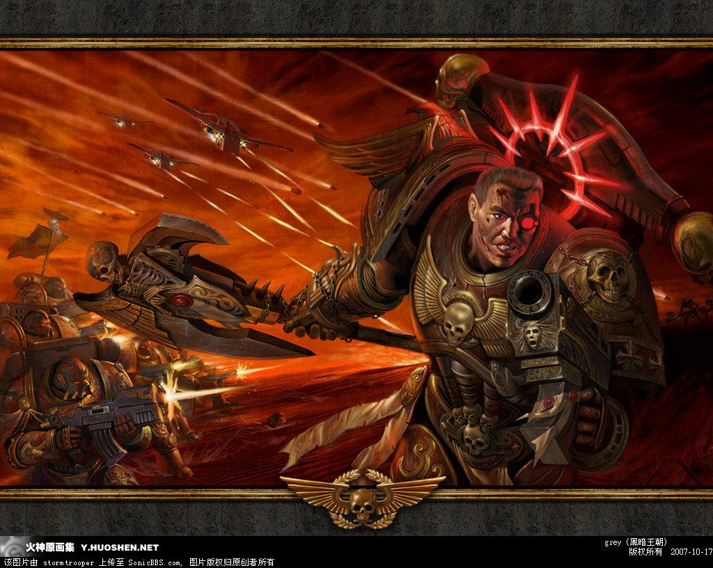
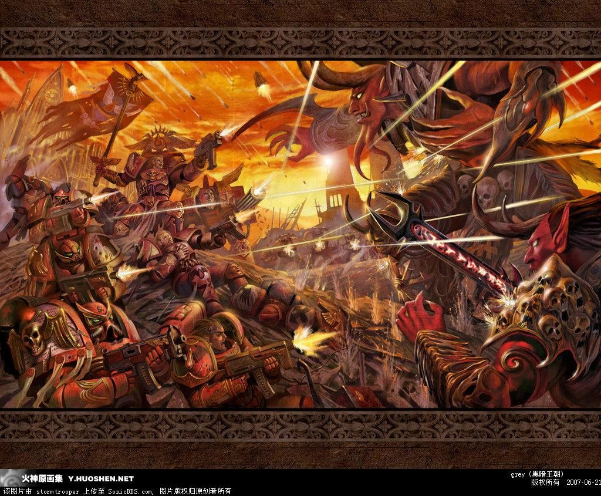

# 转个国人绘制的40k的插画

转个国人绘制的40k的插画

stormtrooper 

第一张还以为是混沌的战团，结果看画作名称《for the emperor 深红大地》才发现是帝国的。右侧还有死灵的骷髅，差点没看见。第二张为《圣血》

]

兔子半妖

原帖在这...没兴趣的不要去骂帖里内容了...1.天上飞的是什么东西...囧2.为什么右肩甲上有徽记...而且是暗黑天使和黑色圣殿骑士的都有3.主角大叔是在Cosplay血天使的但丁叔么下次记得戴面具

liberator

不过还是得承认，相对于第二张画（先前画的），第一张（后画的）向战锤的风格靠拢了不是一点点....虽然还是私藏了一些山口山元素....
